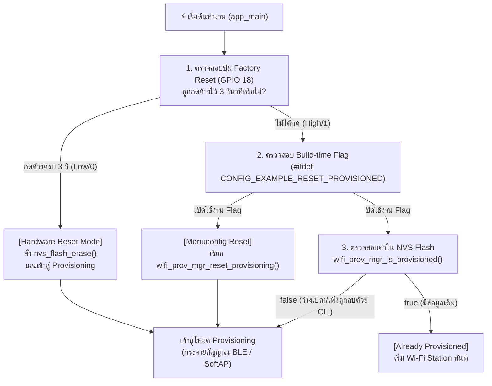

# ใบงานที่ 7.1  การศึกษากลไก Reset Provisioning 3 รูปแบบ และ NVS Memory Forensics

## 0. กล่าวนำ (Introduction)
เมื่ออุปกรณ์ ESP32 ผ่านการ Provisioning สำเร็จแล้ว ข้อมูล Wi-Fi จะถูกบันทึกไว้ใน NVS Flash Memory อย่างถาวร เมื่อเปิดเครื่องใหม่ เฟิร์มแวร์จะเข้าสู่สถานะ `Already provisioned` และข้ามขั้นตอนการรับข้อมูลใหม่ไปทันที

ในการพัฒนาผลิตภัณฑ์และการทดสอบความปลอดภัย วิศวกรจำเป็นต้องทราบวิธีการล้างค่าคอนฟิก (Factory Reset / Erase Credentials) ซึ่งในใบงานนี้นักศึกษาจะได้ทดลองและเปรียบเทียบกลไกการ Reset ครบทั้ง 3 รูปแบบ:
1. **Developer CLI Reset:** การล้างผ่านคำสั่ง Command Line บนเครื่องคอมพิวเตอร์
2. **Build-time Firmware Reset:** การกำหนดค่าผ่าน `menuconfig`
3. **Consumer Hardware Reset:** การต่อสวิตช์ปุ่มกดภายนอก (**External Pushbutton บน GPIO 18**) เพื่อใช้เป็นปุ่ม Factory Reset ทางกายภาพ เสมือนอุปกรณ์ IoT เชิงพาณิชย์จริง (หลีกเลี่ยงการใช้ปุ่ม BOOT/GPIO 0 ที่เป็น Strapping Pin)

---

## 1. วัตถุประสงค์ (Objectives)
1. ศึกษาและทำความเข้าใจสถานะ `Already provisioned` และการตัดสินใจของ `wifi_prov_mgr_is_provisioned()`
2. สามารถล้างข้อมูลการเชื่อมต่อใน Flash Memory ผ่านคำสั่ง CLI (`idf.py erase-flash` และ `esptool.py`) ได้
3. สามารถกำหนดค่า Build Configuration ใน `menuconfig` เพื่อสั่งรีเซ็ต State Machine ได้
4. เข้าใจข้อจำกัดของ **Strapping Pins (GPIO 0 / Bootloader Trap)** และสามารถต่อสวิตช์ปุ่มกดภายนอก (GPIO 18) เพื่อเขียนโปรแกรม Factory Reset ทางกายภาพได้อย่างถูกต้อง

---

## 2. อุปกรณ์ที่ใช้ในการทดลอง (Equipment)
1. บอร์ดไมโครคอนโทรลเลอร์ ESP32 พร้อมสาย USB
2. สวิตช์ปุ่มกด (Tactile Pushbutton Switch) จำนวน 1 ตัว พร้อมสายต่อ Breadboard
3. ESP-IDF Command Prompt (VS Code Terminal)

> [!IMPORTANT]
> **ทำไมจึงไม่ใช้ปุ่ม BOOT (GPIO 0) กดค้างตอนรีเซ็ตบอร์ด?**
> ขา **GPIO 0** บน ESP32 ทำหน้าที่เป็น **Strapping Pin** สำหรับเลือกโหมดการบูต หากขา GPIO 0 มีสถานะเป็น `LOW (0)` ในจังหวะที่บอร์ดถูกรีเซ็ตหรือจ่ายไฟ ชิป ESP32 จะเข้าสู่โหมด **ROM Download Bootloader** (`waiting for download`) ทันที ทำให้ตัวประมวลผลหยุดรอการแฟลชโปรแกรมและไม่รันโค้ด `app_main()` 
> 
> ดังนั้น ในการออกแบบอุปกรณ์เชิงพาณิชย์ จึงนิยมใช้ขา GPIO ทั่วไป (เช่น **GPIO 18**) ต่อร่วมกับปุ่มกดภายนอกเพื่อทำ Factory Reset แทน

---

## 3. สถาปัตยกรรมและการต่อวงจร (Hardware Wiring & Flow)

### 3.1 การต่อวงจรปุ่มกด Factory Reset (GPIO 18)
- ขาหนึ่งของสวิตช์ปุ่มกด $\rightarrow$ ต่อเข้าขา **GPIO 18** ของ ESP32
- อีกขาหนึ่งของสวิตช์ $\rightarrow$ ต่อลง **GND**
*(เปิดใช้งาน Internal Pull-up Resistor ในโค้ด จึงไม่ต้องต่อตัวต้านทานภายนอกเพิ่ม)*



---

## 4. ขั้นตอนการทดลอง (Step-by-Step Procedures)

### ตอนที่ 1 การล้าง Flash ผ่าน Command Line (Developer Level)
1. เสียบสาย USB เข้ากับคอมพิวเตอร์ ตรวจสอบหมายเลขพอร์ต COM (เช่น `COM24`)
2. เปิด Terminal ในโฟลเดอร์โปรเจกต์ `Week-07-W-iFi-Privisioning/Example_codes/Lab7-1-Reset-and-NVS-Forensics`
3. สั่งล้าง Flash Memory ทั้งหมดของชิปด้วยคำสั่ง:
   ```powershell
   idf.py -p COM24 erase-flash
   ```
4. ทำการ Flash โปรแกรมและเปิด Serial Monitor:
   ```powershell
   idf.py -p COM24 flash monitor
   ```
5. สังเกต Log ว่า ESP32 จะรายงานสถานะ `"Starting provisioning"` และสร้าง QR Code ขึ้นมาบนหน้าจอ

---

### ตอนที่ 2 การบังคับ Reset ผ่าน Menuconfig (Firmware Configuration Level)
1. กดปุ่ม `Ctrl + ]` เพื่อออกจาก Serial Monitor
2. เปิดหน้าต่างคอนฟิกโปรเจกต์:
   ```powershell
   idf.py menuconfig
   ```
3. ใช้ปุ่มลูกศรเลื่อนไปที่หัวข้อ **Example Configuration**
4. เลื่อนไปที่บรรทัด **`Reset Provisioned state (Erase credentials)`** แล้วกดปุ่ม `Spacebar` เพื่อเลือกให้มีเครื่องหมาย `[*]`
5. กดปุ่ม `S` เพื่อบันทึก และ `Q` เพื่อออกจากเมนู
6. สั่ง Build และ Flash โปรแกรม:
   ```powershell
   idf.py -p COM24 flash monitor
   ```
7. สังเกตผลลัพธ์ใน Log: บอร์ดจะทำการล้าง Credentials เก่าทิ้งทุกครั้งที่เปิดเครื่องใหม่

---

### ตอนที่ 3 การสร้างปุ่ม Factory Reset ด้วยฮาร์ดแวร์ภายนอก (GPIO 18)

1. นำสวิตช์ปุ่มกดต่อเข้ากับขา **GPIO 18** และ **GND**
2. เพิ่มฟังก์ชันตรวจสอบปุ่ม Factory Reset ลงในไฟล์ `main/main.c`:

```c
#include "driver/gpio.h"

#define FACTORY_RESET_BUTTON_GPIO  GPIO_NUM_18   // ปุ่ม Factory Reset ภายนอก (ต่อลง GND)

static bool check_factory_reset_button(void)
{
    // กำหนดค่า GPIO 18 เป็น Input พร้อมเปิด Internal Pull-up Resistor
    gpio_config_t io_conf = {
        .pin_bit_mask = (1ULL << FACTORY_RESET_BUTTON_GPIO),
        .mode = GPIO_MODE_INPUT,
        .pull_up_en = GPIO_PULLUP_ENABLE,
        .pull_down_en = GPIO_PULLDOWN_DISABLE,
        .intr_type = GPIO_INTR_DISABLE,
    };
    gpio_config(&io_conf);

    ESP_LOGI("FACTORY_RESET", "Hold GPIO 18 button for 3 seconds to trigger Factory Reset...");
    
    // ตรวจสอบสถานะปุ่มกดค้าง (Active Low / Logic 0)
    int hold_count = 0;
    while (gpio_get_level(FACTORY_RESET_BUTTON_GPIO) == 0) {
        vTaskDelay(pdMS_TO_TICKS(100));
        hold_count++;
        if (hold_count % 10 == 0) {
            ESP_LOGI("FACTORY_RESET", "Holding button... %d/3 seconds", hold_count / 10);
        }
        if (hold_count >= 30) { // กดค้างครบ 3 วินาที (30 x 100ms)
            ESP_LOGW("FACTORY_RESET", "=================================================");
            ESP_LOGW("FACTORY_RESET", ">>> FACTORY RESET TRIGGERED! ERASING NVS FLASH <<<");
            ESP_LOGW("FACTORY_RESET", "=================================================");
            return true;
        }
    }
    return false;
}
```

3. เรียกใช้งานในตอนเริ่มต้นของฟังก์ชัน `app_main()`:

```c
void app_main(void)
{
    // ตรวจสอบการกดปุ่ม Factory Reset ทางกายภาพ (GPIO 18)
    if (check_factory_reset_button()) {
        ESP_ERROR_CHECK(nvs_flash_erase());
    }

    /* Initialize NVS partition */
    esp_err_t ret = nvs_flash_init();
    if (ret == ESP_ERR_NVS_NO_FREE_PAGES || ret == ESP_ERR_NVS_NEW_VERSION_FOUND) {
        ESP_ERROR_CHECK(nvs_flash_erase());
        ESP_ERROR_CHECK(nvs_flash_init());
    }
    // ... โค้ดเดิมต่อจากนี้ ...
```

#### การทดสอบ:
1. ปล่อยให้บอร์ดทำงานปกติ $\rightarrow$ บอร์ดจะจำค่าเดิมได้ (`Already provisioned`)
2. กดปุ่มที่ต่อกับ **GPIO 18 ค้างไว้ 3 วินาที** จากนั้นกดรีเซ็ตบอร์ด หรือกดค้างขณะเปิดเครื่อง
3. สังเกต Serial Monitor: ระบบจะตรวจพบการกดค้าง 3 วินาที และสั่งล้าง NVS Flash เพื่อกลับสู่โหมด Provisioning ทันที!

---

---

## 5. กิจกรรมถอดรหัสซอร์สโค้ดและเขียนผังงาน (Code Deconstruction & Flowchart Assignment)

ให้นักศึกษาศึกษาโค้ดใน `main/main.c` และ `main/led_indicator.c` แล้วเขียน **ผังงาน (Flowchart / State Diagram)** เพื่ออธิบายการตัดสินใจและการทำงานของระบบ:

### ภารกิจที่ 1  ผังงานการตัดสินใจช่วง Bootstrapping & Reset Decision
ให้นักศึกษาวาด Flowchart แสดงลำดับตรรกะการตรวจสอบเงื่อนไขตั้งแต่เริ่มต้นรันฟังก์ชัน `app_main()` โดยต้องครอบคลุม:
1. การตรวจสอบสถานะปุ่ม **GPIO 18** (ตรวจจับการกดค้าง 3 วินาที)
2. การทำงานของ `nvs_flash_init()` และกรณีที่ต้อง `nvs_flash_erase()`
3. การตรวจสอบ Macro `#ifdef CONFIG_EXAMPLE_RESET_PROVISIONED`
4. การเรียกฟังก์ชัน `wifi_prov_mgr_is_provisioned(&provisioned)`
5. จุดแยกสายการทำงานเข้าสู่โหมด **Provisioning Mode** หรือ **Station Mode**

![[Untitled Diagram.drawio (4).png]]

### ภารกิจที่ 2 ผังสถานะการเปลี่ยนจังหวะไฟ LED 1 (Wi-Fi STA Indicator)
ให้นักศึกษาวาด State Diagram แสดงการเปลี่ยนสถานะของ **LED 1 (GPIO 2)**:
- เงื่อนไขใดทำให้ LED 1 เข้าสู่สถานะ `LED_STA_MODE_DISCONNECTED` (กระพริบ 200ms Mark / 200ms Space)
- เงื่อนไขหรือ Event ใดทำให้เปลี่ยนเป็น `LED_STA_MODE_CONNECTED` (Heartbeat 200ms ทุก 1s)
-![[Untitled Diagram.drawio (5).png]]

---

## 6. ตารางบันทึกผลการทดลอง (Experiment Results)

| รูปแบบการ Reset                  | คำสั่ง / พฤติกรรมที่ทำ               | พฤติกรรมของ LED แต่ละดวงหลังเปิดเครื่อง                              | สถานะใน Serial Monitor                                                                                                                                                                                                         |
| :------------------------------- | :----------------------------------- | :------------------------------------------------------------------- | :----------------------------------------------------------------------------------------------------------------------------------------------------------------------------------------------------------------------------- |
| **1. CLI Erase**                 | `idf.py erase-flash`                 | ดับตลอด (`LED_STA_OFF`) เพราะ `provisioned=false`                    | `Hold GPIO 18 button...` → `[STATUS]: Device is NOT provisioned (NVS is empty)` → `Ready for Provisioning Lab 7-2...`                                                                                                          |
| **2. Menuconfig Flag**           | `CONFIG_EXAMPLE_RESET_PROVISIONED=y` | ดับตลอด (`LED_STA_OFF`) เหมือนแถวที่ 1                               | `[STATUS]: Device is NOT provisioned` ขึ้นซ้ำทุกครั้งที่เปิดเครื่อง แม้เคย provisioned สำเร็จมาก่อนแล้วก็ตาม _(หมายเหตุ: ต้องเพิ่มโค้ด `#ifdef CONFIG_EXAMPLE_RESET_PROVISIONED` ในไฟล์ก่อน เพราะไฟล์ปัจจุบันยังไม่มีส่วนนี้)_ |
| **3. Hardware Button (GPIO 18)** | กดปุ่ม GPIO 18 ค้าง 3 วินาที         | ดับตลอด (`LED_STA_OFF`) หลัง erase เพราะ `provisioned=false` เช่นกัน | `Holding button... 1/3 seconds` → `2/3 seconds` → `>>> FACTORY RESET TRIGGERED! ERASING NVS FLASH <<<` → `[FORENSIC]: User requested Flash Erase!` → `[STATUS]: Device is NOT provisioned`                                     |

---

## 7. คำถามท้ายการทดลอง (Post-Lab Questions)
1. เพราะเหตุใดการกดปุ่ม BOOT (GPIO 0) ค้างไว้ในจังหวะรีเซ็ตบอร์ด จึงทำให้โปรแกรมค้างอยู่ที่ ROM Bootloader และไม่ยอมทำงานต่อ?
ตอบ **GPIO 0 เป็น Strapping Pin** ที่ ROM Bootloader (โค้ดที่ฝังตายตัวในชิป ESP32 ตั้งแต่โรงงาน แก้ไม่ได้) จะ**สุ่มอ่านค่าเพียงครั้งเดียว**ในจังหวะขอบขาขึ้นของสัญญาณ Reset (Reset Edge) เพื่อตัดสินใจว่าจะบูตแบบไหน:

- **GPIO 0 = HIGH** (ค่าปกติ ผ่าน Internal/External Pull-up) → ROM สั่งให้เข้าสู่ **SPI Flash Boot Mode** คือโหลด 2nd-stage bootloader จาก Flash แล้วรัน `app_main()` ตามปกติ
- **GPIO 0 = LOW** (ปุ่ม BOOT ถูกกดค้าง ทำให้ขาถูกลากลง GND) → ROM สั่งให้เข้าสู่ **UART Download Mode** (`waiting for download`) ทันที เพื่อรอรับคำสั่งแฟลชโปรแกรมผ่าน Serial จากเครื่องมืออย่าง `esptool.py`
จุดสำคัญคือ **การอ่านค่านี้เกิดขึ้น "ก่อน" ที่แอปพลิเคชันหรือแม้แต่ระบบปฏิบัติการ FreeRTOS จะเริ่มทำงานเลยด้วยซ้ำ** ตัวชิปจึงไม่มีทางรัน `app_main()` ได้เลยตราบใดที่ยังอยู่ในโหมด Download — มันไม่ใช่การอ่านค่า GPIO แบบ polling ในโค้ดแอปทั่วไป แต่เป็นกลไกระดับฮาร์ดแวร์/ROM ที่ทำงานก่อนโค้ดผู้ใช้ทั้งหมด

2. เพราะเหตุใดคำสั่ง `idf.py erase-flash` จึงทำให้ข้อมูลเฟิร์มแวร์ Application หายไปด้วย ในขณะที่ `nvs_flash_erase()` ไม่ทำให้เฟิร์มแวร์หาย?
ตอบ 
||`idf.py erase-flash`|`nvs_flash_erase()`|
|---|---|---|
|ทำงานผ่าน|เครื่องมือภายนอก (`esptool.py`) สั่งผ่าน UART ตอน**ยังไม่มีแอปรัน**|API เรียกจาก**ภายในแอปที่กำลังรันอยู่**|
|ขอบเขตที่ลบ|**ทั้งชิป (Whole Chip Erase)** ทุก Sector ตั้งแต่ต้นจนจบพื้นที่ Flash|เฉพาะ **Partition ชื่อ "nvs"** ตามที่ระบุใน Partition Table เท่านั้น|
|Partition ที่โดนผลกระทบ|Bootloader, Partition Table, App (factory/ota_0), NVS, PHY init data — **หายหมด**|เฉพาะพื้นที่ nvs (ที่เก็บ Wi-Fi credentials) — Bootloader และ App **ไม่ถูกแตะต้อง**|

พูดง่ายๆ คือ `erase-flash` เป็นการ "ฟอร์แมตทั้งฮาร์ดดิสก์" ในขณะที่ `nvs_flash_erase()` เป็นการ "ลบเฉพาะโฟลเดอร์เดียว" — เพราะ ESP32 ใช้ **Partition Table** แบ่งพื้นที่ Flash ออกเป็นส่วนๆ ตามที่อยู่ (Offset/Size) ชัดเจน ฟังก์ชัน `nvs_flash_erase()` จะไปอ่าน Partition Table เพื่อรู้ขอบเขตของ Partition "nvs" แล้วลบเฉพาะ Sector ในช่วงนั้น ไม่ยุ่งกับ Partition อื่น

2. การออกแบบปุ่ม Factory Reset บนอุปกรณ์ IoT เชิงพาณิชย์ เหตุใดจึงต้องกำหนดให้ผู้ใช้กดปุ่มค้างไว้ 3-5 วินาที แทนที่จะสั่งลบข้อมูลทันทีที่แตะปุ่มเพียงเสี้ยววินาที?
ตอบ - **ป้องกันการกดโดยไม่ตั้งใจ (Accidental Trigger Prevention)** — ปุ่มภายนอกอาจถูกกระแทก โดนน้ำ โดนฝุ่น หรือมีคนเผลอสัมผัสระหว่างติดตั้ง/ทำความสะอาดอุปกรณ์ หากลบทันทีที่สัมผัสเสี้ยววินาที ความเสี่ยงที่ผู้ใช้จะสูญเสีย Wi-Fi credentials โดยไม่ได้ตั้งใจจะสูงมาก
- **แยกแยะเจตนา (Intent Differentiation) สำหรับปุ่ม Multi-function** — อุปกรณ์ IoT เชิงพาณิชย์มักใช้ปุ่มเดียวทำหลายหน้าที่ เช่น กดสั้น = เปิด/ปิดอุปกรณ์หรือสลับโหมด, กดค้างยาว = Factory Reset การกำหนดเวลาขั้นต่ำช่วยแยกสองพฤติกรรมนี้ออกจากกันอย่างชัดเจน
- **ให้เวลาผู้ใช้ยกเลิกก่อนคำสั่งจะ Commit (Confirmation Window)** — ในระหว่างกดค้าง อุปกรณ์มักออกแบบให้มี Feedback เช่น LED กระพริบเร็วขึ้นเรื่อยๆ หรือนับถอยหลัง เพื่อเตือนผู้ใช้ว่า "ถ้าปล่อยตอนนี้จะไม่มีอะไรเกิดขึ้น แต่ถ้ากดต่อจะลบข้อมูล" คล้ายกับการกดปุ่มปิดเครื่องโทรศัพท์มือถือ

2. หากอุปกรณ์ IoT ถูกติดตั้งอยู่บนเสาสูงหรือฝังอยู่ในผนัง วิธีการ Reset ทางกายภาพรูปแบบใดเหมาะสมที่สุด?
ตอบ เมื่อผู้ใช้**เข้าถึงปุ่มกดทางกายภาพไม่ได้** (หรือเข้าถึงยากมาก) วิธีที่เหมาะสมกว่าคือ:

3. **Power-Cycle Reset Pattern** — ออกแบบให้เฟิร์มแวร์นับจำนวนครั้งที่เปิด-ปิดไฟอย่างรวดเร็วติดต่อกัน (เช่น ปิด-เปิดสวิตช์ไฟ 3 ครั้งภายใน 10 วินาที) โดยเก็บตัวนับไว้ใน NVS พร้อม Timeout ถ้าครบเงื่อนไขให้สั่ง Erase อัตโนมัติ วิธีนี้เป็นที่นิยมมากในอุปกรณ์ Smart Plug/Smart Bulb เชิงพาณิชย์ (เช่นตระกูล Sonoff/Tasmota) เพราะผู้ใช้เข้าถึงแค่ **สวิตช์ไฟหลัก** ก็เพียงพอ ไม่ต้องแตะตัวอุปกรณ์เลย
4. **Remote/OTA Reset ผ่าน Cloud หรือแอปมือถือ** — ถ้าอุปกรณ์ยังเชื่อมต่ออินเทอร์เน็ตอยู่ (แม้จะเชื่อมกับ Wi-Fi/Access Point เดิม) สามารถส่งคำสั่ง Reset ผ่าน MQTT/HTTP API จาก Cloud หรือแอปมือถือของผู้ให้บริการได้ เหมาะกับกรณีที่ต้องการ Reset จากระยะไกลจริงๆ โดยไม่ต้องมีใครไปถึงตัวอุปกรณ์
5. **BLE Proximity Command** — ถ้าเข้าใกล้อุปกรณ์ได้ในระยะสัญญาณ BLE (แม้ปีนไม่ถึงตัวเครื่อง) สามารถส่งคำสั่ง Reset ผ่าน BLE จากมือถือ/แอปได้เช่นกัน

ปุ่มกดภายนอกแบบในใบงานนี้เหมาะกับอุปกรณ์ที่ผู้ใช้เอื้อมถึงได้สะดวก (เช่น Router, Smart Speaker ตั้งโต๊ะ) แต่ **ไม่เหมาะกับงานติดตั้งถาวรที่เข้าถึงยาก** — ในทางปฏิบัติ ผู้ผลิตมักออกแบบให้มีทั้ง 2 วิธีพร้อมกัน (ปุ่มกด + Remote Reset) เพื่อรองรับทุกสถานการณ์

