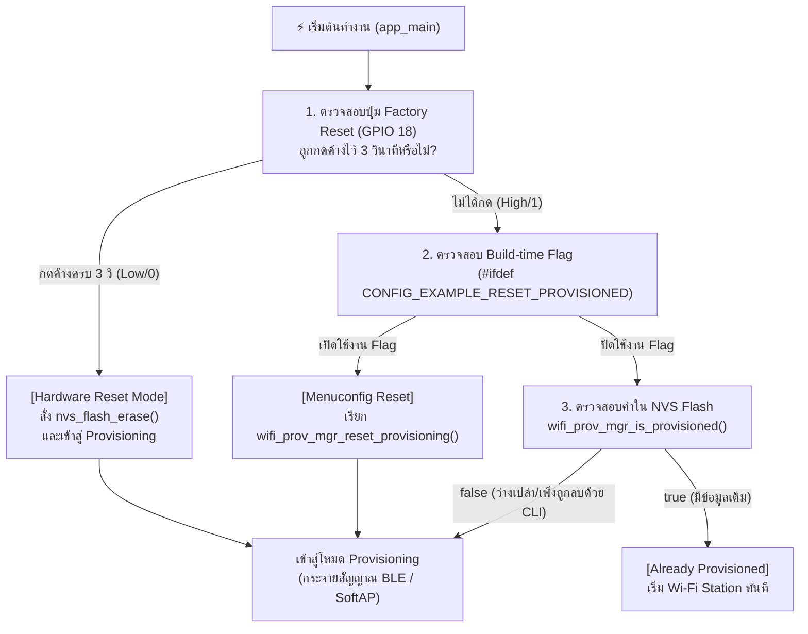
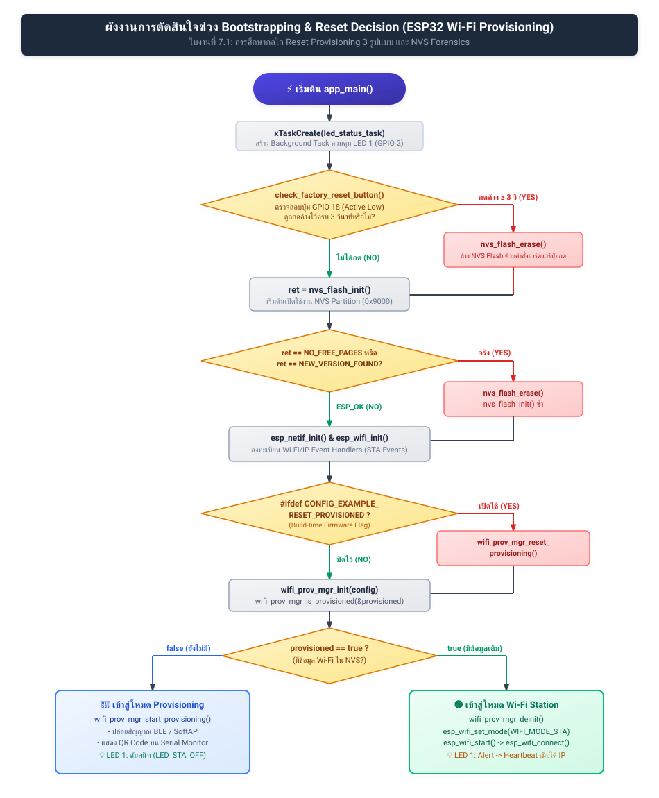
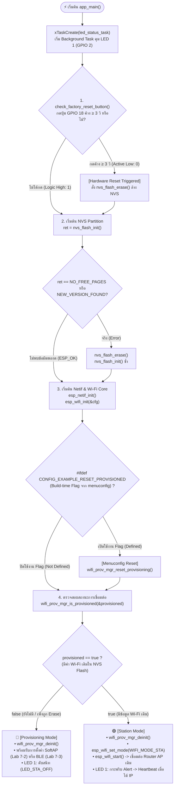
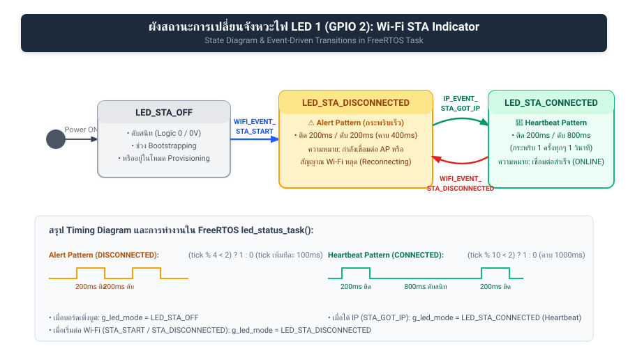

# ใบงานที่ 7.1  การศึกษากลไก Reset Provisioning 3 รูปแบบ และ NVS Memory Forensics

## 0. กล่าวนำ (Introduction)
เมื่ออุปกรณ์ ESP32 ผ่านการ Provisioning สำเร็จแล้ว ข้อมูล Wi-Fi จะถูกบันทึกไว้ใน NVS Flash Memory อย่างถาวร เมื่อเปิดเครื่องใหม่ เฟิร์มแวร์จะเข้าสู่สถานะ `Already provisioned` และข้ามขั้นตอนการรับข้อมูลใหม่ไปทันที

ในการพัฒนาผลิตภัณฑ์และการทดสอบความปลอดภัย วิศวกรจำเป็นต้องทราบวิธีการล้างค่าคอนฟิก (Factory Reset / Erase Credentials) ซึ่งในใบงานนี้นักศึกษาจะได้ทดลองและเปรียบเทียบกลไกการ Reset ครบทั้ง 3 รูปแบบ:
1. **Developer CLI Reset:** การล้างผ่านคำสั่ง Command Line บนเครื่องคอมพิวเตอร์
2. **Build-time Firmware Reset:** การกำหนดค่าผ่าน `menuconfig`
3. **Consumer Hardware Reset:** การต่อสวิตช์ปุ่มกดภายนอก (**External Pushbutton บน GPIO 18**) เพื่อใช้เป็นปุ่ม Factory Reset ทางกายภาพ เสมือนอุปกรณ์ IoT เชิงพาณิชย์จริง (หลีกเลี่ยงการใช้ปุ่ม BOOT/GPIO 0 ที่เป็น Strapping Pin)

---

## 1. วัตถุประสงค์ (Objectives)
1. ศึกษาและทำความเข้าใจสถานะ `Already provisioned` และการตัดสินใจของ `wifi_prov_mgr_is_provisioned()`
2. สามารถล้างข้อมูลการเชื่อมต่อใน Flash Memory ผ่านคำสั่ง CLI (`idf.py erase-flash` และ `esptool.py`) ได้
3. สามารถกำหนดค่า Build Configuration ใน `menuconfig` เพื่อสั่งรีเซ็ต State Machine ได้
4. เข้าใจข้อจำกัดของ **Strapping Pins (GPIO 0 / Bootloader Trap)** และสามารถต่อสวิตช์ปุ่มกดภายนอก (GPIO 18) เพื่อเขียนโปรแกรม Factory Reset ทางกายภาพได้อย่างถูกต้อง

---

## 2. อุปกรณ์ที่ใช้ในการทดลอง (Equipment)
1. บอร์ดไมโครคอนโทรลเลอร์ ESP32 พร้อมสาย USB
2. สวิตช์ปุ่มกด (Tactile Pushbutton Switch) จำนวน 1 ตัว พร้อมสายต่อ Breadboard
3. ESP-IDF Command Prompt (VS Code Terminal)

> [!IMPORTANT]
> **ทำไมจึงไม่ใช้ปุ่ม BOOT (GPIO 0) กดค้างตอนรีเซ็ตบอร์ด?**
> ขา **GPIO 0** บน ESP32 ทำหน้าที่เป็น **Strapping Pin** สำหรับเลือกโหมดการบูต หากขา GPIO 0 มีสถานะเป็น `LOW (0)` ในจังหวะที่บอร์ดถูกรีเซ็ตหรือจ่ายไฟ ชิป ESP32 จะเข้าสู่โหมด **ROM Download Bootloader** (`waiting for download`) ทันที ทำให้ตัวประมวลผลหยุดรอการแฟลชโปรแกรมและไม่รันโค้ด `app_main()` 
> 
> ดังนั้น ในการออกแบบอุปกรณ์เชิงพาณิชย์ จึงนิยมใช้ขา GPIO ทั่วไป (เช่น **GPIO 18**) ต่อร่วมกับปุ่มกดภายนอกเพื่อทำ Factory Reset แทน

---

## 3. สถาปัตยกรรมและการต่อวงจร (Hardware Wiring & Flow)

### 3.1 การต่อวงจรปุ่มกด Factory Reset (GPIO 18)
- ขาหนึ่งของสวิตช์ปุ่มกด $\rightarrow$ ต่อเข้าขา **GPIO 18** ของ ESP32
- อีกขาหนึ่งของสวิตช์ $\rightarrow$ ต่อลง **GND**
*(เปิดใช้งาน Internal Pull-up Resistor ในโค้ด จึงไม่ต้องต่อตัวต้านทานภายนอกเพิ่ม)*



---

## 4. ขั้นตอนการทดลอง (Step-by-Step Procedures)

### ตอนที่ 1 การล้าง Flash ผ่าน Command Line (Developer Level)
1. เสียบสาย USB เข้ากับคอมพิวเตอร์ ตรวจสอบหมายเลขพอร์ต COM (เช่น `COM24`)
2. เปิด Terminal ในโฟลเดอร์โปรเจกต์ `Week-07-W-iFi-Privisioning/Example_codes/Lab7-1-Reset-and-NVS-Forensics`
3. สั่งล้าง Flash Memory ทั้งหมดของชิปด้วยคำสั่ง:
   ```powershell
   idf.py -p COM24 erase-flash
   ```
4. ทำการ Flash โปรแกรมและเปิด Serial Monitor:
   ```powershell
   idf.py -p COM24 flash monitor
   ```
5. สังเกต Log ว่า ESP32 จะรายงานสถานะ `"Starting provisioning"` และสร้าง QR Code ขึ้นมาบนหน้าจอ

---

### ตอนที่ 2 การบังคับ Reset ผ่าน Menuconfig (Firmware Configuration Level)
1. กดปุ่ม `Ctrl + ]` เพื่อออกจาก Serial Monitor
2. เปิดหน้าต่างคอนฟิกโปรเจกต์:
   ```powershell
   idf.py menuconfig
   ```
3. ใช้ปุ่มลูกศรเลื่อนไปที่หัวข้อ **Example Configuration**
4. เลื่อนไปที่บรรทัด **`Reset Provisioned state (Erase credentials)`** แล้วกดปุ่ม `Spacebar` เพื่อเลือกให้มีเครื่องหมาย `[*]`
5. กดปุ่ม `S` เพื่อบันทึก และ `Q` เพื่อออกจากเมนู
6. สั่ง Build และ Flash โปรแกรม:
   ```powershell
   idf.py -p COM24 flash monitor
   ```
7. สังเกตผลลัพธ์ใน Log: บอร์ดจะทำการล้าง Credentials เก่าทิ้งทุกครั้งที่เปิดเครื่องใหม่

---

### ตอนที่ 3 การสร้างปุ่ม Factory Reset ด้วยฮาร์ดแวร์ภายนอก (GPIO 18)

1. นำสวิตช์ปุ่มกดต่อเข้ากับขา **GPIO 18** และ **GND**
2. เพิ่มฟังก์ชันตรวจสอบปุ่ม Factory Reset ลงในไฟล์ `main/main.c`:

```c
#include "driver/gpio.h"

#define FACTORY_RESET_BUTTON_GPIO  GPIO_NUM_18   // ปุ่ม Factory Reset ภายนอก (ต่อลง GND)

static bool check_factory_reset_button(void)
{
    // กำหนดค่า GPIO 18 เป็น Input พร้อมเปิด Internal Pull-up Resistor
    gpio_config_t io_conf = {
        .pin_bit_mask = (1ULL << FACTORY_RESET_BUTTON_GPIO),
        .mode = GPIO_MODE_INPUT,
        .pull_up_en = GPIO_PULLUP_ENABLE,
        .pull_down_en = GPIO_PULLDOWN_DISABLE,
        .intr_type = GPIO_INTR_DISABLE,
    };
    gpio_config(&io_conf);

    ESP_LOGI("FACTORY_RESET", "Hold GPIO 18 button for 3 seconds to trigger Factory Reset...");
    
    // ตรวจสอบสถานะปุ่มกดค้าง (Active Low / Logic 0)
    int hold_count = 0;
    while (gpio_get_level(FACTORY_RESET_BUTTON_GPIO) == 0) {
        vTaskDelay(pdMS_TO_TICKS(100));
        hold_count++;
        if (hold_count % 10 == 0) {
            ESP_LOGI("FACTORY_RESET", "Holding button... %d/3 seconds", hold_count / 10);
        }
        if (hold_count >= 30) { // กดค้างครบ 3 วินาที (30 x 100ms)
            ESP_LOGW("FACTORY_RESET", "=================================================");
            ESP_LOGW("FACTORY_RESET", ">>> FACTORY RESET TRIGGERED! ERASING NVS FLASH <<<");
            ESP_LOGW("FACTORY_RESET", "=================================================");
            return true;
        }
    }
    return false;
}
```

3. เรียกใช้งานในตอนเริ่มต้นของฟังก์ชัน `app_main()`:

```c
void app_main(void)
{
    // ตรวจสอบการกดปุ่ม Factory Reset ทางกายภาพ (GPIO 18)
    if (check_factory_reset_button()) {
        ESP_ERROR_CHECK(nvs_flash_erase());
    }

    /* Initialize NVS partition */
    esp_err_t ret = nvs_flash_init();
    if (ret == ESP_ERR_NVS_NO_FREE_PAGES || ret == ESP_ERR_NVS_NEW_VERSION_FOUND) {
        ESP_ERROR_CHECK(nvs_flash_erase());
        ESP_ERROR_CHECK(nvs_flash_init());
    }
    // ... โค้ดเดิมต่อจากนี้ ...
```

#### การทดสอบ:
1. ปล่อยให้บอร์ดทำงานปกติ $\rightarrow$ บอร์ดจะจำค่าเดิมได้ (`Already provisioned`)
2. กดปุ่มที่ต่อกับ **GPIO 18 ค้างไว้ 3 วินาที** จากนั้นกดรีเซ็ตบอร์ด หรือกดค้างขณะเปิดเครื่อง
3. สังเกต Serial Monitor: ระบบจะตรวจพบการกดค้าง 3 วินาที และสั่งล้าง NVS Flash เพื่อกลับสู่โหมด Provisioning ทันที!

---

---

## 5. กิจกรรมถอดรหัสซอร์สโค้ดและเขียนผังงาน (Code Deconstruction & Flowchart Assignment)

ให้นักศึกษาศึกษาโค้ดใน `main/main.c` และ `main/led_indicator.c` แล้วเขียน **ผังงาน (Flowchart / State Diagram)** เพื่ออธิบายการตัดสินใจและการทำงานของระบบ:

### ภารกิจที่ 1  ผังงานการตัดสินใจช่วง Bootstrapping & Reset Decision
ให้นักศึกษาวาด Flowchart แสดงลำดับตรรกะการตรวจสอบเงื่อนไขตั้งแต่เริ่มต้นรันฟังก์ชัน `app_main()` โดยต้องครอบคลุม:
1. การตรวจสอบสถานะปุ่ม **GPIO 18** (ตรวจจับการกดค้าง 3 วินาที)
2. การทำงานของ `nvs_flash_init()` และกรณีที่ต้อง `nvs_flash_erase()`
3. การตรวจสอบ Macro `#ifdef CONFIG_EXAMPLE_RESET_PROVISIONED`
4. การเรียกฟังก์ชัน `wifi_prov_mgr_is_provisioned(&provisioned)`
5. จุดแยกสายการทำงานเข้าสู่โหมด **Provisioning Mode** หรือ **Station Mode**

#### แผนภาพ Flowchart (Vector SVG Diagram):


#### โค้ดแผนภาพในรูปแบบ Mermaid Diagram:


---

### ภารกิจที่ 2 ผังสถานะการเปลี่ยนจังหวะไฟ LED 1 (Wi-Fi STA Indicator)
ให้นักศึกษาวาด State Diagram แสดงการเปลี่ยนสถานะของ **LED 1 (GPIO 2)**:
- เงื่อนไขใดทำให้ LED 1 เข้าสู่สถานะ `LED_STA_MODE_DISCONNECTED` (กระพริบ 200ms Mark / 200ms Space)
- เงื่อนไขหรือ Event ใดทำให้เปลี่ยนเป็น `LED_STA_MODE_CONNECTED` (Heartbeat 200ms ทุก 1s)

#### แผนภาพ State Diagram (Vector SVG Diagram):


#### โค้ดแผนภาพในรูปแบบ Mermaid Diagram:
```mermaid
stateDiagram-v2
    [*] --> LED_STA_OFF: Power ON / Bootstrapping

    state LED_STA_OFF {
        description: LED 1 ดับสนิท (Logic 0 / 0V)
    }

    state LED_STA_DISCONNECTED {
        description: Alert Pattern (กระพริบเร็ว 200ms ติด / 200ms ดับ)
    }

    state LED_STA_CONNECTED {
        description: Heartbeat Pattern (ติด 200ms ดับ 800ms ทุกๆ 1 วินาที)
    }

    LED_STA_OFF --> LED_STA_DISCONNECTED: WIFI_EVENT_STA_START<br/>(เริ่มโหมด Wi-Fi Station พยายามเชื่อมต่อไปยัง Access Point)
    
    LED_STA_DISCONNECTED --> LED_STA_CONNECTED: IP_EVENT_STA_GOT_IP<br/>(เชื่อมต่อสำเร็จและได้รับ IP Address จากเราเตอร์ DHCP)
    
    LED_STA_CONNECTED --> LED_STA_DISCONNECTED: WIFI_EVENT_STA_DISCONNECTED<br/>(สัญญาณหลุด หรือ Router ปิดตัว เข้าสู่ลูป Reconnecting)
```

#### รายละเอียดเงื่อนไขการเปลี่ยนสถานะตามโค้ดโปรแกรม:
1. **เงื่อนไขที่ทำให้ LED 1 เข้าสู่สถานะ `LED_STA_DISCONNECTED` (Alert: ติด 200ms / ดับ 200ms):**
   - **เมื่อเริ่มสตาร์ต Wi-Fi Station (`WIFI_EVENT_STA_START`):** บอร์ดเข้าสู่กระบวนการเชื่อมต่อเครือข่าย Wi-Fi ตามค่าใน NVS โดยเริ่มเรียกคำสั่ง `esp_wifi_connect()`
   - **เมื่อสัญญาณ Wi-Fi ขาดหาย (`WIFI_EVENT_STA_DISCONNECTED`):** หากหลุดการเชื่อมต่อหรือต่อเราเตอร์ไม่สำเร็จ ตัว Event Handler จะสลับกลับมาเป็น `LED_STA_DISCONNECTED` เพื่อแสดงไฟเตือนและสั่ง `esp_wifi_connect()` ซ้ำ
2. **เงื่อนไขที่ทำให้ LED 1 เข้าสู่สถานะ `LED_STA_CONNECTED` (Heartbeat: ติด 200ms ทุก 1s):**
   - **เมื่อได้รับ IP Address สำเร็จ (`IP_EVENT_STA_GOT_IP`):** เมื่อ ESP32 ทำการ Handshake 4-Way กับเราเตอร์เสร็จสิ้นและได้รับ IP Address จาก DHCP Server ตัว Event Handler จะอัปเดต `g_led_mode = LED_STA_CONNECTED` ส่งผลให้ `led_status_task` ขับสัญญาณไฟกระพริบสไตล์ชีพจร (Heartbeat) บ่งบอกสถานะออนไลน์สมบูรณ์

---

## 6. ตารางบันทึกผลการทดลอง (Experiment Results)

| รูปแบบการ Reset                  | คำสั่ง / พฤติกรรมที่ทำ               | พฤติกรรมของ LED แต่ละดวงหลังเปิดเครื่อง | สถานะใน Serial Monitor |
| :------------------------------- | :----------------------------------- | :-------------------------------------- | :--------------------- |
| **1. CLI Erase**                 | `idf.py erase-flash`                 | **LED 1 (GPIO 2 - STA):** ดับสนิท (`LED_STA_OFF`) เนื่องจาก NVS Flash ถูกลบข้อมูลเป็น `0xFF` ทั้งหมด ไม่มี Credentials หลงเหลือ บอร์ดจึงไม่เข้าสู่โหมด Station<br/>**LED 2 (BLE) / LED 3 (SoftAP):** อยู่ในสถานะพร้อมเข้าสู่โหมด Provisioning รอรับการตั้งค่าใหม่ | ตรวจพบ NVS ว่างเปล่า บอร์ดรายงานข้อความ:<br/>`[STATUS]: Device is NOT provisioned (NVS is empty)`<br/>`Ready for Provisioning Lab 7-2 (SoftAP) or 7-3 (BLE)!` |
| **2. Menuconfig Flag**           | `CONFIG_EXAMPLE_RESET_PROVISIONED=y` | **LED 1 (GPIO 2 - STA):** ดับสนิท (`LED_STA_OFF`) ทุกครั้งที่เปิดเครื่อง เนื่องจาก State Machine ถูกสั่งล้างค่าการเชื่อมต่อทิ้งเสมอ<br/>**LED 2 / LED 3:** พร้อมเริ่มโหมด Provisioning กระจายสัญญาณรอบอร์ดรับค่าใหม่ | บอร์ดรันคำสั่งล้างค่า Credential ผ่าน API:<br/>`wifi_prov_mgr_reset_provisioning()`<br/>และแสดงผลลัพธ์ว่า NVS ถูกรีเซ็ตเรียบร้อยแล้ว พร้อมเริ่มกระบวนการ Provisioning ใหม่เสมอ |
| **3. Hardware Button (GPIO 18)** | กดปุ่ม GPIO 18 ค้าง 3 วินาที         | **ช่วงกดค้าง 0-3 วิ:** บอร์ดกำลังนับเวลา Debounce และตรวจจับระดับสัญญาณ Low<br/>**เมื่อครบ 3 วินาที:** ระบบสั่งลบ NVS Flash ทันที ส่งผลให้ **LED 1 ดับสนิท (`LED_STA_OFF`)** ไม่เข้าสู่ Wi-Fi Station เดิม | Serial Monitor นับเวลาและสั่งลบ Flash ทันที:<br/>`Hold GPIO 18 button for 3 seconds to trigger Factory Reset...`<br/>`Holding button... 1/3 seconds`<br/>`Holding button... 2/3 seconds`<br/>`>>> FACTORY RESET TRIGGERED! ERASING NVS FLASH <<<`<br/>`[FORENSIC]: User requested Flash Erase!`<br/>`[STATUS]: Device is NOT provisioned (NVS is empty)` |

---

## 7. คำถามท้ายการทดลอง (Post-Lab Questions)

### 1. เพราะเหตุใดการกดปุ่ม BOOT (GPIO 0) ค้างไว้ในจังหวะรีเซ็ตบอร์ด จึงทำให้โปรแกรมค้างอยู่ที่ ROM Bootloader และไม่ยอมทำงานต่อ?
**คำตอบ:**
เพราะขา **GPIO 0** บนชิป ESP32 ทำหน้าที่เป็น **Strapping Pin** ซึ่งวงจรระดับฮาร์ดแวร์ภายในตัวชิป (ROM Bootloader) จะทำการอ่านค่าระดับแรงดันทางตรรกะในจังหวะ Power-on Reset (POR) หรือ System Reset ทันทีเพื่อตัดสินใจเลือกโหมดการบูต:
- **หาก GPIO 0 มีสถานะเป็น HIGH (1)** (สภาวะปกติที่มีตัวต้านทาน Pull-up): ESP32 จะบูตเข้าสู่ **SPI Flash Boot Mode** เพื่อไปโหลดรัน 2nd Stage Bootloader และเริ่มประมวลผลโค้ด `app_main()` ตามปกติ
- **หาก GPIO 0 มีสถานะเป็น LOW (0)** (เกิดจากการกดปุ่ม BOOT ค้างลง GND): วงจรฮาร์ดแวร์จะเปลี่ยนเส้นทางการทำงานให้เข้าสู่ **ROM Download Bootloader Mode** (`waiting for download`) เพื่อรอรับคำสั่งแฟลชเฟิร์มแวร์ใหม่ผ่านพอร์ต UART/USB
ดังนั้น ตัวประมวลผลจึงติดลูปค้างอยู่ใน ROM ของโรงงาน ไม่โหลดโค้ดเฟิร์มแวร์ใน Flash ขึ้นมาทำงาน ทำให้ฟังก์ชัน `app_main()` และโค้ดตรวจสอบปุ่ม Factory Reset ของเราไม่ถูกรันเลย การออกแบบอุปกรณ์เชิงพาณิชย์จึงต้องหลีกเลี่ยงการใช้ Strapping Pins เหล่านี้และหันมาใช้ GPIO ทั่วไป (เช่น GPIO 18) แทน

---

### 2. เพราะเหตุใดคำสั่ง `idf.py erase-flash` จึงทำให้ข้อมูลเฟิร์มแวร์ Application หายไปด้วย ในขณะที่ `nvs_flash_erase()` ไม่ทำให้เฟิร์มแวร์หาย?
**คำตอบ:**
เนื่องจาก**ระดับขอบเขต (Scope) และกลไกในการลบหน่วยความจำ Flash แตกต่างกัน**อย่างสิ้นเชิง:
- **คำสั่ง `idf.py erase-flash` (Chip-Level Hardware Erase):** เป็นคำสั่งที่ส่งผ่านเครื่องมือภายนอก (`esptool.py`) ติดต่อกับ ROM Bootloader เพื่อสั่งคำสั่ง Hardware Erase ลบข้อมูลทุกเซกเตอร์ในชิป SPI Flash Memory ทั้งหมด (4MB หรือ 8MB) ให้กลายเป็นค่า `0xFF` ทั้งหมด ซึ่งครอบคลุมทุก Partition ไม่ว่าจะเป็น Bootloader (`0x1000`), Partition Table (`0x8000`), NVS (`0x9000`), และ Factory App Firmware (`0x10000`) ส่งผลให้เฟิร์มแวร์ทั้งหมดสูญหายและต้องแฟลชใหม่เท่านั้น
- **ฟังก์ชัน `nvs_flash_erase()` (Partition-Specific Software API):** เป็นคำสั่งระดับซอฟต์แวร์ API ของ ESP-IDF ที่ทำงานอยู่ภายใต้ระบบปฏิบัติการในขณะที่เฟิร์มแวร์กำลังรัน โดยฟังก์ชันนี้จะค้นหาตำแหน่งเฉพาะของ Partition ที่มี Label ว่า `"nvs"` จากตาราง Partition Table (ปกติอยู่ที่ Offset `0x9000` ขนาด `0x6000` หรือ 24 KB) แล้วสั่งลบเซกเตอร์เฉพาะในย่าน 24 KB นั้นเท่านั้น โดยไม่ไปแตะต้อง Partition ของ Application Firmware หรือ Bootloader เลย จึงเป็นการล้างเฉพาะ Key-Value Store ที่เก็บ Wi-Fi Credentials แต่ตัวโปรแกรมยังคงอยู่และทำงานต่อได้ตามปกติ

---

### 3. การออกแบบปุ่ม Factory Reset บนอุปกรณ์ IoT เชิงพาณิชย์ เหตุใดจึงต้องกำหนดให้ผู้ใช้กดปุ่มค้างไว้ 3-5 วินาที แทนที่จะสั่งลบข้อมูลทันทีที่แตะปุ่มเพียงเสี้ยววินาที?
**คำตอบ:**
ด้วยหลักการออกแบบผลิตภัณฑ์และวิศวกรรมความปลอดภัย มี 3 เหตุผลสำคัญดังนี้:
1. **ป้องกัน Accidental Trigger (การเผลอกดโดยไม่ได้ตั้งใจ):** ในการใช้งานจริง ผู้ใช้อาจเผลอโดนปุ่มขณะหยิบจับ ทำความสะอาด หรืออุปกรณ์อาจถูกกระแทก หากแตะเพียงเสี้ยววินาทีแล้วลบข้อมูลทันที อุปกรณ์จะหลุดจากระบบ Smart Home และผู้ใช้จะต้องเสียเวลาตั้งค่า Wi-Fi ใหม่ทั้งหมด
2. **ป้องกันสัญญาณรบกวนทางไฟฟ้าและการกระดอนของหน้าสัมผัส (Switch Contact Bounce & Electrical Glitches):** สวิตช์ปุ่มกดเชิงกลจะเกิดการกระดอนของขั้วโลหะ (Mechanical Bouncing) ในระดับมิลลิวินาที หรืออาจเกิดสัญญาณรบกวนทางไฟฟ้า (ESD/EMC Spikes) การกำหนดเงื่อนไขให้ตรวจสอบสถานะ Logic LOW อย่างต่อเนื่องนาน 3-5 วินาที ทำหน้าที่เป็นตัวกรองสัญญาณ (Robust Software Debouncing) ที่ช่วยการันตีความถูกต้องของฮาร์ดแวร์ได้ 100%
3. **ยืนยันเจตจำนงที่แท้จริงของผู้ใช้ (Deliberate Intent Confirmation):** การทำ Factory Reset เป็นการกระทำที่มีผลกระทบร้ายแรงต่อข้อมูล (Destructive Operation) การบังคับให้กดค้างเป็นระยะเวลาหนึ่งเป็นการยืนยันความตั้งใจ และเปิดโอกาสให้ระบบแจ้งเตือนผู้ใช้ เช่น ให้หลอดไฟกระพริบเตือนถี่ๆ ในวินาทีที่ 1-3 เพื่อให้ผู้ใช้สามารถปล่อยมือยกเลิกได้หากเปลี่ยนใจก่อนครบกำหนด

---

### 4. หากอุปกรณ์ IoT ถูกติดตั้งอยู่บนเสาสูงหรือฝังอยู่ในผนัง วิธีการ Reset ทางกายภาพรูปแบบใดเหมาะสมที่สุด?
**คำตอบ:**
สำหรับอุปกรณ์ที่ติดตั้งในจุดที่ไม่สามารถเข้าถึงทางกายภาพได้โดยตรง (Inaccessible/Embedded IoT Devices) วิธีการ Reset ทางกายภาพที่เหมาะสมและเป็นมาตรฐานในอุตสาหกรรม มีดังนี้:
1. **Power-Cycle Pattern Reset (การตัด-ต่อไฟตามจังหวะ หรือ Light Bulb Reset Pattern):** เป็นวิธีที่นิยมที่สุดในหลอดไฟอัจฉริยะ (เช่น Philips Hue, Tuya) และสวิตช์ฝังผนัง โดยให้ผู้ใช้สับสวิตช์ไฟหลักหรือเบรกเกอร์ "เปิด-ปิด-เปิด-ปิด-เปิด" ติดต่อกัน 5 ครั้ง (แต่ละครั้งเว้น 2-3 วินาที) เฟิร์มแวร์จะตรวจจับการบูตถี่ผิดปกติผ่าน RTC Fast Memory หรือ NVS Counter แล้วสั่ง Factory Reset ตัวเองโดยอัตโนมัติ
2. **Magnetic Reed Switch / Hall Effect Sensor Reset (การใช้สนามแม่เหล็ก):** ติดตั้งเซนเซอร์ตรวจจับสนามแม่เหล็กไว้ภายในตัวอุปกรณ์ใต้ฝาครอบหรือใต้ผนัง เมื่อต้องการรีเซ็ต เจ้าหน้าที่เพียงนำแม่เหล็กแรงสูง (Neodymium Magnet) มาทาบไว้ที่ผิวด้านนอกของผนังหรือเสาค้างไว้ 5 วินาที โดยไม่ต้องรื้อถอนหรือเจาะผนัง
3. **Hardware Reset Terminal Block ลากสายลงมาด้านล่าง:** สำหรับอุปกรณ์บนเสาสูงหรือเสาไฟถนน (Smart Street Light) จะมีการเดินสายสัญญาณ Reset คู่กับสายคอนโทรล ลากลงมายังตู้ควบคุมไฟฟ้า (Control Cabinet/Junction Box) ที่ระดับพื้นดิน เพื่อให้ช่างเทคนิคสามารถช็อตขา Reset ลง GND ได้อย่างปลอดภัยโดยไม่ต้องปีนเสา
4. **Out-of-Band Wireless Physical Trigger (BLE Beacon / Sub-1GHz Maintenance Mode):** แม้ Wi-Fi จะใช้งานไม่ได้ แต่อุปกรณ์สามารถเปิดรับสัญญาณการตั้งค่าผ่าน BLE หรือคลื่นวิทยุเฉพาะ โดยเจ้าหน้าที่สามารถยืนอยู่ใต้เสาแล้วใช้สมาร์ตโฟนที่มี Security Key/Physical Master Token ส่งคำสั่ง Factory Reset ผ่านระยะใกล้ได้อย่างปลอดภัย


