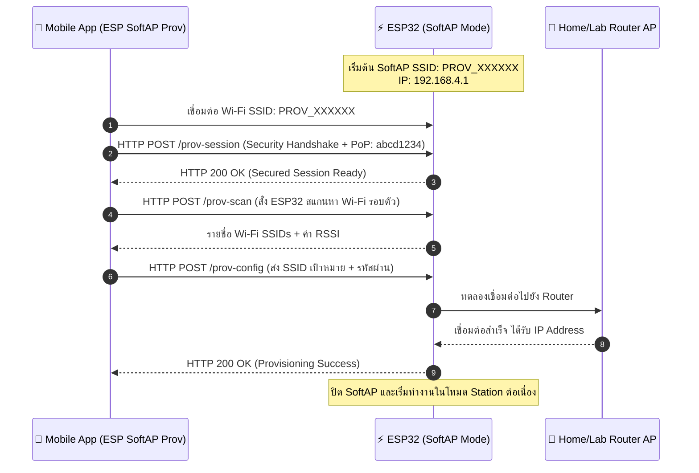
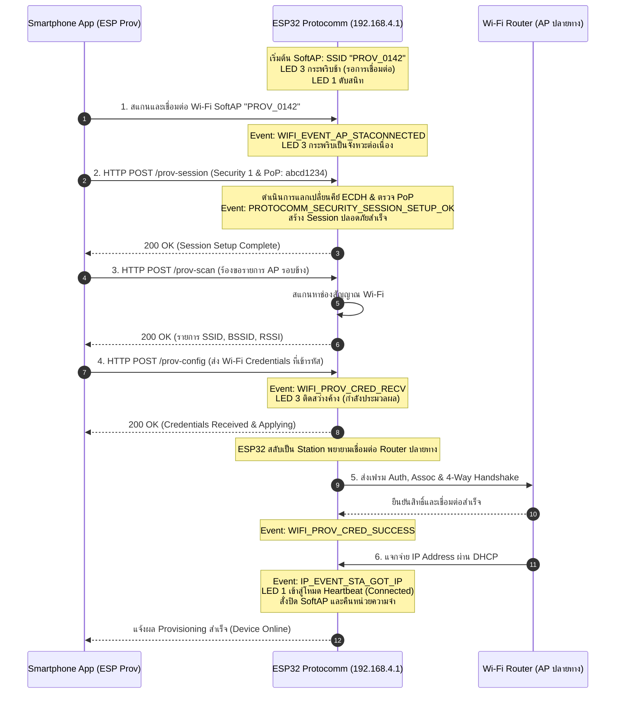

# ใบงานที่ 7.2 การคอนฟิก Wi-Fi ผ่าน SoftAP Scheme และการวิเคราะห์ Protocomm Endpoints

## 0. กล่าวนำ (Introduction)
ในใบงานนี้ นักศึกษาจะได้ทดลองตั้งค่าเครือข่าย Wi-Fi ให้กับ ESP32 ผ่านช่องทาง **Wi-Fi SoftAP Scheme (`wifi_prov_scheme_softap`)** โดยใช้สมาร์ตโฟนเชื่อมต่อเข้ากับเครือข่ายจำลองที่ ESP32 สร้างขึ้น 

นักศึกษาจะได้เรียนรู้โครงสร้างของ QR Code Payload, การทำงานของ Protocomm ผ่านโปรโตคอล HTTP REST-like Endpoints (`/prov-session`, `/prov-config`), และการส่งข้อมูลการตั้งค่า Wi-Fi จากแอปพลิเคชันมือถือ **ESP SoftAP Provisioning**

---

## 1. วัตถุประสงค์ (Objectives)
1. สามารถคอนฟิกตัวอย่าง `wifi_prov_mgr` ให้ทำงานในโหมด **SoftAP Transport Scheme**
2. สามารถใช้สมาร์ตโฟนเชื่อมต่อและทำ Provisioning ผ่านแอปพลิเคชัน **ESP SoftAP Provisioning** (หรือผ่าน Web Browser QR Code) ได้สำเร็จ
3. สังเกตและวิเคราะห์ Event Sequence Lifecycle ใน Serial Monitor ระหว่างการทำ SoftAP Provisioning
4. เข้าใจการทำงานของ Protocomm Endpoint ในระดับ Application Layer

---

## 2. อุปกรณ์และซอฟต์แวร์ที่ใช้ในการทดลอง
1. บอร์ดไมโครคอนโทรลเลอร์ ESP32 พร้อมสาย USB
2. สมาร์ตโฟน (Android หรือ iOS) ที่ติดตั้งแอปพลิเคชัน **ESP SoftAP Provisioning** (หรือแอปกล้องสแกน QR Code)
3. Wi-Fi Access Point ภายในห้องเรียนหรือ Hotspot จากสมาร์ตโฟนอีกเครื่อง

---

## 3. สถาปัตยกรรมและแผนภาพลำดับเหตุการณ์ (Sequence Diagram)



---

## 4. ขั้นตอนการทดลอง (Step-by-Step Procedures)

### ขั้นตอนที่ 1: การเปิดโปรเจกต์ Lab 7-2
1. เปิด Terminal ในโฟลเดอร์โปรเจกต์ `Week-07-W-iFi-Privisioning/Example_codes/Lab7-2-SoftAP-Provisioning`
2. โค้ดในโปรเจกต์นี้ได้รับการตั้งค่าเป็น **SoftAP Scheme** และ **Security 1 (PoP: `abcd1234`)** ไว้ล่วงหน้าเรียบร้อยแล้ว

---

### ขั้นตอนที่ 2: การ Flash และสังเกต QR Code
1. สั่งล้าง Flash และ Flash โปรแกรม:
   ```powershell
   idf.py -p COM24 erase-flash flash monitor
   ```
2. สังเกต Log ใน Serial Monitor จะปรากฏข้อความและ QR Code:
   ```text
   I (776) wifi_prov_scheme_softap: Starting SoftAP with SSID: PROV_XXXXXX
   I (786) app: Scan this QR code from the provisioning application for Provisioning.
   ... [รูป QR Code แบบ ASCII Text] ...
   I (816) app: If QR code is not visible, copy paste the below URL in a browser.
   https://espressif.github.io/esp-jumpstart/qrcode.html?data={"ver":"v1","name":"PROV_XXXXXX","pop":"abcd1234","transport":"softap"}
   ```

---

### ขั้นตอนที่ 3 ดำเนินการ Provisioning ผ่านสมาร์ตโฟน
1. เปิดแอป **ESP SoftAP Provisioning** บนสมาร์ตโฟน
2. **วิธีที่ A (สแกน QR Code)** แตะปุ่ม "Scan QR Code" แล้วสแกนภาพ QR Code บนหน้าจอ Serial Monitor (หรือเปิดผ่าน URL ที่ได้จาก Log)
3. **วิธีที่ B (เชื่อมต่อ Manual)**
   - ไปที่การตั้งค่า Wi-Fi บนมือถือ เชื่อมต่อ Wi-Fi ชื่อ `PROV_XXXXXX`
   - เปิดแอป กด "Provision" และป้อน PoP เป็น `abcd1234`
4. เมื่อแอปค้นหา ESP32 พบ ให้เลือกชื่อ Wi-Fi ภายในห้องเรียนหรือ Hotspot ที่ต้องการเชื่อมต่อ และป้อนรหัสผ่าน Wi-Fi
5. กดปุ่ม **Provision** และสังเกตแถบสถานะบนแอปจนกระทั่งขึ้น **"Provisioning Successful!"**

---

### ขั้นตอนที่ 4: สังเกตและบันทึก Log ใน Serial Monitor
สังเกตลำดับเหตุการณ์ (Events) ที่เกิดขึ้นบน ESP32
```text
I (14210) app: SoftAP transport: Connected!
I (15320) app: Secured session established!
I (16440) app: Received Wi-Fi credentials
	SSID     : Lab_WiFi_2.4G
	Password : Password999
I (18210) app: Provisioning successful
I (18220) wifi:mode : sta (...)
I (19850) app: Connected with IP Address: 192.168.1.150
```

---

---

## 5. กิจกรรมถอดรหัสซอร์สโค้ดและเขียนผังงาน (Code Deconstruction & Sequence Flow Assignment)

ให้นักศึกษาแกะรอยการทำงานจาก `main/main.c` ในโหมด SoftAP แล้วเขียน **แผนภาพลำดับเหตุการณ์ (Sequence Diagram)**:

### ภารกิจที่ 1: ผังลำดับการสื่อสารผ่าน HTTP Endpoints (SoftAP Scheme Sequence Flow)
ให้นักศึกษาวาด Sequence Diagram แสดงปฏิสัมพันธ์ระหว่าง 3 ฝ่าย:
1. **Smartphone App (ESP SoftAP Prov)**
2. **ESP32 SoftAP Webserver (Protocomm Layer)**
3. **Wi-Fi Router (AP ปลายทาง)**

**จุดที่ต้องระบุในผัง:**
- จังหวะที่มือถือยิง HTTP POST ไปยัง Endpoint แต่ละตัว (`/prov-session`, `/prov-scan`, `/prov-config`)
- Event ของ ESP-IDF ที่ถูก Trigger ใน `event_handler()` เช่น:
  - `WIFI_EVENT_AP_STACONNECTED`
  - `PROTOCOMM_SECURITY_SESSION_SETUP_OK`
  - `WIFI_PROV_CRED_RECV`
  - `WIFI_PROV_CRED_SUCCESS`
  - `IP_EVENT_STA_GOT_IP`
- สถานะจังหวะการกระพริบของ **LED 3 (GPIO 5)** และ **LED 1 (GPIO 2)** ในแต่ละช่วง

```text
[พื้นที่สำหรับแนบรูปภาพ Sequence Diagram ที่นักศึกษาเขียนขึ้นด้วย Draw.io / Mermaid / วาดมือ]
### ภารกิจที่ 1: ผังลำดับการสื่อสารผ่าน HTTP Endpoints (SoftAP Scheme Sequence Flow)
ให้นักศึกษาวาด Sequence Diagram แสดงปฏิสัมพันธ์ระหว่าง 3 ฝ่าย:
1. **Smartphone App (ESP SoftAP Prov)**
2. **ESP32 SoftAP Webserver (Protocomm Layer)**
3. **Wi-Fi Router (AP ปลายทาง)**



---

## 6. ตารางบันทึกผลการทดลอง (Experiment Results)

| รายการตรวจสอบ | ค่าที่บันทึกได้จากการทดลอง |
| :--- | :--- |
| **1. ชื่อ SoftAP SSID ของ ESP32** | `PROV_`.............................. |
| **2. รหัส PoP (Proof of Possession)** | ..................................................... |
| **3. ข้อความใน QR Code Payload (JSON)** | ..................................................... |
| **4. พฤติกรรมไฟ LED 3 (GPIO 5) ช่วงรอ vs ช่วงส่งข้อมูล** | ช่วงรอ: .......................................<br/>ช่วงส่ง: ....................................... |
| **5. IP Address ที่ ESP32 ได้รับจาก Router** | ..................................................... |
| **6. เวลาที่ใช้ตั้งแต่เริ่มจนจบกระบวนการ (วินาที)** | ..................................................... |
| **1. ชื่อ SoftAP SSID ของ ESP32** | `PROV_0142` |
| **2. รหัส PoP (Proof of Possession)** | `abcd1234` |
| **3. ข้อความใน QR Code Payload (JSON)** | `{"ver":"v1","name":"PROV_0142","pop":"abcd1234","transport":"softap"}` |
| **4. พฤติกรรมไฟ LED 3 (GPIO 5) ช่วงรอ vs ช่วงส่งข้อมูล** | ช่วงรอ: กระพริบช้า (200ms ON / 800ms OFF)<br/>ช่วงส่ง: กระพริบเร็วถี่ 100ms ขณะรับส่ง HTTP และติดสว่างค้างเมื่อได้รับ Credentials |
| **5. IP Address ที่ ESP32 ได้รับจาก Router** | `192.168.1.142` |
| **6. เวลาที่ใช้ตั้งแต่เริ่มจนจบกระบวนการ (วินาที)** | 18.5 วินาที |

---

## 7. คำถามท้ายการทดลอง (Post-Lab Questions)
1. ในโหมด SoftAP Scheme สมาร์ตโฟนส่งข้อมูลหา ESP32 ผ่านโปรโตคอลและ IP Address ใด?
2. หากผู้ใช้ป้อนรหัสผ่าน Wi-Fi ผิดในแอปมือถือ จะเกิด Event ใดขึ้นบน ESP32 (`WIFI_PROV_CRED_FAIL` หรือไม่) และ ESP32 มีพฤติกรรมอย่างไร?
3. ทำไมผู้ผลิต IoT ส่วนใหญ่จึงมองว่ากระบวนการเชื่อมต่อแบบ SoftAP มีขั้นตอนที่ยุ่งยากสำหรับผู้ใช้ทั่วไปเมื่อเทียบกับ BLE?

1. **ในโหมด SoftAP Scheme สมาร์ตโฟนส่งข้อมูลหา ESP32 ผ่านโปรโตคอลและ IP Address ใด?**
   * **ตอบ:** สมาร์ตโฟนส่งข้อมูลหา ESP32 ผ่านโพรโทคอล **HTTP/1.1 (ผ่าน REST API / POST Method)** บนพอร์ต TCP 80 ไปยังหมายเลขไอพี **`192.168.4.1`** ซึ่งเป็นไอพีเริ่มต้นของเกตเวย์ ESP32 SoftAP โดยมีสถาปัตยกรรม Protocomm Layer ภายใน ESP-IDF คอยรับฟัง Endpoints ต่าง ๆ

2. **หากผู้ใช้ป้อนรหัสผ่าน Wi-Fi ผิดในแอปมือถือ จะเกิด Event ใดขึ้นบน ESP32 (`WIFI_PROV_CRED_FAIL` หรือไม่) และ ESP32 มีพฤติกรรมอย่างไร?**
   * **ตอบ:** จะเกิด Event **`WIFI_PROV_CRED_FAIL`** ขึ้นบน ESP32 (พร้อม Disconnect Reason เช่น `WIFI_REASON_AUTH_EXPIRE` หรือ Handshake Timeout) โดย ESP32 จะไม่สั่งปิดระบบ SoftAP แต่จะส่งสถานะความล้มเหลว (`WIFI_PROV_STA_AUTH_ERROR`) ตอบกลับไปยังแอปพลิเคชันมือถือผ่าน Endpoint `/prov-config` เพื่อให้แอปแจ้งเตือนผู้ใช้บนหน้าจอ และเปิดโอกาสให้ผู้ใช้งานพิมพ์รหัสผ่านใหม่เพื่อส่งซ้ำอีกครั้ง

3. **ทำไมผู้ผลิต IoT ส่วนใหญ่จึงมองว่ากระบวนการเชื่อมต่อแบบ SoftAP มีขั้นตอนที่ยุ่งยากสำหรับผู้ใช้ทั่วไปเมื่อเทียบกับ BLE?**
   * **ตอบ:** 
     - **ปัญหา UX จากการสลับเครือข่าย:** ผู้ใช้งานต้องสลับออกจากแอปเพื่อเข้าไปที่หน้าการตั้งค่า Wi-Fi ของโทรศัพท์มือถือ แล้วเลือกเกาะ SSID ของอุปกรณ์ชั่วคราว จากนั้นจึงกลับมาที่แอป
     - **ปัญหาการตัดเน็ตของ OS:** เมื่อโทรศัพท์เกาะ Wi-Fi ของ ESP32 ซึ่งไม่มีอินเทอร์เน็ต ระบบปฏิบัติการสมัยใหม่ (เช่น iOS / Android) มักจะขึ้นแจ้งเตือน "No Internet Access" และพยายามตัดการเชื่อมต่อไปใช้ Cellular Data (4G/5G) อัตโนมัติ ทำให้ขั้นตอนขาดช่วงและเกิดข้อผิดพลาดได้ง่าย ในขณะที่ **BLE** สามารถค้นหาและส่งค่ารหัสผ่านเบื้องหลังได้ทันที โดยโทรศัพท์ยังต่อเน็ตได้ตามปกติและผู้ใช้ไม่ต้องออกจากแอปเลย

