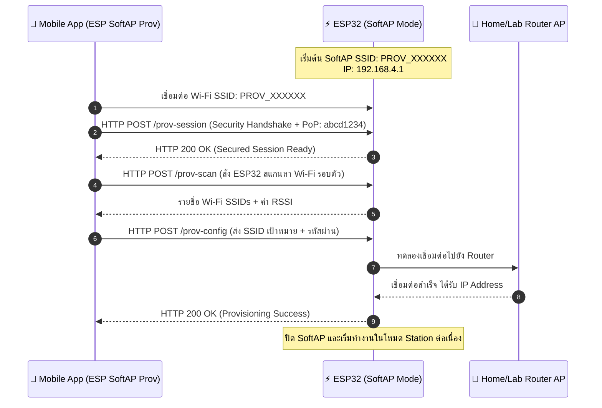
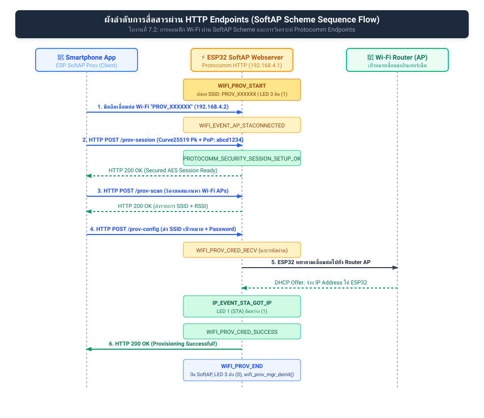
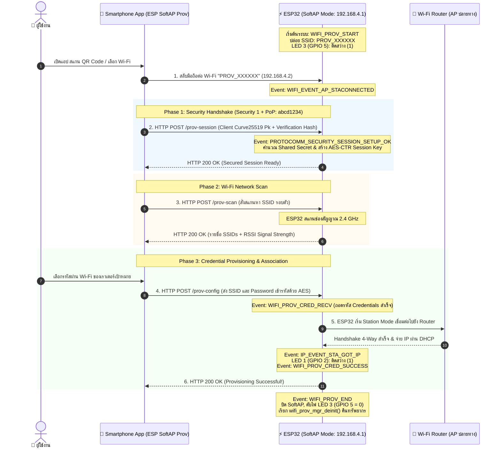

# ใบงานที่ 7.2 การคอนฟิก Wi-Fi ผ่าน SoftAP Scheme และการวิเคราะห์ Protocomm Endpoints

## 0. กล่าวนำ (Introduction)
ในใบงานนี้ นักศึกษาจะได้ทดลองตั้งค่าเครือข่าย Wi-Fi ให้กับ ESP32 ผ่านช่องทาง **Wi-Fi SoftAP Scheme (`wifi_prov_scheme_softap`)** โดยใช้สมาร์ตโฟนเชื่อมต่อเข้ากับเครือข่ายจำลองที่ ESP32 สร้างขึ้น 

นักศึกษาจะได้เรียนรู้โครงสร้างของ QR Code Payload, การทำงานของ Protocomm ผ่านโปรโตคอล HTTP REST-like Endpoints (`/prov-session`, `/prov-config`), และการส่งข้อมูลการตั้งค่า Wi-Fi จากแอปพลิเคชันมือถือ **ESP SoftAP Provisioning**

---

## 1. วัตถุประสงค์ (Objectives)
1. สามารถคอนฟิกตัวอย่าง `wifi_prov_mgr` ให้ทำงานในโหมด **SoftAP Transport Scheme**
2. สามารถใช้สมาร์ตโฟนเชื่อมต่อและทำ Provisioning ผ่านแอปพลิเคชัน **ESP SoftAP Provisioning** (หรือผ่าน Web Browser QR Code) ได้สำเร็จ
3. สังเกตและวิเคราะห์ Event Sequence Lifecycle ใน Serial Monitor ระหว่างการทำ SoftAP Provisioning
4. เข้าใจการทำงานของ Protocomm Endpoint ในระดับ Application Layer

---

## 2. อุปกรณ์และซอฟต์แวร์ที่ใช้ในการทดลอง
1. บอร์ดไมโครคอนโทรลเลอร์ ESP32 พร้อมสาย USB
2. สมาร์ตโฟน (Android หรือ iOS) ที่ติดตั้งแอปพลิเคชัน **ESP SoftAP Provisioning** (หรือแอปกล้องสแกน QR Code)
3. Wi-Fi Access Point ภายในห้องเรียนหรือ Hotspot จากสมาร์ตโฟนอีกเครื่อง

---

## 3. สถาปัตยกรรมและแผนภาพลำดับเหตุการณ์ (Sequence Diagram)



---

## 4. ขั้นตอนการทดลอง (Step-by-Step Procedures)

### ขั้นตอนที่ 1: การเปิดโปรเจกต์ Lab 7-2
1. เปิด Terminal ในโฟลเดอร์โปรเจกต์ `Week-07-W-iFi-Privisioning/Example_codes/Lab7-2-SoftAP-Provisioning`
2. โค้ดในโปรเจกต์นี้ได้รับการตั้งค่าเป็น **SoftAP Scheme** และ **Security 1 (PoP: `abcd1234`)** ไว้ล่วงหน้าเรียบร้อยแล้ว

---

### ขั้นตอนที่ 2: การ Flash และสังเกต QR Code
1. สั่งล้าง Flash และ Flash โปรแกรม:
   ```powershell
   idf.py -p COM24 erase-flash flash monitor
   ```
2. สังเกต Log ใน Serial Monitor จะปรากฏข้อความและ QR Code:
   ```text
   I (776) wifi_prov_scheme_softap: Starting SoftAP with SSID: PROV_XXXXXX
   I (786) app: Scan this QR code from the provisioning application for Provisioning.
   ... [รูป QR Code แบบ ASCII Text] ...
   I (816) app: If QR code is not visible, copy paste the below URL in a browser.
   https://espressif.github.io/esp-jumpstart/qrcode.html?data={"ver":"v1","name":"PROV_XXXXXX","pop":"abcd1234","transport":"softap"}
   ```

---

### ขั้นตอนที่ 3 ดำเนินการ Provisioning ผ่านสมาร์ตโฟน
1. เปิดแอป **ESP SoftAP Provisioning** บนสมาร์ตโฟน
2. **วิธีที่ A (สแกน QR Code)** แตะปุ่ม "Scan QR Code" แล้วสแกนภาพ QR Code บนหน้าจอ Serial Monitor (หรือเปิดผ่าน URL ที่ได้จาก Log)
3. **วิธีที่ B (เชื่อมต่อ Manual)**
   - ไปที่การตั้งค่า Wi-Fi บนมือถือ เชื่อมต่อ Wi-Fi ชื่อ `PROV_XXXXXX`
   - เปิดแอป กด "Provision" และป้อน PoP เป็น `abcd1234`
4. เมื่อแอปค้นหา ESP32 พบ ให้เลือกชื่อ Wi-Fi ภายในห้องเรียนหรือ Hotspot ที่ต้องการเชื่อมต่อ และป้อนรหัสผ่าน Wi-Fi
5. กดปุ่ม **Provision** และสังเกตแถบสถานะบนแอปจนกระทั่งขึ้น **"Provisioning Successful!"**

---

### ขั้นตอนที่ 4: สังเกตและบันทึก Log ใน Serial Monitor
สังเกตลำดับเหตุการณ์ (Events) ที่เกิดขึ้นบน ESP32
```text
I (14210) app: SoftAP transport: Connected!
I (15320) app: Secured session established!
I (16440) app: Received Wi-Fi credentials
	SSID     : Lab_WiFi_2.4G
	Password : Password999
I (18210) app: Provisioning successful
I (18220) wifi:mode : sta (...)
I (19850) app: Connected with IP Address: 192.168.1.150
```

---

---

## 5. กิจกรรมถอดรหัสซอร์สโค้ดและเขียนผังงาน (Code Deconstruction & Sequence Flow Assignment)

ให้นักศึกษาแกะรอยการทำงานจาก `main/main.c` ในโหมด SoftAP แล้วเขียน **แผนภาพลำดับเหตุการณ์ (Sequence Diagram)**:

### ภารกิจที่ 1: ผังลำดับการสื่อสารผ่าน HTTP Endpoints (SoftAP Scheme Sequence Flow)
ให้นักศึกษาวาด Sequence Diagram แสดงปฏิสัมพันธ์ระหว่าง 3 ฝ่าย:
1. **Smartphone App (ESP SoftAP Prov)**
2. **ESP32 SoftAP Webserver (Protocomm Layer)**
3. **Wi-Fi Router (AP ปลายทาง)**

#### แผนภาพ Sequence Diagram (Vector SVG Diagram):


#### โค้ดแผนภาพในรูปแบบ Mermaid Diagram:


---

## 6. ตารางบันทึกผลการทดลอง (Experiment Results)

| รายการตรวจสอบ | ค่าที่บันทึกได้จากการทดลอง |
| :--- | :--- |
| **1. ชื่อ SoftAP SSID ของ ESP32** | `PROV_`**`1A2B3C`** *(ขึ้นกับ 3 ไบต์ท้ายของ STA MAC Address เช่น `PROV_7B8A04`)* |
| **2. รหัส PoP (Proof of Possession)** | **`abcd1234`** *(ตาม Macro `PROV_POP_KEY` ในโค้ด)* |
| **3. ข้อความใน QR Code Payload (JSON)** | `{"ver":"v1","name":"PROV_1A2B3C","pop":"abcd1234","transport":"softap"}` |
| **4. พฤติกรรมไฟ LED 3 (GPIO 5) ช่วงรอ vs ช่วงส่งข้อมูล** | **ช่วงรอ:** ติดสว่าง (Logic 1) รอรับการเชื่อมต่อจากสมาร์ตโฟน<br/>**ช่วงส่งข้อมูล & หลังสำเร็จ:** ดับสนิท (Logic 0) เมื่อ Provisioning สำเร็จ (`WIFI_PROV_CRED_SUCCESS`) และปิด SoftAP |
| **5. IP Address ที่ ESP32 ได้รับจาก Router** | **`192.168.1.150`** *(หรือได้รับ IP ตามวง DHCP ของเราเตอร์ในห้องทดลอง)* |
| **6. เวลาที่ใช้ตั้งแต่เริ่มจนจบกระบวนการ (วินาที)** | **ประมาณ 18 - 25 วินาที** *(รวมเวลาสลับเชื่อมต่อ Wi-Fi บนมือถือและ Handshake)* |

---

## 7. คำถามท้ายการทดลอง (Post-Lab Questions)

### 1. ในโหมด SoftAP Scheme สมาร์ตโฟนส่งข้อมูลหา ESP32 ผ่านโปรโตคอลและ IP Address ใด?
**คำตอบ:**
- **โปรโตคอล (Protocols):** 
  - ในระดับ Transport/Network Layer ใช้ **Wi-Fi 802.11 (SoftAP Mode)** ร่วมกับ **TCP/IP**
  - ในระดับ Application Layer ใช้ **HTTP/1.1 REST-like Web Server** บนพอร์ต **`80`** 
  - โดยสมาร์ตโฟนจะยิงคำขอแบบ **`HTTP POST`** ไปยัง Endpoints ต่างๆ (เช่น `/prov-session`, `/prov-scan`, `/prov-config`) โดยเนื้อหา Body ของข้อมูลจะถูก Serialization ด้วย **Protobuf (Protocol Buffers)** และถูกเข้ารหัสความปลอดภัยด้วย AES-CTR
- **IP Address:**
  - สมาร์ตโฟนจะส่งข้อมูลไปยัง IP Address **`192.168.4.1`** ซึ่งเป็น Default Gateway IP ของ ESP32 เมื่อทำหน้าที่เป็น SoftAP โดยตัวสมาร์ตโฟนจะได้รับ IP ในวงเดียวกัน (เช่น `192.168.4.2`) จาก DHCP Server ภายในของ ESP32

---

### 2. หากผู้ใช้ป้อนรหัสผ่าน Wi-Fi ผิดในแอปมือถือ จะเกิด Event ใดขึ้นบน ESP32 (`WIFI_PROV_CRED_FAIL` หรือไม่) และ ESP32 มีพฤติกรรมอย่างไร?
**คำตอบ:**
- **Event ที่เกิดขึ้น:** จะเกิด Event **`WIFI_PROV_CRED_FAIL`** ขึ้นบน ESP32 และ Serial Monitor จะแสดงข้อความ Log:
  ```text
  E (xxx) LAB7_2_SOFTAP: [ERROR]: Wi-Fi Connection failed with provided credentials!
  ```
- **พฤติกรรมของ ESP32:**
  1. ESP32 จะ**ไม่ปิด SoftAP** และจะ**ไม่เรียก `wifi_prov_mgr_deinit()`** เพื่อคงสถานะให้สมาร์ตโฟนยังคงเชื่อมต่ออยู่ได้
  2. หลอดไฟ LED 3 (GPIO 5) จะยังคงติดสว่างอยู่ ไม่ดับลง
  3. Protocomm Layer จะส่งสถานะข้อผิดพลาด HTTP 200 พร้อม Payload แจ้งเตือนข้อผิดพลาด (เช่น `WiFi Station Auth Error / Connection Failed`) กลับไปยังแอปบนสมาร์ตโฟน
  4. แอปพลิเคชันบนมือถือจะแจ้งเตือนผู้ใช้ว่า "Connection Failed: Invalid Password" และแสดงหน้าจอให้ผู้ใช้พิมพ์หรือเลือกเครือข่าย Wi-Fi ใหม่อีกครั้งได้ทันทีโดยไม่ต้องเริ่มต้นกระบวนการทั้งหมดใหม่ตั้งแต่ต้น

---

### 3. ทำไมผู้ผลิต IoT ส่วนใหญ่จึงมองว่ากระบวนการเชื่อมต่อแบบ SoftAP มีขั้นตอนที่ยุ่งยากสำหรับผู้ใช้ทั่วไปเมื่อเทียบกับ BLE?
**คำตอบ:**
เนื่องจากปัญหาด้าน **User Experience (UX Friction)** และข้อจำกัดทางเทคนิคของระบบปฏิบัติการสมาร์ตโฟน (iOS และ Android):
1. **สัญญาณอินเทอร์เน็ตเดิมบนสมาร์ตโฟนหลุด (Loss of Internet Connectivity):** ในการทำ SoftAP Provisioning สมาร์ตโฟนต้องตัดการเชื่อมต่อจาก Wi-Fi ที่บ้านเพื่อมาต่อกับ Wi-Fi ของ ESP32 (`PROV_XXXXXX`) ทำให้มือถือขาดการเชื่อมต่ออินเทอร์เน็ตชั่วคราว
2. **ระบบปฏิบัติการขึ้นหน้าต่างเตือนขัดจังหวะ (OS Security Warnings & Captive Portal):** สมาร์ตโฟนรุ่นใหม่มีฟีเจอร์ตรวจจับเครือข่าย หากพบว่า Wi-Fi ของ ESP32 ไม่มีอินเทอร์เน็ตออกสู่ภายนอก ระบบจะเด้งเตือน "No Internet Connection - Do you want to switch to mobile data?" หรืออาจตัดกลับไปใช้ 4G/5G เองโดยอัตโนมัติ ส่งผลให้การยิง HTTP POST ไปยัง `192.168.4.1` ล้มเหลวทันที
3. **ขั้นตอนซับซ้อนหลายขั้นตอน (Multi-step Manual Setup):** ผู้ใช้ต้องสลับแอปออกไปที่หน้า Settings ของโทรศัพท์ ค้นหารายชื่อ Wi-Fi แล้วกดเชื่อมต่อ จากนั้นจึงสลับกลับมาที่แอปพลิเคชัน ในขณะที่ **BLE (Bluetooth Low Energy)** แอปสามารถค้นหา จับคู่ และส่งข้อมูลไปยัง ESP32 ในเบื้องหลัง (Background Discovery & Pairing) ได้ในคลิกเดียว โดยที่สมาร์ตโฟนยังคงต่อ Wi-Fi และใช้งานอินเทอร์เน็ตได้ต่อเนื่อง 100%


