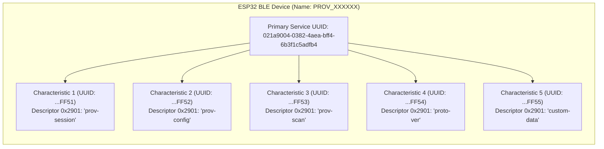
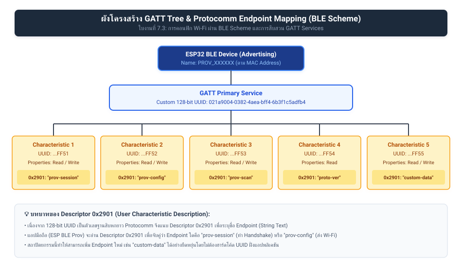
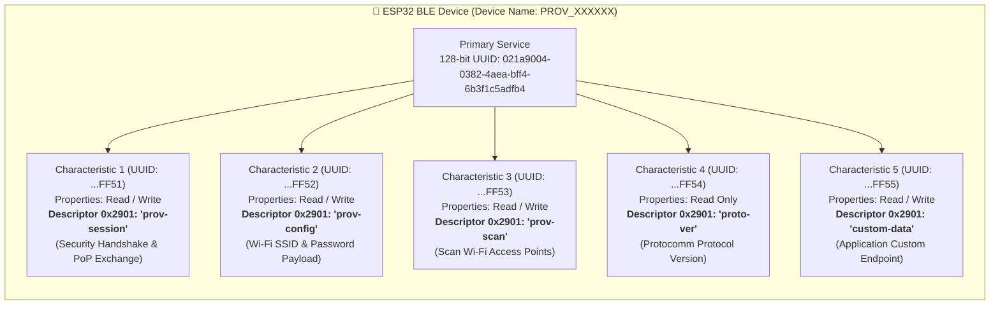
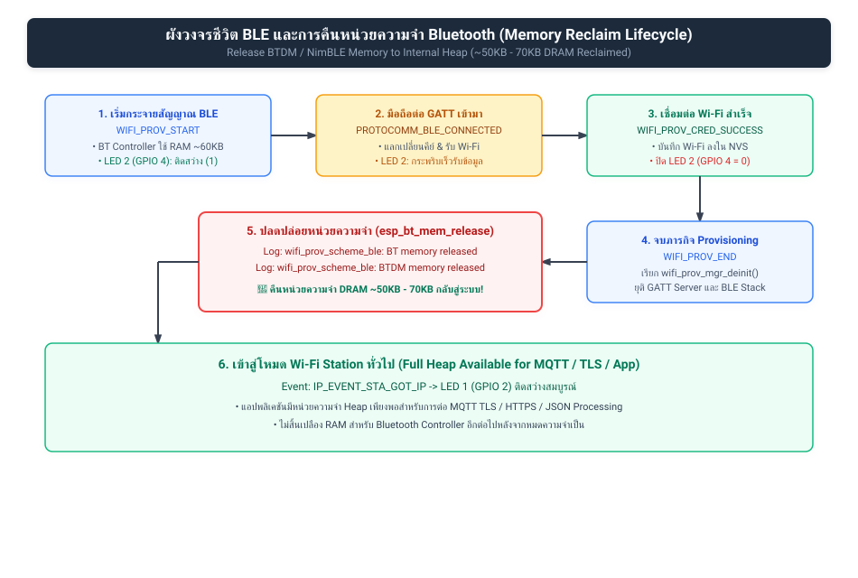
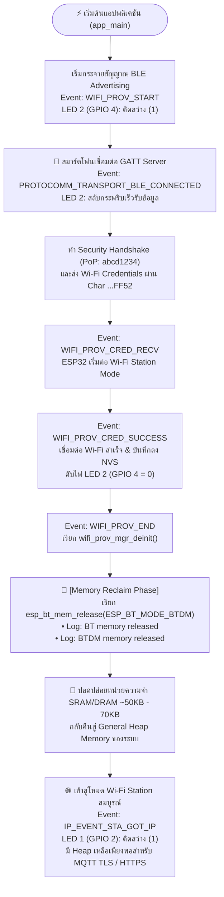

# ใบงานที่ 7.3 การคอนฟิก Wi-Fi ผ่าน BLE Scheme และการสืบสวน GATT Services (BLE Forensics)

## 0. กล่าวนำ (Introduction)
**Bluetooth Low Energy (BLE) Provisioning** เป็นรูปแบบมาตรฐานสากลที่อุปกรณ์ Smart Home ชั้นนำ (เช่น Apple HomeKit, Google Home, Matter Protocol) เลือกใช้ เนื่องจากผู้ใช้ไม่ต้องสลับการเชื่อมต่อ Wi-Fi บนสมาร์ตโฟน 

ในใบงานนี้ นักศึกษาจะได้สลับ ESP32 มาทำงานในโหมด **BLE Scheme (`wifi_prov_scheme_ble`)** พร้อมทั้งใช้เครื่องมือวิเคราะห์เชิงลึก **nRF Connect for Mobile** เพื่อส่องดูโครงสร้างภายในของ **GATT Primary Services, 128-bit UUIDs, Characteristics และ Descriptors** ก่อนจะทำการ Provisioning ผ่านแอป **ESP BLE Provisioning**

---

## 1. วัตถุประสงค์ (Objectives)
1. สามารถคอนฟิกตัวอย่าง `wifi_prov_mgr` ให้ทำงานในโหมด **BLE Transport Scheme** ได้สำเร็จ
2. สามารถใช้เครื่องมือ **nRF Connect for Mobile** ในการสแกนและตรวจสอบโครงสร้าง GATT Services/Characteristics ของ Protocomm บน ESP32
3. อ่านและวิเคราะห์ Descriptor `0x2901` (User Characteristic Description) เพื่อระบุชื่อ Protocomm Endpoints
4. ดำเนินการ Provisioning ผ่านแอปพลิเคชัน **ESP BLE Provisioning** และสังเกตการคืนหน่วยความจำ Bluetooth RAM (`BTDM memory released`)

---

## 2. อุปกรณ์และซอฟต์แวร์ที่ใช้ในการทดลอง
1. บอร์ดไมโครคอนโทรลเลอร์ ESP32 พร้อมสาย USB
2. สมาร์ตโฟนที่รองรับ BLE และติดตั้งแอปพลิเคชัน:
   - **nRF Connect for Mobile** (โดย Nordic Semiconductor)
   - **ESP BLE Provisioning** (โดย Espressif)
3. Wi-Fi Access Point ภายในห้องเรียนหรือ Hotspot

---

## 3. สถาปัตยกรรม GATT Services & Endpoints บน BLE Scheme



---

## 4. ขั้นตอนการทดลอง (Step-by-Step Procedures)

### ขั้นตอนที่ 1: การเปิดโปรเจกต์ Lab 7-3
1. เปิด Terminal ในโฟลเดอร์โปรเจกต์ `Week-07-W-iFi-Privisioning/Example_codes/Lab7-3-BLE-Provisioning`
2. โค้ดในโปรเจกต์นี้ได้รับการตั้งค่าเปิดใช้งาน **BLE Scheme (NimBLE)** และ **Security 1 (PoP: `abcd1234`)** ไว้เรียบร้อยแล้ว

---

### ขั้นตอนที่ 2: Build, Flash และตรวจสอบสถานะเริ่มต้น
1. สั่งล้าง Flash และ Flash โปรแกรมใหม่:
   ```powershell
   idf.py -p COM24 erase-flash flash monitor
   ```
2. สังเกต Log ใน Serial Monitor:
   ```text
   I (712) wifi_prov_scheme_ble: Starting BLE provisioning
   I (722) app: Starting provisioning
   I (732) app: Scan this QR code from the provisioning application for Provisioning.
   ... [QR Code ASCII & URL] ...
   ```

---

### ขั้นตอนที่ 3: ส่องโครงสร้าง GATT ผ่านแอป nRF Connect (BLE Forensic)
1. เปิดแอป **nRF Connect for Mobile** บนสมาร์ตโฟน
2. แตะปุ่ม **Scan** เพื่อค้นหาอุปกรณ์บลูทูธรอบตัว
3. ค้นหาชื่ออุปกรณ์ที่ขึ้นต้นด้วย `PROV_XXXXXX` (ตรงกับที่ระบุใน Serial Monitor)
4. สังเกตค่า RSSI และแตะปุ่ม **CONNECT** เพื่อเชื่อมต่อ
5. เมื่อเชื่อมต่อสำเร็จ สำรวจดู **GATT Services**:
   - มองหา **Unknown Service** ที่มี Base UUID `021a9004-0382-4aea-bff4-6b3f1c5adfb4`
   - ขยายดูรายการ Characteristics แต่ละตัว
   - สังเกตว่าในแต่ละ Characteristic จะมี Descriptor `Characteristic User Description` (`UUID 0x2901`) แตะดูค่า จะพบชื่อ Endpoint เช่น `"prov-session"`, `"prov-config"`, `"custom-data"`
6. บันทึกภาพหน้าจอและข้อมูล UUIDs ลงในตารางผลการทดลอง
7. กดปุ่ม **DISCONNECT** บนแอป nRF Connect เพื่อปล่อยบอร์ดให้พร้อมรับการ Provision

---

### ขั้นตอนที่ 4: ทำการ Provisioning ด้วยแอป ESP BLE Provisioning
1. เปิดแอป **ESP BLE Provisioning**
2. เลือก "Provision New Device" $\rightarrow$ เลือก "BLE"
3. แตะชื่อบอร์ด `PROV_XXXXXX` (หรือสแกน QR Code)
4. ป้อน PoP เป็น `abcd1234`
5. เลือกเครือข่าย Wi-Fi ในห้องเรียน และป้อนรหัสผ่าน Wi-Fi
6. กด **Provision** และรอจนกระทั่งเชื่อมต่อสำเร็จ

---

### ขั้นตอนที่ 5: สังเกตการปล่อยหน่วยความจำ Bluetooth (Memory Freeing)
สังเกตใน Serial Monitor หลังเชื่อมต่อ Wi-Fi สำเร็จ:
```text
I (24560) app: Provisioning successful
I (24570) wifi_prov_scheme_ble: BT memory released
I (24580) wifi_prov_scheme_ble: BTDM memory released
I (26120) app: Connected with IP Address: 192.168.1.155
```
> **ข้อสังเกต:** บอร์ดจะทำการล้างและคืนหน่วยความจำของ Bluetooth Stack ทั้งหมดคืนสู่ระบบ DRAM ทันที ทำให้ประหยัด RAM ได้มหาศาล!

---

---

## 5. กิจกรรมถอดรหัสซอร์สโค้ดและเขียนผังงาน (Code Deconstruction & BLE GATT Architecture Assignment)

ให้นักศึกษาแกะรอยการทำงานของโมดูล BLE Provisioning ใน `main/main.c` แล้วเขียน **ผังโครงสร้างและลำดับเหตุการณ์**:

### ภารกิจที่ 1: ผังโครงสร้าง GATT Tree & Endpoint Mapping
ให้นักศึกษาวาดโครงสร้างต้นไม้ (Tree Diagram / Block Diagram) แสดงความสัมพันธ์ระหว่าง:
- **Primary Service (128-bit UUID: `021a9004-...`)**
  - **Characteristic UUIDs** แต่ละตัว
  - **Descriptor 0x2901 (User Description)** ที่ผูกเข้ากับ Protocomm Endpoints (`prov-session`, `prov-config`, `prov-scan`, `proto-ver`, `custom-data`)

#### แผนภาพ GATT Tree & Endpoint Mapping (Vector SVG Diagram):


#### โค้ดแผนภาพในรูปแบบ Mermaid Diagram:


---

### ภารกิจที่ 2: ผังลำดับการคืนหน่วยความจำ Bluetooth (BLE Lifecycle & Memory Reclaim Flow)
ให้นักศึกษาวาด Flowchart / Sequence แสดงว่า:
1. การเชื่อมต่อ BLE ถูกตรวจพบผ่าน Event `PROTOCOMM_TRANSPORT_BLE_CONNECTED` (LED 2 กระพริบเร็ว 100ms)
2. เมื่อเชื่อมต่อ Wi-Fi สำเร็จ (`WIFI_PROV_CRED_SUCCESS`) $\rightarrow$ เกิด Event `WIFI_PROV_END`
3. Provisioning Manager สั่งเรียก `esp_bt_mem_release()` เพื่อปล่อย DRAM คืนสู่ระบบอย่างไร

#### แผนภาพ BLE Lifecycle & Memory Reclaim Flow (Vector SVG Diagram):


#### โค้ดแผนภาพในรูปแบบ Mermaid Diagram:


---

## 6. ตารางบันทึกผลการทดลอง (Experiment Results)

| รายการตรวจสอบ | ผลการทดลอง / ข้อมูลที่สังเกตได้ |
| :--- | :--- |
| **1. BLE Device Name ที่สแกนเจอ** | `PROV_`**`1A2B3C`** *(ขึ้นกับ MAC Address ของบอร์ด เช่น `PROV_7B8A04`)* |
| **2. Primary Service UUID (128-bit)** | **`021a9004-0382-4aea-bff4-6b3f1c5adfb4`** *(หรือ Custom 128-bit UUID ตามที่กำหนดในโค้ด)* |
| **3. Characteristic Endpoint ที่พบ (0x2901)** | **1.** `prov-session` (UUID: `...0001-ff51`)<br/>**2.** `prov-config` (UUID: `...0002-ff52`)<br/>**3.** `prov-scan` (UUID: `...0003-ff53`)<br/>**4.** `proto-ver` (UUID: `...0004-ff54`)<br/>**5.** `custom-data` (UUID: `...0005-ff55`) |
| **4. พฤติกรรมไฟ LED 2 (GPIO 4) ช่วงรอ vs ช่วงต่อ BLE** | **ช่วงรอ (Advertising):** ติดสว่าง (Logic 1) รอรับการเชื่อมต่อ<br/>**ช่วงต่อ BLE & กำลังส่งรหัส:** ติดสว่าง / กระพริบรับข้อมูล<br/>**เมื่อเสร็จสิ้น (`CRED_SUCCESS`):** ดับสนิท (Logic 0) เพื่อปิดโหมด BLE |
| **5. พฤติกรรมเมื่อต่อ Wi-Fi สำเร็จ** | **มี** ข้อความแจ้งคืนหน่วยความจำ Bluetooth ใน Serial Monitor ดังนี้:<br/>`I (xxx) wifi_prov_scheme_ble: BT memory released`<br/>`I (xxx) wifi_prov_scheme_ble: BTDM memory released` |

---

## 7. คำถามท้ายการทดลอง (Post-Lab Questions)

### 1. เหตุใด BLE Provisioning จึงไม่ส่งผลให้สัญญาณ Wi-Fi บนสมาร์ตโฟนของผู้ใช้หลุดระหว่างทำรายการ?
**คำตอบ:**
เพราะ **Bluetooth Low Energy (BLE)** และ **Wi-Fi** ทำงานบนฮาร์ดแวร์เรดิโอและโปรโตคอลสแต็กที่แยกออกจากกันอย่างสมบูรณ์บนสมาร์ตโฟน:
- ในการทำ BLE Provisioning ตัวแอปพลิเคชันบนสมาร์ตโฟนจะใช้ชิป/อินเทอร์เฟซ Bluetooth ในการสแกนหา Advertised Packets และเชื่อมต่อแบบ GATT Client กับ ESP32
- ในขณะเดียวกัน อินเทอร์เฟซ Wi-Fi และ Cellular Data ของสมาร์ตโฟนยังคงเชื่อมต่อกับเราเตอร์ที่บ้านหรือเครือข่ายมือถือได้ตามปกติ ไม่ต้องถูกสั่งตัดการเชื่อมต่อเพื่อไปเกาะสัญญาณ SSID อื่นเหมือนโหมด SoftAP
- ผู้ใช้จึงสามารถใช้งานอินเทอร์เน็ต ดูวิดีโอ หรือแชทได้อย่างต่อเนื่องโดยไม่มีสะดุด และระบบปฏิบัติการ (iOS/Android) จะไม่มีการแจ้งเตือนเรื่องเน็ตหลุดแต่อย่างใด ส่งผลให้ได้ User Experience (UX) ที่ราบรื่นสูงสุด

---

### 2. Descriptor `0x2901` มีความสำคัญอย่างไรต่อการที่แอปพลิเคชันมือถือจะทราบว่า Characteristic แต่ละตัวใช้ทำหน้าที่อะไร?
**คำตอบ:**
Descriptor **`0x2901`** คือ **Characteristic User Description** ตามข้อกำหนดมาตรฐานของ Bluetooth SIG ซึ่งมีหน้าที่เก็บข้อความอธิบาย (ASCII/UTF-8 String) เพื่อระบุความหมายของ Characteristic นั้นๆ ให้มนุษย์และแอปพลิเคชันอ่านเข้าใจได้:
- ในสถาปัตยกรรม Protocomm ของ ESP-IDF บอร์ด ESP32 จะประกาศ Characteristic หลายตัวที่มี 128-bit UUID ยาวและซับซ้อน ตัวอย่างเช่น `...FF51`, `...FF52`, `...FF53`
- แทนที่แอปพลิเคชันบนมือถือจะต้องฮาร์ดโค้ดจับคู่ UUID เหล่านี้แบบตายตัว (Fixed Mapping) ตัว ESP32 จะแนบ Descriptor `0x2901` ไว้ในแต่ละ Characteristic โดยใส่ข้อความระบุชื่อ Endpoint เช่น `"prov-session"`, `"prov-config"`, `"prov-scan"`, หรือ `"custom-data"`
- เมื่อแอปพลิเคชันมือถือเชื่อมต่อเข้ามา แอปจะทำ Service Discovery และอ่านค่า Descriptor `0x2901` เพื่อจับคู่ว่า Characteristic ใดคือช่องทางทำ Security Handshake และ Characteristic ใดคือช่องทางส่งรหัสผ่าน Wi-Fi ทำให้ระบบมีความยืดหยุ่นสูง (Extensible) และสามารถเพิ่ม Endpoint ใหม่ๆ ได้โดยไม่ต้องแก้ไขแอปพลิเคชัน

---

### 3. การที่ ESP-IDF มีฟังก์ชัน `esp_bt_mem_release()` มีประโยชน์อย่างไรต่อการทำงานของแอปพลิเคชัน IoT หลังเชื่อมต่อ Wi-Fi สำเร็จ?
**คำตอบ:**
มีประโยชน์อย่างยิ่งต่อการ**เพิ่มพื้นที่หน่วยความจำแรม (DRAM/Heap) สำหรับแอปพลิเคชันหลักของอุปกรณ์ IoT**:
1. **Bluetooth Stack สิ้นเปลืองหน่วยความจำสูง:** ตัว Bluetooth Controller และ Dual-Mode Baseband (BTDM) บน ESP32 จำเป็นต้องจองพื้นที่ SRAM/DRAM สำหรับ Baseband Buffers, Link Layer, และ ACL Data Packets เป็นปริมาณมากถึง **~50 KB ถึง 70 KB**
2. **Bluetooth หมดความจำเป็นหลัง Provisioning เสร็จ:** อุปกรณ์ IoT ส่วนใหญ่ (เช่น หลอดไฟอัจฉริยะ, ปลั๊กไฟ, เซนเซอร์) ใช้ Bluetooth เฉพาะในช่วงไม่กี่วินาทีแรกที่เปิดเครื่องเพื่อรับรหัสผ่าน Wi-Fi เท่านั้น เมื่อเชื่อมต่อ Wi-Fi สำเร็จแล้ว บลูทูธจะไม่ถูกใช้งานอีกต่อไป
3. **คืนหน่วยความจำเข้าสู่ System Heap:** การเรียกฟังก์ชัน `esp_bt_mem_release(ESP_BT_MODE_BTDM)` (ผ่าน Option `WIFI_PROV_SCHEME_BLE_EVENT_HANDLER_FREE_BTDM`) จะสั่งล้างและปลดปล่อยหน่วยความจำของคอนโทรลเลอร์บลูทูธทั้งหมดกลับคืนเป็น Internal Heap ให้ระบบนำไปใช้ ทำให้ ESP32 มี RAM ว่างเพิ่มขึ้นมหาศาลสำหรับประมวลผลงานหลัก เช่น การเชื่อมต่อ TLS/HTTPS, MQTT Client, JSON Parser, หรือ OTA Firmware Updates โดยไม่เกิดปัญหา Heap Out-of-Memory (OOM)


