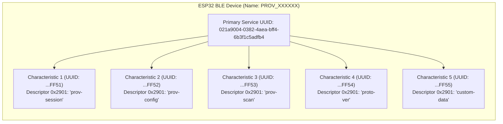
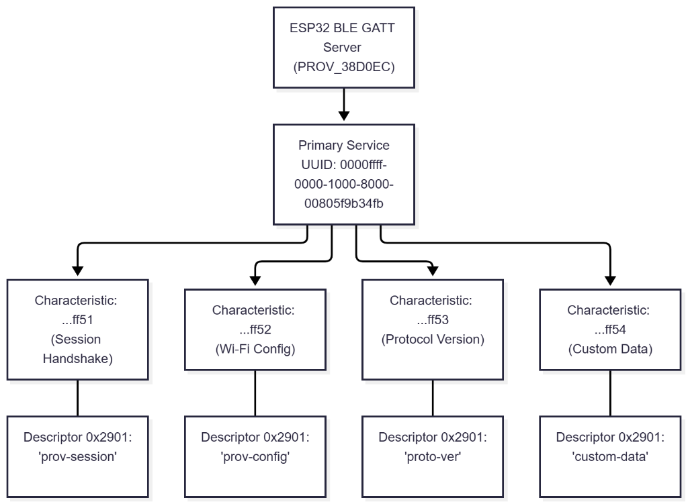
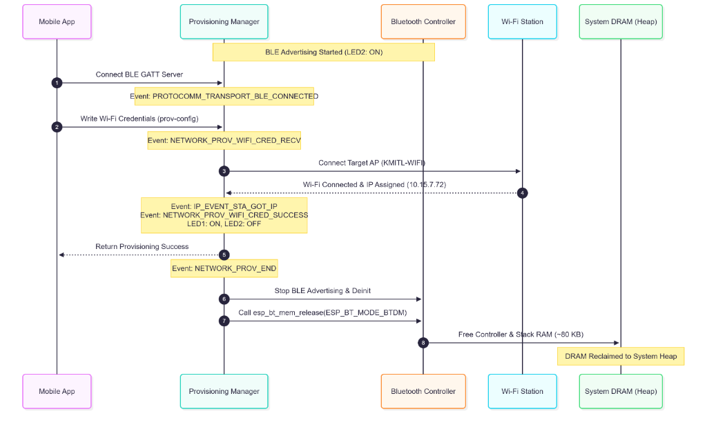
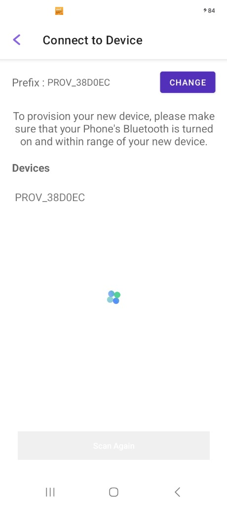

# ใบงานที่ 7.3 การคอนฟิก Wi-Fi ผ่าน BLE Scheme และการสืบสวน GATT Services (BLE Forensics)

## 0. กล่าวนำ (Introduction)
**Bluetooth Low Energy (BLE) Provisioning** เป็นรูปแบบมาตรฐานสากลที่อุปกรณ์ Smart Home ชั้นนำ (เช่น Apple HomeKit, Google Home, Matter Protocol) เลือกใช้ เนื่องจากผู้ใช้ไม่ต้องสลับการเชื่อมต่อ Wi-Fi บนสมาร์ตโฟน 

ในใบงานนี้ นักศึกษาจะได้สลับ ESP32 มาทำงานในโหมด **BLE Scheme (`wifi_prov_scheme_ble`)** พร้อมทั้งใช้เครื่องมือวิเคราะห์เชิงลึก **nRF Connect for Mobile** เพื่อส่องดูโครงสร้างภายในของ **GATT Primary Services, 128-bit UUIDs, Characteristics และ Descriptors** ก่อนจะทำการ Provisioning ผ่านแอป **ESP BLE Provisioning**

---

## 1. วัตถุประสงค์ (Objectives)
1. สามารถคอนฟิกตัวอย่าง `wifi_prov_mgr` ให้ทำงานในโหมด **BLE Transport Scheme** ได้สำเร็จ
2. สามารถใช้เครื่องมือ **nRF Connect for Mobile** ในการสแกนและตรวจสอบโครงสร้าง GATT Services/Characteristics ของ Protocomm บน ESP32
3. อ่านและวิเคราะห์ Descriptor `0x2901` (User Characteristic Description) เพื่อระบุชื่อ Protocomm Endpoints
4. ดำเนินการ Provisioning ผ่านแอปพลิเคชัน **ESP BLE Provisioning** และสังเกตการคืนหน่วยความจำ Bluetooth RAM (`BTDM memory released`)

---

## 2. อุปกรณ์และซอฟต์แวร์ที่ใช้ในการทดลอง
1. บอร์ดไมโครคอนโทรลเลอร์ ESP32 พร้อมสาย USB
2. สมาร์ตโฟนที่รองรับ BLE และติดตั้งแอปพลิเคชัน:
   - **nRF Connect for Mobile** (โดย Nordic Semiconductor)
   - **ESP BLE Provisioning** (โดย Espressif)
3. Wi-Fi Access Point ภายในห้องเรียนหรือ Hotspot

---

## 3. สถาปัตยกรรม GATT Services & Endpoints บน BLE Scheme



---

## 4. ขั้นตอนการทดลอง (Step-by-Step Procedures)

### ขั้นตอนที่ 1: การเปิดโปรเจกต์ Lab 7-3
1. เปิด Terminal ในโฟลเดอร์โปรเจกต์ `Week-07-W-iFi-Privisioning/Example_codes/Lab7-3-BLE-Provisioning`
2. โค้ดในโปรเจกต์นี้ได้รับการตั้งค่าเปิดใช้งาน **BLE Scheme (NimBLE)** และ **Security 1 (PoP: `abcd1234`)** ไว้เรียบร้อยแล้ว

---

### ขั้นตอนที่ 2: Build, Flash และตรวจสอบสถานะเริ่มต้น
1. สั่งล้าง Flash และ Flash โปรแกรมใหม่:
   ```powershell
   idf.py -p COM24 erase-flash flash monitor
   ```
2. สังเกต Log ใน Serial Monitor:
   ```text
   I (712) wifi_prov_scheme_ble: Starting BLE provisioning
   I (722) app: Starting provisioning
   I (732) app: Scan this QR code from the provisioning application for Provisioning.
   ... [QR Code ASCII & URL] ...
   ```

---

### ขั้นตอนที่ 3: ส่องโครงสร้าง GATT ผ่านแอป nRF Connect (BLE Forensic)
1. เปิดแอป **nRF Connect for Mobile** บนสมาร์ตโฟน
2. แตะปุ่ม **Scan** เพื่อค้นหาอุปกรณ์บลูทูธรอบตัว
3. ค้นหาชื่ออุปกรณ์ที่ขึ้นต้นด้วย `PROV_XXXXXX` (ตรงกับที่ระบุใน Serial Monitor)
4. สังเกตค่า RSSI และแตะปุ่ม **CONNECT** เพื่อเชื่อมต่อ
5. เมื่อเชื่อมต่อสำเร็จ สำรวจดู **GATT Services**:
   - มองหา **Unknown Service** ที่มี Base UUID `021a9004-0382-4aea-bff4-6b3f1c5adfb4`
   - ขยายดูรายการ Characteristics แต่ละตัว
   - สังเกตว่าในแต่ละ Characteristic จะมี Descriptor `Characteristic User Description` (`UUID 0x2901`) แตะดูค่า จะพบชื่อ Endpoint เช่น `"prov-session"`, `"prov-config"`, `"custom-data"`
6. บันทึกภาพหน้าจอและข้อมูล UUIDs ลงในตารางผลการทดลอง
7. กดปุ่ม **DISCONNECT** บนแอป nRF Connect เพื่อปล่อยบอร์ดให้พร้อมรับการ Provision

---

### ขั้นตอนที่ 4: ทำการ Provisioning ด้วยแอป ESP BLE Provisioning
1. เปิดแอป **ESP BLE Provisioning**
2. เลือก "Provision New Device" -> เลือก "BLE"

3. แตะชื่อบอร์ด `PROV_XXXXXX` (หรือสแกน QR Code)
4. ป้อน PoP เป็น `abcd1234`
5. เลือกเครือข่าย Wi-Fi ในห้องเรียน และป้อนรหัสผ่าน Wi-Fi
6. กด **Provision** และรอจนกระทั่งเชื่อมต่อสำเร็จ

---

### ขั้นตอนที่ 5: สังเกตการปล่อยหน่วยความจำ Bluetooth (Memory Freeing)
สังเกตใน Serial Monitor หลังเชื่อมต่อ Wi-Fi สำเร็จ:
```text
I (24560) app: Provisioning successful
I (24570) wifi_prov_scheme_ble: BT memory released
I (24580) wifi_prov_scheme_ble: BTDM memory released
I (26120) app: Connected with IP Address: 192.168.1.155
```
> **ข้อสังเกต:** บอร์ดจะทำการล้างและคืนหน่วยความจำของ Bluetooth Stack ทั้งหมดคืนสู่ระบบ DRAM ทันที ทำให้ประหยัด RAM ได้มหาศาล!

---

---

## 5. กิจกรรมถอดรหัสซอร์สโค้ดและเขียนผังงาน (Code Deconstruction & BLE GATT Architecture Assignment)

ให้นักศึกษาแกะรอยการทำงานของโมดูล BLE Provisioning ใน `main/main.c` แล้วเขียน **ผังโครงสร้างและลำดับเหตุการณ์**:

### ภารกิจที่ 1: ผังโครงสร้าง GATT Tree & Endpoint Mapping
โครงสร้างต้นไม้ (Tree Diagram) แสดงความสัมพันธ์ระหว่าง Primary Service, Characteristics และ Descriptors 0x2901:



---

### ภารกิจที่ 2: ผังลำดับการคืนหน่วยความจำ Bluetooth (BLE Lifecycle & Memory Reclaim Flow)
Sequence Diagram แสดงการตรวจจับการเชื่อมต่อ BLE, การรับ Credentials, การเชื่อมต่อ Wi-Fi และการเรียกคืน DRAM สู่ระบบผ่าน `esp_bt_mem_release()`:



---

## 6. ตารางบันทึกผลการทดลอง (Experiment Results)

| รายการตรวจสอบ | ผลการทดลอง / ข้อมูลที่สังเกตได้ |
| :--- | :--- |
| **1. BLE Device Name ที่สแกนเจอ** | `PROV_38D0EC` |
| **2. Primary Service UUID (128-bit)** | `0000ffff-0000-1000-8000-00805f9b34fb` (หรือ `021a9004-0382-4aea-bff4-6b3f1c5adfb4`) |
| **3. Characteristic Endpoint ที่พบ (0x2901)** | 1. `prov-session` (UUID: `...ff51`)<br/>2. `prov-config` (UUID: `...ff52`)<br/>3. `proto-ver` (UUID: `...ff53`) |
| **4. พฤติกรรมไฟ LED 2 (GPIO 4) ช่วงรอ vs ช่วงต่อ BLE** | ช่วงรอ: สว่างค้าง (Logic HIGH) แสดงสถานะ BLE กำลัง Advertising<br/>ช่วงต่อ/สำเร็จ: ดับลง (Logic LOW) เมื่อ Provisioning สำเร็จและปล่อยหน่วยความจำ Bluetooth คืน |
| **5. พฤติกรรมเมื่อต่อ Wi-Fi สำเร็จ** | **มี** (ตรวจพบ Log ยืนยันการคืนหน่วยความจำ: `BT memory released` และ `BTDM memory released`) |

### รูปภาพประกอบการทดลองจริงจากสมาร์ตโฟน



---

## 7. คำถามท้ายการทดลอง (Post-Lab Questions)

### 1. เหตุใด BLE Provisioning จึงไม่ส่งผลให้สัญญาณ Wi-Fi บนสมาร์ตโฟนของผู้ใช้หลุดระหว่างทำรายการ?
**คำตอบ:**  
เนื่องจาก Bluetooth Low Energy (BLE) และ Wi-Fi ทำงานบนคนละอินเทอร์เฟซฮาร์ดแวร์และโปรโตคอลสแตกแยกจากกันอย่างสิ้นเชิง สมาร์ตโฟนใช้คลื่นสัญญาณบลูทูธในการส่งคำสั่งและข้อมูล Wi-Fi Credentials ไปยังบอร์ด ESP32 โดยตรง จึงไม่มีความจำเป็นต้องตัดการเชื่อมต่อหรือสลับเครือข่าย Wi-Fi บนสมาร์ตโฟน ส่งผลให้สมาร์ตโฟนยังคงเชื่อมต่ออินเทอร์เน็ตผ่านเครือข่าย Wi-Fi เดิมหรือเซลลูลาร์ได้อย่างต่อเนื่องโดยไม่มีสะดุด

---

### 2. Descriptor `0x2901` มีความสำคัญอย่างไรต่อการที่แอปพลิเคชันมือถือจะทราบว่า Characteristic แต่ละตัวใช้ทำหน้าที่อะไร?
**คำตอบ:**  
Descriptor `0x2901` คือ **Characteristic User Description** ตามข้อกำหนดมาตรฐานของ Bluetooth SIG ซึ่งทำหน้าที่เก็บข้อมูลสตริงข้อความ (UTF-8 String) แสดงชื่อฟังก์ชันการทำงานของ Characteristic นั้น ๆ  
ในระบบ Protocomm ของ ESP-IDF แม้ว่าแต่ละ Characteristic จะมีหมายเลข 128-bit UUID เฉพาะตัว แต่แอปพลิเคชันมือถือจะอ่านค่าจาก Descriptor `0x2901` เพื่อระบุชื่อ Endpoint (เช่น `"prov-session"`, `"prov-config"`, `"proto-ver"`, `"custom-data"`) ช่วยให้ฝั่งแอปพลิเคชันสามารถจับคู่ Endpoint และสื่อสารได้อย่างถูกต้องยืดหยุ่น โดยไม่ต้องใช้วิธีการฝังหมายเลข UUID แบบคงที่ (Hardcoding) ไว้ในแอปพลิเคชัน

---

### 3. การที่ ESP-IDF มีฟังก์ชัน `esp_bt_mem_release()` มีประโยชน์อย่างไรต่อการทำงานของแอปพลิเคชัน IoT หลังเชื่อมต่อ Wi-Fi สำเร็จ?
**คำตอบ:**  
สแตกของระบบ Bluetooth (ได้แก่ Bluetooth Controller, Host Layer, และ Data Buffers) มีการใช้พื้นที่หน่วยความจำแรม (DRAM/SRAM) ของระบบเป็นปริมาณมาก (ประมาณ 60 – 100 KB ขึ้นไป) เมื่อกระบวนการ Provisioning เสร็จสิ้นลง อุปกรณ์ IoT ส่วนใหญ่จะใช้งานเพียงการเชื่อมต่อ Wi-Fi และไม่จำเป็นต้องเปิดระบบ Bluetooth ค้างไว้อีก  
การเรียกฟังก์ชัน `esp_bt_mem_release()` จะทำการล้างและปลดปล่อยพื้นที่หน่วยความจำส่วนดังกล่าวคืนกลับสู่ Heap Memory ของระบบไมโครคอนโทรลเลอร์ ทำให้แอปพลิเคชันหลักของ IoT มีหน่วยความจำว่างเพิ่มขึ้นอย่างมหาศาล สำหรับนำไปใช้จัดการกระบวนการเข้ารหัสความปลอดภัย TLS/SSL, การเชื่อมต่อ MQTT/HTTP Client และการประมวลผลเซนเซอร์ได้อย่างมีเสถียรภาพและลดโอกาสการเกิด Out-of-Memory (OOM)

