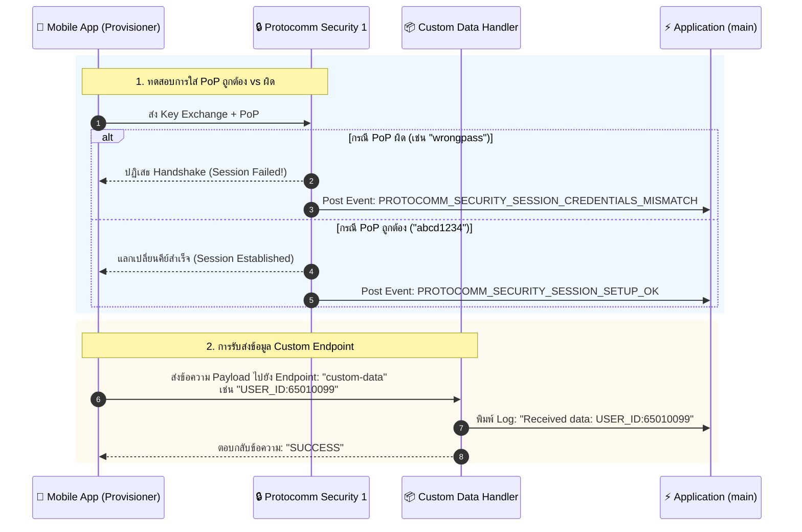
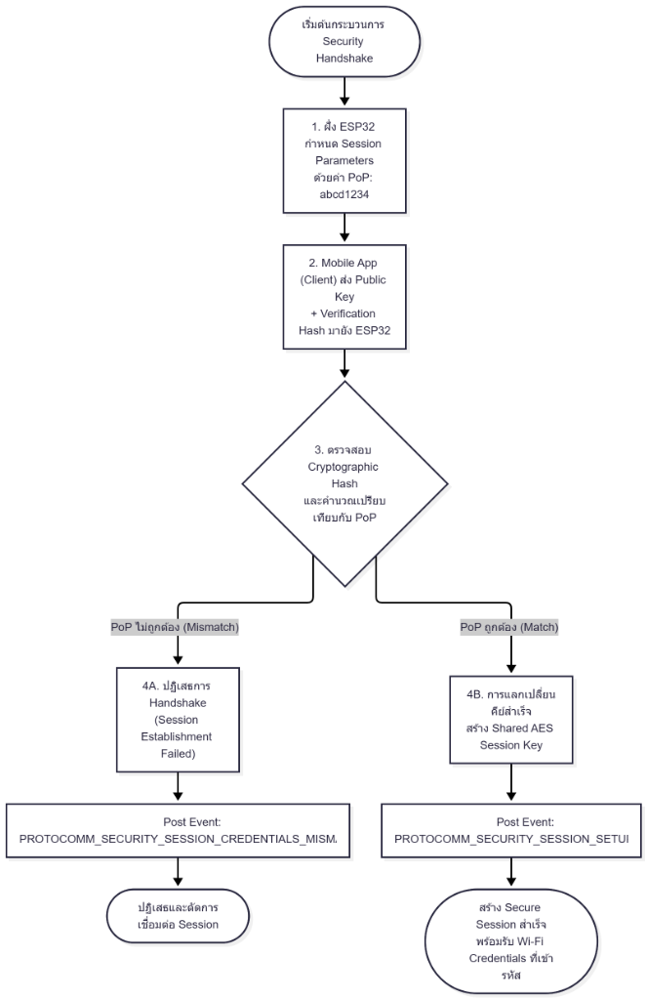
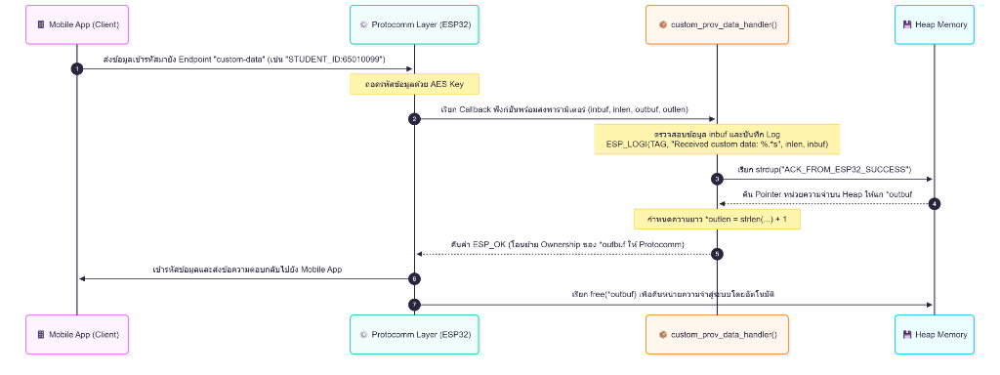
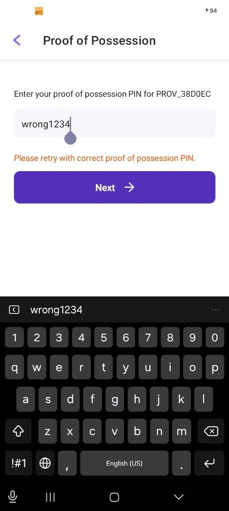

# ใบงานที่ 7.4: การทดสอบ Security Schemes (PoP) และการรับส่ง Custom Data Endpoints

## 0. กล่าวนำ (Introduction)
ในใบงานนี้ นักศึกษาจะได้ทดสอบเจาะลึกด้านความปลอดภัยของกระบวนการ Provisioning โดยทำการทดลองจำลองสถานการณ์ที่มีผู้ไม่หวังดีพยายามเชื่อมต่อด้วย **รหัส Proof-of-Possession (PoP) ที่ไม่ถูกต้อง** เพื่อสังเกตกลไกการปฏิเสธการเชื่อมต่อของ Protocomm Security Layer

นอกจากนี้ นักศึกษาจะได้เรียนรู้การเพิ่ม **Custom Data Endpoint (`custom-data`)** เพื่อรับส่งข้อมูลเฉพาะของแอปพลิเคชัน (เช่น Device ID, Owner Email, MQTT Broker URL หรือ Activation Code) ระหว่างมือถือและ ESP32 ในระหว่างขั้นตอน Provisioning

---

## 1. วัตถุประสงค์ (Objectives)
1. เข้าใจบทบาทและการทำงานของ **Proof-of-Possession (PoP)** ในการป้องกันการโจมตีแบบสวมรอย (Rogue Provisioning)
2. ทดลองจำลองกรณีป้อน PoP ผิด และสังเกต Event `PROTOCOMM_SECURITY_SESSION_CREDENTIALS_MISMATCH`
3. เข้าใจการลงทะเบียน Custom Endpoint ด้วย `wifi_prov_mgr_endpoint_create()` และ `wifi_prov_mgr_endpoint_register()`
4. สังเกตและวิเคราะห์การรับส่งข้อมูลผ่าน Custom Handler (`custom_prov_data_handler`)

---

## 2. อุปกรณ์และซอฟต์แวร์ที่ใช้ในการทดลอง
1. บอร์ดไมโครคอนโทรลเลอร์ ESP32 พร้อมสาย USB
2. สมาร์ตโฟนที่ติดตั้งแอปพลิเคชัน **ESP BLE Provisioning** หรือ **ESP SoftAP Provisioning**
3. Serial Monitor Tool

---

## 3. สถาปัตยกรรม Custom Endpoint & PoP Security Handshake



---

## 4. โค้ดส่วน Custom Data Handler ในตัวอย่าง `main.c`

พิจารณาการทำงานของฟังก์ชันจัดการข้อมูล Custom Endpoint:

```c
/* Handler สำหรับ Custom Endpoint ที่แอปพลิเคชันลงทะเบียนไว้ */
esp_err_t custom_prov_data_handler(uint32_t session_id, const uint8_t *inbuf, ssize_t inlen,
                                   uint8_t **outbuf, ssize_t *outlen, void *priv_data)
{
    if (inbuf) {
        ESP_LOGI(TAG, "Received custom data: %.*s", (int)inlen, (char *)inbuf);
    }
    
    // จัดเตรียมข้อความตอบกลับไปยังสมาร์ตโฟน
    char response[] = "ACK_FROM_ESP32";
    *outbuf = (uint8_t *)strdup(response);
    if (*outbuf == NULL) {
        ESP_LOGE(TAG, "System out of memory");
        return ESP_ERR_NO_MEM;
    }
    *outlen = strlen(response) + 1;

    return ESP_OK;
}
```

และขั้นตอนการลงทะเบียนใน `app_main()`:
```c
// 1. สร้าง Endpoint ก่อนเริ่ม Provisioning Service
wifi_prov_mgr_endpoint_create("custom-data");

// 2. เริ่มต้น Service
ESP_ERROR_CHECK(wifi_prov_mgr_start_provisioning(security, (const void *) sec_params, service_name, service_key));

// 3. ผูกฟังก์ชัน Callback เข้ากับ Endpoint หลังเริ่ม Service แล้ว
wifi_prov_mgr_endpoint_register("custom-data", custom_prov_data_handler, NULL);
```

---

## 5. ขั้นตอนการทดลอง (Step-by-Step Procedures)

### ตอนที่ 1: การเปิดโปรเจกต์และทดสอบ Security Handshake ด้วย PoP
1. เปิด Terminal ในโฟลเดอร์โปรเจกต์ `Week-07-W-iFi-Privisioning/Example_codes/Lab7-4-Custom-Data-and-Security`
2. สั่งล้าง Flash และรันโปรแกรม:
   ```powershell
   idf.py -p COM24 erase-flash flash monitor
   ```
3. เปิดแอป **ESP BLE Provisioning** สแกนหาบอร์ด ESP32
3. **การทดสอบที่ 1 (ป้อน PoP ผิด):**
   - เมื่อแอปถามรหัส PoP ให้พิมพ์รหัสผ่านมั่ว เช่น `wrong1234`
   - สังเกตปฏิกิริยาบนแอปมือถือและใน Serial Monitor:
     ```text
     E (15600) app: Received incorrect username and/or PoP for establishing secure session!
     ```
4. **การทดสอบที่ 2 (ป้อน PoP ถูกต้อง):**
   - สั่งรีเซ็ตบอร์ดใหม่ และเปิดแอปป้อน PoP เป็น `abcd1234` (ตรงกับค่าในโค้ด)
   - สังเกต Log:
     ```text
     I (18200) app: Secured session established!
     ```

---

### ตอนที่ 2: การรับส่งข้อมูลผ่าน Custom Endpoint
1. ในหน้าแอป **ESP BLE Provisioning** หลังผ่านขั้นตอนความปลอดภัยแล้ว ให้เข้าไปที่เมนู **Custom Data** หรือส่งข้อมูลผ่านแอปที่รองรับการเขียน Custom Endpoint
2. ป้อนข้อความ เช่น `STUDENT_ID:65010099` และกดส่ง
3. สังเกต Serial Monitor จะปรากฏข้อความที่ได้รับจากสมาร์ตโฟน:
   ```text
   I (22150) app: Received custom data: STUDENT_ID:65010099
   ```

---

---

## 6. กิจกรรมถอดรหัสซอร์สโค้ดและเขียนผังงาน (Code Deconstruction & Security Flow Assignment)

ให้นักศึกษาแกะรอยการทำงานด้านความปลอดภัยและ Custom Handler ใน `main/main.c` แล้วเขียน **ผังการไหลของข้อมูล (Data Flow & Cryptographic Handshake Flow)**:

### ภารกิจที่ 1: ผังขั้นตอนการตรวจสอบ PoP (Security Handshake Decision Flow)
Flowchart แสดงลำดับขั้นตอนการแลกเปลี่ยนคีย์และตรวจสอบสิทธิ์ Proof-of-Possession (PoP):



---

### ภารกิจที่ 2: ผังการรับส่งข้อมูลผ่าน Custom Endpoint (Custom Data Handler Flow)
Sequence Diagram แสดงการรับส่งข้อมูลผ่านฟังก์ชัน `custom_prov_data_handler()`:



#### การวิเคราะห์การจัดสรรหน่วยความจำสำหรับ `*outbuf`
**คำถาม:** ทำไมตัวแปร `*outbuf` จึงต้องจัดสรรใน Heap Memory (ทำไมจึงใช้ตัวแปร Local Static Array ธรรมดาไม่ได้)?

**คำอธิบายเชิงลึก:**
1. **ข้อจำกัดของตัวแปร Local Stack Array (`char response[] = "..."`)**:  
   ตัวแปรโลคอลธรรมดาจะถูกจองอยู่บน Stack Memory ของฟังก์ชัน `custom_prov_data_handler()` ซึ่งจะถูกทำลายและคืนพื้นที่สแตกลงทันทีที่ฟังก์ชันทำงานเสร็จสิ้นและ Return หากเราส่ง Pointer ของสแตกออกไปภายนอก จะเกิดสภาวะ **Dangling Pointer** ข้อมูลจะถูกเขียนทับโดย Stack Frame ของฟังก์ชันถัดไปทันที ส่งผลให้ข้อมูลที่ส่งไปยังมือถือเสียหาย (Memory Corruption) หรือระบบเกิดความขัดข้องจนแครช
2. **ข้อจำกัดของตัวแปร Local Static Array (`static char response[] = "..."`)**:  
   แม้ว่าตัวแปรแบบ `static` จะไม่ถูกทำลายหลังจบฟังก์ชัน แต่ตัวแปร static จะมีขนาดตายตัว ไม่ยืดหยุ่นต่อข้อมูลตอบกลับที่ขนาดเปลี่ยนแปลงได้ และที่สำคัญที่สุดคือ สถาปัตยกรรมของ Protocomm Layer ถูกออกแบบตามหลัก **Dynamic Memory Ownership Transfer** ซึ่ง Protocomm จะสั่งเรียกฟังก์ชัน `free(*outbuf)` โดยอัตโนมัติหลังจากส่งแพ็กเก็ตเสร็จ หากส่งแอดเดรสของตัวแปร `static` เข้าไป จะทำให้ฟังก์ชัน `free()` ทำงานผิดพลาดและเกิด **Heap Corruption Crash** ทันที เนื่องจากหน่วยความจำ static ไม่ได้ถูกจองมาจาก Heap
3. **ข้อสรุป**:  
   การจองพื้นที่บน **Heap Memory** ด้วยฟังก์ชัน `strdup()` หรือ `malloc()` เป็นแนวทางที่ถูกต้องและจำเป็น เพื่อให้หน่วยความจำคงอยู่อย่างปลอดภัยตลอดช่วงเวลาที่ Protocomm นำข้อมูลไปเข้าคิวและส่งสัญญาณออกอากาศแบบอะซิงโครนัส (Asynchronous Transmission) และส่งมอบกรรมสิทธิ์ (Ownership) ให้ Protocomm สามารถเรียก `free()` คืนแรมสู่ระบบได้อย่างสมบูรณ์หลังการส่งสำเร็จ

---

## 7. ตารางบันทึกผลการทดลอง (Experiment Results)

| สถานการณ์ทดสอบ | ค่า PoP ที่ป้อน | ผลลัพธ์บนแอปมือถือ | ข้อความ Log ใน Serial Monitor |
| :--- | :--- | :--- | :--- |
| **1. ป้อน PoP ผิดพลาด** | `wrong1234` | แสดงข้อความแจ้งเตือน "Please retry with correct proof of possession PIN." บนหน้าจอ | `[SECURITY ALERT]: INVALID PoP / Unauthorized Access!` |
| **2. ป้อน PoP ถูกต้อง** | `abcd1234` | แลกเปลี่ยนคีย์สำเร็จ และผ่านเข้าสู่หน้าเลือกเครือข่าย Wi-Fi | `[SECURITY SUCCESS]: Valid PoP! Secured Session OK!` |
| **3. ส่ง Custom Data** | `STUDENT_ID:65010099` (หรือ `TEST_DATA_999`) | แอปพลิเคชันได้รับข้อความตอบกลับ `ACK_FROM_ESP32_SUCCESS` | `[CUSTOM DATA RECEIVED]: STUDENT_ID:65010099` |

### รูปภาพผลการทดลองจริงจากสมาร์ตโฟน (ป้อน PoP ผิดพลาด)



---

## 8. คำถามท้ายการทดลอง (Post-Lab Questions)

### 1. การใช้ Proof-of-Possession (PoP) ช่วยป้องกันการโจมตีประเภทใดได้บ้าง?
**คำตอบ:**  
การใช้ Proof-of-Possession (PoP) ช่วยป้องกันการโจมตีประเภท **Man-in-the-Middle (MitM) Attack** และการโจมตีแบบ **Rogue Provisioning / Device Hijacking** โดยผู้โจมตีที่อยู่ในรัศมีการกระจายสัญญาณวิทยุ (เช่น สัญญาณ Wi-Fi หรือ Bluetooth) จะไม่สามารถสวมรอยหรือส่งข้อมูลเพื่อยึดครองอุปกรณ์ได้ หากไม่มีรหัสผ่านยืนยันสิทธิ์ครอบครองทางกายภาพ (Physical Possession) ซึ่งมักติดอยู่บนตัวผลิตภัณฑ์ ฉลากสินค้า หรือแสดงผ่านหน้าจอของอุปกรณ์จริงเท่านั้น

---

### 2. หากไม่มีการใช้ PoP (เช่น ใน Security 0) ผู้โจมตีที่อยู่ในรัศมีสัญญาณบลูทูธสามารถทำสิ่งใดกับอุปกรณ์ได้บ้าง?
**คำตอบ:**  
ในโหมด **Security 0** การสื่อสารจะเป็นแบบเปิดเผย ไม่มีการเข้ารหัสความปลอดภัยและไม่มีการยืนยันตัวตน ผู้โจมตีที่อยู่ในรัศมีสัญญาณสามารถกระทำการดังต่อไปนี้ได้:
1. **การดักรับข้อมูล (Eavesdropping / Packet Sniffing):** สามารถดักจับแพ็กเก็ตข้อมูลและอ่านชื่อเครือข่าย Wi-Fi (SSID) รวมถึงรหัสผ่าน (Password) ที่ส่งผ่านอากาศในรูปแบบข้อความธรรมดา (Plaintext) ได้โดยตรง
2. **การยึดครองอุปกรณ์ (Unauthorized Device Provisioning):** สามารถส่งคำสั่ง Provisioning เข้าไปยังบอร์ด ESP32 เพื่อบังคับให้อุปกรณ์เชื่อมต่อไปยัง Access Point ปลอม (Rogue AP) ของผู้ไม่หวังดี ทำให้สามารถดักจับการสื่อสารทั้งหมดของอุปกรณ์ในอนาคตได้

---

### 3. ในการประยุกต์ใช้งานเชิงพาณิชย์จริง เราสามารถนำ Custom Data Endpoint ไปใช้ส่งข้อมูลประเภทใดได้อีกบ้าง (ยกตัวอย่าง 2 กรณี)?
**คำตอบ:**  
1. **การผูกบัญชีผู้ใช้และการเปิดใช้งานอุปกรณ์ (Device Activation & User Binding):** การส่ง User Account Token, Registration Key หรือ Customer UUID จากแอปพลิเคชันมือถือไปให้อุปกรณ์ เพื่อทำการผูกอุปกรณ์เข้ากับบัญชีผู้ใช้ในระบบ Cloud IoT (เช่น AWS IoT Core, Google Cloud IoT หรือ Tuya Platform) ทันทีหลังเชื่อมต่อโครงข่ายสำเร็จ
2. **การกำหนดค่าพารามิเตอร์ของระบบ (System Configuration & MQTT Broker Settings):** การส่งค่า URL และ Port ของ Local MQTT Broker, รหัส Organization/Tenant ID, หรือค่าพารามิเตอร์เฉพาะ เช่น โซนเวลา (Timezone) และชื่อตำแหน่งติดตั้งของเซนเซอร์

---

### 4. ในฟังก์ชัน `custom_prov_data_handler()` เหตุใดหน่วยความจำที่จัดสรรให้ `*outbuf` จึงถูก Free โดย Protocomm Layer อัตโนมัติหลังจากส่งข้อมูลเสร็จ?
**คำตอบ:**  
การออกแบบสถาปัตยกรรมของ Protocomm Layer ใช้หลักการ **Ownership Transfer (การโอนย้ายกรรมสิทธิ์การครอบครองหน่วยความจำ)** เพื่อให้การทำงานมีประสิทธิภาพและป้องกันปัญหาหน่วยความจำรั่วไหล (Memory Leak):
- ฟังก์ชัน Callback (`custom_prov_data_handler`) มีหน้าที่เพียงจัดเตรียมข้อมูลคำตอบและคืนค่า Pointer ของหน่วยความจำ Heap ที่จองด้วย `strdup()` หรือ `malloc()` ให้แก่ Protocomm Layer
- เนื่องจากกระบวนการส่งข้อมูลไปยังฮาร์ดแวร์ปลายทาง (BLE GATT Server หรือ HTTP Server) เป็นการทำงานแบบอะซิงโครนัส (Asynchronous) ตัวฟังก์ชัน Handler จึงไม่สามารถสั่ง `free()` ทันทีภายในฟังก์ชันได้ (เพราะหากสั่ง `free()` ข้อมูลจะถูกทำลายก่อนที่แพ็กเก็ตจะถูกส่งข้ามเครือข่าย)
- ดังนั้น Protocomm Layer จึงรับหน้าที่เป็นผู้ครอบครองบล็อกหน่วยความจำนั้น นำข้อมูลไปเข้ารหัสและส่งออกไปยัง Transport Stack จนกระทั่งส่งแพ็กเก็ตสำเร็จสมบูรณ์ จึงทำการเรียกคำสั่ง `free(*outbuf)` โดยอัตโนมัติ เพื่อคืนพื้นที่แรมสู่ Heap Memory ของระบบอย่างปลอดภัย

