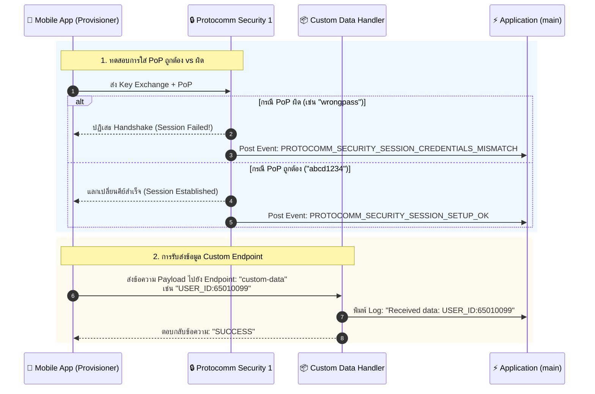
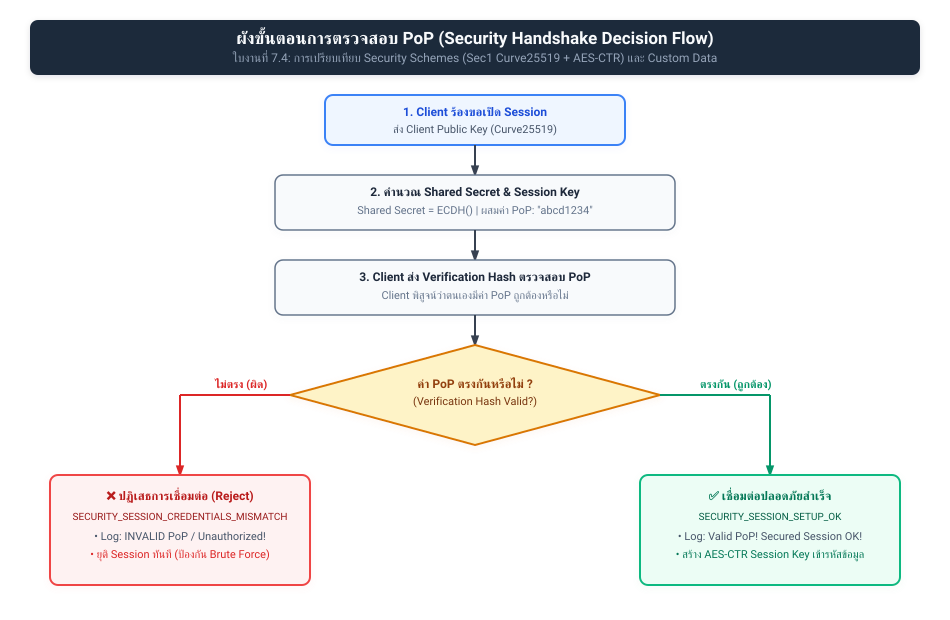
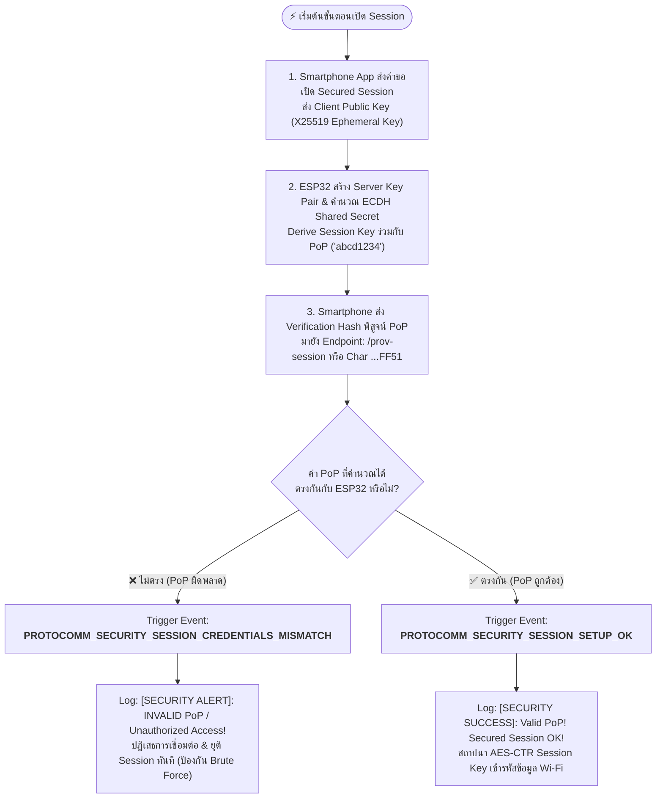
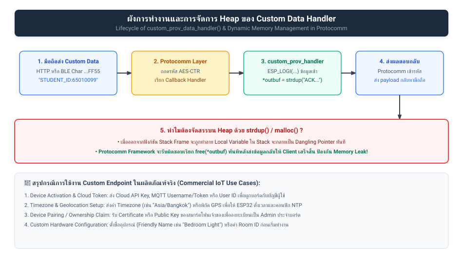
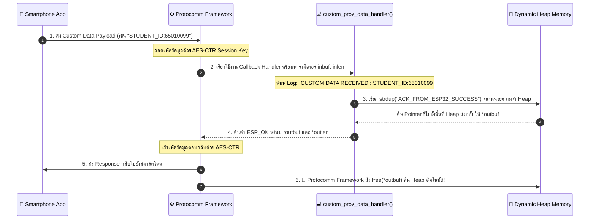

# ใบงานที่ 7.4: การทดสอบ Security Schemes (PoP) และการรับส่ง Custom Data Endpoints

## 0. กล่าวนำ (Introduction)
ในใบงานนี้ นักศึกษาจะได้ทดสอบเจาะลึกด้านความปลอดภัยของกระบวนการ Provisioning โดยทำการทดลองจำลองสถานการณ์ที่มีผู้ไม่หวังดีพยายามเชื่อมต่อด้วย **รหัส Proof-of-Possession (PoP) ที่ไม่ถูกต้อง** เพื่อสังเกตกลไกการปฏิเสธการเชื่อมต่อของ Protocomm Security Layer

นอกจากนี้ นักศึกษาจะได้เรียนรู้การเพิ่ม **Custom Data Endpoint (`custom-data`)** เพื่อรับส่งข้อมูลเฉพาะของแอปพลิเคชัน (เช่น Device ID, Owner Email, MQTT Broker URL หรือ Activation Code) ระหว่างมือถือและ ESP32 ในระหว่างขั้นตอน Provisioning

---

## 1. วัตถุประสงค์ (Objectives)
1. เข้าใจบทบาทและการทำงานของ **Proof-of-Possession (PoP)** ในการป้องกันการโจมตีแบบสวมรอย (Rogue Provisioning)
2. ทดลองจำลองกรณีป้อน PoP ผิด และสังเกต Event `PROTOCOMM_SECURITY_SESSION_CREDENTIALS_MISMATCH`
3. เข้าใจการลงทะเบียน Custom Endpoint ด้วย `wifi_prov_mgr_endpoint_create()` และ `wifi_prov_mgr_endpoint_register()`
4. สังเกตและวิเคราะห์การรับส่งข้อมูลผ่าน Custom Handler (`custom_prov_data_handler`)

---

## 2. อุปกรณ์และซอฟต์แวร์ที่ใช้ในการทดลอง
1. บอร์ดไมโครคอนโทรลเลอร์ ESP32 พร้อมสาย USB
2. สมาร์ตโฟนที่ติดตั้งแอปพลิเคชัน **ESP BLE Provisioning** หรือ **ESP SoftAP Provisioning**
3. Serial Monitor Tool

---

## 3. สถาปัตยกรรม Custom Endpoint & PoP Security Handshake



---

## 4. โค้ดส่วน Custom Data Handler ในตัวอย่าง `main.c`

พิจารณาการทำงานของฟังก์ชันจัดการข้อมูล Custom Endpoint:

```c
/* Handler สำหรับ Custom Endpoint ที่แอปพลิเคชันลงทะเบียนไว้ */
esp_err_t custom_prov_data_handler(uint32_t session_id, const uint8_t *inbuf, ssize_t inlen,
                                   uint8_t **outbuf, ssize_t *outlen, void *priv_data)
{
    if (inbuf) {
        ESP_LOGI(TAG, "Received custom data: %.*s", (int)inlen, (char *)inbuf);
    }
    
    // จัดเตรียมข้อความตอบกลับไปยังสมาร์ตโฟน
    char response[] = "ACK_FROM_ESP32";
    *outbuf = (uint8_t *)strdup(response);
    if (*outbuf == NULL) {
        ESP_LOGE(TAG, "System out of memory");
        return ESP_ERR_NO_MEM;
    }
    *outlen = strlen(response) + 1;

    return ESP_OK;
}
```

และขั้นตอนการลงทะเบียนใน `app_main()`:
```c
// 1. สร้าง Endpoint ก่อนเริ่ม Provisioning Service
wifi_prov_mgr_endpoint_create("custom-data");

// 2. เริ่มต้น Service
ESP_ERROR_CHECK(wifi_prov_mgr_start_provisioning(security, (const void *) sec_params, service_name, service_key));

// 3. ผูกฟังก์ชัน Callback เข้ากับ Endpoint หลังเริ่ม Service แล้ว
wifi_prov_mgr_endpoint_register("custom-data", custom_prov_data_handler, NULL);
```

---

## 5. ขั้นตอนการทดลอง (Step-by-Step Procedures)

### ตอนที่ 1: การเปิดโปรเจกต์และทดสอบ Security Handshake ด้วย PoP
1. เปิด Terminal ในโฟลเดอร์โปรเจกต์ `Week-07-W-iFi-Privisioning/Example_codes/Lab7-4-Custom-Data-and-Security`
2. สั่งล้าง Flash และรันโปรแกรม:
   ```powershell
   idf.py -p COM24 erase-flash flash monitor
   ```
3. เปิดแอป **ESP BLE Provisioning** สแกนหาบอร์ด ESP32
3. **การทดสอบที่ 1 (ป้อน PoP ผิด):**
   - เมื่อแอปถามรหัส PoP ให้พิมพ์รหัสผ่านมั่ว เช่น `wrong1234`
   - สังเกตปฏิกิริยาบนแอปมือถือและใน Serial Monitor:
     ```text
     E (15600) app: Received incorrect username and/or PoP for establishing secure session!
     ```
4. **การทดสอบที่ 2 (ป้อน PoP ถูกต้อง):**
   - สั่งรีเซ็ตบอร์ดใหม่ และเปิดแอปป้อน PoP เป็น `abcd1234` (ตรงกับค่าในโค้ด)
   - สังเกต Log:
     ```text
     I (18200) app: Secured session established!
     ```

---

### ตอนที่ 2: การรับส่งข้อมูลผ่าน Custom Endpoint
1. ในหน้าแอป **ESP BLE Provisioning** หลังผ่านขั้นตอนความปลอดภัยแล้ว ให้เข้าไปที่เมนู **Custom Data** หรือส่งข้อมูลผ่านแอปที่รองรับการเขียน Custom Endpoint
2. ป้อนข้อความ เช่น `STUDENT_ID:65010099` และกดส่ง
3. สังเกต Serial Monitor จะปรากฏข้อความที่ได้รับจากสมาร์ตโฟน:
   ```text
   I (22150) app: Received custom data: STUDENT_ID:65010099
   ```

---

---

## 6. กิจกรรมถอดรหัสซอร์สโค้ดและเขียนผังงาน (Code Deconstruction & Security Flow Assignment)

ให้นักศึกษาแกะรอยการทำงานด้านความปลอดภัยและ Custom Handler ใน `main/main.c` แล้วเขียน **ผังการไหลของข้อมูล (Data Flow & Cryptographic Handshake Flow)**:

### ภารกิจที่ 1: ผังขั้นตอนการตรวจสอบ PoP (Security Handshake Decision Flow)
ให้นักศึกษาวาด Flowchart แสดงการแลกเปลี่ยนคีย์และตรวจสอบสิทธิ์:
1. การสร้าง Session Parameters ด้วยค่า PoP (`abcd1234`)
2. เมื่อ Client ส่ง Public Key + Verification Hash มาให้ ESP32
3. จุดแยกทางเลือก (Branching):
   - หาก PoP ไม่ตรง $\rightarrow$ Trigger Event `PROTOCOMM_SECURITY_SESSION_CREDENTIALS_MISMATCH` และปฏิเสธการเชื่อมต่อ
   - หาก PoP ถูกต้อง $\rightarrow$ Trigger Event `PROTOCOMM_SECURITY_SESSION_SETUP_OK` และสร้าง AES Session Key สำเร็จ

#### แผนภาพ Security Handshake Decision Flow (Vector SVG Diagram):


#### โค้ดแผนภาพในรูปแบบ Mermaid Diagram:


---

### ภารกิจที่ 2: ผังการรับส่งข้อมูลผ่าน Custom Endpoint (Custom Data Handler Flow)
ให้นักศึกษาวาด Sequence / Data Flow ของฟังก์ชัน `custom_prov_data_handler()`:
1. ข้อมูล `inbuf` ถูกส่งเข้ามาจากสมาร์ตโฟนผ่าน Protocomm
2. การพิมพ์ข้อความ Log ด้วย `ESP_LOGI()`
3. การจัดสรรหน่วยความจำแบบไดนามิกด้วย `strdup()` ให้กับ `*outbuf`
4. ทำไมตัวแปร `*outbuf` จึงต้องจัดสรรใน Heap Memory (ทำไมจึงใช้ตัวแปร Local Static Array ธรรมดาไม่ได้)?

#### แผนภาพ Custom Data Handler Flow (Vector SVG Diagram):


#### โค้ดแผนภาพในรูปแบบ Mermaid Diagram:


#### ตอบคำถามข้อ 4: ทำไมตัวแปร `*outbuf` จึงต้องจัดสรรใน Heap Memory (ทำไมใช้ Local/Static Array ไม่ได้)?
- **ไม่สามารถใช้ Local Variable บน Stack ได้:** เพราะเมื่อฟังก์ชัน `custom_prov_data_handler()` ทำงานเสร็จและ Return ออกไป Stack Frame ของฟังก์ชันจะถูกทำลายทันที หากชี้ Pointer ไปยังตัวแปร Local บน Stack ข้อมูลจะถูกเขียนทับและกลายเป็น **Dangling Pointer** ส่งผลให้ระบบ Crash (Memory Corruption)
- **ไม่ควรใช้ Static Array:** เพราะหน่วยความจำจะถูกจองค้างไว้ตลอดเวลา ไม่ยืดหยุ่นต่อขนาดข้อมูลที่เปลี่ยนแปลง และไม่ปลอดภัยต่อการเรียกซ้ำพร้อมกันในระบบ Multi-threading (Not Thread-Safe / Non-Reentrant)
- **การจัดสรรบน Heap ด้วย `strdup()` / `malloc()`:** เป็นไปตามสัญญาการออกแบบ (API Contract) ของ Protocomm เพื่อให้ข้อมูลยังคงอยู่ในหน่วยความจำหลังจากฟังก์ชัน Handler สิ้นสุดลง เพื่อให้ตัวเฟรมเวิร์กสามารถนำข้อมูลไปเข้ารหัสและส่งผ่านวิทยุได้อย่างปลอดภัย จากนั้นตัว Protocomm Framework จะทำหน้าที่เรียกฟังก์ชัน `free(*outbuf)` ให้โดยอัตโนมัติ จึงป้องกันทั้ง Memory Corruption และ Memory Leak ได้ 100%

---

## 7. ตารางบันทึกผลการทดลอง (Experiment Results)

| สถานการณ์ทดสอบ | ค่า PoP ที่ป้อน | ผลลัพธ์บนแอปมือถือ | ข้อความ Log ใน Serial Monitor |
| :--- | :--- | :--- | :--- |
| **1. ป้อน PoP ผิดพลาด** | `wrong1234` | แอปพลิเคชันแสดงข้อความเตือนผิดพลาด:<br/>`Session establishment failed`<br/>และไม่ยอมให้เข้าสู่หน้าค้นหาเครือข่าย Wi-Fi | Serial Monitor แสดงข้อความเตือนความปลอดภัยทันที:<br/>`E (xxx) LAB7_4_CUSTOM: --------------------------------------------------`<br/>`E (xxx) LAB7_4_CUSTOM: [SECURITY ALERT]: INVALID PoP / Unauthorized Access!`<br/>`E (xxx) LAB7_4_CUSTOM: --------------------------------------------------` |
| **2. ป้อน PoP ถูกต้อง** | `abcd1234` | แอปพลิเคชันทำการยืนยันสิทธิ์สำเร็จ และเปลี่ยนหน้าจอเข้าสู่เมนูค้นหาและเลือก Wi-Fi ทันที | Serial Monitor แสดงการ Handshake สำเร็จ:<br/>`I (xxx) LAB7_4_CUSTOM: --------------------------------------------------`<br/>`I (xxx) LAB7_4_CUSTOM: [SECURITY SUCCESS]: Valid PoP! Secured Session OK!`<br/>`I (xxx) LAB7_4_CUSTOM: --------------------------------------------------` |
| **3. ส่ง Custom Data** | `TEST_DATA_999` *(หรือ `STUDENT_ID:65010099`)* | แอปพลิเคชันแสดงสถานะส่งสำเร็จ และได้รับข้อความตอบกลับจาก ESP32 ว่า:<br/>`ACK_FROM_ESP32_SUCCESS` | Serial Monitor แสดงข้อมูลที่ได้รับจากสมาร์ตโฟน:<br/>`I (xxx) LAB7_4_CUSTOM: =================================================`<br/>`I (xxx) LAB7_4_CUSTOM: [CUSTOM DATA RECEIVED]: TEST_DATA_999`<br/>`I (xxx) LAB7_4_CUSTOM: =================================================` |

---

## 8. คำถามท้ายการทดลอง (Post-Lab Questions)

### 1. การใช้ **Proof-of-Possession (PoP)** ช่วยป้องกันการโจมตีประเภทใดได้บ้าง?
**คำตอบ:**
1. **ป้องกันการโจมตีแบบ Man-in-the-Middle (MITM Attacks):** ใน Security 1 ค่า PoP จะถูกนำไปผสม (Derive) ร่วมกับ Shared Secret ที่ได้จาก Curve25519 ผ่านฟังก์ชัน HKDF ผู้โจมตีที่ดักรับแพ็กเก็ตกลางอากาศจะไม่สามารถสร้าง Session Key เดียวกันได้ เพราะไม่มีค่า PoP ที่พิมพ์อยู่บนฉลากของตัวเครื่องจริง
2. **ป้องกัน Unauthorized Hijacking / Drive-by Provisioning:** ป้องกันไม่ให้บุคคลภายนอกหรือเพื่อนบ้านที่อยู่ในรัศมีคลื่นวิทยุ BLE/Wi-Fi เชื่อมต่อเข้ามาขโมยหรือยึดอุปกรณ์ไปตั้งค่า Wi-Fi ของตนเองได้ เพราะต้องเป็นผู้ที่มีสิทธิ์ครอบครองตัวอุปกรณ์ทางกายภาพ (Physical Possession) เท่านั้น จึงจะทราบรหัส PoP
3. **ป้องกัน Eavesdropping (Sniffing):** ทำให้ข้อมูล credentials ที่ส่งผ่านช่องทางไร้สายถูกเข้ารหัสด้วย AES-CTR เสมอ บุคคลภายนอกที่ใช้ Sniffer ดักจับแพ็กเก็ตจะไม่สามารถอ่านรหัสผ่าน Wi-Fi ได้

---

### 2. หากไม่มีการใช้ PoP (เช่น ใน Security 0) ผู้โจมตีที่อยู่ในรัศมีสัญญาณบลูทูธสามารถทำสิ่งใดกับอุปกรณ์ได้บ้าง?
**คำตอบ:**
1. **ขโมยหรือเปลี่ยนค่า Wi-Fi (Device Hijacking):** ผู้โจมตีสามารถเปิดแอป ESP Provisioning ทั่วไปแล้วเชื่อมต่อเข้ากับอุปกรณ์ได้ทันทีโดยไม่ต้องใส่รหัสผ่านใดๆ จากนั้นสามารถส่งคำสั่งเปลี่ยน Wi-Fi ไปยัง Rogue AP ของผู้โจมตีเพื่อดักขโมยข้อมูลการทำงานทั้งหมด
2. **ดักอ่านรหัสผ่านเครือข่าย Wi-Fi (Plaintext Sniffing):** ใน Security 0 ข้อมูลทั้งหมดที่ส่งผ่าน Protocomm จะไม่มีการเข้ารหัสความปลอดภัย (Plaintext) หากผู้ใช้กำลังตั้งค่า Wi-Fi ผู้โจมตีที่ดักฟังแพ็กเก็ต BLE ด้วยเครื่องมือดักสัญญาณ (เช่น Wireshark หรือ nRF Sniffer) จะมองเห็น SSID และรหัสผ่าน Wi-Fi ของบ้าน/องค์กรได้ทันที
3. **ส่งคำสั่งมุ่งร้ายผ่าน Custom Endpoint:** ผู้โจมตีสามารถยิงข้อมูลปลอมเข้าทาง Custom Data Endpoint เพื่อทำให้อุปกรณ์ทำงานผิดพลาด หรือสั่ง Factory Reset อุปกรณ์ซ้ำๆ (Denial of Service)

---

### 3. ในการประยุกต์ใช้งานเชิงพาณิชย์จริง เราสามารถนำ **Custom Data Endpoint** ไปใช้ส่งข้อมูลประเภทใดได้อีกบ้าง (ยกตัวอย่าง 2 กรณี)?
**คำตอบ:**
- **กรณีที่ 1: การลงทะเบียนอุปกรณ์และยืนยันสิทธิ์คลาวด์ (Device Activation & Cloud Token):**
  ในผลิตภัณฑ์ Smart Home เชิงพาณิชย์ แอปพลิเคชันมือถือของผู้ใช้สามารถส่ง `Cloud API Token`, `User Account ID`, หรือ `MQTT Client Credentials` ผ่าน Custom Endpoint เพื่อให้ ESP32 นำโทเคนนี้ไปใช้เชื่อมต่อและลงทะเบียนเป็นของบัญชีผู้ใช้ในระบบ Cloud (เช่น AWS IoT Core, Google Cloud IoT หรือ Home Assistant) ทันทีที่เชื่อมต่ออินเทอร์เน็ตสำเร็จโดยอัตโนมัติ
- **กรณีที่ 2: การกำหนดค่าเริ่มต้นและการระบุตำแหน่ง (Timezone, Geolocation & Friendly Name):**
  ส่งข้อมูลชื่ออุปกรณ์ที่ตั้งตามความชอบของผู้ใช้ (เช่น `"Bedroom_Air_Conditioner"`), ค่าพิกัดละติจูด/ลองจิจูด, และค่า Timezone (เช่น `"Asia/Bangkok"`) เพื่อให้อุปกรณ์สามารถตั้งค่าเวลาภายในเครื่องและซิงค์ NTP Server ได้อย่างถูกต้องตามโซนเวลาของสถานที่ติดตั้งจริง

---

### 4. ในฟังก์ชัน `custom_prov_data_handler()` เหตุใดหน่วยความจำที่จัดสรรให้ `*outbuf` จึงถูก Free โดย Protocomm Layer อัตโนมัติหลังจากส่งข้อมูลเสร็จ?
**คำตอบ:**
เพราะเป็นไปตาม**หลักการออกแบบ API (API Design Contract & Separation of Concerns)**:
1. **ฟังก์ชัน Handler จบการทำงานก่อนที่ข้อมูลจะถูกส่งจริง:** ในสถาปัตยกรรม Asynchronous ของ Protocomm ตัว Handler มีหน้าที่เพียงเตรียมข้อมูล Payload ตอบกลับเท่านั้น แต่กระบวนการเข้ารหัส (AES Encryption) และการส่งข้อมูลออกทางฮาร์ดแวร์เรดิโอ (Wi-Fi หรือ BLE) จะเกิดขึ้นในภายหลังจากที่ฟังก์ชัน Handler สิ้นสุดลง (Return)
2. **ป้องกัน Memory Leak และอำนวยความสะดวกให้นักพัฒนา:** หากกำหนดให้นักพัฒนาเป็นผู้ Free เอง นักพัฒนาจะไม่มีทางทราบได้เลยว่าข้อมูลถูกส่งผ่านช่องทางวิทยุเสร็จสิ้นเมื่อใด ดังนั้น ตัวเฟรมเวิร์ก Protocomm จึงรับหน้าที่เป็นผู้ครอบครอง (Owner) หน่วยความจำก้อนดังกล่าวต่อ และจะเรียกฟังก์ชัน `free(*outbuf)` ให้โดยอัตโนมัติทันทีที่การส่งข้อมูลสำเร็จ ช่วยขจัดปัญหาหน่วยความจำรั่วไหล (Memory Leak) ในระบบฝังตัวได้อย่างสมบูรณ์


