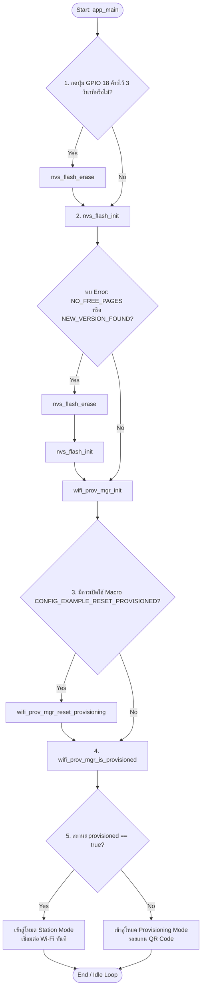
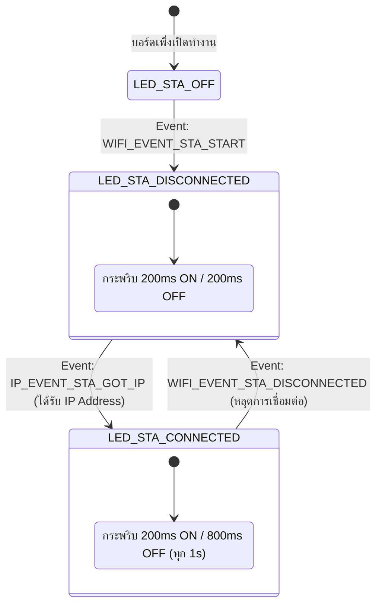
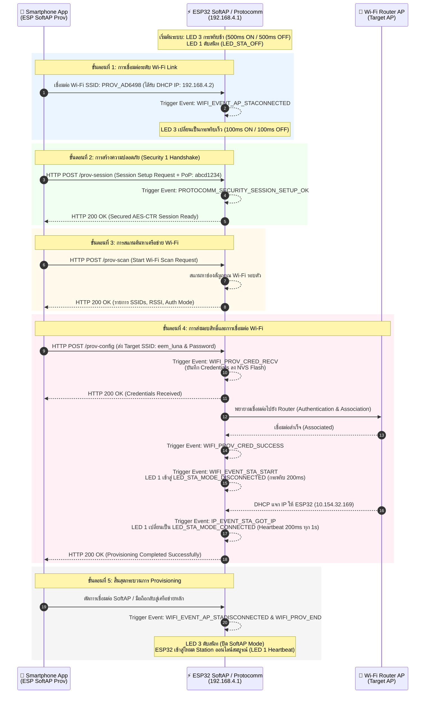
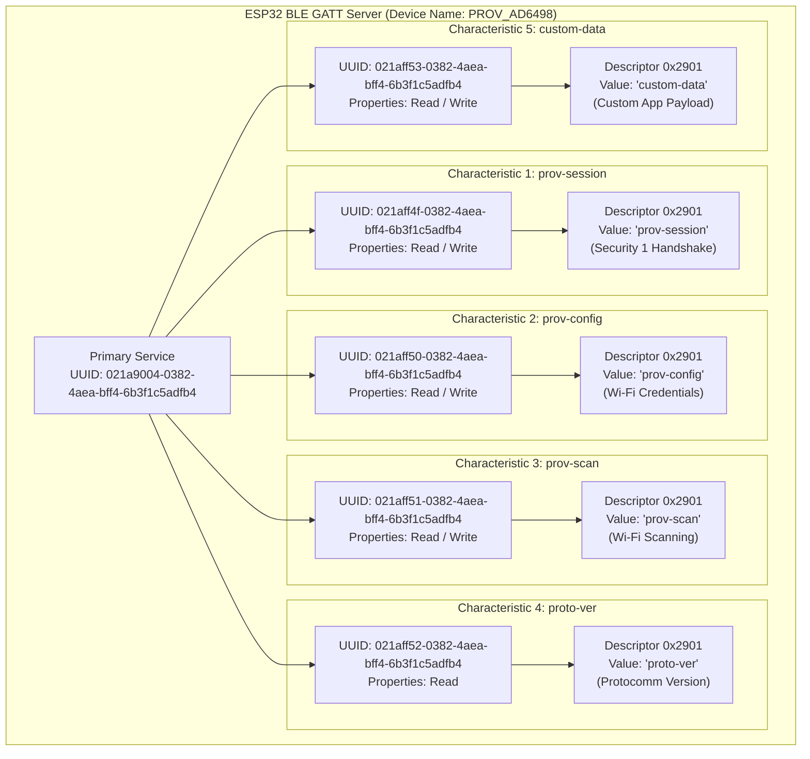
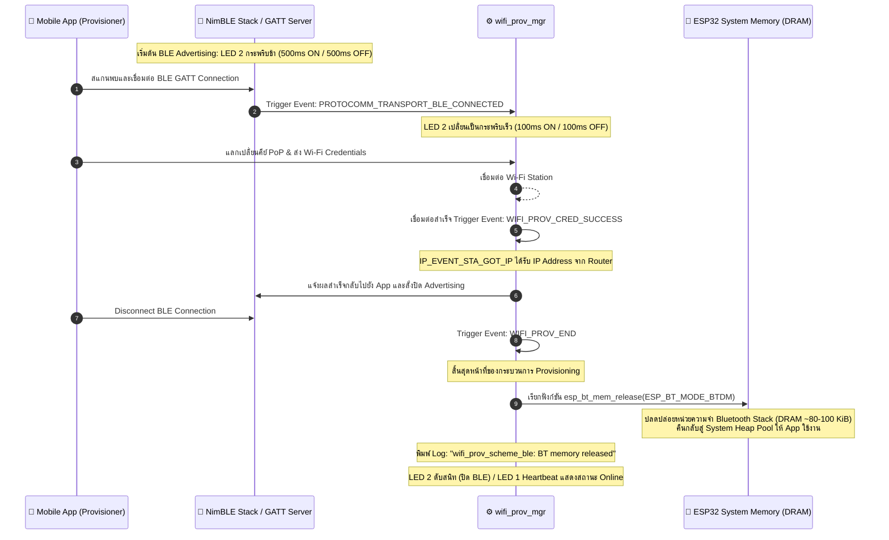

## 06-Labsheet-07-1-Reset-Mechanisms-and-NVS-Forensics
## 5. กิจกรรมถอดรหัสซอร์สโค้ดและเขียนผังงาน (Code Deconstruction & Flowchart Assignment)

ให้นักศึกษาศึกษาโค้ดใน `main/main.c` และ `main/led_indicator.c` แล้วเขียน **ผังงาน (Flowchart / State Diagram)** เพื่ออธิบายการตัดสินใจและการทำงานของระบบ:

### ภารกิจที่ 1  ผังงานการตัดสินใจช่วง Bootstrapping & Reset Decision
ให้นักศึกษาวาด Flowchart แสดงลำดับตรรกะการตรวจสอบเงื่อนไขตั้งแต่เริ่มต้นรันฟังก์ชัน `app_main()` โดยต้องครอบคลุม:
1. การตรวจสอบสถานะปุ่ม **GPIO 18** (ตรวจจับการกดค้าง 3 วินาที)
2. การทำงานของ `nvs_flash_init()` และกรณีที่ต้อง `nvs_flash_erase()`
3. การตรวจสอบ Macro `#ifdef CONFIG_EXAMPLE_RESET_PROVISIONED`
4. การเรียกฟังก์ชัน `wifi_prov_mgr_is_provisioned(&provisioned)`
5. จุดแยกสายการทำงานเข้าสู่โหมด **Provisioning Mode** หรือ **Station Mode**



### ภารกิจที่ 2 ผังสถานะการเปลี่ยนจังหวะไฟ LED 1 (Wi-Fi STA Indicator)
ให้นักศึกษาวาด State Diagram แสดงการเปลี่ยนสถานะของ **LED 1 (GPIO 2)**:
- เงื่อนไขใดทำให้ LED 1 เข้าสู่สถานะ `LED_STA_MODE_DISCONNECTED` (กระพริบ 200ms Mark / 200ms Space)
- เงื่อนไขหรือ Event ใดทำให้เปลี่ยนเป็น `LED_STA_MODE_CONNECTED` (Heartbeat 200ms ทุก 1s)



---

## 6. ตารางบันทึกผลการทดลอง (Experiment Results)

| รูปแบบการ Reset                  | คำสั่ง / พฤติกรรมที่ทำ               | พฤติกรรมของ LED แต่ละดวงหลังเปิดเครื่อง                                     | สถานะใน Serial Monitor                                                                                                                            |
| :------------------------------- | :----------------------------------- | :-------------------------------------------------------------------------- | :------------------------------------------------------------------------------------------------------------------------------------------------ |
| **1. CLI Erase**                 | `idf.py erase-flash`                 | ดับ (OFF)<br>(เพราะระบบล้างข้อมูลและหยุดรอ ไม่ได้เข้าสู่โหมด Wi-Fi Station) | `[STATUS]: Device is NOT provisioned (NVS is empty)`<br><br>`Ready for Provisioning Lab 7-2...`                                                   |
| **2. Menuconfig Flag**           | `CONFIG_EXAMPLE_RESET_PROVISIONED=y` | ดับ (OFF)                                                                   | `[FORENSIC]: Menuconfig Reset flag detected! Erasing credentials...`<br><br>ตามด้วย `[STATUS]: Device is NOT provisioned...`                      |
| **3. Hardware Button (GPIO 18)** | กดปุ่ม GPIO 18 ค้าง 3 วินาที         | ดับ (OFF)                                                                   | `Holding button... 3/3 seconds`<br>  <br>`>>> FACTORY RESET TRIGGERED! ERASING NVS FLASH <<<`<br><br>และ `[STATUS]: Device is NOT provisioned...` |

---

## 7. คำถามท้ายการทดลอง (Post-Lab Questions)
1. เพราะเหตุใดการกดปุ่ม BOOT (GPIO 0) ค้างไว้ในจังหวะรีเซ็ตบอร์ด จึงทำให้โปรแกรมค้างอยู่ที่ ROM Bootloader และไม่ยอมทำงานต่อ?
	**คำตอบ:** เพราะขา GPIO 0 ของ ESP32 ทำหน้าที่เป็น **Strapping Pin** (ขาที่ใช้กำหนดโหมดการบูต) หากสถานะของขา GPIO 0 เป็น Logic Low (ถูกกดลง GND) ในจังหวะที่บอร์ดกำลังเริ่มทำงาน ฮาร์ดแวร์จะสั่งให้ชิปเข้าสู่โหมด **Download Boot (UART Download Mode)** ทันที ซึ่งเป็นการรัน ROM Bootloader เพื่อรอรับการแฟลชเฟิร์มแวร์ใหม่ผ่านสาย USB ชิปจึงหยุดรออยู่ตรงนั้นและไม่ยอมเข้าไปอ่านเฟิร์มแวร์ Application ใน Flash Memory
2. เพราะเหตุใดคำสั่ง `idf.py erase-flash` จึงทำให้ข้อมูลเฟิร์มแวร์ Application หายไปด้วย ในขณะที่ `nvs_flash_erase()` ไม่ทำให้เฟิร์มแวร์หาย?
	 **คำตอบ:** เพราะขอบเขตการลบข้อมูล (Scope) ต่างกันอย่างสิ้นเชิง: 
	* `idf.py erase-flash`: เป็นคำสั่งระดับเครื่องมือภายนอก (ผ่าน Command Line) ที่สั่งลบ **ชิปหน่วยความจำ Flash ทั้งลูก** แบบถอนรากถอนโคน ข้อมูลทุกพาร์ทิชัน (Bootloader, Partition Table, NVS และ Application) จึงหายทั้งหมด 
	* `nvs_flash_erase()`: เป็นเพียงคำสั่งระดับซอฟต์แวร์ (API) ภายในเฟิร์มแวร์ ที่ชี้เป้าล้างข้อมูลเฉพาะใน **NVS Partition** (พื้นที่เก็บการตั้งค่า/Wi-Fi) เท่านั้น โครงสร้างพาร์ทิชันอื่นและเฟิร์มแวร์ Application จึงยังคงปลอดภัย
3. การออกแบบปุ่ม Factory Reset บนอุปกรณ์ IoT เชิงพาณิชย์ เหตุใดจึงต้องกำหนดให้ผู้ใช้กดปุ่มค้างไว้ 3-5 วินาที แทนที่จะสั่งลบข้อมูลทันทีที่แตะปุ่มเพียงเสี้ยววินาที?
	**คำตอบ:** เพื่อป้องกัน **Human Error หรือการเผลอกดโดยไม่ได้ตั้งใจ (Accidental Press)** การทำ Factory Reset คือการลบการตั้งค่าและรหัสผ่านทั้งหมดทิ้ง ซึ่งสร้างความยุ่งยากหากเกิดขึ้นโดยไม่ตั้งใจ การบังคับให้กดค้าง (Long Press) จึงเป็นการบังคับให้ผู้ใช้ยืนยัน "ความตั้งใจจริง" ก่อนที่ระบบจะทำการลบข้อมูล
4. หากอุปกรณ์ IoT ถูกติดตั้งอยู่บนเสาสูงหรือฝังอยู่ในผนัง วิธีการ Reset ทางกายภาพรูปแบบใดเหมาะสมที่สุด?
	**คำตอบ:** วิธีการที่เหมาะสมที่สุดคือการใช้ **Power-Cycle Sequence** 
	* **หลักการทำงาน:** ให้ผู้ใช้สับสวิตช์ไฟหลัก (Breaker หรือสวิตช์ผนัง) เปิดและปิดสลับกันอย่างรวดเร็วตามจำนวนครั้งที่กำหนด (เช่น เปิด-ปิดต่อเนื่อง 5 ครั้ง) 
	* ไมโครคอนโทรลเลอร์จะถูกโปรแกรมให้นับจังหวะการตัดต่อไฟในช่วงเสี้ยววินาทีแรกที่บูตเครื่อง หากนับได้ครบตามเงื่อนไข จะทริกเกอร์ฟังก์ชัน Factory Reset ตัวเองทันที โดยที่ผู้ใช้ไม่ต้องเสี่ยงปีนขึ้นไปหาปุ่มกดบนตัวอุปกรณ์

Log
```text
rst:0x1 (POWERON_RESET),boot:0x13 (SPI_FAST_FLASH_BOOT)
configsip: 0, SPIWP:0xee
clk_drv:0x00,q_drv:0x00,d_drv:0x00,cs0_drv:0x00,hd_drv:0x00,wp_drv:0x00
mode:DIO, clock div:2
load:0x3fff0030,len:6380
ho 0 tail 12 room 4
load:0x40078000,len:15916
load:0x40080400,len:3860
--- 0x40080400: _invalid_pc_placeholder at C:/Users/Thanu/esp/v5.5.1/esp-idf/components/xtensa/xtensa_vectors.S:2235
entry 0x40080638
--- 0x40080638: call_start_cpu0 at C:/Users/Thanu/esp/v5.5.1/esp-idf/components/bootloader/subproject/main/bootloader_start.c:25
I (29) boot: ESP-IDF v5.5.1 2nd stage bootloader
I (29) boot: compile time Aug 25 2026 09:28:40
I (29) boot: Multicore bootloader
I (31) boot: chip revision: v3.1
I (33) boot.esp32: SPI Speed      : 40MHz
I (37) boot.esp32: SPI Mode       : DIO
I (41) boot.esp32: SPI Flash Size : 2MB
I (44) boot: Enabling RNG early entropy source...
I (49) boot: Partition Table:
I (51) boot: ## Label            Usage          Type ST Offset   Length
I (58) boot:  0 nvs              WiFi data        01 02 00009000 00006000
I (64) boot:  1 phy_init         RF data          01 01 0000f000 00001000
I (71) boot:  2 factory          factory app      00 00 00010000 00100000
I (77) boot: End of partition table
I (81) esp_image: segment 0: paddr=00010020 vaddr=3f400020 size=1d168h (119144) map
I (129) esp_image: segment 1: paddr=0002d190 vaddr=3ffb0000 size=02e88h ( 11912) load
I (133) esp_image: segment 2: paddr=00030020 vaddr=400d0020 size=921f4h (598516) map
I (338) esp_image: segment 3: paddr=000c221c vaddr=3ffb2e88 size=010a4h (  4260) load
I (340) esp_image: segment 4: paddr=000c32c8 vaddr=40080000 size=17f8ch ( 98188) load
I (380) esp_image: segment 5: paddr=000db25c vaddr=50000000 size=00020h (    32) load
I (392) boot: Loaded app from partition at offset 0x10000
I (392) boot: Disabling RNG early entropy source...
I (403) cpu_start: Multicore app
I (411) cpu_start: Pro cpu start user code
I (411) cpu_start: cpu freq: 160000000 Hz
I (411) app_init: Application information:
I (411) app_init: Project name:     lab7_1_reset_nvs_forensics
I (417) app_init: App version:      f874021-dirty
I (421) app_init: Compile time:     Aug 25 2026 10:34:53
I (426) app_init: ELF file SHA256:  641db2348...
I (431) app_init: ESP-IDF:          v5.5.1
I (434) efuse_init: Min chip rev:     v0.0
I (438) efuse_init: Max chip rev:     v3.99 
I (442) efuse_init: Chip rev:         v3.1
I (446) heap_init: Initializing. RAM available for dynamic allocation:
I (452) heap_init: At 3FFAE6E0 len 00001920 (6 KiB): DRAM
I (457) heap_init: At 3FFB8028 len 00027FD8 (159 KiB): DRAM
I (463) heap_init: At 3FFE0440 len 00003AE0 (14 KiB): D/IRAM
I (468) heap_init: At 3FFE4350 len 0001BCB0 (111 KiB): D/IRAM
I (474) heap_init: At 40097F8C len 00008074 (32 KiB): IRAM
I (480) spi_flash: detected chip: generic
I (482) spi_flash: flash io: dio
W (485) spi_flash: Detected size(4096k) larger than the size in the binary image header(2048k). Using the size in the binary image header.
I (499) main_task: Started on CPU0
I (509) main_task: Calling app_main()
I (509) LAB7_1_RESET: Hold GPIO 18 button for 3 seconds to trigger Factory Reset...
I (1509) LAB7_1_RESET: Holding button... 1/3 seconds
I (2509) LAB7_1_RESET: Holding button... 2/3 seconds
I (3509) LAB7_1_RESET: Holding button... 3/3 seconds
W (3509) LAB7_1_RESET: =================================================
W (3509) LAB7_1_RESET: >>> FACTORY RESET TRIGGERED! ERASING NVS FLASH <<<
W (3509) LAB7_1_RESET: =================================================
W (3519) LAB7_1_RESET: [FORENSIC]: User requested Flash Erase!
I (3599) wifi:wifi driver task: 3ffc0774, prio:23, stack:6656, core=0
I (3599) wifi:wifi firmware version: 14da9b7
I (3599) wifi:wifi certification version: v7.0
I (3599) wifi:config NVS flash: enabled
I (3599) wifi:config nano formatting: disabled
I (3609) wifi:Init data frame dynamic rx buffer num: 32
I (3609) wifi:Init static rx mgmt buffer num: 5
I (3619) wifi:Init management short buffer num: 32
I (3619) wifi:Init dynamic tx buffer num: 32
I (3619) wifi:Init static rx buffer size: 1600
I (3629) wifi:Init static rx buffer num: 10
I (3629) wifi:Init dynamic rx buffer num: 32
I (3639) wifi_init: rx ba win: 6
I (3639) wifi_init: accept mbox: 6
I (3639) wifi_init: tcpip mbox: 32
I (3649) wifi_init: udp mbox: 6
I (3649) wifi_init: tcp mbox: 6
I (3649) wifi_init: tcp tx win: 5760
I (3649) wifi_init: tcp rx win: 5760
I (3659) wifi_init: tcp mss: 1440
I (3659) wifi_init: WiFi IRAM OP enabled
I (3659) wifi_init: WiFi RX IRAM OP enabled
W (3669) LAB7_1_RESET: --------------------------------------------------
W (3679) LAB7_1_RESET: [STATUS]: Device is NOT provisioned (NVS is empty)
W (3679) LAB7_1_RESET: Ready for Provisioning Lab 7-2 (SoftAP) or 7-3 (BLE)!
W (3689) LAB7_1_RESET: --------------------------------------------------
```

---

## 07-Labsheet-07-2-SoftAP-Provisioning-and-HTTP-Sniffing

## 5. กิจกรรมถอดรหัสซอร์สโค้ดและเขียนผังงาน (Code Deconstruction & Sequence Flow Assignment)

ให้นักศึกษาแกะรอยการทำงานจาก `main/main.c` ในโหมด SoftAP แล้วเขียน **แผนภาพลำดับเหตุการณ์ (Sequence Diagram)**:

### ภารกิจที่ 1: ผังลำดับการสื่อสารผ่าน HTTP Endpoints (SoftAP Scheme Sequence Flow)
ให้นักศึกษาวาด Sequence Diagram แสดงปฏิสัมพันธ์ระหว่าง 3 ฝ่าย:
1. **Smartphone App (ESP SoftAP Prov)**
2. **ESP32 SoftAP Webserver (Protocomm Layer)**
3. **Wi-Fi Router (AP ปลายทาง)**

**จุดที่ต้องระบุในผัง:**
- จังหวะที่มือถือยิง HTTP POST ไปยัง Endpoint แต่ละตัว (`/prov-session`, `/prov-scan`, `/prov-config`)
- Event ของ ESP-IDF ที่ถูก Trigger ใน `event_handler()` เช่น:
  - `WIFI_EVENT_AP_STACONNECTED`
  - `PROTOCOMM_SECURITY_SESSION_SETUP_OK`
  - `WIFI_PROV_CRED_RECV`
  - `WIFI_PROV_CRED_SUCCESS`
  - `IP_EVENT_STA_GOT_IP`
- สถานะจังหวะการกระพริบของ **LED 3 (GPIO 5)** และ **LED 1 (GPIO 2)** ในแต่ละช่วง




---

## 6. ตารางบันทึกผลการทดลอง (Experiment Results)

| รายการตรวจสอบ | ค่าที่บันทึกได้จากการทดลอง |
| :--- | :--- |
| **1. ชื่อ SoftAP SSID ของ ESP32** | `PROV_AD6498` |
| **2. รหัส PoP (Proof of Possession)** | `abcd1234` |
| **3. ข้อความใน QR Code Payload (JSON)** | `{"ver":"v1","name":"PROV_AD6498","pop":"abcd1234","transport":"softap"}` |
| **4. พฤติกรรมไฟ LED 3 (GPIO 5) ช่วงรอ vs ช่วงส่งข้อมูล** | **ช่วงรอ:** กระพริบช้า (ติด 500ms / ดับ 500ms)<br/>**ช่วงส่ง:** กระพริบเร็ว (ติด 100ms / ดับ 100ms) และดับสนิทเมื่อจบกระบวนการ |
| **5. IP Address ที่ ESP32 ได้รับจาก Router** | `10.154.32.169` |
| **6. เวลาที่ใช้ตั้งแต่เริ่มจนจบกระบวนการ (วินาที)** | ประมาณ 120 - 125 วินาที |

---

## 7. คำถามท้ายการทดลอง (Post-Lab Questions)
1. ในโหมด SoftAP Scheme สมาร์ตโฟนส่งข้อมูลหา ESP32 ผ่านโปรโตคอลและ IP Address ใด?
	**คำตอบ:** สมาร์ตโฟนส่งข้อมูลหา ESP32 ผ่านโปรโตคอล **HTTP REST-like (over TCP)** โดยใช้ IP Address เริ่มต้นของ ESP32 SoftAP คือ **`192.168.4.1`** (โดย ESP32 จะรัน DHCP Server แจก IP ให้กับสมาร์ตโฟนเป็น `192.168.4.2`) และสื่อสารผ่าน Endpoints เช่น `/prov-session`, `/prov-scan` และ `/prov-config`
2. หากผู้ใช้ป้อนรหัสผ่าน Wi-Fi ผิดในแอปมือถือ จะเกิด Event ใดขึ้นบน ESP32 (`WIFI_PROV_CRED_FAIL` หรือไม่) และ ESP32 มีพฤติกรรมอย่างไร?
	**คำตอบ:** เกิด Event **`WIFI_PROV_CRED_FAIL`** บน ESP32 โดยระบบจะส่งสถานะความล้มเหลว (Authentication Error) แจ้งกลับไปยังแอปพลิเคชันมือถือ และ ESP32 **จะยังคงเปิด SoftAP ค้างไว้ต่อไป** เพื่อรอรับการป้อน Credentials ใหม่อีกครั้ง โดยไม่ยอมสลับเข้าสู่โหมด Station Mode จนกว่าจะต่อสำเร็จ
3. ทำไมผู้ผลิต IoT ส่วนใหญ่จึงมองว่ากระบวนการเชื่อมต่อแบบ SoftAP มีขั้นตอนที่ยุ่งยากสำหรับผู้ใช้ทั่วไปเมื่อเทียบกับ BLE?
	**คำตอบ:** เพราะ SoftAP บังคับให้ผู้ใช้งานต้อง **กดออกจากแอปเพื่อไปสลับการเชื่อมต่อ Wi-Fi ในหน้าตั้งค่าของโทรศัพท์มือถือ** จาก Wi-Fi บ้านมาเกาะกับ SoftAP ของ ESP32 ก่อน ซึ่งทำให้เน็ต 4G/5G หรือ Wi-Fi มือถือหลุดชั่วคราว และสมาร์ตโฟนยุคใหม่อาจขึ้นเตือน "No Internet Access" ชวนสับสน ต่างจาก **BLE** ที่ระบบสามารถสแกน ค้นหา และแลกเปลี่ยนข้อมูลผ่านบลูทูธเบื้องหลังได้ทันทีโดยไม่ต้องสลับเครือข่าย Wi-Fi ของเครื่อง

Log
```text
load:0x40080400,len:3860
--- 0x40080400: _invalid_pc_placeholder at C:/Users/09677/esp/v5.5.1/esp-idf/components/xtensa/xtensa_vectors.S:2235
entry 0x40080638
--- 0x40080638: call_start_cpu0 at C:/Users/09677/esp/v5.5.1/esp-idf/components/bootloader/subproject/main/bootloader_start.c:25
I (29) boot: ESP-IDF v5.5.1-dirty 2nd stage bootloader
I (29) boot: compile time Aug 24 2026 10:19:50
I (29) boot: Multicore bootloader
I (31) boot: chip revision: v3.1
I (34) boot.esp32: SPI Speed      : 40MHz
I (38) boot.esp32: SPI Mode       : DIO
I (41) boot.esp32: SPI Flash Size : 2MB
I (45) boot: Enabling RNG early entropy source...
I (49) boot: Partition Table:
I (52) boot: ## Label            Usage          Type ST Offset   Length
I (58) boot:  0 nvs              WiFi data        01 02 00009000 00006000
I (65) boot:  1 phy_init         RF data          01 01 0000f000 00001000
I (71) boot:  2 factory          factory app      00 00 00010000 00100000
I (78) boot: End of partition table
I (81) esp_image: segment 0: paddr=00010020 vaddr=3f400020 size=22920h (141600) map
I (137) esp_image: segment 1: paddr=00032948 vaddr=3ffb0000 size=03f3ch ( 16188) load
I (143) esp_image: segment 2: paddr=0003688c vaddr=40080000 size=0978ch ( 38796) load
I (158) esp_image: segment 3: paddr=00040020 vaddr=400d0020 size=9f7bch (653244) map
I (382) esp_image: segment 4: paddr=000df7e4 vaddr=4008978c size=0e800h ( 59392) load
I (405) esp_image: segment 5: paddr=000edfec vaddr=50000000 size=00020h (    32) load
I (417) boot: Loaded app from partition at offset 0x10000
I (417) boot: Disabling RNG early entropy source...
I (428) cpu_start: Multicore app
I (436) cpu_start: Pro cpu start user code
I (436) cpu_start: cpu freq: 160000000 Hz
I (436) app_init: Application information:
I (436) app_init: Project name:     lab7_2_softap_provisioning
I (442) app_init: App version:      6e3a261-dirty
I (446) app_init: Compile time:     Aug 24 2026 10:18:24
I (451) app_init: ELF file SHA256:  e7028d632...
I (456) app_init: ESP-IDF:          v5.5.1-dirty
I (460) efuse_init: Min chip rev:     v0.0
I (464) efuse_init: Max chip rev:     v3.99 
I (468) efuse_init: Chip rev:         v3.1
I (472) heap_init: Initializing. RAM available for dynamic allocation:
I (478) heap_init: At 3FFAE6E0 len 00001920 (6 KiB): DRAM
I (483) heap_init: At 3FFB8040 len 00027FC0 (159 KiB): DRAM
I (488) heap_init: At 3FFE0440 len 00003AE0 (14 KiB): D/IRAM
I (494) heap_init: At 3FFE4350 len 0001BCB0 (111 KiB): D/IRAM
I (499) heap_init: At 40097F8C len 00008074 (32 KiB): IRAM
W (506) spi_flash: Detected boya flash chip but using generic driver. For optimal functionality, enable `SPI_FLASH_SUPPORT_BOYA_CHIP` in menuconfig
I (518) spi_flash: detected chip: generic
I (521) spi_flash: flash io: dio
W (524) spi_flash: Detected size(4096k) larger than the size in the binary image header(2048k). Using the size in the binary image header.
I (537) main_task: Started on CPU0
I (547) main_task: Calling app_main()
I (567) wifi:wifi driver task: 3ffc0114, prio:23, stack:6656, core=0
I (567) wifi:wifi firmware version: 14da9b7
I (567) wifi:wifi certification version: v7.0
I (567) wifi:config NVS flash: enabled
I (567) wifi:config nano formatting: disabled
I (577) wifi:Init data frame dynamic rx buffer num: 32
I (577) wifi:Init static rx mgmt buffer num: 5
I (587) wifi:Init management short buffer num: 32
I (587) wifi:Init dynamic tx buffer num: 32
I (587) wifi:Init static rx buffer size: 1600
I (597) wifi:Init static rx buffer num: 10
I (597) wifi:Init dynamic rx buffer num: 32
I (607) wifi_init: rx ba win: 6
I (607) wifi_init: accept mbox: 6
I (607) wifi_init: tcpip mbox: 32
I (607) wifi_init: udp mbox: 6
I (617) wifi_init: tcp mbox: 6
I (617) wifi_init: tcp tx win: 5760
I (617) wifi_init: tcp rx win: 5760
I (627) wifi_init: tcp mss: 1440
I (627) wifi_init: WiFi IRAM OP enabled
I (627) wifi_init: WiFi RX IRAM OP enabled
I (637) LAB7_2_SOFTAP: Starting SoftAP Provisioning (SSID: PROV_AD6498, PoP: abcd1234)
I (647) phy_init: phy_version 4861,b71b5ad,Aug  5 2025,11:16:06
I (727) wifi:mode : sta (88:57:21:ad:64:98)
I (737) wifi:enable tsf
I (747) wifi:mode : sta (88:57:21:ad:64:98) + softAP (88:57:21:ad:64:99)
I (747) wifi:Total power save buffer number: 16
I (747) wifi:Init max length of beacon: 752/752
I (747) wifi:Init max length of beacon: 752/752
I (757) esp_netif_lwip: DHCP server started on interface WIFI_AP_DEF with IP: 192.168.4.1
I (757) wifi:Total power save buffer number: 16
I (767) esp_netif_lwip: DHCP server started on interface WIFI_AP_DEF with IP: 192.168.4.1
I (777) wifi_prov_mgr: Provisioning started with service name : PROV_AD6498 
I (777) LAB7_2_SOFTAP: [PROV EVENT]: SoftAP Provisioning Started!
I (787) LAB7_2_SOFTAP: --------------------------------------------------
I (787) LAB7_2_SOFTAP: [QR CODE URL]: Click or copy the URL below:
I (797) LAB7_2_SOFTAP: https://espressif.github.io/esp-jumpstart/qrcode.html?data=%7B%22ver%22%3A%22v1%22%2C%22name%22%3A%22PROV_AD6498%22%2C%22pop%22%3A%22abcd1234%22%2C%22transport%22%3A%22softap%22%7D
I (817) LAB7_2_SOFTAP: Payload JSON: {"ver":"v1","name":"PROV_AD6498","pop":"abcd1234","transport":"softap"}
I (827) LAB7_2_SOFTAP: --------------------------------------------------
I (827) main_task: Returned from app_main()
I (79217) wifi:new:<1,0>, old:<1,1>, ap:<1,0>, sta:<0,0>, prof:1, snd_ch_cfg:0x0
I (79217) wifi:station: 02:7e:f9:bf:be:c9 join, AID=1, bgn, 20
I (79217) LAB7_2_SOFTAP: [SOFTAP]: Mobile Phone connected to ESP32 SoftAP!
I (81867) esp_netif_lwip: DHCP server assigned IP to a client, IP is: 192.168.4.2
I (83777) wifi:<ba-add>idx:2 (ifx:1, 02:7e:f9:bf:be:c9), tid:0, ssn:0, winSize:64
W (192077) wifi:Password length matches WPA2 standards, authmode threshold changes from OPEN to WPA2
I (192107) LAB7_2_SOFTAP: =================================================
I (192107) LAB7_2_SOFTAP: [CREDENTIALS RECEIVED]:
I (192107) LAB7_2_SOFTAP:   -> Target SSID     : eem_luna
I (192107) LAB7_2_SOFTAP:   -> Target Password : 123456789naeem
I (192117) LAB7_2_SOFTAP: =================================================
I (195947) wifi:new:<1,0>, old:<1,0>, ap:<1,0>, sta:<1,0>, prof:1, snd_ch_cfg:0x0
I (195957) wifi:state: init -> auth (0xb0)
I (196917) wifi:state: auth -> assoc (0x0)
I (196947) wifi:state: assoc -> run (0x10)
I (197007) wifi:connected with eem_luna, aid = 1, channel 1, BW20, bssid = be:8e:69:31:c2:c7
I (197007) wifi:security: WPA3-SAE, phy: bgn, rssi: -46
I (197017) wifi:pm start, type: 1

I (197027) wifi:dp: 1, bi: 102400, li: 3, scale listen interval from 307200 us to 307200 us
I (197037) wifi:dp: 2, bi: 102400, li: 4, scale listen interval from 307200 us to 409600 us
I (197037) wifi:AP's beacon interval = 102400 us, DTIM period = 2
I (197047) wifi:<ba-add>idx:0 (ifx:0, be:8e:69:31:c2:c7), tid:0, ssn:0, winSize:64
I (198067) LAB7_2_SOFTAP: =================================================
I (198067) LAB7_2_SOFTAP: [ONLINE]: Got IP: 10.154.32.169
I (198067) LAB7_2_SOFTAP: =================================================
I (198067) esp_netif_handlers: sta ip: 10.154.32.169, mask: 255.255.255.0, gw: 10.154.32.38
I (198077) wifi_prov_mgr: STA Got IP
I (198087) LAB7_2_SOFTAP: [SUCCESS]: Provisioning Completed Successfully!
I (203307) wifi:station: 02:7e:f9:bf:be:c9 leave, AID = 1, reason = 2, bss_flags is 33721443, bss:0x3ffb93f4
I (203307) wifi:new:<1,0>, old:<1,0>, ap:<1,0>, sta:<1,0>, prof:1, snd_ch_cfg:0x0
I (203307) wifi:<ba-del>idx:2, tid:0
I (203327) wifi:new:<1,1>, old:<1,0>, ap:<1,1>, sta:<1,0>, prof:1, snd_ch_cfg:0x0
I (203327) wifi:mode : sta (88:57:21:ad:64:98)
I (203327) wifi:ieee80211_send_beacon mode switch cause ap destroyed
I (203327) wifi_prov_mgr: Provisioning stopped
W (203337) LAB7_2_SOFTAP: [SOFTAP]: Mobile Phone disconnected from ESP32 SoftAP
I (203347) LAB7_2_SOFTAP: [PROV EVENT]: De-initializing Provisioning Manager
```

---

## 08-Labsheet-07-3-BLE-Provisioning-and-GATT-Forensics

## 5. กิจกรรมถอดรหัสซอร์สโค้ดและเขียนผังงาน (Code Deconstruction & BLE GATT Architecture Assignment)

ให้นักศึกษาแกะรอยการทำงานของโมดูล BLE Provisioning ใน `main/main.c` แล้วเขียน **ผังโครงสร้างและลำดับเหตุการณ์**:

### ภารกิจที่ 1: ผังโครงสร้าง GATT Tree & Endpoint Mapping
ให้นักศึกษาวาดโครงสร้างต้นไม้ (Tree Diagram / Block Diagram) แสดงความสัมพันธ์ระหว่าง:
- **Primary Service (128-bit UUID: `021a9004-...`)**
  - **Characteristic UUIDs** แต่ละตัว
  - **Descriptor 0x2901 (User Description)** ที่ผูกเข้ากับ Protocomm Endpoints (`prov-session`, `prov-config`, `prov-scan`, `proto-ver`, `custom-data`)




### ภารกิจที่ 2: ผังลำดับการคืนหน่วยความจำ Bluetooth (BLE Lifecycle & Memory Reclaim Flow)
ให้นักศึกษาวาด Flowchart / Sequence แสดงว่า:
1. การเชื่อมต่อ BLE ถูกตรวจพบผ่าน Event `PROTOCOMM_TRANSPORT_BLE_CONNECTED` (LED 2 กระพริบเร็ว 100ms)
2. เมื่อเชื่อมต่อ Wi-Fi สำเร็จ (`WIFI_PROV_CRED_SUCCESS`) $\rightarrow$ เกิด Event `WIFI_PROV_END`
3. Provisioning Manager สั่งเรียก `esp_bt_mem_release()` เพื่อปล่อย DRAM คืนสู่ระบบอย่างไร




---

## 6. ตารางบันทึกผลการทดลอง (Experiment Results)

```text
[10:52:20.112] Normal: Scanner On.
[10:52:20.122] Normal: Device Scanned.
[10:52:31.799] Normal: Connected.
[10:52:31.907] Normal: Discovered 021A9004-0382-4AEA-BFF4-6B3F1C5ADFB4 Services.
[10:52:32.054] Normal: Service Discovery returned nil Services.
[10:52:32.238] Normal: Discovered 021AFF4F-0382-4AEA-BFF4-6B3F1C5ADFB4, 021AFF50-0382-4AEA-BFF4-6B3F1C5ADFB4, 021AFF51-0382-4AEA-BFF4-6B3F1C5ADFB4, 021AFF52-0382-4AEA-BFF4-6B3F1C5ADFB4, and 021AFF53-0382-4AEA-BFF4-6B3F1C5ADFB4 Characteristics for Service 021A9004-0382-4AEA-BFF4-6B3F1C5ADFB4.
[10:52:32.324] Normal: 021AFF4F-0382-4AEA-BFF4-6B3F1C5ADFB4 has no Descriptors.
[10:52:32.384] Normal: 021AFF50-0382-4AEA-BFF4-6B3F1C5ADFB4 has no Descriptors.
[10:52:32.564] Normal: 021AFF51-0382-4AEA-BFF4-6B3F1C5ADFB4 has no Descriptors.
[10:52:32.744] Normal: 021AFF52-0382-4AEA-BFF4-6B3F1C5ADFB4 has no Descriptors.
[10:52:32.925] Normal: 021AFF53-0382-4AEA-BFF4-6B3F1C5ADFB4 has no Descriptors.
[10:54:20.062] Normal: Scanner Off.
[10:54:47.970] Normal: Disconnected.
```

| รายการตรวจสอบ | ผลการทดลอง / ข้อมูลที่สังเกตได้ |
| :--- | :--- |
| **1. BLE Device Name ที่สแกนเจอ** | `PROV_AD6498` |
| **2. Primary Service UUID (128-bit)** | `021A9004-0382-4AEA-BFF4-6B3F1C5ADFB4` |
| **3. Characteristic Endpoint ที่พบ (0x2901)** | 1. `021AFF4F-0382-4AEA-BFF4-6B3F1C5ADFB4` (prov-session)<br/>2. `021AFF50-0382-4AEA-BFF4-6B3F1C5ADFB4` (prov-config)<br/>3. `021AFF51-0382-4AEA-BFF4-6B3F1C5ADFB4` (prov-scan) |
| **4. พฤติกรรมไฟ LED 2 (GPIO 4) ช่วงรอ vs ช่วงต่อ BLE** | **ช่วงรอ:** กระพริบช้า (ติด 500ms / ดับ 500ms)<br/>**ช่วงต่อ BLE:** กระพริบเร็ว (ติด 100ms / ดับ 100ms) แสดงสถานะ BLE Connected |
| **5. พฤติกรรมเมื่อต่อ Wi-Fi สำเร็จ** | **มี Log คืนหน่วยความจำ Bluetooth** (ปรากฏ `wifi_prov_scheme_ble: BT memory released` / ระบบเรียก `esp_bt_mem_release()`) และ LED 2 ดับสนิท |

---

## 7. คำถามท้ายการทดลอง (Post-Lab Questions)
1. เหตุใด BLE Provisioning จึงไม่ส่งผลให้สัญญาณ Wi-Fi บนสมาร์ตโฟนของผู้ใช้หลุดระหว่างทำรายการ?
	**คำตอบ:** เพราะสมาร์ตโฟนติดต่อสื่อสารกับ ESP32 ผ่านช่องทางฮาร์ดแวร์ **Bluetooth Low Energy (BLE)** ซึ่งแยกส่วนอิสระจากฮาร์ดแวร์ Wi-Fi ของโทรศัพท์ ทำให้สมาร์ตโฟนสามารถคงการเชื่อมต่ออินเทอร์เน็ตผ่าน Wi-Fi บ้าน หรือเครือข่าย 4G/5G ได้ตามปกติโดยไม่เกิดการตัดการเชื่อมต่อ
2. Descriptor `0x2901` มีความสำคัญอย่างไรต่อการที่แอปพลิเคชันมือถือจะทราบว่า Characteristic แต่ละตัวใช้ทำหน้าที่อะไร?
	**คำตอบ:** Descriptor `0x2901` คือ **Characteristic User Description** ทำหน้าที่เก็บสตริงข้อความที่มนุษย์เข้าใจได้ (เช่น `"prov-session"`, `"prov-config"`, `"prov-scan"`, `"custom-data"`) เพื่อระบุว่า Characteristic ที่มี 128-bit UUID นั้นๆ ผูกอยู่กับ Protocomm Endpoint ใด หากไม่มี Descriptor นี้ แอปพลิเคชันจะไม่สามารถแยกแยะหน้าที่ของ Characteristic แต่ละตัวได้ เนื่องจาก 128-bit UUID มักเป็นค่าสุ่มที่ไม่สื่อความหมาย
3. การที่ ESP-IDF มีฟังก์ชัน `esp_bt_mem_release()` มีประโยชน์อย่างไรต่อการทำงานของแอปพลิเคชัน IoT หลังเชื่อมต่อ Wi-Fi สำเร็จ?
	**คำตอบ:** มีประโยชน์อย่างยิ่งในการ **ประหยัดและกู้คืนพื้นที่ RAM (DRAM)** ให้กับระบบ เนื่องจาก Bluetooth Stack (เช่น NimBLE / Bluedroid และ BT Controller) ใช้หน่วยความจำขนาดใหญ่มากประมาณ **80 - 100 KiB** ซึ่งหลังจากที่อุปกรณ์ทำการ Provision Wi-Fi สำเร็จแล้ว บลูทูธจะไม่จำเป็นต้องใช้งานอีกต่อไป การเรียก `esp_bt_mem_release()` จะสั่งคืนพื้นที่หน่วยความจำส่วนนี้กลับเข้าสู่ System Heap Pool ทำให้เฟิร์มแวร์หลักมี RAM เหลือเฟือสำหรับรันโปรแกรม เช่น HTTP Client, MQTT, TLS/SSL, หรือจัดเก็บข้อมูลเซนเซอร์

Log
```text
ho 0 tail 12 room 4
load:0x40078000,len:15916
load:0x40080400,len:3860
--- 0x40080400: _invalid_pc_placeholder at C:/Users/09677/esp/v5.5.1/esp-idf/components/xtensa/xtensa_vectors.S:2235
entry 0x40080638
--- 0x40080638: call_start_cpu0 at C:/Users/09677/esp/v5.5.1/esp-idf/components/bootloader/subproject/main/bootloader_start.c:25
I (29) boot: ESP-IDF v5.5.1-dirty 2nd stage bootloader
I (29) boot: compile time Aug 24 2026 10:48:55
I (29) boot: Multicore bootloader
I (31) boot: chip revision: v3.1
I (34) boot.esp32: SPI Speed      : 40MHz
I (38) boot.esp32: SPI Mode       : DIO
I (41) boot.esp32: SPI Flash Size : 2MB
I (45) boot: Enabling RNG early entropy source...
I (49) boot: Partition Table:
I (52) boot: ## Label            Usage          Type ST Offset   Length
I (58) boot:  0 nvs              WiFi data        01 02 00009000 00006000
I (65) boot:  1 phy_init         RF data          01 01 0000f000 00001000
I (71) boot:  2 factory          factory app      00 00 00010000 00150000
I (78) boot: End of partition table
I (81) esp_image: segment 0: paddr=00010020 vaddr=3f400020 size=25e98h (155288) map
I (142) esp_image: segment 1: paddr=00035ec0 vaddr=3ffbdb60 size=058a8h ( 22696) load
I (150) esp_image: segment 2: paddr=0003b770 vaddr=40080000 size=048a8h ( 18600) load
I (158) esp_image: segment 3: paddr=00040020 vaddr=400d0020 size=b91b4h (758196) map
I (417) esp_image: segment 4: paddr=000f91dc vaddr=400848a8 size=1a89ch (108700) load
I (459) esp_image: segment 5: paddr=00113a80 vaddr=50000000 size=00020h (    32) load
I (475) boot: Loaded app from partition at offset 0x10000
I (475) boot: Disabling RNG early entropy source...
I (486) cpu_start: Multicore app
I (494) cpu_start: Pro cpu start user code
I (494) cpu_start: cpu freq: 160000000 Hz
I (494) app_init: Application information:
I (494) app_init: Project name:     lab7_3_ble_provisioning
I (499) app_init: App version:      4cfb255
I (503) app_init: Compile time:     Aug 24 2026 10:46:29
I (508) app_init: ELF file SHA256:  f5b7116a7...
I (513) app_init: ESP-IDF:          v5.5.1-dirty
I (517) efuse_init: Min chip rev:     v0.0
I (521) efuse_init: Max chip rev:     v3.99 
I (525) efuse_init: Chip rev:         v3.1
I (529) heap_init: Initializing. RAM available for dynamic allocation:
I (535) heap_init: At 3FFAFF10 len 000000F0 (0 KiB): DRAM
I (540) heap_init: At 3FFB6388 len 00001C78 (7 KiB): DRAM
I (545) heap_init: At 3FFB9A20 len 00004108 (16 KiB): DRAM
I (550) heap_init: At 3FFC9988 len 00016678 (89 KiB): DRAM
I (556) heap_init: At 3FFE0440 len 00003AE0 (14 KiB): D/IRAM
I (561) heap_init: At 3FFE4350 len 0001BCB0 (111 KiB): D/IRAM
I (566) heap_init: At 4009F144 len 00000EBC (3 KiB): IRAM
W (573) spi_flash: Detected boya flash chip but using generic driver. For optimal functionality, enable `SPI_FLASH_SUPPORT_BOYA_CHIP` in menuconfig
I (585) spi_flash: detected chip: generic
I (588) spi_flash: flash io: dio
W (591) spi_flash: Detected size(4096k) larger than the size in the binary image header(2048k). Using the size in the binary image header.
I (604) coexist: coex firmware version: b0bcc39
I (609) main_task: Started on CPU0
I (619) main_task: Calling app_main()
I (649) wifi:wifi driver task: 3ffcd79c, prio:23, stack:6656, core=0
I (649) wifi:wifi firmware version: 14da9b7
I (649) wifi:wifi certification version: v7.0
I (649) wifi:config NVS flash: enabled
I (649) wifi:config nano formatting: disabled
I (659) wifi:Init data frame dynamic rx buffer num: 32
I (659) wifi:Init static rx mgmt buffer num: 5
I (669) wifi:Init management short buffer num: 32
I (669) wifi:Init dynamic tx buffer num: 32
I (669) wifi:Init static rx buffer size: 1600
I (679) wifi:Init static rx buffer num: 10
I (679) wifi:Init dynamic rx buffer num: 32
I (689) wifi_init: rx ba win: 6
I (689) wifi_init: accept mbox: 6
I (689) wifi_init: tcpip mbox: 32
I (689) wifi_init: udp mbox: 6
I (699) wifi_init: tcp mbox: 6
I (699) wifi_init: tcp tx win: 5760
I (699) wifi_init: tcp rx win: 5760
I (709) wifi_init: tcp mss: 1440
I (709) wifi_init: WiFi IRAM OP enabled
I (709) wifi_init: WiFi RX IRAM OP enabled
I (719) wifi_prov_scheme_ble: BT memory released
I (719) LAB7_3_BLE: Starting BLE Provisioning (Name: PROV_AD6498, PoP: abcd1234)
I (729) phy_init: phy_version 4861,b71b5ad,Aug  5 2025,11:16:06
I (819) wifi:mode : sta (88:57:21:ad:64:98)
I (819) wifi:enable tsf
W (829) BTDM_INIT: esp_bt_controller_rom_mem_release already released, mode 2
I (829) BTDM_INIT: BT controller compile version [722c907]
I (829) BTDM_INIT: Using main XTAL as clock source
I (829) BTDM_INIT: Bluetooth MAC: 88:57:21:ad:64:9a
I (1079) protocomm_nimble: BLE Host Task Started
I (1089) wifi_prov_mgr: Provisioning started with service name : PROV_AD6498 
I (1099) LAB7_3_BLE: [PROV EVENT]: BLE Provisioning Started (Advertising)!
I (1099) LAB7_3_BLE: --------------------------------------------------
I (1099) LAB7_3_BLE: [QR CODE URL]: Click or copy the URL below:
I (1109) LAB7_3_BLE: https://espressif.github.io/esp-jumpstart/qrcode.html?data=%7B%22ver%22%3A%22v1%22%2C%22name%22%3A%22PROV_AD6498%22%2C%22pop%22%3A%22abcd1234%22%2C%22transport%22%3A%22ble%22%7D
I (1129) LAB7_3_BLE: Payload JSON: {"ver":"v1","name":"PROV_AD6498","pop":"abcd1234","transport":"ble"}
I (1129) NimBLE: GAP procedure initiated: advertise; 
I (1139) NimBLE: disc_mode=2
I (1139) NimBLE:  adv_channel_map=0 own_addr_type=0 adv_filter_policy=0 adv_itvl_min=256 adv_itvl_max=256
I (1149) NimBLE: 

I (1149) LAB7_3_BLE: --------------------------------------------------
I (1159) main_task: Returned from app_main()
I (56929) LAB7_3_BLE: [BLE]: Smartphone Connected to GATT Server!
I (57149) protocomm_nimble: mtu update event; conn_handle=0 cid=4 mtu=256
```

---

## 09-Labsheet-07-4-Security-Schemes-and-Custom-Data

## 6. กิจกรรมถอดรหัสซอร์สโค้ดและเขียนผังงาน (Code Deconstruction & Security Flow Assignment)

ให้นักศึกษาแกะรอยการทำงานด้านความปลอดภัยและ Custom Handler ใน `main/main.c` แล้วเขียน **ผังการไหลของข้อมูล (Data Flow & Cryptographic Handshake Flow)**:

### ภารกิจที่ 1: ผังขั้นตอนการตรวจสอบ PoP (Security Handshake Decision Flow)
ให้นักศึกษาวาด Flowchart แสดงการแลกเปลี่ยนคีย์และตรวจสอบสิทธิ์:
1. การสร้าง Session Parameters ด้วยค่า PoP (`abcd1234`)
2. เมื่อ Client ส่ง Public Key + Verification Hash มาให้ ESP32
3. จุดแยกทางเลือก (Branching):
   - หาก PoP ไม่ตรง $\rightarrow$ Trigger Event `PROTOCOMM_SECURITY_SESSION_CREDENTIALS_MISMATCH` และปฏิเสธการเชื่อมต่อ
   - หาก PoP ถูกต้อง $\rightarrow$ Trigger Event `PROTOCOMM_SECURITY_SESSION_SETUP_OK` และสร้าง AES Session Key สำเร็จ

### ภารกิจที่ 2: ผังการรับส่งข้อมูลผ่าน Custom Endpoint (Custom Data Handler Flow)
ให้นักศึกษาวาด Sequence / Data Flow ของฟังก์ชัน `custom_prov_data_handler()`:
1. ข้อมูล `inbuf` ถูกส่งเข้ามาจากสมาร์ตโฟนผ่าน Protocomm
2. การพิมพ์ข้อความ Log ด้วย `ESP_LOGI()`
3. การจัดสรรหน่วยความจำแบบไดนามิกด้วย `strdup()` ให้กับ `*outbuf`
4. ทำไมตัวแปร `*outbuf` จึงต้องจัดสรรใน Heap Memory (ทำไมจึงใช้ตัวแปร Local Static Array ธรรมดาไม่ได้)?

```text
[พื้นที่สำหรับแนบรูปภาพ Diagram ที่นักศึกษาเขียนขึ้นด้วย Draw.io / Mermaid / วาดมือ]
```

---

## 7. ตารางบันทึกผลการทดลอง (Experiment Results)

| สถานการณ์ทดสอบ | ค่า PoP ที่ป้อน | ผลลัพธ์บนแอปมือถือ | ข้อความ Log ใน Serial Monitor |
| :--- | :--- | :--- | :--- |
| **1. ป้อน PoP ผิดพลาด** | `wrong1234` | | |
| **2. ป้อน PoP ถูกต้อง** | `abcd1234` | | |
| **3. ส่ง Custom Data** | `TEST_DATA_999` | | |

---

## 8. คำถามท้ายการทดลอง (Post-Lab Questions)
1. การใช้ **Proof-of-Possession (PoP)** ช่วยป้องกันการโจมตีประเภทใดได้บ้าง?
2. หากไม่มีการใช้ PoP (เช่น ใน Security 0) ผู้โจมตีที่อยู่ในรัศมีสัญญาณบลูทูธสามารถทำสิ่งใดกับอุปกรณ์ได้บ้าง?
3. ในการประยุกต์ใช้งานเชิงพาณิชย์จริง เราสามารถนำ **Custom Data Endpoint** ไปใช้ส่งข้อมูลประเภทใดได้อีกบ้าง (ยกตัวอย่าง 2 กรณี)?
4. ในฟังก์ชัน `custom_prov_data_handler()` เหตุใดหน่วยความจำที่จัดสรรให้ `*outbuf` จึงถูก Free โดย Protocomm Layer อัตโนมัติหลังจากส่งข้อมูลเสร็จ?

Log
```text

```

---