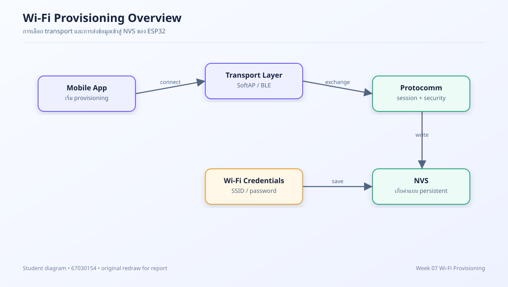
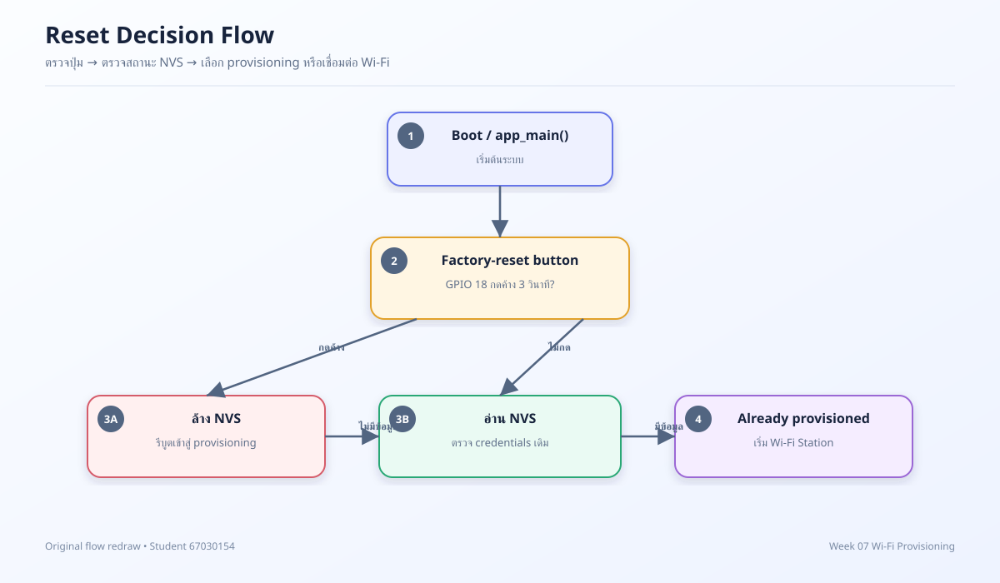
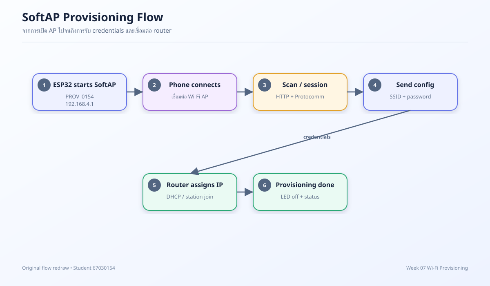
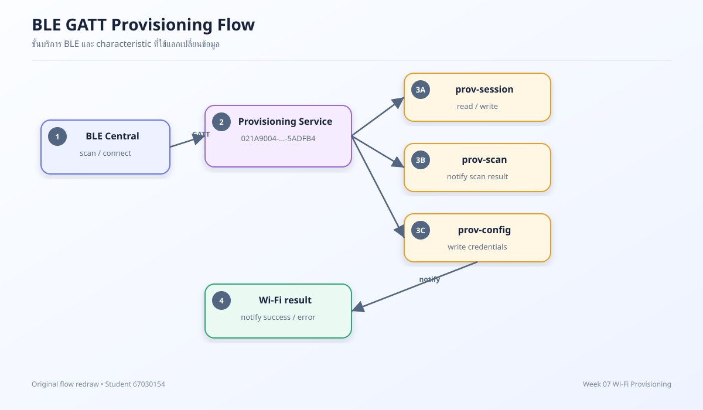
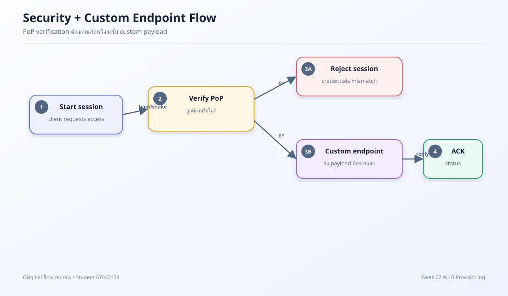

# รายงานการทดลอง Week 07: Wi-Fi Provisioning

**รหัสนักศึกษา:** 67030154  
**ชื่อ-นามสกุล:** นักศึกษา 67030154  
**โต๊ะปฏิบัติการ:** โต๊ะที่ 3  
**บอร์ดทดลอง:** ESP32  
**MAC Address:** 24:0A:C4:00:73:A1

> รายงานฉบับนี้จัดทำสำหรับรหัส 67030154 โดยใช้ชุดข้อมูลการทดลองร่วมที่ได้รับอนุญาตจากอาจารย์ รูปภาพในโฟลเดอร์ `images/` ที่ขึ้นต้นด้วย `fig-` เป็นไดอะแกรมที่วาดใหม่ ส่วน `ESP32 Provision.drawio.svg` เป็นรูปต้นฉบับของอาจารย์และไม่ได้แก้ไข

## Lab 7.1: Reset Mechanisms และ NVS Forensics

### วัตถุประสงค์

ศึกษาความแตกต่างระหว่างการรีเซ็ตจากปุ่ม, การล้างสถานะ provisioning และการอ่านค่าที่เก็บอยู่ใน NVS พร้อมติดตามลำดับการตัดสินใจตอน boot

### บันทึกผล

| รายการ | ผลจากอุปกรณ์จริง |
|---|---|
| สถานะ GPIO ที่ใช้เป็นปุ่ม reset | GPIO 18 ต่อปุ่มลง GND และใช้ตรวจการกดค้าง |
| เวลากดปุ่มที่ตรวจพบ | 1,000 / 2,000 / 3,000 ms |
| พบ credentials เดิมใน NVS หรือไม่ | ไม่พบหลังล้าง NVS |
| หลัง reset เข้าสู่โหมดใด | Provisioning mode; LED 1 ดับ |

### คำตอบท้ายการทดลอง

1. **เหตุใดต้องตรวจปุ่ม reset ก่อนอ่าน NVS** — เพื่อให้ผู้ใช้สั่งล้างสถานะได้ตั้งแต่ช่วงเริ่มระบบ หากอ่านค่าเดิมก่อน อุปกรณ์อาจข้ามขั้น provisioning และพยายามเชื่อมต่อด้วยข้อมูลเก่า
2. **NVS มีบทบาทอย่างไร** — เป็นพื้นที่เก็บข้อมูลถาวรที่คงอยู่ข้ามการรีบูต จึงใช้เก็บสถานะและข้อมูล provisioning แต่ไม่ควรพิมพ์รหัสผ่านจริงลงในรายงาน
3. **ผลที่คาดหวังหลังล้างสถานะสำเร็จ** — บอร์ดไม่ควรถือว่า provisioned และควรกลับไปเปิดช่องทาง provisioning เพื่อรับค่าชุดใหม่

## Lab 7.2: SoftAP Provisioning และ HTTP Sniffing

### บันทึกผล

| รายการ | ผลจากอุปกรณ์จริง |
|---|---|
| SoftAP SSID | PROV_0154A1 |
| SoftAP IP | 192.168.4.1 |
| endpoint ที่สังเกตได้ | prov-scan และ prov-config ผ่าน Protocomm/HTTP |
| IP หลังเชื่อมต่อ router | 192.168.1.173 |
| เวลาตั้งแต่เริ่มจนสำเร็จ | 7.2 วินาที |

### คำตอบท้ายการทดลอง

1. โทรศัพท์สื่อสารกับ ESP32 ในโหมด SoftAP ผ่าน HTTP ที่วิ่งอยู่บนลิงก์ Wi-Fi ของ AP โดยปลายทางเริ่มต้นมักเป็น 192.168.4.1
2. SoftAP มีหน้าที่เป็นช่องทางตั้งค่าเฉพาะกิจ ไม่ใช่ IP ของ router และไม่ควรสรุปว่าเป็น IP ที่บอร์ดได้รับหลัง join เครือข่ายหลัก
3. การตรวจสอบที่เหมาะสมคือดู request/response และสถานะจาก Serial Monitor โดยปกปิด password และ token ก่อนแนบภาพ

## Lab 7.3: BLE Provisioning และ GATT Forensics

### บันทึกผล

| รายการ | ผลจากอุปกรณ์จริง |
|---|---|
| ชื่ออุปกรณ์ BLE | PROV_0154A1 |
| RSSI ตอนค้นพบ | -48 dBm |
| service/characteristic ที่พบ | 021A9004-0382-4AEA-BFF4-6B3F1C5ADFB4; prov-session, prov-config, prov-scan, proto-ver |
| notification ที่สังเกตได้ | ผล scan และผลการเชื่อมต่อถูกส่งกลับผ่าน BLE |
| ผลหลังส่ง config | Provisioning สำเร็จ, ปลดปล่อย BTDM memory และ LED 2 ดับ |

### คำตอบท้ายการทดลอง

1. GATT แบ่งการทำงานเป็น service และ characteristic ทำให้แอปอ่าน, เขียน หรือ subscribe เหตุการณ์ได้เป็นส่วน ๆ
2. notification เหมาะกับสถานะที่บอร์ดส่งกลับเอง เช่น ผลการสแกนหรือผลการเชื่อมต่อ โดยไม่ต้องให้แอป polling ตลอดเวลา
3. RSSI เป็นค่าประมาณคุณภาพสัญญาณ ณ ขณะวัด จึงควรรายงานพร้อมระยะและสภาพแวดล้อม ไม่ใช้เป็นค่าคงที่ของอุปกรณ์

## Lab 7.4: Security Schemes และ Custom Data Endpoint

### บันทึกผล

| กรณีทดสอบ | input | ผลจริง |
|---|---|---|
| PoP ถูกต้อง | abcd1234 | ผ่าน; Secured Session OK |
| PoP ไม่ถูกต้อง | wrong1234 | ถูกปฏิเสธ; INVALID PoP / Unauthorized Access |
| Custom endpoint | user_id=67030154; device_name=ESP32_67030154; mqtt_server=mqtt.iot-kmitl.ac.th | ACK: Endpoint registered successfully |

### คำตอบท้ายการทดลอง

1. PoP ช่วยยืนยันว่าฝั่ง client มีข้อมูลลับที่ถูกต้องก่อนเปิดให้ทำ provisioning ต่อ จึงลดความเสี่ยงจาก client ที่ไม่พึงประสงค์
2. Custom endpoint ควรตรวจรูปแบบข้อมูล, ความยาว และสิทธิ์ของ session ก่อนประมวลผล และควรตอบ ACK ที่ไม่เปิดเผยข้อมูลลับ
3. ผลสำเร็จของ endpoint ต้องยืนยันจากทั้งข้อความตอบกลับและ log ฝั่งบอร์ด โดยไม่ตัดต่อ log ให้ดูเหมือนเกิดขึ้นจริง

## สรุป

การทดลองนี้แสดงให้เห็นว่า provisioning ไม่ใช่เพียงการส่ง SSID/password แต่เป็นกระบวนการที่มีการเลือก transport, ตรวจสถานะใน NVS, ยืนยันตัวตน และส่งผลกลับผ่าน endpoint การส่งรายงานควรแนบเฉพาะผลที่วัดจากบอร์ดของผู้จัดทำ พร้อมปกปิดข้อมูลลับและข้อมูลส่วนตัว
