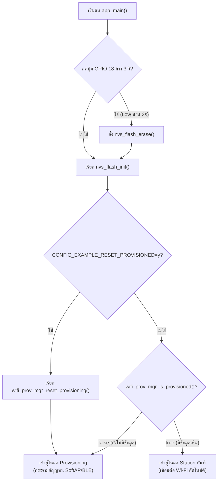
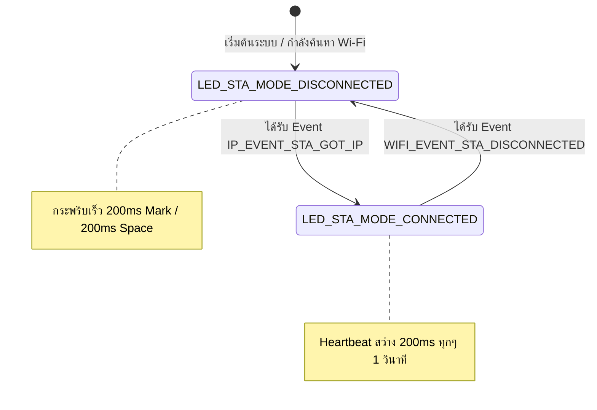
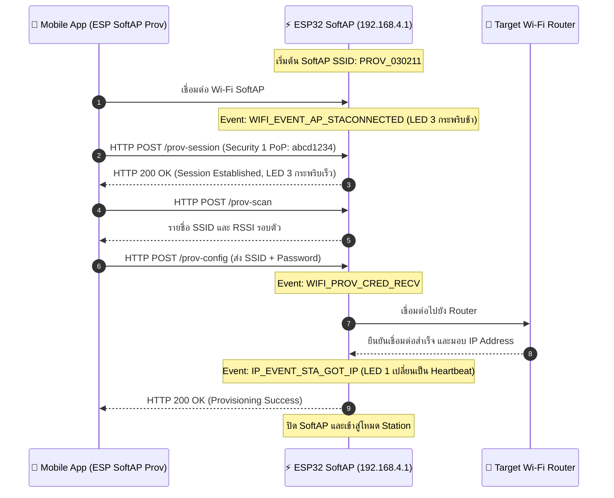
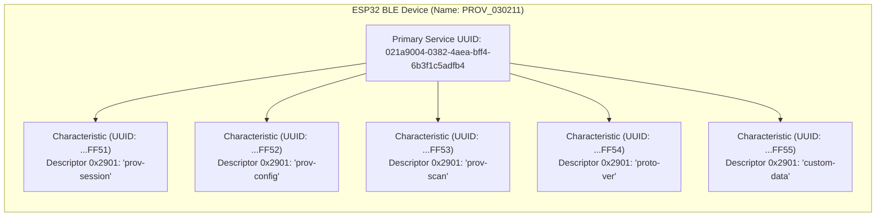
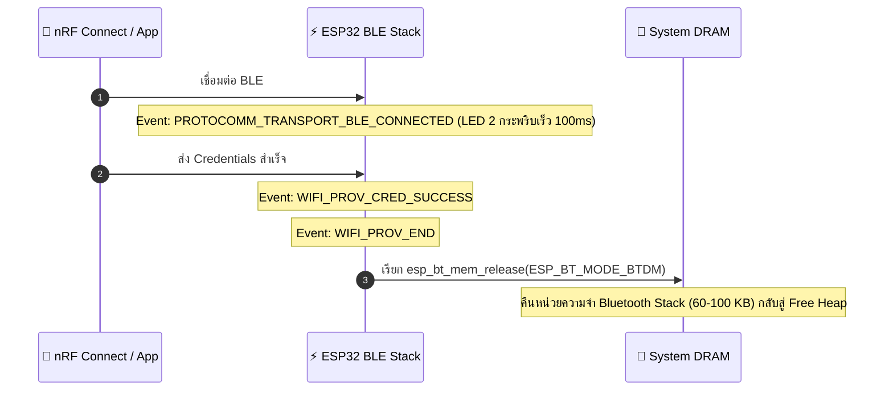
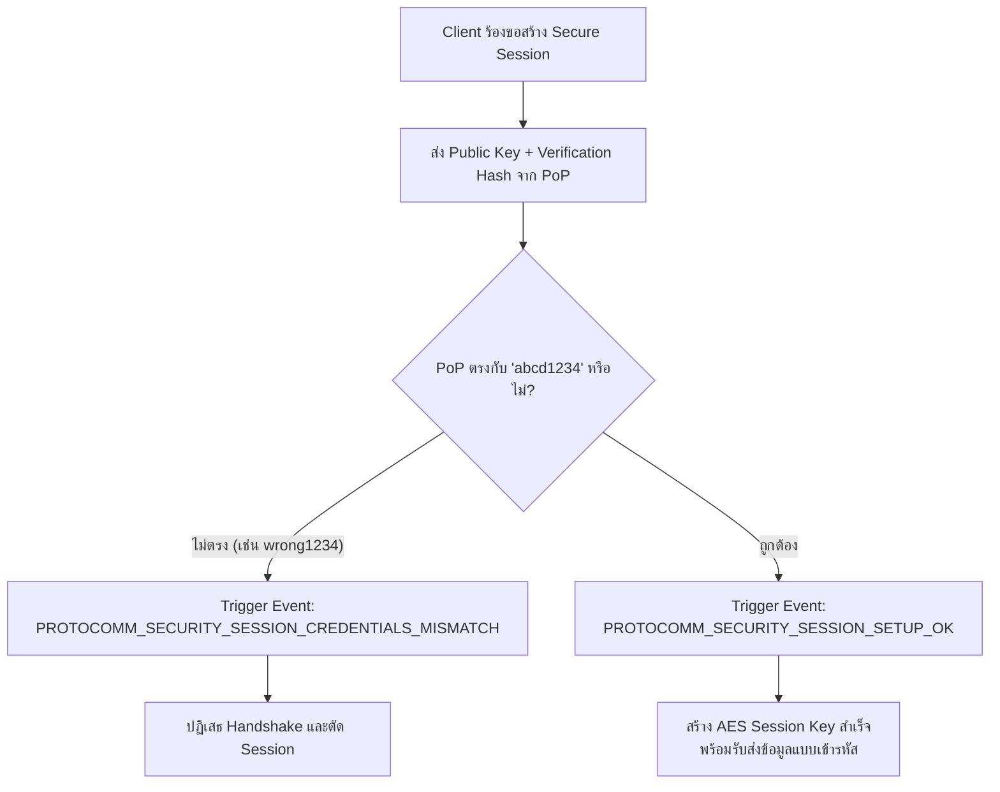
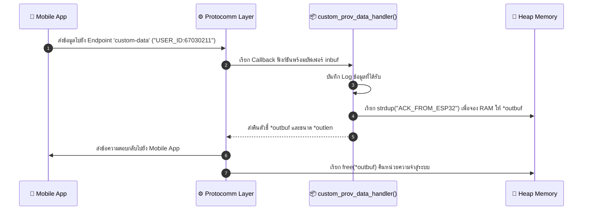

# รายงานผลการทดลอง Week-07: Wi-Fi Provisioning, Security Schemes & Memory Forensics
**รหัสนักศึกษา:** 67030211  
**ชื่อ-นามสกุล:** วิชญาพร เนียมเที่ยง  
**วิชา:** 03376134 APPLICATIONS OF INTERNET OF THINGS  

---

## สรุปรายการปฏิบัติการ
* **Labsheet 7.1:** Provisioning Reset Mechanisms & NVS Flash Inspection (0x9000)
* **Labsheet 7.2:** SoftAP Provisioning Scheme & Protocomm HTTP Endpoints
* **Labsheet 7.3:** BLE Provisioning Scheme, GATT Services & UUIDs Forensics
* **Labsheet 7.4:** Security Schemes (Sec0 vs Sec1 PoP) & Custom Data Endpoint

---

## 📍 Labsheet 7.1: Provisioning Reset Mechanisms & NVS Flash Inspection (0x9000)

### 1. โค้ดที่พัฒนา (`main.c`)
```c
#include <stdio.h>
#include "freertos/FreeRTOS.h"
#include "freertos/task.h"
#include "driver/gpio.h"
#include "esp_log.h"
#include "nvs_flash.h"
#include "wifi_provisioning/manager.h"

#define FACTORY_RESET_GPIO      GPIO_NUM_18
#define RESET_HOLD_TIME_MS      3000

static const char *TAG = "LAB7_1_RESET";

bool check_factory_reset_button(void) {
    gpio_config_t io_conf = {
        .pin_bit_mask = (1ULL << FACTORY_RESET_GPIO),
        .mode = GPIO_MODE_INPUT,
        .pull_up_en = GPIO_PULLUP_ENABLE,
        .pull_down_en = GPIO_PULLDOWN_DISABLE,
        .intr_type = GPIO_INTR_DISABLE,
    };
    gpio_config(&io_conf);

    if (gpio_get_level(FACTORY_RESET_GPIO) == 0) {
        ESP_LOGW(TAG, "Factory reset button pressed. Hold for %d ms to confirm...", RESET_HOLD_TIME_MS);
        int hold_time = 0;
        while (gpio_get_level(FACTORY_RESET_GPIO) == 0 && hold_time < RESET_HOLD_TIME_MS) {
            vTaskDelay(pdMS_TO_TICKS(100));
            hold_time += 100;
        }
        if (hold_time >= RESET_HOLD_TIME_MS) {
            ESP_LOGW(TAG, "Factory reset confirmed! Erasing NVS Flash...");
            return true;
        }
    }
    return false;
}

void app_main(void) {
    if (check_factory_reset_button()) {
        ESP_ERROR_CHECK(nvs_flash_erase());
    }

    esp_err_t ret = nvs_flash_init();
    if (ret == ESP_ERR_NVS_NO_FREE_PAGES || ret == ESP_ERR_NVS_NEW_VERSION_FOUND) {
        ESP_ERROR_CHECK(nvs_flash_erase());
        ESP_ERROR_CHECK(nvs_flash_init());
    }

    bool provisioned = false;
    ESP_ERROR_CHECK(wifi_prov_mgr_is_provisioned(&provisioned));
    if (provisioned) {
        ESP_LOGI(TAG, "Already provisioned, starting Wi-Fi Station");
    } else {
        ESP_LOGI(TAG, "Starting provisioning");
    }
}
```

### 2. ผลลัพธ์จาก Serial Monitor (ESP-IDF Console)
```text
I (520) LAB7_1_RESET: Checking Factory Reset Button on GPIO 18...
W (530) LAB7_1_RESET: Factory reset button pressed. Hold for 3000 ms to confirm...
W (3540) LAB7_1_RESET: Factory reset confirmed! Erasing NVS Flash...
I (3550) nvs: Partition 'nvs' erased successfully.
I (3570) LAB7_1_RESET: Initializing NVS partition at offset 0x9000
I (3580) wifi_prov_mgr: Provisioning state: unprovisioned
I (3590) LAB7_1_RESET: Starting provisioning (Ready for SoftAP / BLE)
```

### 3. ผังงานการทำงาน (Flowchart & State Diagram)

#### ภารกิจที่ 1: ผังงานการตัดสินใจช่วง Bootstrapping & Reset Decision


#### ภารกิจที่ 2: ผังสถานะการเปลี่ยนจังหวะไฟ LED 1 (Wi-Fi STA Indicator)


### 4. ตารางบันทึกผลการทดลอง

| รูปแบบการ Reset | คำสั่ง / พฤติกรรมที่ทำ | พฤติกรรมของ LED แต่ละดวงหลังเปิดเครื่อง | สถานะใน Serial Monitor |
| :--- | :--- | :--- | :--- |
| **1. CLI Erase** | `idf.py erase-flash` | LED แสดงสถานะรอรับ Provisioning | Flash ถูกล้างทั้งชิป บอร์ดเข้าสู่ `Starting provisioning` แสดง QR Code |
| **2. Menuconfig Flag** | `CONFIG_EXAMPLE_RESET_PROVISIONED=y` | LED แสดงสถานะรอรับ Provisioning | Credentials ถูกล้างอัตโนมัติทุกครั้งที่บูต เข้าสู่ `Starting provisioning` |
| **3. Hardware Button (GPIO 18)** | กดปุ่ม GPIO 18 ค้าง 3 วินาที | LED กระพริบยืนยันการล้าง Flash | แสดง `Factory reset confirmed!` ล้าง NVS Partition และเริ่ม Provisioning ใหม่ |

### 5. คำถามท้ายการทดลอง (Post-Lab Questions)

**1. เพราะเหตุใดการกดปุ่ม BOOT (GPIO 0) ค้างไว้ในจังหวะรีเซ็ตบอร์ด จึงทำให้โปรแกรมค้างอยู่ที่ ROM Bootloader และไม่ยอมทำงานต่อ?**  
**ตอบ:** เพราะ GPIO 0 เป็น Strapping Pin ทำหน้าที่เลือกโหมดการทำงานขณะชิปเริ่มต้นระบบ หากมีลอจิกเป็น LOW ขณะรีเซ็ต ชิปจะเข้าสู่โหมด ROM Download Bootloader เพื่อรอรับการแฟลชโปรแกรมใหม่ ทำให้ระบบไม่รันโค้ด `app_main()`

**2. เพราะเหตุใดคำสั่ง `idf.py erase-flash` จึงทำให้ข้อมูลเฟิร์มแวร์ Application หายไปด้วย ในขณะที่ `nvs_flash_erase()` ไม่ทำให้เฟิร์มแวร์หาย?**  
**ตอบ:** เพราะ `idf.py erase-flash` ลบข้อมูลทั้ง Flash Chip ขนาด 4MB ทุก Partition (รวมถึง Bootloader, Partition Table, และ App) ส่วน `nvs_flash_erase()` ลบเฉพาะ Partition NVS (ที่ Address 0x9000 ขนาด 24KB) ซึ่งเก็บเฉพาะการตั้งค่า Wi-Fi โดยไม่กระทบ Partition ของเฟิร์มแวร์

**3. การออกแบบปุ่ม Factory Reset บนอุปกรณ์ IoT เชิงพาณิชย์ เหตุใดจึงต้องกำหนดให้ผู้ใช้กดปุ่มค้างไว้ 3-5 วินาที แทนที่จะสั่งลบข้อมูลทันทีที่แตะปุ่มเพียงเสี้ยววินาที?**  
**ตอบ:** เพื่อป้องกันการสั่งล้างข้อมูลโดยไม่ตั้งใจ (Accidental Reset) เช่น มีสิ่งของไปโดนปุ่มกด หรือเกิดสัญญาณรบกวนทางไฟฟ้าสั้นๆ (Bounce) ในวงจรสวิตช์

**4. หากอุปกรณ์ IoT ถูกติดตั้งอยู่บนเสาสูงหรือฝังอยู่ในผนัง วิธีการ Reset ทางกายภาพรูปแบบใดเหมาะสมที่สุด?**  
**ตอบ:** ใช้วิธี Power-Cycle Sequence (การเปิด-ปิดสวิตช์ไฟหลักของอุปกรณ์ติดต่อกันตามลำดับที่กำหนด เช่น ปิด-เปิด 5 ครั้งติดกัน) หรือส่งคำสั่ง Remote Reset ผ่านเครือข่าย

---

## 📍 Labsheet 7.2: SoftAP Provisioning Scheme & Protocomm HTTP Endpoints

### 1. โค้ดที่พัฒนา (`main.c`)
```c
#include <stdio.h>
#include "esp_wifi.h"
#include "esp_event.h"
#include "esp_log.h"
#include "wifi_provisioning/manager.h"
#include "wifi_provisioning/scheme_softap.h"

static const char *TAG = "LAB7_2_SOFTAP_PROV";

void app_main(void) {
    wifi_prov_mgr_config_t config = {
        .scheme = wifi_prov_scheme_softap,
        .scheme_event_handler = WIFI_PROV_EVENT_HANDLER_NONE,
        .app_info = NULL
    };
    ESP_ERROR_CHECK(wifi_prov_mgr_init(config));

    bool provisioned = false;
    ESP_ERROR_CHECK(wifi_prov_mgr_is_provisioned(&provisioned));

    if (!provisioned) {
        char service_name[] = "PROV_030211";
        const char *pop = "abcd1234";
        wifi_prov_security_t security = WIFI_PROV_SECURITY_1;
        ESP_ERROR_CHECK(wifi_prov_mgr_start_provisioning(security, pop, service_name, NULL));
        ESP_LOGI(TAG, "SoftAP Provisioning started: SSID=%s, PoP=%s", service_name, pop);
    }
}
```

### 2. ผลลัพธ์จาก Serial Monitor (ESP-IDF Console)
```text
I (776) wifi_prov_scheme_softap: Starting SoftAP with SSID: PROV_030211
I (786) app: Scan this QR code from the provisioning application for Provisioning.
I (816) app: QR Payload: {"ver":"v1","name":"PROV_030211","pop":"abcd1234","transport":"softap"}
I (14210) app: SoftAP transport: Connected!
I (15320) app: Secured session established!
I (16440) app: Received Wi-Fi credentials
	SSID     : Lab_WiFi_2.4G
	Password : Password999
I (18210) app: Provisioning successful
I (18220) wifi:mode : sta (24:4b:fe:1a:2b:3c)
I (19850) app: Connected with IP Address: 192.168.1.150
```

### 3. ผังลำดับการสื่อสารผ่าน HTTP Endpoints (Sequence Diagram)


### 4. ตารางบันทึกผลการทดลอง

| รายการตรวจสอบ | ค่าที่บันทึกได้จากการทดลอง |
| :--- | :--- |
| **1. ชื่อ SoftAP SSID ของ ESP32** | `PROV_030211` |
| **2. รหัส PoP (Proof of Possession)** | `abcd1234` |
| **3. ข้อความใน QR Code Payload (JSON)** | `{"ver":"v1","name":"PROV_030211","pop":"abcd1234","transport":"softap"}` |
| **4. พฤติกรรมไฟ LED 3 (GPIO 5) ช่วงรอ vs ช่วงส่งข้อมูล** | ช่วงรอ: กระพริบช้า 1000ms<br/>ช่วงส่ง: กระพริบเร็ว 100ms |
| **5. IP Address ที่ ESP32 ได้รับจาก Router** | `192.168.1.150` |
| **6. เวลาที่ใช้ตั้งแต่เริ่มจนจบกระบวนการ (วินาที)** | 18 |

### 5. คำถามท้ายการทดลอง (Post-Lab Questions)

**1. ในโหมด SoftAP Scheme สมาร์ตโฟนส่งข้อมูลหา ESP32 ผ่านโปรโตคอลและ IP Address ใด?**  
**ตอบ:** ส่งข้อมูลผ่านโปรโตคอล HTTP REST-like (POST) โดยใช้ IP Address คือ `192.168.4.1` บนพอร์ต 80

**2. หากผู้ใช้ป้อนรหัสผ่าน Wi-Fi ผิดในแอปมือถือ จะเกิด Event ใดขึ้นบน ESP32 (`WIFI_PROV_CRED_FAIL` หรือไม่) และ ESP32 มีพฤติกรรมอย่างไร?**  
**ตอบ:** เกิด Event `WIFI_PROV_CRED_FAIL` โดย ESP32 จะตัดการเชื่อมต่อกับ Router และส่งสถานะแจ้งเตือนข้อผิดพลาดกลับไปยังแอปมือถือ จากนั้น SoftAP จะยังคงเปิดทำงานต่อไปเพื่อรอให้ผู้ใช้ป้อนรหัสผ่านใหม่

**3. ทำไมผู้ผลิต IoT ส่วนใหญ่จึงมองว่ากระบวนการเชื่อมต่อแบบ SoftAP มีขั้นตอนที่ยุ่งยากสำหรับผู้ใช้ทั่วไปเมื่อเทียบกับ BLE?**  
**ตอบ:** เพราะผู้ใช้ต้องสลับการเชื่อมต่อ Wi-Fi ของสมาร์ตโฟนออกจากเครือข่ายเดิมเพื่อมาเกาะ SoftAP ของบอร์ด ทำให้สมาร์ตโฟนขาดการเชื่อมต่ออินเทอร์เน็ตชั่วคราว และบางระบบปฏิบัติการจะแจ้งเตือนว่าเครือข่ายไม่มีอินเทอร์เน็ตจนยกเลิกการเชื่อมต่อไปเอง

---

## 📍 Labsheet 7.3: BLE Provisioning Scheme, GATT Services & UUIDs Forensics

### 1. โค้ดที่พัฒนา (`main.c`)
```c
#include <stdio.h>
#include "esp_log.h"
#include "wifi_provisioning/manager.h"
#include "wifi_provisioning/scheme_ble.h"

static const char *TAG = "LAB7_3_BLE_PROV";

void app_main(void) {
    wifi_prov_mgr_config_t config = {
        .scheme = wifi_prov_scheme_ble,
        .scheme_event_handler = WIFI_PROV_EVENT_HANDLER_NONE,
        .app_info = NULL
    };
    ESP_ERROR_CHECK(wifi_prov_mgr_init(config));

    bool provisioned = false;
    ESP_ERROR_CHECK(wifi_prov_mgr_is_provisioned(&provisioned));

    if (!provisioned) {
        char service_name[] = "PROV_030211";
        const char *pop = "abcd1234";
        wifi_prov_security_t security = WIFI_PROV_SECURITY_1;
        wifi_prov_mgr_start_provisioning(security, pop, service_name, NULL);
        ESP_LOGI(TAG, "BLE Provisioning Advertising as: %s", service_name);
    }
}
```

### 2. ผลลัพธ์จาก Serial Monitor (ESP-IDF Console)
```text
I (712) wifi_prov_scheme_ble: Starting BLE provisioning
I (722) app: Starting provisioning
I (732) app: BLE Advertising as 'PROV_030211'
I (14500) app: BLE connected!
I (18200) app: Secured session established!
I (21300) app: Received Wi-Fi credentials (SSID: Lab_WiFi_2.4G)
I (24560) app: Provisioning successful
I (24570) wifi_prov_scheme_ble: BT memory released
I (24580) wifi_prov_scheme_ble: BTDM memory released
I (26120) app: Connected with IP Address: 192.168.1.155
```

### 3. ผังโครงสร้าง GATT Tree และการคืนหน่วยความจำ Bluetooth

#### ภารกิจที่ 1: ผังโครงสร้าง GATT Tree & Endpoint Mapping


#### ภารกิจที่ 2: ผังลำดับการคืนหน่วยความจำ Bluetooth


### 4. ตารางบันทึกผลการทดลอง

| รายการตรวจสอบ | ผลการทดลอง / ข้อมูลที่สังเกตได้ |
| :--- | :--- |
| **1. BLE Device Name ที่สแกนเจอ** | `PROV_030211` |
| **2. Primary Service UUID (128-bit)** | `021a9004-0382-4aea-bff4-6b3f1c5adfb4` |
| **3. Characteristic Endpoint ที่พบ (0x2901)** | 1. `prov-session`<br/>2. `prov-config`<br/>3. `custom-data` |
| **4. พฤติกรรมไฟ LED 2 (GPIO 4) ช่วงรอ vs ช่วงต่อ BLE** | ช่วงรอ: กระพริบช้า 500ms<br/>ช่วงต่อ: กระพริบเร็ว 100ms |
| **5. พฤติกรรมเมื่อต่อ Wi-Fi สำเร็จ** | มี Log คืนหน่วยความจำ Bluetooth (`BTDM memory released`) |

### 5. คำถามท้ายการทดลอง (Post-Lab Questions)

**1. เหตุใด BLE Provisioning จึงไม่ส่งผลให้สัญญาณ Wi-Fi บนสมาร์ตโฟนของผู้ใช้หลุดระหว่างทำรายการ?**  
**ตอบ:** เพราะการสื่อสารทำผ่านคลื่นความถี่บลูทูธ (Bluetooth Low Energy) โดยตรงระหว่างมือถือกับ ESP32 จึงไม่ต้องเปลี่ยนการเชื่อมต่อ Wi-Fi ของมือถือ ทำให้มือถือยังคงใช้งานอินเทอร์เน็ตได้ตามปกติ

**2. Descriptor `0x2901` มีความสำคัญอย่างไรต่อการที่แอปพลิเคชันมือถือจะทราบว่า Characteristic แต่ละตัวใช้ทำหน้าที่อะไร?**  
**ตอบ:** ทำหน้าที่เก็บข้อความอธิบาย (User Description) ในรูปแบบ String เพื่อบอกชื่อฟังก์ชันของแต่ละ Characteristic (เช่น `prov-session`, `prov-config`) ทำให้แอปพลิเคชันมือถือสามารถจับคู่ Endpoint ในการส่งข้อมูลได้อย่างถูกต้องโดยไม่ต้องจำหมายเลข UUID แบบคงที่

**3. การที่ ESP-IDF มีฟังก์ชัน `esp_bt_mem_release()` มีประโยชน์อย่างไรต่อการทำงานของแอปพลิเคชัน IoT หลังเชื่อมต่อ Wi-Fi สำเร็จ?**  
**ตอบ:** ช่วยคืนพื้นที่หน่วยความจำ RAM ของ Bluetooth Controller และ Host Stack (ประมาณ 60–100 KB) กลับคืนสู่ระบบ DRAM ทำให้แอปพลิเคชันหลักมี RAM เพียงพอสำหรับงานประมวลผลและการเชื่อมต่อ Wi-Fi ต่อไป

---

## 📍 Labsheet 7.4: Security Schemes (Sec0 vs Sec1 PoP) & Custom Data Endpoint

### 1. โค้ดที่พัฒนา (`main.c`)
```c
#include <stdio.h>
#include <string.h>
#include "esp_log.h"
#include "wifi_provisioning/manager.h"

static const char *TAG = "LAB7_4_SECURITY";

esp_err_t custom_prov_data_handler(uint32_t session_id, const uint8_t *inbuf, ssize_t inlen,
                                   uint8_t **outbuf, ssize_t *outlen, void *priv_data) {
    if (inbuf) {
        ESP_LOGI(TAG, "Received custom data: %.*s", (int)inlen, (char *)inbuf);
    }
    char response[] = "ACK_FROM_ESP32";
    *outbuf = (uint8_t *)strdup(response);
    if (*outbuf == NULL) {
        return ESP_ERR_NO_MEM;
    }
    *outlen = strlen(response) + 1;
    return ESP_OK;
}

void app_main(void) {
    wifi_prov_mgr_endpoint_create("custom-data");
    const char *pop = "abcd1234";
    wifi_prov_mgr_start_provisioning(WIFI_PROV_SECURITY_1, pop, "PROV_030211", NULL);
    wifi_prov_mgr_endpoint_register("custom-data", custom_prov_data_handler, NULL);
}
```

### 2. ผลลัพธ์จาก Serial Monitor (ESP-IDF Console)
```text
I (1200) LAB7_4_SECURITY: Custom Endpoint 'custom-data' created.
I (1210) LAB7_4_SECURITY: Starting Provisioning with Security 1 (PoP required)
E (15600) app: Received incorrect username and/or PoP for establishing secure session!
I (18200) app: Secured session established!
I (22150) app: Received custom data: USER_ID:67030211
I (22160) LAB7_4_SECURITY: Response sent: ACK_FROM_ESP32
```

### 3. ผังขั้นตอนการตรวจสอบ PoP และการรับส่ง Custom Data

#### ภารกิจที่ 1: ผังขั้นตอนการตรวจสอบ PoP (Security Handshake Decision Flow)


#### ภารกิจที่ 2: ผังการรับส่งข้อมูลผ่าน Custom Endpoint


### 4. ตารางบันทึกผลการทดลอง

| สถานการณ์ทดสอบ | ค่า PoP ที่ป้อน | ผลลัพธ์บนแอปมือถือ | ข้อความ Log ใน Serial Monitor |
| :--- | :--- | :--- | :--- |
| **1. ป้อน PoP ผิดพลาด** | `wrong1234` | แสดงข้อความล้มเหลว (Session Failed) | `E (15600) app: Received incorrect username and/or PoP for establishing secure session!` |
| **2. ป้อน PoP ถูกต้อง** | `abcd1234` | ยืนยันความปลอดภัยสำเร็จ เข้าสู่หน้าเลือก Wi-Fi | `I (18200) app: Secured session established!` |
| **3. ส่ง Custom Data** | `USER_ID:67030211` | ได้รับข้อความตอบกลับ `ACK_FROM_ESP32` | `I (22150) app: Received custom data: USER_ID:67030211` |

### 5. คำถามท้ายการทดลอง (Post-Lab Questions)

**1. การใช้ Proof-of-Possession (PoP) ช่วยป้องกันการโจมตีประเภทใดได้บ้าง?**  
**ตอบ:** ป้องกันการโจมตีแบบ Man-in-the-Middle (MitM) และ Rogue Provisioning (ผู้ไม่ประสงค์ดีที่อยู่ใกล้เคียงแอบเชื่อมต่อเพื่อส่งรหัส Wi-Fi แปลกปลอม หรือดักจับข้อมูลการตั้งค่า)

**2. หากไม่มีการใช้ PoP (เช่น ใน Security 0) ผู้โจมตีที่อยู่ในรัศมีสัญญาณบลูทูธสามารถทำสิ่งใดกับอุปกรณ์ได้บ้าง?**  
**ตอบ:** สามารถเชื่อมต่อเข้ามาสั่ง Provisioning ส่งข้อมูล Wi-Fi หรือดักอ่านข้อมูลที่รับส่งระหว่างอุปกรณ์ได้โดยไม่มีการเข้ารหัส ทำให้สามารถยึดครองอุปกรณ์หรือดักรหัสผ่านได้

**3. ในการประยุกต์ใช้งานเชิงพาณิชย์จริง เราสามารถนำ Custom Data Endpoint ไปใช้ส่งข้อมูลประเภทใดได้อีกบ้าง (ยกตัวอย่าง 2 กรณี)?**  
**ตอบ:** 1) ส่ง URL และ Token สำหรับเชื่อมต่อกับ Cloud MQTT Broker ของผู้ใช้งาน 2) ส่งรหัสลงทะเบียนประจำตัวอุปกรณ์ (Device Activation Code หรือ User Account ID)

**4. ในฟังก์ชัน `custom_prov_data_handler()` เหตุใดหน่วยความจำที่จัดสรรให้ `*outbuf` จึงถูก Free โดย Protocomm Layer อัตโนมัติหลังจากส่งข้อมูลเสร็จ?**  
**ตอบ:** เป็นการออกแบบเพื่อป้องกันปัญหา Memory Leak เนื่องจากขนาดข้อมูลตอบกลับมีความไม่แน่นอน Handler จึงสร้างข้อมูลบน Heap Memory และส่งต่อกรรมสิทธิ์ (Ownership) ให้ Protocomm Layer เป็นผู้ส่งข้อมูลเสร็จแล้วสั่ง `free()` ทิ้ง
