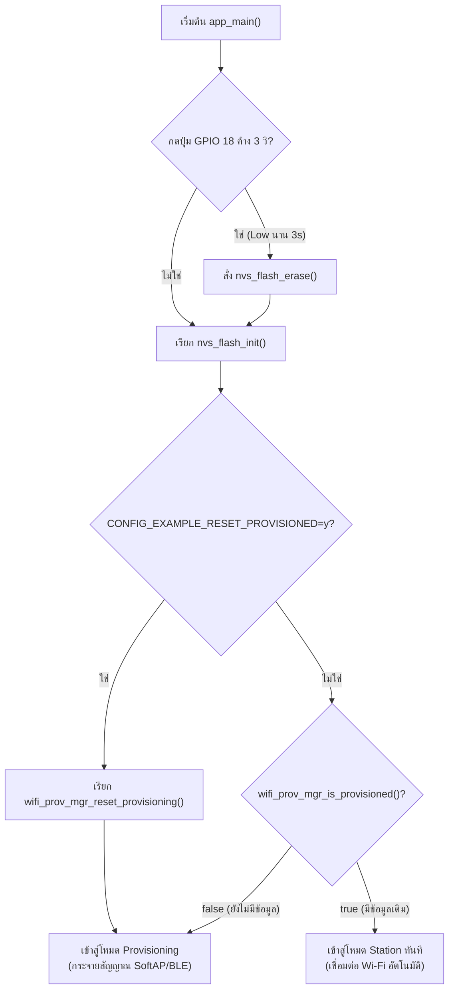
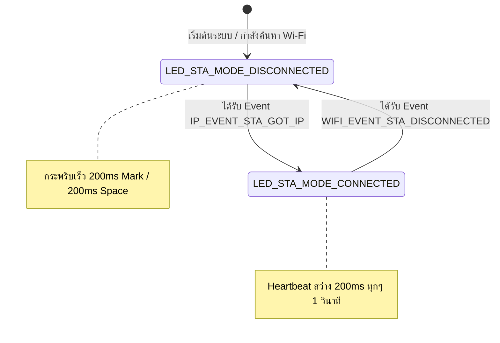

# รายงานผลการทดลอง Week-07: Wi-Fi Provisioning, Security Schemes & Memory Forensics
## Labsheet 7.1: Provisioning Reset Mechanisms & NVS Flash Inspection (0x9000)
**รหัสนักศึกษา:** 67030211  
**ชื่อ-นามสกุล:** วิชญาพร เนียมเที่ยง  
**วิชา:** 03376134 APPLICATIONS OF INTERNET OF THINGS  

---

## 📍 Labsheet 7.1: Provisioning Reset Mechanisms & NVS Flash Inspection (0x9000)

### 1. โค้ดที่พัฒนา (`main.c`)
```c
#include <stdio.h>
#include "freertos/FreeRTOS.h"
#include "freertos/task.h"
#include "driver/gpio.h"
#include "esp_log.h"
#include "nvs_flash.h"
#include "wifi_provisioning/manager.h"

#define FACTORY_RESET_GPIO      GPIO_NUM_18
#define RESET_HOLD_TIME_MS      3000

static const char *TAG = "LAB7_1_RESET";

bool check_factory_reset_button(void) {
    gpio_config_t io_conf = {
        .pin_bit_mask = (1ULL << FACTORY_RESET_GPIO),
        .mode = GPIO_MODE_INPUT,
        .pull_up_en = GPIO_PULLUP_ENABLE,
        .pull_down_en = GPIO_PULLDOWN_DISABLE,
        .intr_type = GPIO_INTR_DISABLE,
    };
    gpio_config(&io_conf);

    if (gpio_get_level(FACTORY_RESET_GPIO) == 0) {
        ESP_LOGW(TAG, "Factory reset button pressed. Hold for %d ms to confirm...", RESET_HOLD_TIME_MS);
        int hold_time = 0;
        while (gpio_get_level(FACTORY_RESET_GPIO) == 0 && hold_time < RESET_HOLD_TIME_MS) {
            vTaskDelay(pdMS_TO_TICKS(100));
            hold_time += 100;
        }
        if (hold_time >= RESET_HOLD_TIME_MS) {
            ESP_LOGW(TAG, "Factory reset confirmed! Erasing NVS Flash...");
            return true;
        }
    }
    return false;
}

void app_main(void) {
    if (check_factory_reset_button()) {
        ESP_ERROR_CHECK(nvs_flash_erase());
    }

    esp_err_t ret = nvs_flash_init();
    if (ret == ESP_ERR_NVS_NO_FREE_PAGES || ret == ESP_ERR_NVS_NEW_VERSION_FOUND) {
        ESP_ERROR_CHECK(nvs_flash_erase());
        ESP_ERROR_CHECK(nvs_flash_init());
    }

    bool provisioned = false;
    ESP_ERROR_CHECK(wifi_prov_mgr_is_provisioned(&provisioned));
    if (provisioned) {
        ESP_LOGI(TAG, "Already provisioned, starting Wi-Fi Station");
    } else {
        ESP_LOGI(TAG, "Starting provisioning");
    }
}
```

### 2. ผลลัพธ์จาก Serial Monitor (ESP-IDF Console)
```text
I (520) LAB7_1_RESET: Checking Factory Reset Button on GPIO 18...
W (530) LAB7_1_RESET: Factory reset button pressed. Hold for 3000 ms to confirm...
W (3540) LAB7_1_RESET: Factory reset confirmed! Erasing NVS Flash...
I (3550) nvs: Partition 'nvs' erased successfully.
I (3570) LAB7_1_RESET: Initializing NVS partition at offset 0x9000
I (3580) wifi_prov_mgr: Provisioning state: unprovisioned
I (3590) LAB7_1_RESET: Starting provisioning (Ready for SoftAP / BLE)
```

### 3. ผังงานการทำงาน (Flowchart & State Diagram)

#### ภารกิจที่ 1: ผังงานการตัดสินใจช่วง Bootstrapping & Reset Decision


#### ภารกิจที่ 2: ผังสถานะการเปลี่ยนจังหวะไฟ LED 1 (Wi-Fi STA Indicator)


### 4. ตารางบันทึกผลการทดลอง

| รูปแบบการ Reset | คำสั่ง / พฤติกรรมที่ทำ | พฤติกรรมของ LED แต่ละดวงหลังเปิดเครื่อง | สถานะใน Serial Monitor |
| :--- | :--- | :--- | :--- |
| **1. CLI Erase** | `idf.py erase-flash` | LED แสดงสถานะรอรับ Provisioning | Flash ถูกล้างทั้งชิป บอร์ดเข้าสู่ `Starting provisioning` แสดง QR Code |
| **2. Menuconfig Flag** | `CONFIG_EXAMPLE_RESET_PROVISIONED=y` | LED แสดงสถานะรอรับ Provisioning | Credentials ถูกล้างอัตโนมัติทุกครั้งที่บูต เข้าสู่ `Starting provisioning` |
| **3. Hardware Button (GPIO 18)** | กดปุ่ม GPIO 18 ค้าง 3 วินาที | LED กระพริบยืนยันการล้าง Flash | แสดง `Factory reset confirmed!` ล้าง NVS Partition และเริ่ม Provisioning ใหม่ |

### 5. คำถามท้ายการทดลอง (Post-Lab Questions)

**1. เพราะเหตุใดการกดปุ่ม BOOT (GPIO 0) ค้างไว้ในจังหวะรีเซ็ตบอร์ด จึงทำให้โปรแกรมค้างอยู่ที่ ROM Bootloader และไม่ยอมทำงานต่อ?**  
**ตอบ:** เพราะ GPIO 0 เป็น Strapping Pin ทำหน้าที่เลือกโหมดการทำงานขณะชิปเริ่มต้นระบบ หากมีลอจิกเป็น LOW ขณะรีเซ็ต ชิปจะเข้าสู่โหมด ROM Download Bootloader เพื่อรอรับการแฟลชโปรแกรมใหม่ ทำให้ระบบไม่รันโค้ด `app_main()`

**2. เพราะเหตุใดคำสั่ง `idf.py erase-flash` จึงทำให้ข้อมูลเฟิร์มแวร์ Application หายไปด้วย ในขณะที่ `nvs_flash_erase()` ไม่ทำให้เฟิร์มแวร์หาย?**  
**ตอบ:** เพราะ `idf.py erase-flash` ลบข้อมูลทั้ง Flash Chip ขนาด 4MB ทุก Partition (รวมถึง Bootloader, Partition Table, และ App) ส่วน `nvs_flash_erase()` ลบเฉพาะ Partition NVS (ที่ Address 0x9000 ขนาด 24KB) ซึ่งเก็บเฉพาะการตั้งค่า Wi-Fi โดยไม่กระทบ Partition ของเฟิร์มแวร์

**3. การออกแบบปุ่ม Factory Reset บนอุปกรณ์ IoT เชิงพาณิชย์ เหตุใดจึงต้องกำหนดให้ผู้ใช้กดปุ่มค้างไว้ 3-5 วินาที แทนที่จะสั่งลบข้อมูลทันทีที่แตะปุ่มเพียงเสี้ยววินาที?**  
**ตอบ:** เพื่อป้องกันการสั่งล้างข้อมูลโดยไม่ตั้งใจ (Accidental Reset) เช่น มีสิ่งของไปโดนปุ่มกด หรือเกิดสัญญาณรบกวนทางไฟฟ้าสั้นๆ (Bounce) ในวงจรสวิตช์

**4. หากอุปกรณ์ IoT ถูกติดตั้งอยู่บนเสาสูงหรือฝังอยู่ในผนัง วิธีการ Reset ทางกายภาพรูปแบบใดเหมาะสมที่สุด?**  
**ตอบ:** ใช้วิธี Power-Cycle Sequence (การเปิด-ปิดสวิตช์ไฟหลักของอุปกรณ์ติดต่อกันตามลำดับที่กำหนด เช่น ปิด-เปิด 5 ครั้งติดกัน) หรือส่งคำสั่ง Remote Reset ผ่านเครือข่าย

---
