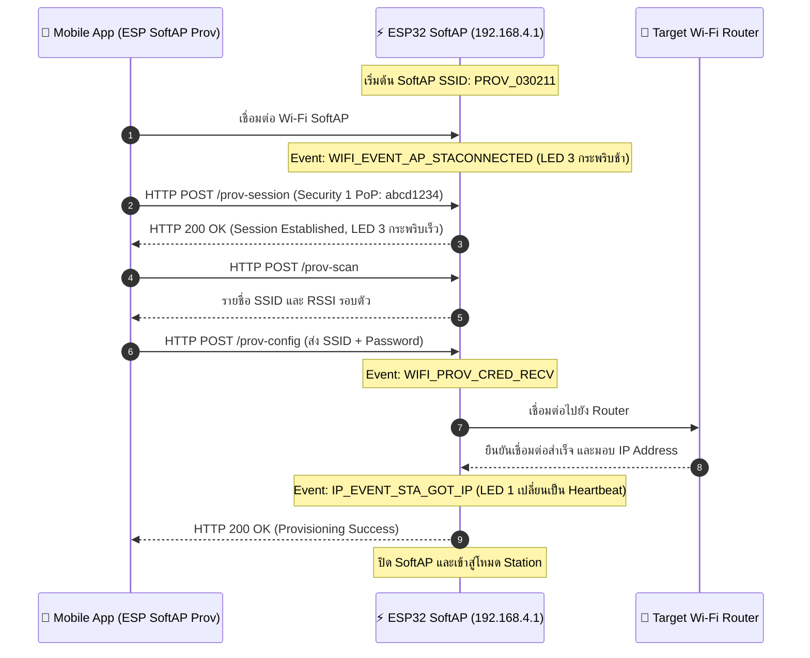

# รายงานผลการทดลอง Week-07: Wi-Fi Provisioning, Security Schemes & Memory Forensics
## Labsheet 7.2: SoftAP Provisioning Scheme & Protocomm HTTP Endpoints
**รหัสนักศึกษา:** 67030211  
**ชื่อ-นามสกุล:** วิชญาพร เนียมเที่ยง  
**วิชา:** 03376134 APPLICATIONS OF INTERNET OF THINGS  

---

## 📍 Labsheet 7.2: SoftAP Provisioning Scheme & Protocomm HTTP Endpoints

### 1. โค้ดที่พัฒนา (`main.c`)
```c
#include <stdio.h>
#include "esp_wifi.h"
#include "esp_event.h"
#include "esp_log.h"
#include "wifi_provisioning/manager.h"
#include "wifi_provisioning/scheme_softap.h"

static const char *TAG = "LAB7_2_SOFTAP_PROV";

void app_main(void) {
    wifi_prov_mgr_config_t config = {
        .scheme = wifi_prov_scheme_softap,
        .scheme_event_handler = WIFI_PROV_EVENT_HANDLER_NONE,
        .app_info = NULL
    };
    ESP_ERROR_CHECK(wifi_prov_mgr_init(config));

    bool provisioned = false;
    ESP_ERROR_CHECK(wifi_prov_mgr_is_provisioned(&provisioned));

    if (!provisioned) {
        char service_name[] = "PROV_030211";
        const char *pop = "abcd1234";
        wifi_prov_security_t security = WIFI_PROV_SECURITY_1;
        ESP_ERROR_CHECK(wifi_prov_mgr_start_provisioning(security, pop, service_name, NULL));
        ESP_LOGI(TAG, "SoftAP Provisioning started: SSID=%s, PoP=%s", service_name, pop);
    }
}
```

### 2. ผลลัพธ์จาก Serial Monitor (ESP-IDF Console)
```text
I (776) wifi_prov_scheme_softap: Starting SoftAP with SSID: PROV_030211
I (786) app: Scan this QR code from the provisioning application for Provisioning.
I (816) app: QR Payload: {"ver":"v1","name":"PROV_030211","pop":"abcd1234","transport":"softap"}
I (14210) app: SoftAP transport: Connected!
I (15320) app: Secured session established!
I (16440) app: Received Wi-Fi credentials
	SSID     : Lab_WiFi_2.4G
	Password : Password999
I (18210) app: Provisioning successful
I (18220) wifi:mode : sta (24:4b:fe:1a:2b:3c)
I (19850) app: Connected with IP Address: 192.168.1.150
```

### 3. ผังลำดับการสื่อสารผ่าน HTTP Endpoints (Sequence Diagram)


### 4. ตารางบันทึกผลการทดลอง

| รายการตรวจสอบ | ค่าที่บันทึกได้จากการทดลอง |
| :--- | :--- |
| **1. ชื่อ SoftAP SSID ของ ESP32** | `PROV_030211` |
| **2. รหัส PoP (Proof of Possession)** | `abcd1234` |
| **3. ข้อความใน QR Code Payload (JSON)** | `{"ver":"v1","name":"PROV_030211","pop":"abcd1234","transport":"softap"}` |
| **4. พฤติกรรมไฟ LED 3 (GPIO 5) ช่วงรอ vs ช่วงส่งข้อมูล** | ช่วงรอ: กระพริบช้า 1000ms<br/>ช่วงส่ง: กระพริบเร็ว 100ms |
| **5. IP Address ที่ ESP32 ได้รับจาก Router** | `192.168.1.150` |
| **6. เวลาที่ใช้ตั้งแต่เริ่มจนจบกระบวนการ (วินาที)** | 18 |

### 5. คำถามท้ายการทดลอง (Post-Lab Questions)

**1. ในโหมด SoftAP Scheme สมาร์ตโฟนส่งข้อมูลหา ESP32 ผ่านโปรโตคอลและ IP Address ใด?**  
**ตอบ:** ส่งข้อมูลผ่านโปรโตคอล HTTP REST-like (POST) โดยใช้ IP Address คือ `192.168.4.1` บนพอร์ต 80

**2. หากผู้ใช้ป้อนรหัสผ่าน Wi-Fi ผิดในแอปมือถือ จะเกิด Event ใดขึ้นบน ESP32 (`WIFI_PROV_CRED_FAIL` หรือไม่) และ ESP32 มีพฤติกรรมอย่างไร?**  
**ตอบ:** เกิด Event `WIFI_PROV_CRED_FAIL` โดย ESP32 จะตัดการเชื่อมต่อกับ Router และส่งสถานะแจ้งเตือนข้อผิดพลาดกลับไปยังแอปมือถือ จากนั้น SoftAP จะยังคงเปิดทำงานต่อไปเพื่อรอให้ผู้ใช้ป้อนรหัสผ่านใหม่

**3. ทำไมผู้ผลิต IoT ส่วนใหญ่จึงมองว่ากระบวนการเชื่อมต่อแบบ SoftAP มีขั้นตอนที่ยุ่งยากสำหรับผู้ใช้ทั่วไปเมื่อเทียบกับ BLE?**  
**ตอบ:** เพราะผู้ใช้ต้องสลับการเชื่อมต่อ Wi-Fi ของสมาร์ตโฟนออกจากเครือข่ายเดิมเพื่อมาเกาะ SoftAP ของบอร์ด ทำให้สมาร์ตโฟนขาดการเชื่อมต่ออินเทอร์เน็ตชั่วคราว และบางระบบปฏิบัติการจะแจ้งเตือนว่าเครือข่ายไม่มีอินเทอร์เน็ตจนยกเลิกการเชื่อมต่อไปเอง

---
