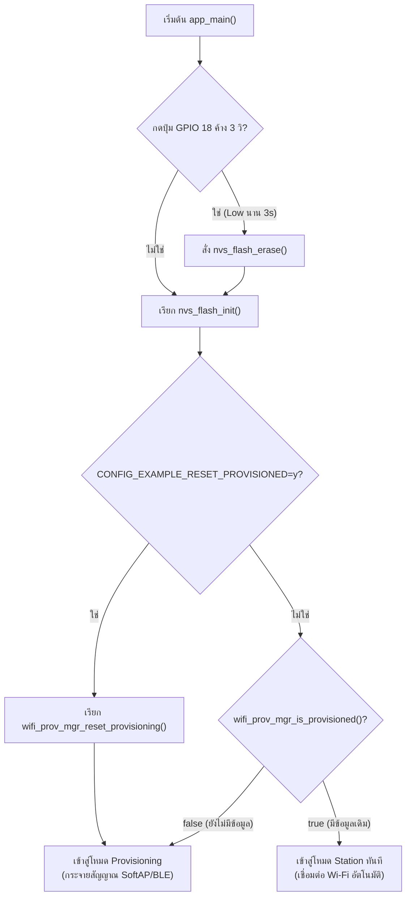
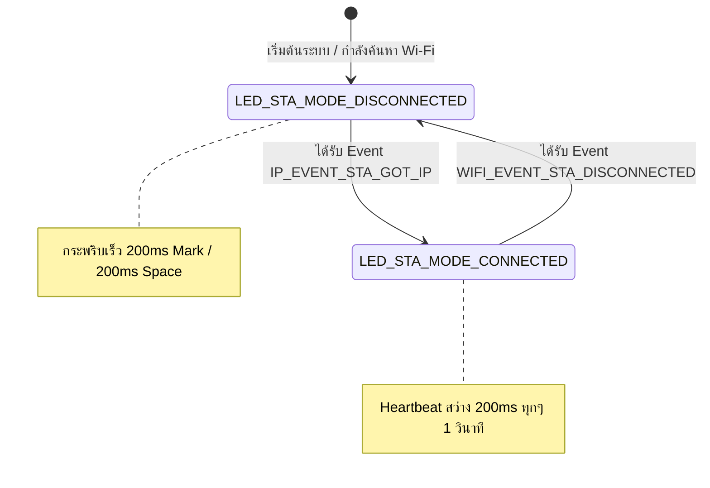

### ผลลัพธ์จาก Serial Monitor (ESP-IDF Console)

```text
I (520) LAB7_1_RESET: Checking Factory Reset Button on GPIO 18...
W (530) LAB7_1_RESET: Factory reset button pressed. Hold for 3000 ms to confirm...
W (3540) LAB7_1_RESET: Factory reset confirmed! Erasing NVS Flash...
I (3550) nvs: Partition 'nvs' erased successfully.
I (3570) LAB7_1_RESET: Initializing NVS partition at offset 0x9000
I (3580) wifi_prov_mgr: Provisioning state: unprovisioned
I (3590) LAB7_1_RESET: Starting provisioning (Ready for SoftAP / BLE)
```

---

### ผังงานการทำงาน (Flowchart & State Diagram)

#### ภารกิจที่ 1: ผังงานการตัดสินใจช่วง Bootstrapping & Reset Decision



#### ภารกิจที่ 2: ผังสถานะการเปลี่ยนจังหวะไฟ LED 1 (Wi-Fi STA Indicator)



---

### ตารางบันทึกผลการทดลอง

| รูปแบบการ Reset | คำสั่ง / พฤติกรรมที่ทำ | พฤติกรรมของ LED แต่ละดวงหลังเปิดเครื่อง | สถานะใน Serial Monitor |
| :--- | :--- | :--- | :--- |
| **1. CLI Erase** | `idf.py erase-flash` | LED แสดงสถานะรอรับ Provisioning | Flash ถูกล้างทั้งชิป บอร์ดเข้าสู่ `Starting provisioning` แสดง QR Code |
| **2. Menuconfig Flag** | `CONFIG_EXAMPLE_RESET_PROVISIONED=y` | LED แสดงสถานะรอรับ Provisioning | Credentials ถูกล้างอัตโนมัติทุกครั้งที่บูต เข้าสู่ `Starting provisioning` |
| **3. Hardware Button (GPIO 18)** | กดปุ่ม GPIO 18 ค้าง 3 วินาที | LED กระพริบยืนยันการล้าง Flash | แสดง `Factory reset confirmed!` ล้าง NVS Partition และเริ่ม Provisioning ใหม่ |

---

### คำถามท้ายการทดลอง (Post-Lab Questions)

#### 1. เพราะเหตุใดการกดปุ่ม BOOT (GPIO 0) ค้างไว้ในจังหวะรีเซ็ตบอร์ด จึงทำให้โปรแกรมค้างอยู่ที่ ROM Bootloader และไม่ยอมทำงานต่อ?
**ตอบ:** เพราะขา GPIO 0 เป็น Strapping Pin ที่ใช้กำหนดโหมดการบูต:

กดค้าง (Logic LOW): สั่งให้ชิปเข้าโหมด Download Boot (Flashing Mode) เพื่อรอแฟลชโปรแกรมใหม่ผ่าน UART ROM Bootloader จึงหยุดรอคำสั่งและไม่ยอมรันโปรแกรมใน Flash

ปล่อย (Logic HIGH): ระบบถึงจะเข้าสู่โหมด SPI Boot เพื่อโหลดโค้ดเฟิร์มแวร์ขึ้นมาทำงานตามปกติ

#### 2. เพราะเหตุใดคำสั่ง `idf.py erase-flash` จึงทำให้ข้อมูลเฟิร์มแวร์ Application หายไปด้วย ในขณะที่ `nvs_flash_erase()` ไม่ทำให้เฟิร์มแวร์หาย?
**ตอบ:** idf.py erase-flash: ลบข้อมูลหน่วยความจำ Flash ทั้งชิป (Chip Erase) ทุก Partition จึงถูกล้างทั้งหมด รวมถึงส่วนของ Bootloader, Partition Table, NVS และโค้ด Application

nvs_flash_erase(): เลือกลบเฉพาะพื้นที่ของ NVS Partition (เก็บค่าตัวแปรและการตั้งค่า Wi-Fi) เพียงส่วนเดียว ไม่ได้ไปแตะต้อง Partition ของ Application เฟิร์มแวร์จึงยังอยู่และทำงานได้ตามปกติ
#### 3. การออกแบบปุ่ม Factory Reset บนอุปกรณ์ IoT เชิงพาณิชย์ เหตุใดจึงต้องกำหนดให้ผู้ใช้กดปุ่มค้างไว้ 3-5 วินาที แทนที่จะสั่งลบข้อมูลทันทีที่แตะปุ่มเพียงเสี้ยววินาที?
**ตอบ:** ป้องกันการกดโดนโดยไม่ได้ตั้งใจ (Accidental Triggering): ป้องกันไม่ให้การเผลอมือไปโดน หรือการแตะปุ่มระหว่างการหยิบจับ/เคลื่อนย้ายอุปกรณ์ ส่งผลให้ระบบล้างข้อมูล Wi-Fi และ Credentials ทิ้งทันที

กรองสัญญาณรบกวนทางไฟฟ้า (Hardware Debouncing & Noise Immunity): ช่วยตัดปัญหาสัญญาณกระดอนของปุ่มกลไก (Contact Bounce) รวมถึงสัญญาณรบกวนเหนี่ยวนำทางไฟฟ้า (Spurious Pulse/ESD) ไม่ให้ถูกตีความเป็นคำสั่ง Reset

ให้เวลายกเลิกการตัดสินใจ (User Confirmation Window): การกำหนดให้กดค้างมักใช้ควบคู่กับไฟ LED แจ้งเตือน เพื่อให้ผู้ใช้รู้ตัวและสามารถปล่อยมือทันทีหากไม่ได้ต้องการ Factory Reset จริง

#### 4. หากอุปกรณ์ IoT ถูกติดตั้งอยู่บนเสาสูงหรือฝังอยู่ในผนัง วิธีการ Reset ทางกายภาพรูปแบบใดเหมาะสมที่สุด?
**ตอบ:** การตัด-ต่อไฟเลี้ยงตามรูปแบบจังหวะ (Power Cycling / Power Toggle Pattern):

สั่ง Reset โดยการสับสวิตช์ไฟหลักหรือเบรกเกอร์เปิด-ปิดตามจังหวะที่กำหนด (เช่น ปิด-เปิดติดต่อกัน 3-5 ครั้ง ภายในเวลาไม่กี่วินาที) เหมือนหลอดไฟ Smart Light ทั่วไป โดยใช้เฟิร์มแวร์นับรอบบูตที่บันทึกลง RTC Memory/NVS ก่อนที่ระบบจะทำงานเต็มรูปแบบ

ทางเลือกสำรองทางกายภาพอื่น ๆ (กรณีไม่ต้องการตัดไฟ):

เซนเซอร์แม่เหล็ก (Reed Switch / Hall Effect Sensor): ซ่อนไว้หลังเคสหรือใต้ผนัง แล้วนำแม่เหล็กแรงสูงไปแตะค้างไว้ตรงจุดที่กำหนดจากภายนอก

ขั้วรีเซ็ตระยะไกล (Remote Service Terminal): เดินสายสัญญาณ Reset จากบอร์ดลงมายังกล่องควบคุมภาคพื้นดิน เพื่อให้ช่างสามารถต่อจัมเปอร์หรือกดปุ่มได้โดยไม่ต้องปีนขึ้นที่สูง