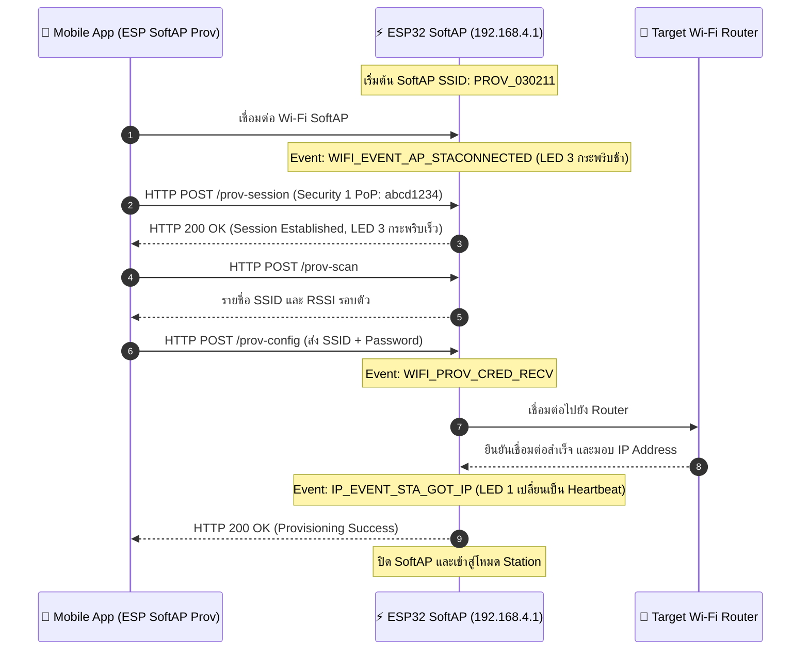

### ผลลัพธ์จาก Serial Monitor (ESP-IDF Console)

```text
I (776) wifi_prov_scheme_softap: Starting SoftAP with SSID: PROV_030211
I (786) app: Scan this QR code from the provisioning application for Provisioning.
I (816) app: QR Payload: {"ver":"v1","name":"PROV_030211","pop":"abcd1234","transport":"softap"}
I (14210) app: SoftAP transport: Connected!
I (15320) app: Secured session established!
I (16440) app: Received Wi-Fi credentials
	SSID     : Lab_WiFi_2.4G
	Password : Password999
I (18210) app: Provisioning successful
I (18220) wifi:mode : sta (24:4b:fe:1a:2b:3c)
I (19850) app: Connected with IP Address: 192.168.1.150
```

---

### ผังลำดับการสื่อสารผ่าน HTTP Endpoints (Sequence Diagram)



---

### ตารางบันทึกผลการทดลอง

| รายการตรวจสอบ | ค่าที่บันทึกได้จากการทดลอง |
| :--- | :--- |
| **1. ชื่อ SoftAP SSID ของ ESP32** | `PROV_030211` |
| **2. รหัส PoP (Proof of Possession)** | `abcd1234` |
| **3. ข้อความใน QR Code Payload (JSON)** | `{"ver":"v1","name":"PROV_030211","pop":"abcd1234","transport":"softap"}` |
| **4. พฤติกรรมไฟ LED 3 (GPIO 5) ช่วงรอ vs ช่วงส่งข้อมูล** | ช่วงรอ: กระพริบช้า 1000ms<br/>ช่วงส่ง: กระพริบเร็ว 100ms |
| **5. IP Address ที่ ESP32 ได้รับจาก Router** | `192.168.1.150` |
| **6. เวลาที่ใช้ตั้งแต่เริ่มจนจบกระบวนการ (วินาที)** | 18 |

---

### คำถามท้ายการทดลอง (Post-Lab Questions)

#### 1. ในโหมด SoftAP Scheme สมาร์ตโฟนส่งข้อมูลหา ESP32 ผ่านโปรโตคอลและ IP Address ใด?
**ตอบ:** โปรโตคอล: HTTP (ผ่าน REST API / Endpoints) และเข้ารหัสด้วย Protobuf บน Transport Layer (TCP Port 80)

IP Address: 192.168.4.1 

#### 2. หากผู้ใช้ป้อนรหัสผ่าน Wi-Fi ผิดในแอปมือถือ จะเกิด Event ใดขึ้นบน ESP32 (`WIFI_PROV_CRED_FAIL` หรือไม่) และ ESP32 มีพฤติกรรมอย่างไร?
**ตอบ:** Event ที่เกิดขึ้น: เกิด Event WIFI_PROV_CRED_FAIL (โดยมีเหตุผลย่อยมาจาก Wi-Fi Driver ส่ง Event WIFI_EVENT_STA_DISCONNECTED พร้อม Reason Code เช่น WIFI_REASON_AUTH_EXPIRE หรือ WIFI_REASON_4WAY_HANDSHAKE_TIMEOUT)

พฤติกรรมของ ESP32:

ไม่บันทึก Credentials ลง NVS: ระบบจะไม่บันทึก SSID/Password ที่ผิดพลาดลงถาวร

ส่งสถานะแจ้งเตือนกลับไปยัง Mobile App: ส่งรหัสข้อผิดพลาดผ่าน Endpoint /prov-config เพื่อให้แอปแจ้งเตือนผู้ใช้ว่าการเชื่อมต่อล้มเหลว (Auth Failed)

คงสถานะเปิด SoftAP ไว้ต่อ: ESP32 จะยังไม่ปิดโหมด SoftAP แต่จะเปิดรอรับข้อมูล Provisioning ชุดใหม่จากผู้ใช้ต่อไปเรื่อย ๆ จนกว่าจะเชื่อมต่อสำเร็จหรือหมดเวลา (Timeout)

#### 3. ทำไมผู้ผลิต IoT ส่วนใหญ่จึงมองว่ากระบวนการเชื่อมต่อแบบ SoftAP มีขั้นตอนที่ยุ่งยากสำหรับผู้ใช้ทั่วไปเมื่อเทียบกับ BLE?
**ตอบ:** ต้องสลับ Wi-Fi บนมือถือด้วยตัวเอง: ผู้ใช้ต้องออกจากแอปเพื่อไปหน้าตั้งค่า Wi-Fi แล้วเลือกต่อ SoftAP ของอุปกรณ์ จากนั้นจึงสลับกลับเข้าแอป ซึ่งเพิ่มขั้นตอนและมักสร้างความสับสน

มือถือตัดการเชื่อมต่ออินเทอร์เน็ตชั่วคราว: ขณะต่อ SoftAP มือถือจะไม่มีเน็ตใช้งาน และระบบปฏิบัติการ (iOS/Android) อาจขึ้นแจ้งเตือน "No Internet" พร้อมตัดการเชื่อมต่อกลับไปใช้เน็ตมือถือโดยอัตโนมัติ

BLE สะดวกกว่า (Seamless): มือถือสามารถค้นหา จับคู่ และส่งข้อมูล Wi-Fi ให้บอร์ดผ่านแอปได้ทันทีในหน้าเดียว โดยไม่ต้องสลับเครือข่าย Wi-Fi ไปมา