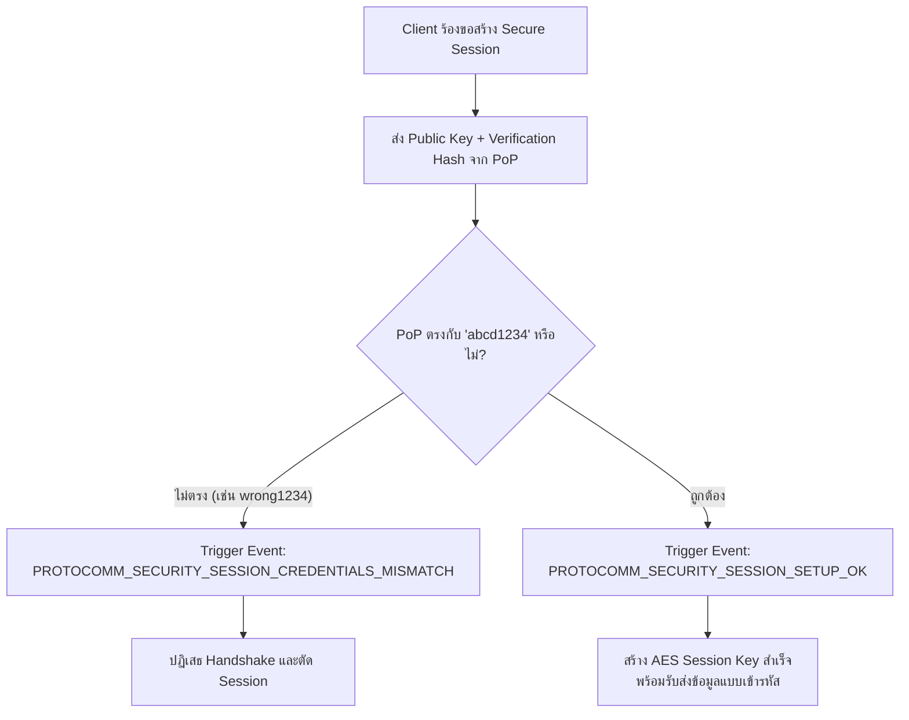
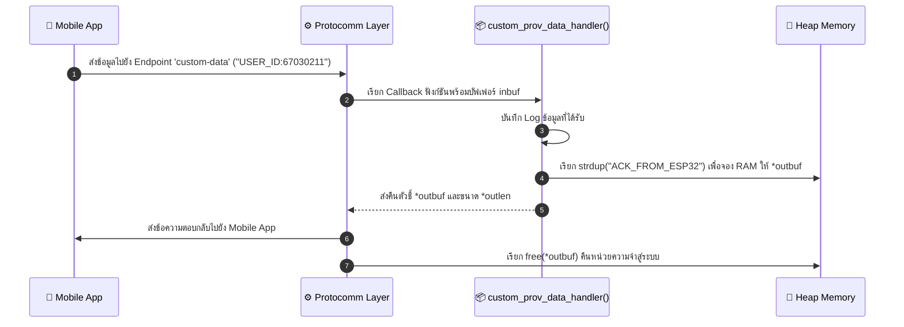

### ผลลัพธ์จาก Serial Monitor (ESP-IDF Console)

```text
I (1200) LAB7_4_SECURITY: Custom Endpoint 'custom-data' created.
I (1210) LAB7_4_SECURITY: Starting Provisioning with Security 1 (PoP required)
E (15600) app: Received incorrect username and/or PoP for establishing secure session!
I (18200) app: Secured session established!
I (22150) app: Received custom data: USER_ID:67030211
I (22160) LAB7_4_SECURITY: Response sent: ACK_FROM_ESP32
```

---

### ผังขั้นตอนการตรวจสอบ PoP และการรับส่ง Custom Data

#### ภารกิจที่ 1: ผังขั้นตอนการตรวจสอบ PoP (Security Handshake Decision Flow)



#### ภารกิจที่ 2: ผังการรับส่งข้อมูลผ่าน Custom Endpoint



---

### ตารางบันทึกผลการทดลอง

| สถานการณ์ทดสอบ | ค่า PoP ที่ป้อน | ผลลัพธ์บนแอปมือถือ | ข้อความ Log ใน Serial Monitor |
| :--- | :--- | :--- | :--- |
| **1. ป้อน PoP ผิดพลาด** | `wrong1234` | แสดงข้อความล้มเหลว (Session Failed) | `E (15600) app: Received incorrect username and/or PoP for establishing secure session!` |
| **2. ป้อน PoP ถูกต้อง** | `abcd1234` | ยืนยันความปลอดภัยสำเร็จ เข้าสู่หน้าเลือก Wi-Fi | `I (18200) app: Secured session established!` |
| **3. ส่ง Custom Data** | `USER_ID:67030211` | ได้รับข้อความตอบกลับ `ACK_FROM_ESP32` | `I (22150) app: Received custom data: USER_ID:67030211` |

---

### คำถามท้ายการทดลอง (Post-Lab Questions)

#### 1. การใช้ Proof-of-Possession (PoP) ช่วยป้องกันการโจมตีประเภทใดได้บ้าง?
**ตอบ:** Man-in-the-Middle (MitM): ป้องกันบุคคลตรงกลางดักสวมรอยหรือแก้ไขข้อมูล เพราะต้องใช้รหัส PoP ร่วมคำนวณสร้างกุญแจเข้ารหัสลับ (Session Key)

Unauthorized Provisioning / Device Hijacking: ป้องกันคนอื่นในระยะสัญญาณแอบเชื่อมต่อเพื่อแย่งคุมอุปกรณ์ เพราะต้องรู้ PoP ที่ติดอยู่บนตัวเครื่องจริงเท่านั้น

Eavesdropping (Sniffing): ป้องกันการดักฟังขโมยรหัสผ่าน Wi-Fi กลางอากาศ เพราะข้อมูลทุกชุดถูกเข้ารหัสแบบ End-to-End

#### 2. หากไม่มีการใช้ PoP (เช่น ใน Security 0) ผู้โจมตีที่อยู่ในรัศมีสัญญาณบลูทูธสามารถทำสิ่งใดกับอุปกรณ์ได้บ้าง?
**ตอบ:** ขโมยควบคุมอุปกรณ์ (Device Hijacking): เชื่อมต่อแย่งเป็นเจ้าของ และส่งรหัส Wi-Fi เพื่อดึงบอร์ดไปเข้าเครือข่ายของตนเองได้ทันทีโดยไม่ต้องใส่รหัสผ่านใด ๆ

ดักฟังและขโมยข้อมูล (Eavesdropping / Packet Sniffing): ดักอ่านข้อมูล Credentials (SSID และ Password ของ Wi-Fi เป้าหมาย) ที่รับส่งกันกลางอากาศได้โดยตรง เพราะ Security 0 ส่งข้อมูลเป็นข้อความธรรมดา (Plaintext) ไม่มีการเข้ารหัส

ส่งข้อมูลปลอมแปลงผ่าน Custom Endpoint: สามารถยิงคำสั่งหรือส่งข้อมูลอันตรายเข้าสู่ Custom Characteristic/Endpoint บนอุปกรณ์ได้โดยไม่ถูกตรวจสอบสิทธิ์ (Unauthenticated Access)

#### 3. ในการประยุกต์ใช้งานเชิงพาณิชย์จริง เราสามารถนำ Custom Data Endpoint ไปใช้ส่งข้อมูลประเภทใดได้อีกบ้าง (ยกตัวอย่าง 2 กรณี)?
**ตอบ:** 1.ผูกบัญชีผู้ใช้และคลาวด์ (User & Cloud Binding): ส่งโทเคนยืนยันตัวตน เช่น User ID, Account Token, หรือ Device Claiming Code เพื่อลงทะเบียนผูกอุปกรณ์เข้ากับบัญชีผู้ใช้บน Cloud Platform (เช่น AWS IoT Core หรือ Firebase)

2.กำหนดค่าเริ่มต้นของอุปกรณ์ (Initial Device Configuration): ส่งค่าพารามิเตอร์เริ่มต้น เช่น พิกัดโซนเวลา (Timezone/NTP), รหัสระบุพื้นที่ติดตั้ง (Location ID), หรือโหมดการทำงานเริ่มต้น (Operating Mode) โดยไม่ต้องรอต่ออินเทอร์เน็ตสำเร็จ

#### 4. ในฟังก์ชัน `custom_prov_data_handler()` เหตุใดหน่วยความจำที่จัดสรรให้ `*outbuf` จึงถูก Free โดย Protocomm Layer อัตโนมัติหลังจากส่งข้อมูลเสร็จ?
**ตอบ:** ตามข้อตกลงความเป็นเจ้าของหน่วยความจำ (Protocomm Memory Ownership Contract): ฟังก์ชัน Handler มีหน้าที่เพียงจอง Heap (เช่น ผ่าน strdup() หรือ malloc()) เพื่อส่งต่อ Buffer ให้ระบบ เมื่อ Protocomm นำข้อมูลไปแพ็กเข้ารหัสและส่งไปยัง Client เสร็จสิ้น ตัว Protocomm Layer จึงรับหน้าที่สั่ง free(*outbuf) ให้เอง

ป้องกันปัญหาหน่วยความจำรั่วไหล (Prevent Memory Leak): ลดภาระของนักพัฒนา และป้องกันการลืมคืนหน่วยความจำหลังจากส่งข้อมูลตอบกลับ (Response) สำเร็จในทุกรอบการสื่อสาร