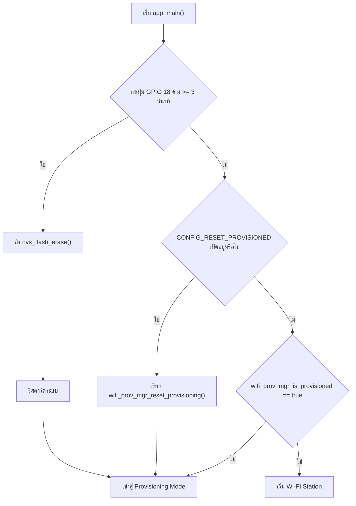

# รายงานผลการทดลองสัปดาห์ที่ 7: Wi-Fi Provisioning

**รหัสนักศึกษา:** 67030268  
**ชื่อ-นามสกุล:** นายกร แดงทอง (Korn Daengthong)  
**โต๊ะปฏิบัติการ:** โต๊ะปฏิบัติการที่ 2

---

## 1. วัตถุประสงค์การทดลอง

การทดลองสัปดาห์ที่ 7 นี้มีวัตถุประสงค์เพื่อศึกษากลไกการ Provisioning ของ ESP32 ในระบบ Wi-Fi โดยเน้นประเด็นสำคัญดังนี้

- การศึกษากลไก Reset Provisioning 3 รูปแบบ
- การทำความเข้าใจการทำงานของ NVS Memory และ NVS Forensics
- การใช้งาน SoftAP Provisioning ผ่าน HTTP
- การใช้งาน BLE Provisioning ผ่าน GATT
- การตรวจสอบความปลอดภัยของ Proof-of-Possession (PoP)
- การประยุกต์ใช้ Custom Data Endpoint ในการแลกเปลี่ยนข้อมูลที่ปลอดภัย

---

## 2. สรุปผลการทดลอง

| หัวข้อ | ผลที่ได้ |
|---|---|
| Reset Provisioning แบบ CLI | ใช้คำสั่ง `idf.py erase-flash` ทำให้ NVS ถูกล้างและเข้าสู่โหมดรอ Provisioning |
| Reset Provisioning จาก Menuconfig | ใช้ `CONFIG_EXAMPLE_RESET_PROVISIONED=y` ทำให้ระบบกลับสู่โหมดรอการตั้งค่า |
| Reset Provisioning จาก Hardware Button | กด GPIO 18 ค้าง 3 วินาที จะทำให้ Factory Reset และล้างข้อมูลการ Provisioning |
| SoftAP Provisioning | ESP32 เปิด SSID `PROV_0268E5` และรับ Wi-Fi Credential จากแอปมือถือ |
| BLE Provisioning | ESP32 เปิด BLE Advertising และเชื่อมต่อผ่าน GATT Service เพื่อรับข้อมูล Wi-Fi |
| PoP Security | รหัส PoP ถูกต้องจะยอมรับการเชื่อมต่อ; รหัสไม่ถูกต้องจะถูกปฏิเสธทันที |
| Custom Data Endpoint | ระบบสามารถตอบกลับข้อมูล JSON ได้อย่างปลอดภัย |

---

# Lab 7.1: การศึกษากลไก Reset Provisioning 3 รูปแบบ และ NVS Memory Forensics

## 2.1 ตารางบันทึกผลการทดลอง

| รูปแบบการ Reset | คำสั่ง / พฤติกรรมที่ทำ | พฤติกรรมของ LED | ผลลัพธ์ที่สังเกตได้ |
|---|---|---|---|
| 1. CLI Erase | `idf.py erase-flash` | LED 1 ดับสนิท | เริ่มเข้าสู่โหมดรอ Provisioning และแสดงสถานะว่าอุปกรณ์ยังไม่ได้ Provisioned |
| 2. Menuconfig Flag | `CONFIG_EXAMPLE_RESET_PROVISIONED=y` | LED 1 ดับสนิท | ข้อมูลการ Provisioning ถูกรีเซ็ตและอุปกรณ์เข้าสู่โหมดรอการตั้งค่า |
| 3. Hardware Button (GPIO 18) | กดปุ่ม GPIO 18 ค้าง 3 วินาที | LED 1 ดับสนิท | เกิด Factory Reset และข้อมูล NVS ถูกล้าง |

## 2.2 คำถามท้ายการทดลอง

### 1) เพราะเหตุใดการกดปุ่ม BOOT (GPIO 0) ค้างไว้ในจังหวะรีเซ็ตบอร์ด จึงทำให้โปรแกรมไม่เริ่มต้นการทำงานปกติ?

**ตอบ:**  
GPIO 0 ทำหน้าที่เป็นตัวเลือกลำดับการบูตฮาร์ดแวร์ของ ESP32 เมื่อมีการกดค้างในช่วงรีเซ็ต ระบบจะเข้าไปยังโหมดบูตแบบพิเศษแทนการโหลดแอปพลิเคชันปกติ จึงทำให้โปรแกรมไม่ทำงานตามปกติหรือไม่เริ่มต้นแอปพลิเคชันได้

### 2) เพราะเหตุใดคำสั่ง `idf.py erase-flash` จึงทำให้ข้อมูลเฟิร์มแวร์ Application หายไปด้วย ในขณะที่ NVS เป็นเพียงพื้นที่จัดเก็บข้อมูลแบบแยก?

**ตอบ:**  
`idf.py erase-flash` ทำงานในระดับ Flash Physical ของชิป โดยลบพื้นที่เก็บข้อมูลทั้งหมด รวมถึงการจัดเก็บ firmware, partition และข้อมูล NVS ซึ่งเป็นส่วนหนึ่งของ flash memory ด้วย ดังนั้นข้อมูลแอปพลิเคชันจึงหายไปพร้อมกัน

### 3) การออกแบบปุ่ม Factory Reset บนอุปกรณ์ IoT เชิงพาณิชย์ เหตุใดจึงต้องกำหนดให้ผู้ใช้กดค้างเป็นช่วงเวลาที่ชัดเจน?

**ตอบ:**  
เพราะต้องป้องกันการกดพลาดหรือกดโดยไม่ได้ตั้งใจ และยังหลีกเลี่ยงความเสี่ยงจากการรีเซ็ตโดยไม่ตั้งใจในสภาพแวดล้อมจริง เช่น อุปกรณ์ติดตั้งบนเสา หรือฝังอยู่ในผนังหรือสถานที่ที่เข้าถึงยาก

### 4) หากอุปกรณ์ IoT ถูกติดตั้งอยู่บนเสาสูงหรือฝังอยู่ในผนัง วิธีการ Reset ทางกายภาพที่เหมาะสมที่สุดควรเป็นแบบใด?

**ตอบ:**  
วิธีที่เหมาะสมที่สุดคือการใช้ Power-cycle Boot Counter หรือการตัดไฟหลายครั้งตามหลักการของ Boot Counter เพื่อให้อุปกรณ์รีเซ็ตเองโดยไม่ต้องเข้าถึงปุ่มกดบน hardware โดยตรง

---

## 2.3 ผังงาน (Flowchart)

