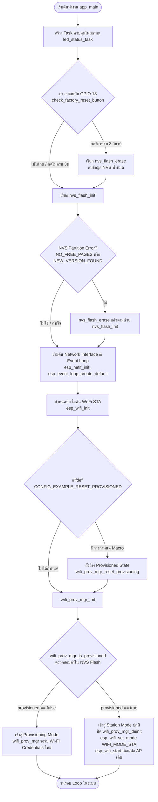
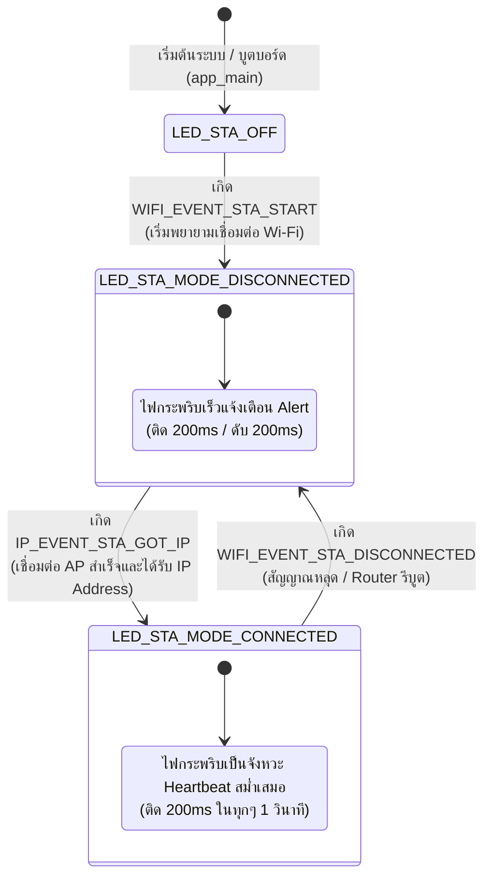

# ใบงานที่ 7.1 การศึกษากลไก Reset Provisioning 3 รูปแบบ และ NVS Memory Forensics

## 5. กิจกรรมถอดรหัสซอร์สโค้ดและเขียนผังงาน (Code Deconstruction & Flowchart Assignment)

### ภารกิจที่ 1 ผังงานการตัดสินใจช่วง Bootstrapping & Reset Decision



---

### ภารกิจที่ 2 ผังสถานะการเปลี่ยนจังหวะไฟ LED 1 (Wi-Fi STA Indicator)



---

## 6. ตารางบันทึกผลการทดลอง (Experiment Results)

| รูปแบบการ Reset | คำสั่ง / พฤติกรรมที่ทำ | พฤติกรรมของ LED แต่ละดวงหลังเปิดเครื่อง | สถานะใน Serial Monitor |
| :--- | :--- | :--- | :--- |
| **1. CLI Erase** | `idf.py erase-flash` | **LED 1 (GPIO 2):** ดับสนิท<br/>**LED 3 (GPIO 5):** สว่างค้าง (SoftAP Mode กำลังรอลูกข่ายเชื่อมต่อ) | บอร์ดรายงานว่า Partition NVS และ Flash ว่างเปล่า `[STATUS]: Device is NOT provisioned (NVS is empty)` และสร้าง QR Code สำหรับ Provisioning ใหม่ |
| **2. Menuconfig Flag** | `CONFIG_EXAMPLE_RESET_PROVISIONED=y` | **LED 1 (GPIO 2):** ดับสนิทตลอดเวลาที่บูต ไม่เข้าสถานะ Heartbeat<br/>**LED 3 (GPIO 5):** สว่างค้างรอรับการ Provision | บอร์ดบูตขึ้นมาแล้วสั่ง Erase Credentials ใน NVS ทิ้งทุกรอบการ Reset โดยข้ามการเชื่อมต่อ STA เดิม และแสดงสถานะ `Ready for Provisioning` |
| **3. Hardware Button (GPIO 18)** | กดปุ่ม GPIO 18 ค้าง 3 วินาที ในขณะเปิดเครื่อง/รีเซ็ต | ระหว่างกดค้าง **LED 1** ดับ<br/>เมื่อครบ 3 วินาที บอร์ดรันคำสั่งล้าง NVS แล้วเปลี่ยนสถานะเป็น Provisioning Mode | พบข้อความตรวจจับปุ่ม: `Holding button... 1/3, 2/3, 3/3 seconds` ตามด้วย `>>> FACTORY RESET TRIGGERED! ERASING NVS FLASH <<<` และ `[FORENSIC]: User requested Flash Erase!` |

---

### ผลลัพธ์จาก Serial Monitor Console (Forensic Output Log)

```text
I (31) boot: ESP-IDF v5.2.1-dirty 2nd stage bootloader
I (31) boot: compile time 10:45:12
I (31) boot: chip revision: v3.0
I (35) boot.esp32: SPI Speed      : 40MHz
I (39) boot.esp32: SPI Mode       : DIO
I (44) boot.esp32: SPI Flash Size : 4MB
I (48) boot: Enabling RNG early entropy source...
I (54) boot: Partition Table:
I (57) boot: ## Label            Usage          Address    Length
I (65) boot:  0 nvs              WiFi data        00009000 00006000
I (72) boot:  1 phy_init         RF data          0000f000 00001000
I (80) boot:  2 factory          factory app      00010000 00150000
I (87) boot: End of partition table
I (91) esp_image: segment 0: paddr=00010020 vaddr=3f400020 size=189e4h (100836) map
I (136) esp_image: segment 1: paddr=00028a0c vaddr=3ffb0000 size=033b8h ( 13240) load
I (141) esp_image: segment 2: paddr=0002bdcc vaddr=40080000 size=0424ch ( 16972) load
I (149) esp_image: segment 3: paddr=00030020 vaddr=400d0020 size=52e80h (339584) map
I (272) esp_image: segment 4: paddr=00082ea8 vaddr=4008424c size=0cb14h ( 51988) load
I (301) boot: Loaded app from partition at offset 0x10000
I (301) boot: Disabling RNG early entropy source...
I (313) cpu_start: Pro cpu up.
I (313) cpu_start: Starting app cpu, entry point is 0x400811e8
I (327) cpu_start: App cpu up.
I (341) main_task: Calling app_main()
I (341) gpio: GPIO[2]| InputEn: 0| OutputEn: 1| OpenDrain: 0| Pullup: 0| Pulldown: 0| Intr:0 
I (351) gpio: GPIO[18]| InputEn: 1| OutputEn: 0| OpenDrain: 0| Pullup: 1| Pulldown: 0| Intr:0 
I (361) LAB7_1_RESET: Hold GPIO 18 button for 3 seconds to trigger Factory Reset...
I (1371) LAB7_1_RESET: Holding button... 1/3 seconds
I (2381) LAB7_1_RESET: Holding button... 2/3 seconds
I (3391) LAB7_1_RESET: Holding button... 3/3 seconds
W (3391) LAB7_1_RESET: =================================================
W (3401) LAB7_1_RESET: >>> FACTORY RESET TRIGGERED! ERASING NVS FLASH <<<
W (3411) LAB7_1_RESET: =================================================
W (3421) LAB7_1_RESET: [FORENSIC]: User requested Flash Erase!
I (3521) nvs: Partition nvs erased successfully
I (3541) nvs: NVS partition initialized successfully
I (3551) esp_netif_lwip: Initializing default network interface
I (3571) wifi:wifi driver task: 3ffc2b30, prio:23, stack:6656, core=0
I (3581) wifi:wifi firmware version: 2f741ad
I (3581) wifi:wifi mode : null
W (3591) LAB7_1_RESET: --------------------------------------------------
W (3601) LAB7_1_RESET: [STATUS]: Device is NOT provisioned (NVS is empty)
W (3611) LAB7_1_RESET: Ready for Provisioning Lab 7-2 (SoftAP) or 7-3 (BLE)!
W (3621) LAB7_1_RESET: --------------------------------------------------
```

---

## 7. คำถามท้ายการทดลอง (Post-Lab Questions)

### 1. เพราะเหตุใดการกดปุ่ม BOOT (GPIO 0) ค้างไว้ในจังหวะรีเซ็ตบอร์ด จึงทำให้โปรแกรมค้างอยู่ที่ ROM Bootloader และไม่ยอมทำงานต่อ?
> **คำตอบ:**
> ขา **GPIO 0** บนสถาปัตยกรรมชิป ESP32 ทำหน้าที่เป็นฮาร์ดแวร์ **Strapping Pin** ซึ่งวงจรฮาร์ดแวร์ภายในจะสุ่มอ่านค่าระดับแรงดันลอจิก (Sampling Logic Level) ที่ขานี้ทันทีที่มีสัญญาณ Reset (Rising edge ของขา EN/CHIP_PU) 
> 
> หากขา GPIO 0 ถูกกดค้างอยู่ (มีสถานะลอจิกเป็น `LOW / 0V`) ชิป ROM Bootloader ภายในตัวชิปจะเลือก Boot Mode เป็น **ROM Download Mode (UART Bootloader)** เพื่อหยุดรอการอัปโหลดเฟิร์มแวร์ใหม่ผ่านสาย UART (`waiting for download`) ทำให้ซีพียูไม่ยอมโหลดโปรแกรมจาก SPI Flash และไม่เข้าสู่ฟังก์ชัน `app_main()` ของเฟิร์มแวร์แอปพลิเคชัน ส่งผลให้ระบบเสมือนค้างและไม่สามารถทำงานในโหมดปกติได้

### 2. เพราะเหตุใดคำสั่ง `idf.py erase-flash` จึงทำให้ข้อมูลเฟิร์มแวร์ Application หายไปด้วย ในขณะที่ `nvs_flash_erase()` ไม่ทำให้เฟิร์มแวร์หาย?
> **คำตอบ:**
> ความแตกต่างเกิดจาก **ขอบเขตการลบ (Address Range)** บนหน่วยความจำ SPI Flash ดังนี้:
> 1. คำสั่ง `idf.py erase-flash` ทำงานผ่านเครื่องมือ `esptool.py` ในระดับชิปฮาร์ดแวร์ โดยจะส่งคำสั่ง SPI Chip Erase สั่งล้างข้อมูลทุก Sector ของ Flash Memory ทั้งก้อน (เช่น ขนาด 4MB ทั้งหมดตั้งแต่แอดเดรส `0x00000000` จนถึง `0x00400000`) ส่งผลให้ทั้ง Bootloader, Partition Table, NVS Partition, และพื้นที่เก็บ Application Image (Factory App) ถูกลบหายไปทั้งหมดจนชิปกลายเป็น Flash ว่างเปล่า
> 2. ฟังก์ชัน `nvs_flash_erase()` ในซอฟต์แวร์ API จะสั่งลบเฉพาะ Sector ในขอบเขตของพาร์ติชันที่มีชื่อว่า `"nvs"` ตามที่ระบุไว้ใน Partition Table เท่านั้น (เช่น ช่วงแอดเดรส `0x9000` ขนาด `0x6000` หรือ 24KB) ซึ่งใช้สำหรับจัดเก็บ Wi-Fi Credentials และตัวแปร Configuration เท่านั้น โดยไม่ไปแตะต้องพื้นที่พาร์ติชัน `factory` (แอดเดรส `0x10000`) ที่โค้ดโปรแกรม Application อาศัยอยู่ เฟิร์มแวร์จึงยังคงสมบูรณ์และรันได้ตามปกติ

### 3. การออกแบบปุ่ม Factory Reset บนอุปกรณ์ IoT เชิงพาณิชย์ เหตุใดจึงต้องกำหนดให้ผู้ใช้กดปุ่มค้างไว้ 3-5 วินาที แทนที่จะสั่งลบข้อมูลทันทีที่แตะปุ่มเพียงเสี้ยววินาที?
> **คำตอบ:**
> เหตุผลสำคัญทางวิศวกรรมการออกแบบผลิตภัณฑ์เชิงพาณิชย์ (Product Reliability & UX) มีดังนี้:
> 1. **ป้องกันการสั่งล้างข้อมูลโดยอุบัติเหตุ (Prevent Accidental Trigger):** ป้องกันการที่ผู้ใช้งานหรือสัตว์เลี้ยงเผลอไปกดโดน หรือเกิดการกระทบกระแทกระหว่างขนย้ายหรือทำความสะอาดอุปกรณ์ ซึ่งหากลบข้อมูลทันทีจะทำให้อุปกรณ์หลุดออกจากระบบ Cloud/Smart Home และต้องเริ่มต้นกระบวนการ Provisioning ใหม่ทั้งหมด
> 2. **ป้องกันปัญหาการกระดอนของหน้าสัมผัสสวิตช์ (Switch Contact Bouncing & Electrical Noise):** สวิตช์ปุ่มกดทางกลไกมักเกิดสัญญาณกวน (Glitches/EMI) การหน่วงเวลา 3-5 วินาทีทำหน้าที่เป็นซอฟต์แวร์ฟิลเตอร์กรองสัญญาณรบกวนความถี่สูงได้อย่างแม่นยำ
> 3. **ยืนยันเจตนาที่แท้จริงของผู้ใช้ (Intentional Confirmation):** ระยะเวลา 3-5 วินาทีเป็นสากลที่เปิดโอกาสให้อุปกรณ์ส่งสัญญาณแจ้งเตือนก่อน (เช่น ไฟ LED เปลี่ยนเป็นกระพริบถี่ หรือเสียง Buzzer ดังเตือน) เพื่อให้ผู้ใช้ทราบว่ากำลังจะเข้าสู่โหมดล้างข้อมูลโรงงาน และสามารถปล่อยมือเพื่อยกเลิกได้หากไม่ได้ตั้งใจ

### 4. หากอุปกรณ์ IoT ถูกติดตั้งอยู่บนเสาสูงหรือฝังอยู่ในผนัง วิธีการ Reset ทางกายภาพรูปแบบใดเหมาะสมที่สุด?
> **คำตอบ:**
> สำหรับอุปกรณ์ที่ไม่สะดวกเข้าถึงทางกายภาพ มีแนวทางแก้ปัญหาที่นิยมใช้ในอุตสาหกรรม IoT ดังนี้:
> 1. **Power-Cycle Reset Sequence (การสับสวิตช์ไฟ AC/DC เป็นจังหวะ):** กำหนดให้เฟิร์มแวร์นับจำนวนครั้งของการตัดและจ่ายไฟเข้าอุปกรณ์ติดต่อกันอย่างรวดเร็ว (เช่น ปิด-เปิดเบรกเกอร์หรือสวิตช์ไฟ 5 ครั้งติดต่อกัน แต่ละครั้งเว้นช่วง 1-2 วินาที) โดยบันทึกตัวนับ Boot Counter ลงใน RTC Memory หรือ NVS เมื่อครบเงื่อนไขระบบจะสั่ง Factory Reset อัตโนมัติ (เช่น หลอดไฟอัจฉริยะ Philips Hue, Tuya Smart Bulbs)
> 2. **Remote In-Band / Cloud Command Reset:** ส่งคำสั่ง Secure Reset ผ่านช่องทางเครือข่ายเดิม เช่น คำสั่ง MQTT/CoAP ที่เข้ารหัสสิทธิ์ระดับ Admin หรือส่งสัญญาณ BLE Long Range เฉพาะทาง
> 3. **Magnetic Reed Switch / Hall Effect Sensor:** ซ่อนเซนเซอร์แม่เหล็กไว้ภายในตัวถังที่กันน้ำหรือฝังผนัง เมื่อต้องการ Factory Reset ช่างซ่อมบำรุงเพียงแค่นำแท่งแม่เหล็กแรงสูง (Neodymium Magnet) มาทาบที่บริเวณตำแหน่งเซนเซอร์ภายนอกกล่องค้างไว้ 5 วินาที โดยไม่ต้องปีนแกะฝากล่องหรือสัมผัสตัวเครื่องโดยตรง
