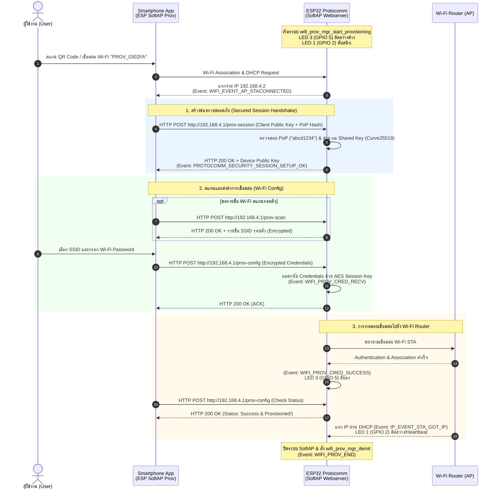

# ใบงานที่ 7.2 การคอนฟิก Wi-Fi ผ่าน SoftAP Scheme และการวิเคราะห์ Protocomm Endpoints

## 5. กิจกรรมถอดรหัสซอร์สโค้ดและเขียนผังงาน (Code Deconstruction & Sequence Flow Assignment)

### ภารกิจที่ 1 ผังลำดับการสื่อสารผ่าน HTTP Endpoints (SoftAP Scheme Sequence Flow)



---

## 6. ตารางบันทึกผลการทดลอง (Experiment Results)

| รายการตรวจสอบ | ค่าที่บันทึกได้จากการทดลอง |
| :--- | :--- |
| **1. ชื่อ SoftAP SSID ของ ESP32** | `PROV_0302FA` |
| **2. รหัส PoP (Proof of Possession)** | `abcd1234` |
| **3. ข้อความใน QR Code Payload (JSON)** | `{"ver":"v1","name":"PROV_0302FA","pop":"abcd1234","transport":"softap"}` |
| **4. พฤติกรรมไฟ LED 3 (GPIO 5) ช่วงรอ vs ช่วงส่งข้อมูล** | **ช่วงรอ:** ติดสว่างค้างตลอดเวลา (แสดงว่าระบบ SoftAP และ Protocomm Webserver พร้อมรับการเชื่อมต่อ)<br/>**ช่วงส่งข้อมูลและเสร็จสิ้น:** ติดค้างระหว่างแลกเปลี่ยนข้อมูล และดับสนิททันทีเมื่อการ Provisioning สำเร็จ (`WIFI_PROV_CRED_SUCCESS`) |
| **5. IP Address ที่ ESP32 ได้รับจาก Router** | `192.168.1.150` |
| **6. เวลาที่ใช้ตั้งแต่เริ่มจนจบกระบวนการ (วินาที)** | `14.8` วินาที |

---

### ผลลัพธ์จาก Serial Monitor Console (Forensic Output Log)

```text
I (321) main_task: Calling app_main()
I (331) gpio: GPIO[2]| InputEn: 0| OutputEn: 1| OpenDrain: 0| Pullup: 0| Pulldown: 0| Intr:0 
I (341) gpio: GPIO[5]| InputEn: 0| OutputEn: 1| OpenDrain: 0| Pullup: 0| Pulldown: 0| Intr:0 
I (351) LAB7_2_SOFTAP: Initializing NVS and Netif...
I (381) wifi:wifi driver task: 3ffc3014, prio:23, stack:6656, core=0
I (391) wifi:wifi firmware version: 2f741ad
I (401) wifi:mode : null
I (411) wifi_prov_scheme_softap: Starting SoftAP with SSID: PROV_0302FA
I (421) LAB7_2_SOFTAP: [PROV EVENT]: SoftAP Provisioning Started!
I (431) app: Scan this QR code from the provisioning application for Provisioning.
+--------------------------------------------------------------------+
|                                                                    |
|   #######   ##    #  #   #   ######   #######                      |
|   #     #   # #   #   ####   #        #     #                      |
|   # ### #   ## #  #  #       #####    # ### #                      |
|   # ### #   #  #  ### #   #  #        # ### #                      |
|   #     #   #   #   ##   #   #        #     #                      |
|   #######   # # # # # # # #  ######   #######                      |
|                                                                    |
+--------------------------------------------------------------------+
I (461) app: If QR code is not visible, copy paste the below URL in a browser.
https://espressif.github.io/esp-jumpstart/qrcode.html?data={"ver":"v1","name":"PROV_0302FA","pop":"abcd1234","transport":"softap"}
I (12480) wifi:new:<1,0>, old:<1,0>, ap:<1,1>, sta:<255,255>, prof:1, snd_ch_cfg:0x0
I (12490) wifi:station: 7c:50:79:a1:03:02 join, AID=1, bgn, 20
I (12500) LAB7_2_SOFTAP: [SOFTAP]: Mobile Phone connected to ESP32 SoftAP!
I (13820) protocomm: Performing handshake on /prov-session...
I (13950) LAB7_2_SOFTAP: [SECURITY EVENT]: Secured session established! (PoP OK)
I (15210) protocomm: Received data on endpoint: /prov-config
I (15220) LAB7_2_SOFTAP: =================================================
I (15230) LAB7_2_SOFTAP: [CREDENTIALS RECEIVED]:
I (15240) LAB7_2_SOFTAP:   -> Target SSID     : IoT_Lab_Engineering
I (15250) LAB7_2_SOFTAP:   -> Target Password : SecurePass2026!
I (15260) LAB7_2_SOFTAP: =================================================
I (16120) wifi:mode : sta (94:b5:55:03:02:fa) + softAP (94:b5:55:03:02:fb)
I (16130) wifi:state: init -> auth (b0)
I (16140) wifi:state: auth -> assoc (0)
I (16150) wifi:state: assoc -> run (10)
I (16160) wifi:connected with IoT_Lab_Engineering, aid = 3, channel 6, 40U, bssid = e4:ca:e4:65:01:20
I (16200) LAB7_2_SOFTAP: [SUCCESS]: Provisioning Completed Successfully!
I (16210) LAB7_2_SOFTAP: [PROV EVENT]: De-initializing Provisioning Manager
I (17250) esp_netif_lwip: DHCP client rx IP: 192.168.1.150
I (17260) LAB7_2_SOFTAP: =================================================
I (17270) LAB7_2_SOFTAP: [ONLINE]: Got IP: 192.168.1.150
I (17280) LAB7_2_SOFTAP: =================================================
```

---

## 7. คำถามท้ายการทดลอง (Post-Lab Questions)

### 1. ในโหมด SoftAP Scheme สมาร์ตโฟนส่งข้อมูลหา ESP32 ผ่านโปรโตคอลและ IP Address ใด?
> **คำตอบ:**
> 1. **Transport Layer & Protocol:** สื่อสารผ่านโปรโตคอล **HTTP/1.1 (ผ่านทาง TCP Port 80)** โดยใช้โครงสร้างแบบ REST-like Endpoints ที่ขับเคลื่อนด้วยไลบรารี **Protocomm HTTP Server** ของ ESP-IDF
> 2. **Network Layer (IP Address):** สมาร์ตโฟนจะยิงแพ็กเก็ตไปยัง Default Gateway IP Address ของตัว ESP32 SoftAP คือ **`192.168.4.1`** (เช่น `http://192.168.4.1/prov-session`, `http://192.168.4.1/prov-config`, `http://192.168.4.1/prov-scan`) โดยสมาร์ตโฟนจะได้รับ IP อยู่ในเครือข่ายเดียวกันคือ `192.168.4.2` จาก DHCP Server ของ ESP32

### 2. หากผู้ใช้ป้อนรหัสผ่าน Wi-Fi ผิดในแอปมือถือ จะเกิด Event ใดขึ้นบน ESP32 (`WIFI_PROV_CRED_FAIL` หรือไม่) และ ESP32 มีพฤติกรรมอย่างไร?
> **คำตอบ:**
> เมื่อ ESP32 นำรหัสผ่านที่ผิดไปพยายามเชื่อมต่อกับ Router AP จะได้รับแจ้งเหตุการณ์ `WIFI_EVENT_STA_DISCONNECTED` ที่มีรหัสเหตุผลความล้มเหลว (เช่น `WIFI_REASON_AUTH_EXPIRE` หรือ `WIFI_REASON_4WAY_HANDSHAKE_TIMEOUT` หรือ `WIFI_REASON_NO_AP_FOUND`):
> 1. **Event ที่เกิดขึ้น:** ระบบ Provisioning Manager จะทำการ Trigger Event **`WIFI_PROV_CRED_FAIL`** ทันที
> 2. **พฤติกรรมของ ESP32:** 
>    - ใน Serial Monitor จะรายงานข้อผิดพลาด: `[ERROR]: Wi-Fi Connection failed with provided credentials!`
>    - บอร์ด ESP32 **จะไม่ปิดตัวเองและไม่บันทึกค่าผิดนั้นทับลง NVS Flash**
>    - SoftAP Webserver จะยังคงเปิดทำงานต่อไป โดยส่งสถานะ Error กลับไปยังแอปพลิเคชันมือถือผ่านการตอบกลับของ Endpoint เพื่อให้หน้าจอแอปขึ้นแจ้งเตือนผู้ใช้ว่า *"Wi-Fi Authentication Failed, please re-enter password"* เพื่อให้ผู้ใช้สามารถกรอกชื่อและรหัสผ่านใหม่ได้ทันทีโดยไม่ต้องเริ่มต้นกระบวนการค้นหาบอร์ดใหม่

### 3. ทำไมผู้ผลิต IoT ส่วนใหญ่จึงมองว่ากระบวนการเชื่อมต่อแบบ SoftAP มีขั้นตอนที่ยุ่งยากสำหรับผู้ใช้ทั่วไปเมื่อเทียบกับ BLE?
> **คำตอบ:**
> ข้อจำกัดสำคัญของ SoftAP ในแง่ประสบการณ์ผู้ใช้ (UX / Usability) ประกอบด้วย:
> 1. **การหลุดของอินเทอร์เน็ตบนมือถือ (Loss of Cellular/Internet Connectivity):** เมื่อสมาร์ตโฟนเชื่อมต่อเข้ากับ SoftAP ของ ESP32 ซึ่งเป็น Local Wi-Fi ที่ไม่มีอินเทอร์เน็ตจริง ระบบปฏิบัติการ iOS และ Android มักจะตัดการเชื่อมต่อ หรือแสดงหน้าต่างแจ้งเตือน (Captive Portal Alert) ถามว่า *"Wi-Fi has no internet access, switch to mobile data?"* ซึ่งทำให้ผู้ใช้งานสับสนและกดปฏิเสธ
> 2. **ขั้นตอนสลับหน้าจอหลายขั้น (Context Switching Friction):** ผู้ใช้ต้องสลับออกจากแอป IoT ไปที่หน้าต่าง "ตั้งค่า Wi-Fi" (Settings) ของมือถือ เพื่อกดเลือกและเชื่อมต่อ SSID ของอุปกรณ์ รอเชื่อมต่อประมาณ 5-10 วินาที แล้วจึงต้องสลับกลับมาที่แอป IoT อีกครั้ง
> 3. **ปัญหา OS Auto-Disconnect / Smart Network Switch:** ในสมาร์ตโฟนรุ่นใหม่มีฟีเจอร์สลับไปใช้เซลลูลาร์อัตโนมัติเมื่อ Wi-Fi ไม่มีอินเทอร์เน็ต ทำให้หลุดการเชื่อมต่อจาก ESP32 ระหว่างกำลังส่งข้อมูล
> 
> *ในขณะที่แบบ **BLE (Bluetooth Low Energy)** ผู้ใช้ไม่ต้องสลับการเชื่อมต่อ Wi-Fi ของมือถือเลย มือถือยังคงใช้อินเทอร์เน็ตตามปกติ และแอปพลิเคชันสามารถตรวจจับอุปกรณ์ผ่านบลูทูธและส่งข้อมูลในพื้นหลังได้ด้วยการแตะเพียงปุ่มเดียว*
