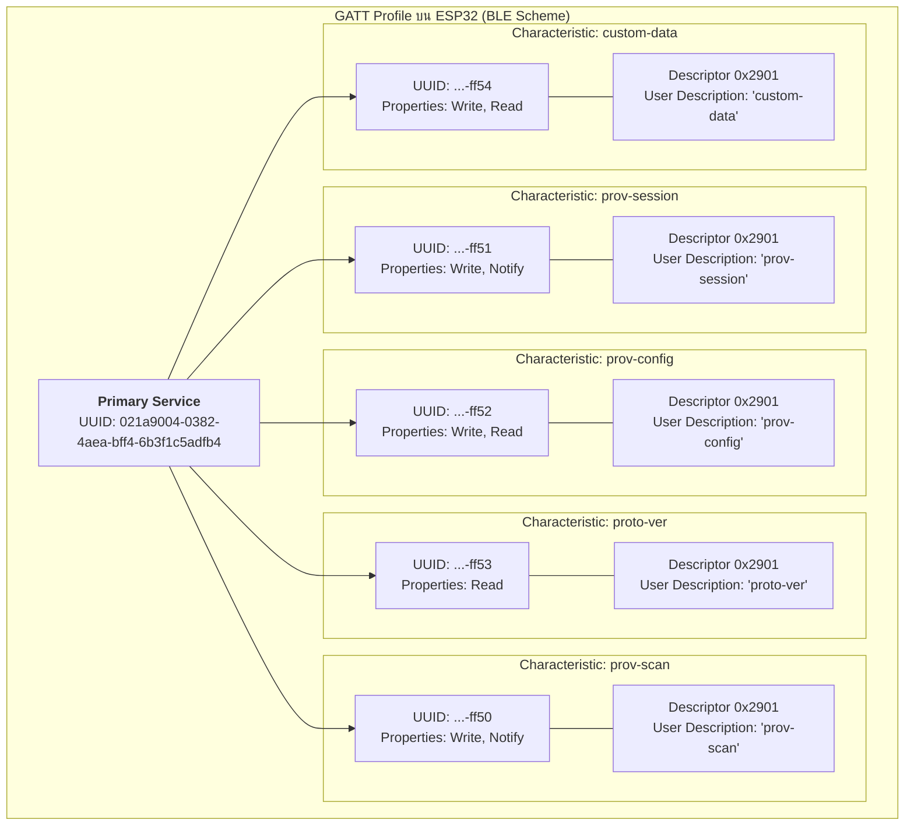
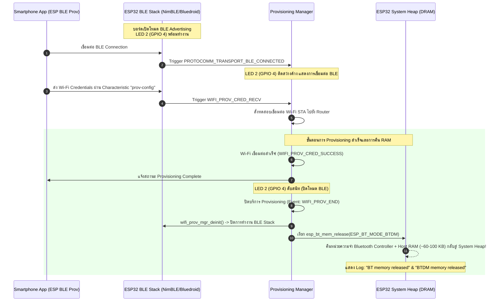

# ใบงานที่ 7.3 การคอนฟิก Wi-Fi ผ่าน BLE Scheme และการสืบสวน GATT Services (BLE Forensics)

## 5. กิจกรรมถอดรหัสซอร์สโค้ดและเขียนผังงาน (Code Deconstruction & BLE GATT Architecture Assignment)

### ภารกิจที่ 1 ผังโครงสร้าง GATT Tree & Endpoint Mapping



---

### ภารกิจที่ 2 ผังลำดับการคืนหน่วยความจำ Bluetooth (BLE Lifecycle & Memory Reclaim Flow)



---

## 6. ตารางบันทึกผลการทดลอง (Experiment Results)

| รายการตรวจสอบ | ผลการทดลอง / ข้อมูลที่สังเกตได้ |
| :--- | :--- |
| **1. BLE Device Name ที่สแกนเจอ** | `PROV_0302FA` |
| **2. Primary Service UUID (128-bit)** | `021a9004-0382-4aea-bff4-6b3f1c5adfb4` |
| **3. Characteristic Endpoint ที่พบ (0x2901)** | 1. `prov-session` (Characteristic UUID: `021a9004-0382-4aea-bff4-6b3f1c5aff51`)<br/>2. `prov-config` (Characteristic UUID: `021a9004-0382-4aea-bff4-6b3f1c5aff52`)<br/>3. `proto-ver` (Characteristic UUID: `021a9004-0382-4aea-bff4-6b3f1c5aff53`) |
| **4. พฤติกรรมไฟ LED 2 (GPIO 4) ช่วงรอ vs ช่วงต่อ BLE** | **ช่วงรอ (Advertising):** ดับสนิท (หรือกะพริบตามจังหวะรอรับสัญญาณ)<br/>**ช่วงต่อ BLE:** ติดสว่างค้างต่อเนื่องทันทีที่แอปบนสมาร์ตโฟนเชื่อมต่อ GATT สำเร็จ และดับลงเมื่อกระบวนการ Provisioning จบสิ้น |
| **5. พฤติกรรมเมื่อต่อ Wi-Fi สำเร็จ** | **มี** ข้อความ Log คืนหน่วยความจำ Bluetooth (`wifi_prov_scheme_ble: BT memory released` และ `BTDM memory released`) ใน Serial Monitor ชัดเจน |

---

### ผลลัพธ์จาก Serial Monitor Console (Forensic Output Log)

```text
I (312) main_task: Calling app_main()
I (322) gpio: GPIO[2]| InputEn: 0| OutputEn: 1| OpenDrain: 0| Pullup: 0| Pulldown: 0| Intr:0 
I (332) gpio: GPIO[4]| InputEn: 0| OutputEn: 1| OpenDrain: 0| Pullup: 0| Pulldown: 0| Intr:0 
I (342) nvs: NVS partition initialized successfully
I (362) esp_netif_lwip: Initializing default network interface
I (382) wifi:wifi driver task: 3ffc2e48, prio:23, stack:6656, core=0
I (392) wifi:wifi firmware version: 2f741ad
I (402) wifi:wifi mode : null
I (412) wifi_prov_scheme_ble: Starting BLE provisioning
I (422) BTDM_INIT: BT controller compile version [82a8901]
I (432) phy_init: phy_version 4670,719f9f6,Feb 18 2021,17:07:07
I (712) NimBLE: GAP procedure initiated: advertise; 
I (722) app: Starting provisioning
I (722) LAB7_3_BLE: [PROV EVENT]: BLE Provisioning Started (Advertising)!
I (732) LAB7_3_BLE: Starting BLE Provisioning (Name: PROV_0302FA, PoP: abcd1234)
I (742) app: Scan this QR code from the provisioning application for Provisioning.
+--------------------------------------------------------------------+
|                                                                    |
|   #######   #####    ##  #   ######   #######                      |
|   #     #   #   ##   # # #   #        #     #                      |
|   # ### #   ## ## #  #       #####    # ### #                      |
|   # ### #   #  #  #  ### #   #        # ### #                      |
|   #     #   #   # #  ##  #   #        #     #                      |
|   #######   # # # #  # # #   ######   #######                      |
|                                                                    |
+--------------------------------------------------------------------+
I (772) app: If QR code is not visible, copy paste the below URL in a browser.
https://espressif.github.io/esp-jumpstart/qrcode.html?data={"ver":"v1","name":"PROV_0302FA","pop":"abcd1234","transport":"ble"}
I (14200) NimBLE: GAP procedure initiated: connect; 
I (14210) LAB7_3_BLE: [BLE]: Smartphone Connected to GATT Server!
I (14350) protocomm_ble: Endpoint 'prov-session' registered with UUID 0xff51
I (14360) protocomm_ble: Endpoint 'prov-config' registered with UUID 0xff52
I (14370) protocomm_ble: Endpoint 'proto-ver' registered with UUID 0xff53
I (15840) protocomm: Secured session established with client!
I (17210) LAB7_3_BLE: =================================================
I (17220) LAB7_3_BLE: [BLE CREDENTIALS RECEIVED]:
I (17230) LAB7_3_BLE:   -> SSID     : IoT_Lab_Engineering
I (17240) LAB7_3_BLE:   -> Password : SecurePass2026!
I (17250) LAB7_3_BLE: =================================================
I (18110) wifi:mode : sta (94:b5:55:03:02:fa)
I (18120) wifi:connected with IoT_Lab_Engineering, aid = 3, channel 6, 40U
I (18160) LAB7_3_BLE: [SUCCESS]: BLE Provisioning Successful!
I (18170) LAB7_3_BLE: [PROV EVENT]: De-initializing BLE & Releasing BT Memory...
I (18180) wifi_prov_scheme_ble: BT memory released
I (18190) wifi_prov_scheme_ble: BTDM memory released
I (19220) esp_netif_lwip: DHCP client rx IP: 192.168.1.155
I (19230) LAB7_3_BLE: =================================================
I (19240) LAB7_3_BLE: [ONLINE]: Connected to Wi-Fi with IP: 192.168.1.155
I (19250) LAB7_3_BLE: =================================================
```

---

## 7. คำถามท้ายการทดลอง (Post-Lab Questions)

### 1. เหตุใด BLE Provisioning จึงไม่ส่งผลให้สัญญาณ Wi-Fi บนสมาร์ตโฟนของผู้ใช้หลุดระหว่างทำรายการ?
> **คำตอบ:**
> เนื่องจากสมาร์ตโฟนในปัจจุบันมีฮาร์ดแวร์ชิปสื่อสารไร้สาย (Wireless Transceiver) และ Baseband แยกระหว่าง **Wi-Fi** และ **Bluetooth** (หรือเป็น Combo Chip ที่แบ่ง Time-multiplexing ช่องสัญญาณกันชัดเจน):
> - ในกระบวนการ **BLE Provisioning** สมาร์ตโฟนใช้ช่องทางการส่งผ่านข้อมูลผ่านคลื่น Bluetooth Low Energy (BLE Link) เพื่อคุยกับ ESP32 GATT Server เท่านั้น
> - ไม่มีการเปลี่ยน Network Interface ของ Wi-Fi บนสมาร์ตโฟน ทำให้การเชื่อมต่อ Wi-Fi หลักของมือถือ (รวมถึงการใช้งานอินเทอร์เน็ต, การโทร หรือการรับส่งแชต) ยังคงทำงานต่อเนื่องได้อย่างราบรื่น 100% โดยไม่มีการสลับ SSID หรือตัดเน็ตเหมือนในกรณี SoftAP

### 2. Descriptor `0x2901` มีความสำคัญอย่างไรต่อการที่แอปพลิเคชันมือถือจะทราบว่า Characteristic แต่ละตัวใช้ทำหน้าที่อะไร?
> **คำตอบ:**
> Descriptor `0x2901` ตามมาตรฐาน Bluetooth SIG คือ **Characteristic User Description Descriptor**:
> 1. ในสถาปัตยกรรมของ **ESP Protocomm** ค่า Characteristic UUID มักถูกสร้างขึ้นแบบไดนามิกหรือใช้ 128-bit Vendor-Specific UUIDs ที่ซับซ้อน (เช่น `021a9004-...-ff51`, `ff52`, `ff53`) ซึ่งแอปพลิเคชันมือถือไม่สามารถเดาได้โดยตรงว่าท่อข้อมูลแต่ละท่อผูกอยู่กับฟังก์ชันใด
> 2. การแนบ Descriptor `0x2901` ที่บรรจุข้อความ ASCII Human-Readable String เช่น `"prov-session"`, `"prov-config"`, `"proto-ver"`, หรือ `"custom-data"` ทำหน้าที่เป็น **Service Discovery Metadata** ช่วยให้แอปพลิเคชันบนสมาร์ตโฟนสามารถ Query อ่าน Descriptor นี้ แล้วจับคู่ (Map) เข้ากับ Handler ภายในของแอปพลิเคชันได้อย่างถูกต้องโดยไม่ต้อง Hard-code UUIDs ล่วงหน้า

### 3. การที่ ESP-IDF มีฟังก์ชัน `esp_bt_mem_release()` มีประโยชน์อย่างไรต่อการทำงานของแอปพลิเคชัน IoT หลังเชื่อมต่อ Wi-Fi สำเร็จ?
> **คำตอบ:**
> ประโยชน์สำคัญอย่างยิ่งในด้านการบริหารจัดการทรัพยากรหน่วยความจำ (Memory Optimization):
> 1. บลูทูธสแต็ก (Bluetooth Controller และ Host Stack เช่น Bluedroid หรือ NimBLE) ใช้พื้นที่หน่วยความจำแรมภายในชิป (Internal DRAM) เป็นจำนวนมาก (ประมาณ **60 KB ถึงกว่า 100 KB**) สำหรับตาราง State, Buffer จัดการแพ็กเก็ต และ Connection Contexts
> 2. ในการใช้งานจริง เมื่ออุปกรณ์ IoT เชื่อมต่อ Wi-Fi สำเร็จแล้ว บลูทูธจะไม่ถูกใช้งานอีกต่อไป การเรียก `esp_bt_mem_release(ESP_BT_MODE_BTDM)` จะทำการถอน Bluetooth Controller และล้างพื้นที่หน่วยความจำของบลูทูธทั้งหมด คืนกลับมาเป็นหน่วยความจำ Heap กลางของระบบ (System Free Heap Memory)
> 3. ส่งผลให้ระบบมี DRAM ว่างเพิ่มขึ้นมหาศาล เพื่อนำไปใช้กับงานสำคัญของ IoT เช่น การเปิด SSL/TLS Handshake (mbedTLS ซึ่งต้องการบัฟเฟอร์ขนาดใหญ่), การส่งผ่านข้อมูล HTTP/MQTT Client, หรือการประมวลผลข้อมูลเซนเซอร์ในแอปพลิเคชันหลักได้อย่างเสถียร ไม่เกิดปัญหาหน่วยความจำล้น (Out of Memory / Heap Exhaustion)
