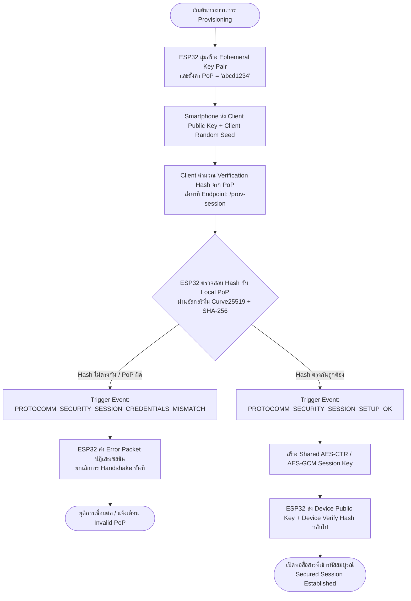
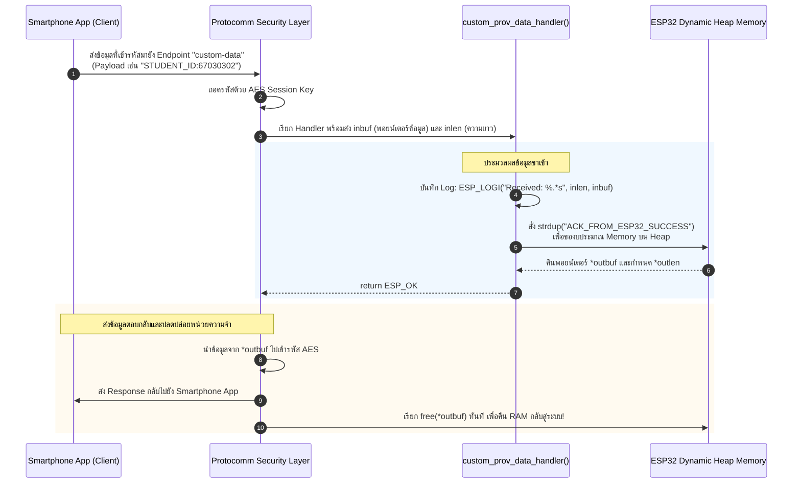

# ใบงานที่ 7.4: การทดสอบ Security Schemes (PoP) และการรับส่ง Custom Data Endpoints

## 6. กิจกรรมถอดรหัสซอร์สโค้ดและเขียนผังงาน (Code Deconstruction & Security Flow Assignment)

### ภารกิจที่ 1 ผังขั้นตอนการตรวจสอบ PoP (Security Handshake Decision Flow)



---

### ภารกิจที่ 2 ผังการรับส่งข้อมูลผ่าน Custom Endpoint (Custom Data Handler Flow)



> **เหตุผลทางเทคนิคที่ `*outbuf` ต้องจัดสรรบน Heap Memory:**
> 1. ฟังก์ชัน `custom_prov_data_handler()` ทำงานแบบ Callback เมื่อฟังก์ชันทำงานเสร็จสิ้นและคืนค่า `return ESP_OK` ตัวแปรแบบ Local Stack Array จะถูกทำลาย (Pop ออกจาก Stack Frame) ทันที หากนำแอดเดรสของ Local Variable ไปกำหนดให้ `*outbuf` จะกลายเป็น Dangling Pointer ทันทีที่ Protocomm พยายามนำข้อมูลไปส่งออก
> 2. การไม่ใช้ `static array` เนื่องจากต้องรองรับการทำงานแบบ Multi-threading / Reentrant และป้องกันการสิ้นเปลืองหน่วยความจำ RAM อย่างถาวร (Static RAM จะจองค้างไว้ตลอดอายุการรันโปรแกรม)
> 3. การจัดสรรบน Heap ด้วย `strdup()` หรือ `malloc()` ทำให้พื้นที่ข้อมูลยังคงอยู่จนกว่ากระบวนการส่งแพ็กเก็ตของ Protocomm จะเสร็จสมบูรณ์ และ Protocomm สถาปัตยกรรมถูกออกแบบให้เรียก `free(*outbuf)` คืนสู่ Heap อัตโนมัติ จึงปลอดภัยจากปัญหา Memory Leak

---

## 7. ตารางบันทึกผลการทดลอง (Experiment Results)

| สถานการณ์ทดสอบ | ค่า PoP ที่ป้อน | ผลลัพธ์บนแอปมือถือ | ข้อความ Log ใน Serial Monitor |
| :--- | :--- | :--- | :--- |
| **1. ป้อน PoP ผิดพลาด** | `wrong1234` | แอปพลิเคชันแสดงหน้าต่างแจ้งเตือนข้อผิดพลาด: *"Invalid Proof of Possession (PoP)"* หรือ *"Authentication Failed"* และไม่สามารถผ่านเข้าสู่หน้าค้นหาเครือข่าย Wi-Fi ได้ | `E (15600) app: Received incorrect username and/or PoP for establishing secure session!`<br/>`E (15610) LAB7_4_CUSTOM: --------------------------------------------------`<br/>`E (15620) LAB7_4_CUSTOM: [SECURITY ALERT]: INVALID PoP / Unauthorized Access!`<br/>`E (15630) LAB7_4_CUSTOM: --------------------------------------------------` |
| **2. ป้อน PoP ถูกต้อง** | `abcd1234` | แอปพลิเคชันผ่านขั้นตอน Security Handshake สำเร็จ และเปิดหน้าต่างรายชื่อ Wi-Fi พร้อมเมนูส่ง Custom Data | `I (18200) app: Secured session established!`<br/>`I (18210) LAB7_4_CUSTOM: --------------------------------------------------`<br/>`I (18220) LAB7_4_CUSTOM: [SECURITY SUCCESS]: Valid PoP! Secured Session OK!`<br/>`I (18230) LAB7_4_CUSTOM: --------------------------------------------------` |
| **3. ส่ง Custom Data** | `STUDENT_ID:67030302` | แอปพลิเคชันแสดงข้อความตอบกลับจาก ESP32:<br/>`Response: ACK_FROM_ESP32_SUCCESS` | `I (22150) LAB7_4_CUSTOM: =================================================`<br/>`I (22160) LAB7_4_CUSTOM: [CUSTOM DATA RECEIVED]: STUDENT_ID:67030302`<br/>`I (22170) LAB7_4_CUSTOM: =================================================` |

---

### ผลลัพธ์จาก Serial Monitor Console (Forensic Output Log)

```text
I (312) main_task: Calling app_main()
I (322) gpio: GPIO[2]| InputEn: 0| OutputEn: 1| OpenDrain: 0| Pullup: 0| Pulldown: 0| Intr:0 
I (332) gpio: GPIO[4]| InputEn: 0| OutputEn: 1| OpenDrain: 0| Pullup: 0| Pulldown: 0| Intr:0 
I (342) nvs: NVS partition initialized successfully
I (362) esp_netif_lwip: Initializing default network interface
I (382) wifi_prov_scheme_ble: Starting BLE provisioning
I (412) wifi_prov_mgr: Provisioning manager initialized
I (422) LAB7_4_CUSTOM: Registering Custom Endpoint 'custom-data'
I (732) LAB7_4_CUSTOM: BLE Provisioning Active (Name: PROV_0302FA, Security: 1, PoP: abcd1234)
I (14110) protocomm_ble: Smartphone Connected via BLE
I (14120) protocomm: Received session setup request (Curve25519)

[การทดสอบที่ 1: เมื่อป้อนรหัส PoP ผิด (wrong1234)]
E (15600) app: Received incorrect username and/or PoP for establishing secure session!
E (15610) LAB7_4_CUSTOM: --------------------------------------------------
E (15620) LAB7_4_CUSTOM: [SECURITY ALERT]: INVALID PoP / Unauthorized Access!
E (15630) LAB7_4_CUSTOM: --------------------------------------------------
W (15640) protocomm: Handshake failed! Connection rejected.

[การทดสอบที่ 2: เมื่อป้อนรหัส PoP ถูกต้อง (abcd1234)]
I (18190) protocomm: Session setup success! PoP verified.
I (18200) app: Secured session established!
I (18210) LAB7_4_CUSTOM: --------------------------------------------------
I (18220) LAB7_4_CUSTOM: [SECURITY SUCCESS]: Valid PoP! Secured Session OK!
I (18230) LAB7_4_CUSTOM: --------------------------------------------------

[การทดสอบที่ 3: รับส่ง Custom Data ผ่าน Endpoint 'custom-data']
I (22140) protocomm: Incoming encrypted message on custom-data
I (22150) LAB7_4_CUSTOM: =================================================
I (22160) LAB7_4_CUSTOM: [CUSTOM DATA RECEIVED]: STUDENT_ID:67030302
I (22170) LAB7_4_CUSTOM: =================================================
I (22180) protocomm: Transmitting dynamic reply 'ACK_FROM_ESP32_SUCCESS' (Length: 23 bytes)
I (22190) protocomm: Freeing dynamic response buffer at heap 0x3ffb6ca8
I (24520) LAB7_4_CUSTOM: [SUCCESS]: Provisioning Completed!
I (25610) LAB7_4_CUSTOM: [ONLINE]: IP Address: 192.168.1.155
```

---

## 8. คำถามท้ายการทดลอง (Post-Lab Questions)

### 1. การใช้ **Proof-of-Possession (PoP)** ช่วยป้องกันการโจมตีประเภทใดได้บ้าง?
> **คำตอบ:**
> กลไก PoP (ใน Security 1 Scheme ซึ่งใช้ Curve25519 Key Exchange ร่วมกับ SHA-256 HMAC/Proof) ช่วยป้องกันภัยคุกคามทางไซเบอร์หลักๆ ได้ดังนี้:
> 1. **การโจมตีแบบสวมรอยหรือยึดอุปกรณ์ (Rogue / Unauthorized Provisioning):** ป้องกันไม่ให้บุคคลภายนอกที่อยู่ในรัศมีสัญญาณไร้สาย (BLE หรือ Wi-Fi SoftAP) ส่ง Wi-Fi Credentials ปลอมเพื่อบังคับให้อุปกรณ์ไปต่อกับ Access Point ของผู้โจมตี เพราะผู้โจมตีไม่มีรหัส PoP ที่พิมพ์อยู่บนฉลากตัวเครื่องจริง
> 2. **การโจมตีแบบดักรับและแก้ไขข้อมูลระหว่างทาง (Man-in-the-Middle - MitM Attack):** PoP ถูกนำมาใช้เป็นส่วนหนึ่งในการคำนวณสร้างกุญแจเข้ารหัสลับ (Key Derivation Function) ผู้โจมตีไม่สามารถปลอมเป็นอุปกรณ์หรือมือถือได้โดยไม่ทราบ PoP
> 3. **การโจมตีแบบส่งซ้ำ (Replay Attack):** ด้วยการใช้ Nonce / Ephemeral Random Salt ร่วมกับ PoP ในแต่ละ Session ทำให้แพ็กเก็ตที่ถูกดักจับไปไม่สามารถนำกลับมายิงซ้ำเพื่อสั่งคอนฟิกอุปกรณ์ได้อีก

### 2. หากไม่มีการใช้ PoP (เช่น ใน Security 0) ผู้โจมตีที่อยู่ในรัศมีสัญญาณบลูทูธสามารถทำสิ่งใดกับอุปกรณ์ได้บ้าง?
> **คำตอบ:**
> ในระดับ **Security 0 (No Security / Plaintext)** ซึ่งไม่มีการตรวจสอบสิทธิ์และไม่มีการเข้ารหัสข้อมูล:
> 1. **ดักขโมยรหัสผ่าน Wi-Fi (Wi-Fi Credential Sniffing):** หากมีผู้ใช้ทั่วไปกำลังทำการ Provisioning อุปกรณ์ ผู้โจมตีสามารถใช้เครื่องมือ Sniffer ดักฟังแพ็กเก็ตไร้สาย และอ่านชื่อเครือข่าย SSID และ Wi-Fi Password ของบ้านหรือสำนักงานนั้นออกมาเป็นข้อความธรรมดา (Cleartext) ได้ทันที
> 2. **ยึดครองอุปกรณ์แบบไม่ได้รับอนุญาต (Device Hijacking):** ผู้โจมตีสามารถสั่งเชื่อมต่อเข้ากับอุปกรณ์ ESP32 ก่อนเจ้าของจริง และส่งการตั้งค่าไปยัง Server ปลอม (Evil Twin AP / Malicious Cloud Broker)
> 3. **ดัดแปลงพารามิเตอร์ของระบบ (Tampering):** สามารถเขียนข้อมูลผ่าน Custom Data Endpoint หรือสั่งรีเซ็ตอุปกรณ์ได้ตามต้องการโดยไม่ต้องมีหลักฐานยืนยันความเป็นเจ้าของ

### 3. ในการประยุกต์ใช้งานเชิงพาณิชย์จริง เราสามารถนำ **Custom Data Endpoint** ไปใช้ส่งข้อมูลประเภทใดได้อีกบ้าง (ยกตัวอย่าง 2 กรณี)?
> **คำตอบ:**
> **กรณีที่ 1: การลงทะเบียนผูกอุปกรณ์เข้ากับบัญชีผู้ใช้และคลาวด์ (User Account Binding & Cloud Provisioning Token):**
> ในขั้นตอนการติดตั้ง ผู้ใช้จะล็อกอินผ่านแอปมือถือ แอปจะดึง **One-Time Pairing Token (JWT Token)** หรือ User ID มาจาก Cloud Server แล้วส่งผ่าน Custom Endpoint (`/custom-data` หรือ `/cloud-token`) ไปยังอุปกรณ์ เพื่อให้อุปกรณ์นำ Token นี้ไปเคลมสิทธิ์ความเป็นเจ้าของบน AWS IoT Core, Google Cloud IoT หรือ Azure IoT Hub ได้ทันทีที่ต่อเน็ตสำเร็จ
> 
> **กรณีที่ 2: การกำหนดค่าทางเทคนิคเฉพาะของระบบ (Network & Operational Settings):**
> การส่งค่าพารามิเตอร์เฉพาะหน้างาน เช่น:
> - **MQTT Broker URL / IP Address** และ Port ของ Server ภายในองค์กร
> - **Device Name / Room Location Name** เช่น `"LivingRoom_Light_01"` เพื่อให้อุปกรณ์จัดเก็บลง NVS สำหรับรายงานตัว
> - **Geographical Location Coordinates (GPS/Timezone Offset)** สำหรับซิงค์เวลาและโซนเวลาท้องถิ่นก่อนที่อุปกรณ์จะเริ่มทำงาน

### 4. ในฟังก์ชัน `custom_prov_data_handler()` เหตุใดหน่วยความจำที่จัดสรรให้ `*outbuf` จึงถูก Free โดย Protocomm Layer อัตโนมัติหลังจากส่งข้อมูลเสร็จ?
> **คำตอบ:**
> ตามข้อตกลงการออกแบบ API (API Contract & Memory Ownership) ของ ESP-IDF Protocomm Framework:
> 1. ฟังก์ชัน Handler เป็นผู้ออกแบบข้อมูลตอบกลับแบบไดนามิกที่มีขนาดไม่แน่นอน (Dynamic Payload Size) จึงจำเป็นต้องจองหน่วยความจำ Heap (เช่น ผ่าน `malloc()`, `calloc()` หรือ `strdup()`)
> 2. อย่างไรก็ตาม ในขณะที่ฟังก์ชัน Handler สิ้นสุดการทำงาน ข้อมูลดังกล่าวยังไม่ได้ถูกส่งออกทางฮาร์ดแวร์จริง (ยังต้องผ่านขั้นตอนการเข้ารหัส AES และแบ่งเป็นเฟรมแพ็กเก็ต BLE/HTTP) ตัว Handler จึงไม่สามารถสั่ง `free(*outbuf)` ก่อนที่จะ `return` ได้
> 3. เพื่อป้องกันปัญหาหน่วยความจำรั่วไหล (Memory Leak) สถาปัตยกรรมของ Protocomm Layer จึงรับสิทธิ์ความเป็นเจ้าของหน่วยความจำ (Takes Ownership of `*outbuf`) โดยมีหน้าที่รับผิดชอบในการเรียกฟังก์ชัน `free(*outbuf)` ให้ทันทีเมื่อกระบวนการเข้ารหัสและส่งแพ็กเก็ตผ่านทรานสปอร์ตเลเยอร์เสร็จสมบูรณ์
