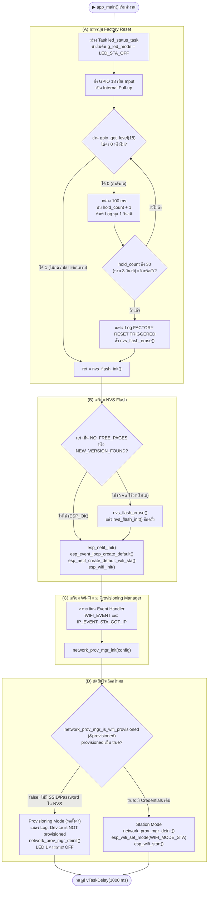
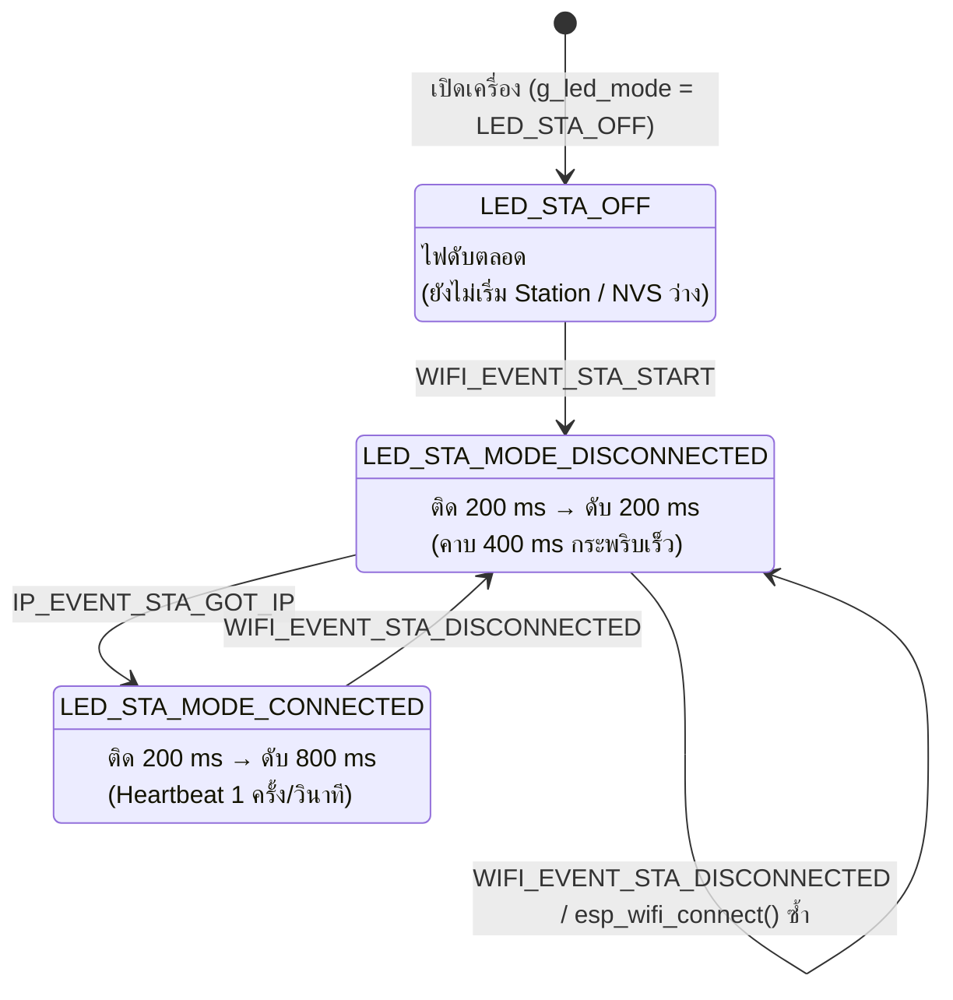
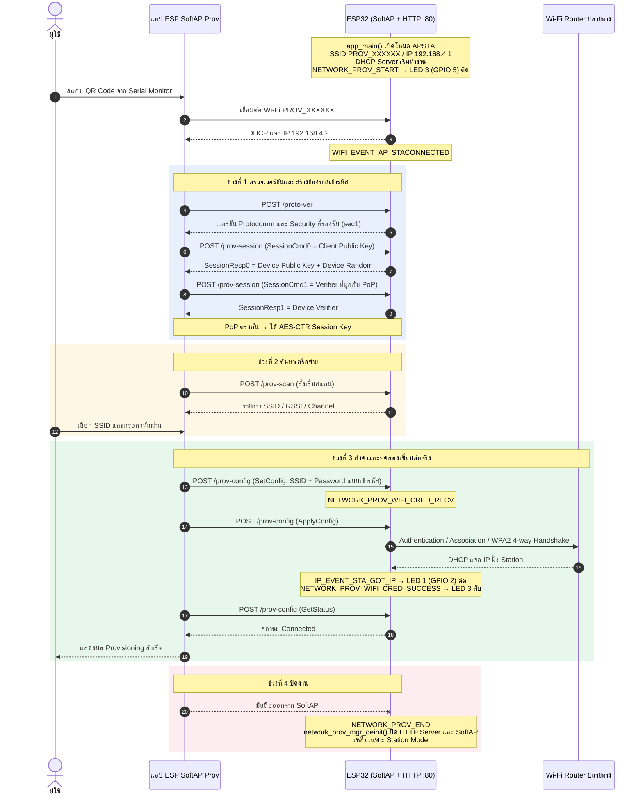
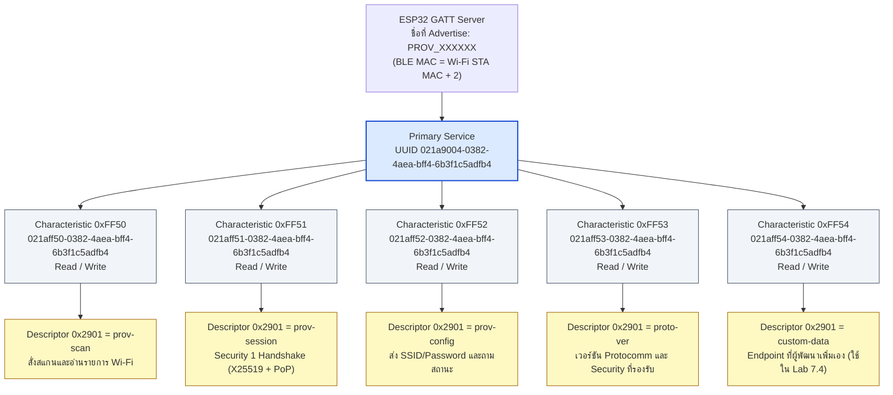
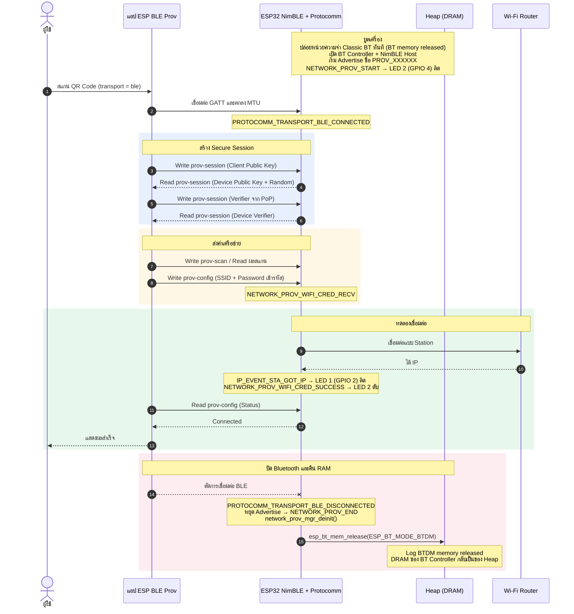
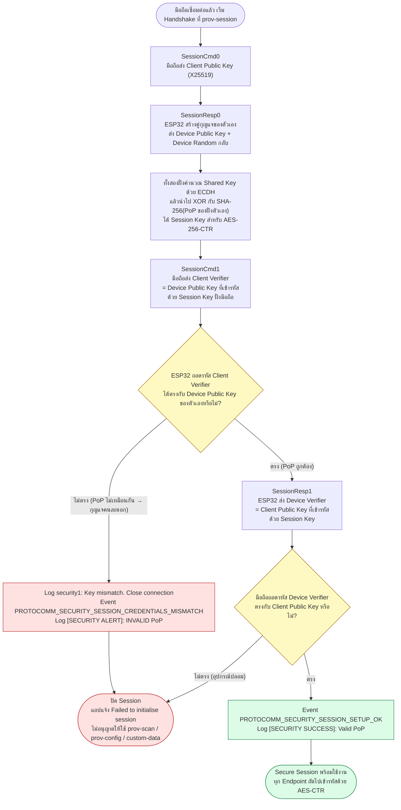
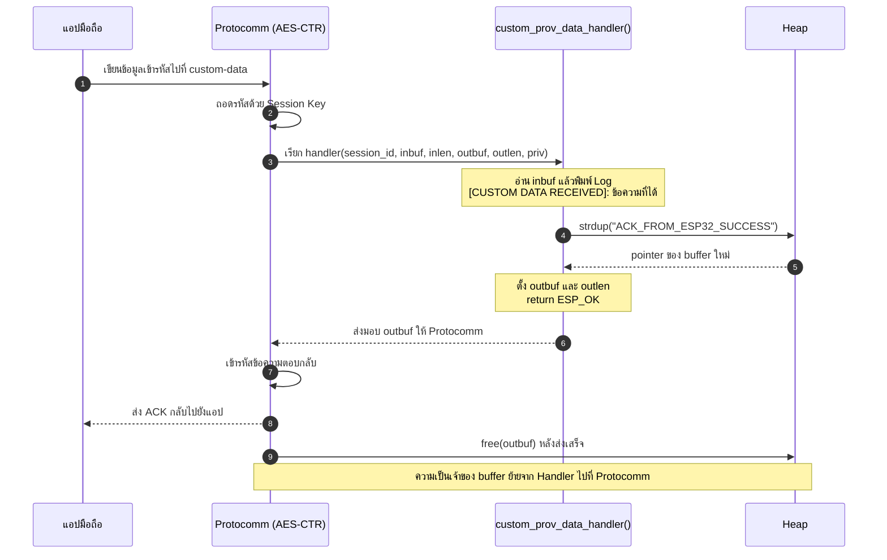

# ใบงานที่ 7.1  การศึกษากลไก Reset Provisioning 3 รูปแบบ และ NVS Memory Forensics
### ภารกิจที่ 1  ผังงานการตัดสินใจช่วง Bootstrapping & Reset Decision
ให้นักศึกษาวาด Flowchart แสดงลำดับตรรกะการตรวจสอบเงื่อนไขตั้งแต่เริ่มต้นรันฟังก์ชัน `app_main()` โดยต้องครอบคลุม:
1. การตรวจสอบสถานะปุ่ม **GPIO 18** (ตรวจจับการกดค้าง 3 วินาที)
2. การทำงานของ `nvs_flash_init()` และกรณีที่ต้อง `nvs_flash_erase()`
3. การตรวจสอบ Macro `#ifdef CONFIG_EXAMPLE_RESET_PROVISIONED`
4. การเรียกฟังก์ชัน `wifi_prov_mgr_is_provisioned(&provisioned)`
5. จุดแยกสายการทำงานเข้าสู่โหมด **Provisioning Mode** หรือ **Station Mode**



### ภารกิจที่ 2 ผังสถานะการเปลี่ยนจังหวะไฟ LED 1 (Wi-Fi STA Indicator)
ให้นักศึกษาวาด State Diagram แสดงการเปลี่ยนสถานะของ **LED 1 (GPIO 2)**:
- เงื่อนไขใดทำให้ LED 1 เข้าสู่สถานะ `LED_STA_MODE_DISCONNECTED` (กระพริบ 200ms Mark / 200ms Space)
- เงื่อนไขหรือ Event ใดทำให้เปลี่ยนเป็น `LED_STA_MODE_CONNECTED` (Heartbeat 200ms ทุก 1s)


---
### Log 
```text
I (29) boot: ESP-IDF v6.0.2 2nd stage bootloader
I (52) boot: Partition Table:
I (55) boot: ## Label            Usage          Type ST Offset   Length
I (61) boot:  0 nvs              WiFi data        01 02 00009000 00006000
I (68) boot:  1 phy_init         RF data          01 01 0000f000 00001000
I (74) boot:  2 factory          factory app      00 00 00010000 00100000
I (81) boot: End of partition table
I (418) boot: Loaded app from partition at offset 0x10000
...
I (543) main_task: Started on CPU0
I (543) main_task: Calling app_main()
I (543) LAB7_1_RESET: Hold GPIO 18 button for 3 seconds to trigger Factory Reset...
I (553) nvs: NVS partition "nvs" is empty, formatting...
I (622) nvs: Formatting finished, 6 free sectors
I (632) wifi:wifi driver task: 3ffc1a8c, prio:23, stack:6656, core=0
I (632) wifi:wifi firmware version: 00ad238
...
I (693) wifi_init: WiFi RX IRAM OP enabled
W (703) LAB7_1_RESET: --------------------------------------------------
W (713) LAB7_1_RESET: [STATUS]: Device is NOT provisioned (NVS is empty)
W (713) LAB7_1_RESET: Ready for Provisioning Lab 7-2 (SoftAP) or 7-3 (BLE)!
W (723) LAB7_1_RESET: --------------------------------------------------
```
### Log (GPIO 18)
```text
I (543) main_task: Started on CPU0
I (543) main_task: Calling app_main()
I (543) LAB7_1_RESET: Hold GPIO 18 button for 3 seconds to trigger Factory Reset...
I (1553) LAB7_1_RESET: Holding button... 1/3 seconds
I (2553) LAB7_1_RESET: Holding button... 2/3 seconds
I (3553) LAB7_1_RESET: Holding button... 3/3 seconds
W (3553) LAB7_1_RESET: =================================================
W (3553) LAB7_1_RESET: >>> FACTORY RESET TRIGGERED! ERASING NVS FLASH <<<
W (3553) LAB7_1_RESET: =================================================
W (3563) LAB7_1_RESET: [FORENSIC]: User requested Flash Erase!
I (3793) wifi:wifi driver task: 3ffc1a8c, prio:23, stack:6656, core=0
...
I (3853) wifi_init: WiFi RX IRAM OP enabled
W (3863) LAB7_1_RESET: --------------------------------------------------
W (3873) LAB7_1_RESET: [STATUS]: Device is NOT provisioned (NVS is empty)
W (3873) LAB7_1_RESET: Ready for Provisioning Lab 7-2 (SoftAP) or 7-3 (BLE)!
W (3883) LAB7_1_RESET: --------------------------------------------------
```

## 6. ตารางบันทึกผลการทดลอง (Experiment Results)

| รูปแบบการ Reset                  | คำสั่ง / พฤติกรรมที่ทำ               | พฤติกรรมของ LED แต่ละดวงหลังเปิดเครื่อง | สถานะใน Serial Monitor |
| :------------------------------- | :----------------------------------- | :-------------------------------------- | :--------------------- |
| **1. CLI Erase**                 | `idf.py erase-flash`                 |  **LED 1 (GPIO 2):** ดับตลอด (`LED_STA_OFF`) เพราะไม่มี Credentials โปรแกรมจึงไม่เข้า Station Mode | `Chip erase completed successfully` → หลังบูต `NVS partition "nvs" is empty, formatting...` → `[STATUS]: Device is NOT provisioned` |
| **2. Hardware Button (GPIO 18)** | กดปุ่ม GPIO 18 ค้าง 3 วินาที         | กดปุ่ม GPIO 18 ค้างไว้ แล้วรีเซ็ตบอร์ด ค้างจนครบ 3 วินาที | **LED 1 (GPIO 2):** ดับระหว่างนับเวลากดปุ่ม และยังคงดับหลังล้าง NVS | นับ `1/3 → 2/3 → 3/3 seconds` → `FACTORY RESET TRIGGERED!` → `[STATUS]: Device is NOT provisioned` |

---

## 7. คำถามท้ายการทดลอง (Post-Lab Questions)
1. เพราะเหตุใดการกดปุ่ม BOOT (GPIO 0) ค้างไว้ในจังหวะรีเซ็ตบอร์ด จึงทำให้โปรแกรมค้างอยู่ที่ ROM Bootloader และไม่ยอมทำงานต่อ?
```text
GPIO 0 เป็น **Strapping Pin** ที่ฮาร์ดแวร์ใช้เลือกโหมดบูต ทุกครั้งที่ชิปเริ่มทำงานจากการจ่ายไฟหรือการกด EN โค้ดใน ROM จะอ่านระดับแรงดันของขานี้เป็นอย่างแรก ก่อนที่โปรแกรมของเราจะทำงาน
- ถ้า GPIO 0 = **HIGH** ชิปจะบูตแบบ `SPI_FAST_FLASH_BOOT` คือโหลด Bootloader และ Application จาก Flash ตามปกติ
- ถ้า GPIO 0 = **LOW** ชิปจะเข้าโหมด `DOWNLOAD_BOOT` และแสดง `waiting for download` เพื่อรอรับไฟล์เฟิร์มแวร์ผ่าน UART ซึ่งเป็นโหมดที่ `esptool` ใช้แฟลชโปรแกรม

```
2. เพราะเหตุใดคำสั่ง `idf.py erase-flash` จึงทำให้ข้อมูลเฟิร์มแวร์ Application หายไปด้วย ในขณะที่ `nvs_flash_erase()` ไม่ทำให้เฟิร์มแวร์หาย?
```text
- `idf.py erase-flash` สั่ง **Chip Erase** ผ่าน esptool จากคอมพิวเตอร์ ทำให้ Flash ทั้งชิปกลายเป็น `0xFF` จึงไม่มีโปรแกรมเหลือ ต้องแฟลชใหม่
- `nvs_flash_erase()` เป็นฟังก์ชันที่รัน**ภายในเฟิร์มแวร์เอง** โดยค้นตำแหน่งพาร์ทิชันชื่อ `nvs` จาก Partition Table แล้วลบเฉพาะ sector ในช่วงนั้น ตัวโปรแกรมที่กำลังรันอยู่ในพาร์ทิชัน `factory` จึงยังอยู่ครบ
```
3. การออกแบบปุ่ม Factory Reset บนอุปกรณ์ IoT เชิงพาณิชย์ เหตุใดจึงต้องกำหนดให้ผู้ใช้กดปุ่มค้างไว้ 3-5 วินาที แทนที่จะสั่งลบข้อมูลทันทีที่แตะปุ่มเพียงเสี้ยววินาที?
```text
1. **การลบย้อนกลับไม่ได้** เมื่อ Reset แล้ว อุปกรณ์จะหลุดจาก Wi-Fi และ Cloud ผู้ใช้ต้องตั้งค่าใหม่ทั้งหมด จึงต้องกันการแตะโดนโดยบังเอิญ เช่นตอนทำความสะอาด เคลื่อนย้าย หรือเด็กกดเล่น
2. **กรองสัญญาณที่ไม่ใช่การกดจริง** ปุ่มเชิงกลมีอาการ Bounce และสายไฟอาจรับสัญญาณรบกวนจนขาเป็น LOW ชั่วขณะ เงื่อนไข "LOW ต่อเนื่อง 3 วินาที" (ตรวจทุก 100 ms × 30 ครั้ง) จึงทำหน้าที่เป็นตัวกรองไปในตัว
3. **ให้ผู้ใช้มีเวลาเปลี่ยนใจ** ระหว่างกดค้าง ระบบแสดงความคืบหน้า (1/3, 2/3, 3/3) ผ่าน Log หรือไฟ LED ถ้าปล่อยก่อนครบ อุปกรณ์จะบูตตามปกติโดยไม่เสียข้อมูล
4. **ใช้ปุ่มเดียวได้หลายหน้าที่** เช่น กดสั้นเพื่อรีสตาร์ต และกดค้างเพื่อ Factory Reset
```
4. หากอุปกรณ์ IoT ถูกติดตั้งอยู่บนเสาสูงหรือฝังอยู่ในผนัง วิธีการ Reset ทางกายภาพรูปแบบใดเหมาะสมที่สุด?
```text
1. **Power-Cycle Reset (เหมาะที่สุดเมื่อเป็นวิธีทางกายภาพ)** ผู้ใช้เปิด-ปิดสวิตช์ไฟหรือเบรกเกอร์ติดกันตามจำนวนที่กำหนด เช่น 5 ครั้ง เฟิร์มแวร์นับจำนวนครั้งที่บูตเก็บไว้ใน NVS และล้างตัวนับเมื่อเครื่องทำงานต่อเนื่องเกินประมาณ 5–10 วินาที ถ้านับครบจะเรียก `nvs_flash_erase()` ข้อดีคือใช้สวิตช์ไฟที่มีอยู่แล้ว ไม่ต้องเพิ่มฮาร์ดแวร์ และใช้ได้แม้อุปกรณ์หลุดจากเครือข่าย
2. **Remote Reset ผ่านเครือข่าย** ส่งคำสั่งจากแอปหรือ Cloud ผ่าน MQTT/HTTPS โดยต้องยืนยันตัวตนก่อน เหมาะสำหรับใช้ในงานปกติ แต่ใช้ไม่ได้ถ้าอุปกรณ์ออฟไลน์อยู่แล้ว (เช่นเปลี่ยนรหัส Wi-Fi บ้าน)
```

# ใบงานที่ 7.2 การคอนฟิก Wi-Fi ผ่าน SoftAP Scheme และการวิเคราะห์ Protocomm Endpoints
### ภารกิจที่ 1: ผังลำดับการสื่อสารผ่าน HTTP Endpoints (SoftAP Scheme Sequence Flow)
ให้นักศึกษาวาด Sequence Diagram แสดงปฏิสัมพันธ์ระหว่าง 3 ฝ่าย:
1. **Smartphone App (ESP SoftAP Prov)**
2. **ESP32 SoftAP Webserver (Protocomm Layer)**
3. **Wi-Fi Router (AP ปลายทาง)**

**จุดที่ต้องระบุในผัง:**
- จังหวะที่มือถือยิง HTTP POST ไปยัง Endpoint แต่ละตัว (`/prov-session`, `/prov-scan`, `/prov-config`)
- Event ของ ESP-IDF ที่ถูก Trigger ใน `event_handler()` เช่น:
  - `WIFI_EVENT_AP_STACONNECTED`
  - `PROTOCOMM_SECURITY_SESSION_SETUP_OK`
  - `WIFI_PROV_CRED_RECV`
  - `WIFI_PROV_CRED_SUCCESS`
  - `IP_EVENT_STA_GOT_IP`
- สถานะจังหวะการกระพริบของ **LED 3 (GPIO 5)** และ **LED 1 (GPIO 2)** ในแต่ละช่วง



---

## 6. ตารางบันทึกผลการทดลอง (Experiment Results)

| รายการตรวจสอบ | ค่าที่บันทึกได้จากการทดลอง |
| :--- | :--- |
| **1. ชื่อ SoftAP SSID ของ ESP32** | `PROV_0DCD74` |
| **2. รหัส PoP (Proof of Possession)** | `abcd1234` |
| **3. ข้อความใน QR Code Payload (JSON)** | `{"ver":"v1","name":"PROV_0DCD74","pop":"abcd1234","transport":"softap"}` |
| **4. พฤติกรรมไฟ LED 3 (GPIO 5) ช่วงรอ vs ช่วงส่งข้อมูล** | ช่วงรอ: ติดตั้งแต่ SoftAP เริ่มทำงาน และดับเมื่อ Provision สำเร็จ <br/>ช่วงส่ง: ดับระหว่างรอตั้งค่า และติดเมื่อได้ IP จาก Router |
| **5. IP Address ที่ ESP32 ได้รับจาก Router** | 172.20.10.2 |
| **6. เวลาที่ใช้ตั้งแต่เริ่มจนจบกระบวนการ (วินาที)** | 47 วินาที |

### Log 
```text
I (569) main_task: Calling app_main()
...
I (669) LAB7_2_SOFTAP: Starting SoftAP Provisioning (SSID: PROV_0DCD74, PoP: abcd1234)
I (789) wifi:mode : sta (14:33:5c:0d:cd:74) + softAP (14:33:5c:0d:cd:75)
I (799) esp_netif_lwip: DHCP server started on interface WIFI_AP_DEF with IP: 192.168.4.1
I (819) network_prov_mgr: Provisioning started with service name : PROV_0DCD74
I (829) LAB7_2_SOFTAP: [PROV EVENT]: SoftAP Provisioning Started!
I (859) LAB7_2_SOFTAP: Payload JSON: {"ver":"v1","name":"PROV_0DCD74","pop":"abcd1234","transport":"softap"}
...
I (12859) LAB7_2_SOFTAP: [SOFTAP]: Mobile Phone connected to ESP32 SoftAP!
I (12979) esp_netif_lwip: DHCP server assigned IP to a client, IP is: 192.168.4.2
I (14279) security1: ...   (ข้อมูล Handshake ของ Security 1)
I (28279) LAB7_2_SOFTAP: [CREDENTIALS RECEIVED]:
I (28289) LAB7_2_SOFTAP:   -> Target SSID     : MyHome-2.4G
I (32489) wifi:switch to channel 6
I (38489) wifi:state: init -> auth (0xb0)
I (38504) wifi:state: auth -> assoc (0x0)
I (38516) wifi:state: assoc -> run (0x10)
I (38586) wifi:connected with MyHome-2.4G, aid = 1, channel 6, BW20
I (39686) esp_netif_handlers: sta ip: 172.20.10.2, mask: 255.255.255.0, gw: 172.20.10.1
I (39696) network_prov_mgr: STA Got IP
I (39711) LAB7_2_SOFTAP: [SUCCESS]: Provisioning Completed Successfully!
W (44911) LAB7_2_SOFTAP: [SOFTAP]: Mobile Phone disconnected from ESP32 SoftAP
I (47611) wifi:mode : sta (14:33:5c:0d:cd:74)
I (47621) network_prov_mgr: Provisioning stopped
I (47626) LAB7_2_SOFTAP: [PROV EVENT]: De-initializing Provisioning Manager
```
---

## 7. คำถามท้ายการทดลอง (Post-Lab Questions)
1. ในโหมด SoftAP Scheme สมาร์ตโฟนส่งข้อมูลหา ESP32 ผ่านโปรโตคอลและ IP Address ใด?
```text
- **โปรโตคอล:** HTTP ผ่าน TCP พอร์ต `80` โดยแต่ละ Endpoint เป็น URI ของตัวเอง (`/proto-ver`, `/prov-session`, `/prov-scan`, `/prov-config`) และส่งด้วยเมธอด `POST` เนื้อหาใน Body เป็นข้อความ Protobuf ที่ Protocomm เข้ารหัสด้วย Security 1 (X25519 + AES-CTR) จึงไม่ใช่ HTTP ธรรมดาที่อ่านได้
- **IP ปลายทาง:** `192.168.4.1` ซึ่งเป็น IP ของ ESP32 ในวง SoftAP
- **IP ของมือถือ:** `192.168.4.2` ได้จาก DHCP Server ใน ESP32
```
2. หากผู้ใช้ป้อนรหัสผ่าน Wi-Fi ผิดในแอปมือถือ จะเกิด Event ใดขึ้นบน ESP32 (`WIFI_PROV_CRED_FAIL` หรือไม่) และ ESP32 มีพฤติกรรมอย่างไร?
```text
- **Event:** `NETWORK_PROV_WIFI_CRED_FAIL` โดย `event_data` บอกสาเหตุเป็น `NETWORK_PROV_WIFI_STA_AUTH_ERROR` (รหัสผิด) หรือ `NETWORK_PROV_WIFI_STA_AP_NOT_FOUND` (หา SSID ไม่เจอ) ใน Log จะเห็นการเปลี่ยนสถานะ `run -> init` และ `Disconnect reason : 15` ตามด้วย `STA Auth Error`
- **พฤติกรรม:**
  1. ESP32 **ไม่บันทึก** ค่าที่ผิดเป็นค่าถาวร และไม่รีบูต
  2. เมื่อแอปถามสถานะผ่าน `/prov-config` จะได้ผลเป็น Failed พร้อมเหตุผล แอปจึงแจ้งผู้ใช้ได้ว่ารหัสผ่านไม่ถูกต้อง
  3. SoftAP ยังเปิดอยู่ ถ้าเฟิร์มแวร์เปิดตัวเลือกให้รีเซ็ต State Machine เมื่อล้มเหลว (`network_prov_mgr_reset_wifi_sm_state_on_failure()`) ผู้ใช้จะกรอกรหัสใหม่ได้ทันทีโดยไม่ต้องรีเซ็ตบอร์ด
```
3. ทำไมผู้ผลิต IoT ส่วนใหญ่จึงมองว่ากระบวนการเชื่อมต่อแบบ SoftAP มีขั้นตอนที่ยุ่งยากสำหรับผู้ใช้ทั่วไปเมื่อเทียบกับ BLE?
```text
1. **ต้องออกจากแอปไปตั้งค่า Wi-Fi เอง** ผู้ใช้ต้องสลับไปหน้า Settings เพื่อเลือก `PROV_XXXXXX` แล้วสลับกลับมา หลายคนหลงขั้นตอนตรงนี้
2. **มือถือเสียอินเทอร์เน็ตชั่วคราว** เพราะ Wi-Fi ของมือถือถูกใช้เชื่อม ESP32 ซึ่งไม่มีทางออกอินเทอร์เน็ต
3. **ระบบปฏิบัติการมักตัดการเชื่อมต่อเอง** iOS/Android ตรวจพบว่า Wi-Fi นี้ไม่มีอินเทอร์เน็ต อาจสลับกลับไปใช้ 4G/5G หรือ Wi-Fi เดิม ทำให้คำขอ HTTP ไปไม่ถึง `192.168.4.1`
4. **BLE ไม่มีปัญหาเหล่านี้** แอปค้นหาและเชื่อมอุปกรณ์ได้จากในแอปเอง และ Wi-Fi ของมือถือยังต่ออินเทอร์เน็ตตามปกติ
```

# ใบงานที่ 7.3 การคอนฟิก Wi-Fi ผ่าน BLE Scheme และการสืบสวน GATT Services (BLE Forensics)
### ภารกิจที่ 1: ผังโครงสร้าง GATT Tree & Endpoint Mapping
ให้นักศึกษาวาดโครงสร้างต้นไม้ (Tree Diagram / Block Diagram) แสดงความสัมพันธ์ระหว่าง:
- **Primary Service (128-bit UUID: `021a9004-...`)**
  - **Characteristic UUIDs** แต่ละตัว
  - **Descriptor 0x2901 (User Description)** ที่ผูกเข้ากับ Protocomm Endpoints (`prov-session`, `prov-config`, `prov-scan`, `proto-ver`, `custom-data`)



### ภารกิจที่ 2: ผังลำดับการคืนหน่วยความจำ Bluetooth (BLE Lifecycle & Memory Reclaim Flow)
ให้นักศึกษาวาด Flowchart / Sequence แสดงว่า:
1. การเชื่อมต่อ BLE ถูกตรวจพบผ่าน Event `PROTOCOMM_TRANSPORT_BLE_CONNECTED` (LED 2 กระพริบเร็ว 100ms)
2. เมื่อเชื่อมต่อ Wi-Fi สำเร็จ (`WIFI_PROV_CRED_SUCCESS`) $\rightarrow$ เกิด Event `WIFI_PROV_END`
3. Provisioning Manager สั่งเรียก `esp_bt_mem_release()` เพื่อปล่อย DRAM คืนสู่ระบบอย่างไร



---

## 6. ตารางบันทึกผลการทดลอง (Experiment Results)

| รายการตรวจสอบ | ผลการทดลอง / ข้อมูลที่สังเกตได้ |
| :--- | :--- |
| **1. BLE Device Name ที่สแกนเจอ** | `PROV_0DCD74` |
| **2. Primary Service UUID (128-bit)** | `021a9004-0382-4aea-bff4-6b3f1c5adfb4` |
| **3. Characteristic Endpoint ที่พบ (0x2901)** | 1. `prov-scan` <br/>2. `prov-session` <br/>3. `prov-config` <br/>4. `proto-ver` <br/>5. `custom-data` |
| **4. พฤติกรรมไฟ LED 2 (GPIO 4) ช่วงรอ vs ช่วงต่อ BLE** | ช่วงรอ: ติดตลอดช่วง Advertise และดับเมื่อ Provision สำเร็จ <br/>ช่วงต่อ: ดับระหว่างรอ และติดเมื่อได้ IP |
| **5. พฤติกรรมเมื่อต่อ Wi-Fi สำเร็จ** | มี Log คืนหน่วยความจำ Bluetooth มี |

---

## 7. คำถามท้ายการทดลอง (Post-Lab Questions)
1. เหตุใด BLE Provisioning จึงไม่ส่งผลให้สัญญาณ Wi-Fi บนสมาร์ตโฟนของผู้ใช้หลุดระหว่างทำรายการ?
```text
มือถือคุยกับ ESP32 ผ่าน **วิทยุ Bluetooth** ซึ่งเป็นคนละช่องทางกับวิทยุ Wi-Fi ของมือถือ (แม้จะใช้ย่าน 2.4 GHz เหมือนกัน แต่ชิปจัดการแยกกันด้วยกลไก Coexistence)
- Wi-Fi ของมือถือจึงยังเกาะ Router เดิมและใช้อินเทอร์เน็ตได้ตลอด
- ต่างจาก SoftAP ที่มือถือต้องย้าย Wi-Fi ไปเกาะ ESP32 แทน ทำให้เสียการเชื่อมต่อเดิมไปชั่วคราว
```
2. Descriptor `0x2901` มีความสำคัญอย่างไรต่อการที่แอปพลิเคชันมือถือจะทราบว่า Characteristic แต่ละตัวใช้ทำหน้าที่อะไร?
```text
`0x2901` คือ **Characteristic User Description** ซึ่งเป็น Descriptor มาตรฐานของ Bluetooth SIG ไว้เก็บคำอธิบายเป็นข้อความ
- ESP-IDF ใส่ชื่อ Endpoint (`prov-session`, `prov-config`, ...) ลงใน Descriptor นี้
- แอปจะอ่าน Descriptor ของทุก Characteristic ใน Service แล้วสร้างตารางจับคู่ **ชื่อ → UUID** เอง จึงไม่ต้องจำ UUID ตายตัวไว้ในแอป
- ข้อดีคือ ผู้พัฒนาเปลี่ยน Service UUID หรือเพิ่ม Endpoint ใหม่ (เช่น `custom-data`) ได้ โดยแอปตัวเดิมยังหาเจอด้วยชื่อ
```
3. การที่ ESP-IDF มีฟังก์ชัน `esp_bt_mem_release()` มีประโยชน์อย่างไรต่อการทำงานของแอปพลิเคชัน IoT หลังเชื่อมต่อ Wi-Fi สำเร็จ?
```text
- Bluetooth Controller ของ ESP32 จองพื้นที่ **DRAM ภายใน** ไว้หลายสิบ KB ตั้งแต่บูต ทั้งที่อุปกรณ์ส่วนใหญ่ใช้ Bluetooth แค่ช่วง Provisioning ครั้งเดียว
- `esp_bt_mem_release(ESP_BT_MODE_BTDM)` คืนพื้นที่นั้นให้ Heap อย่างถาวร เห็นได้จาก Log `BTDM memory released`
- RAM ที่ได้คืนนำไปใช้กับงานหลักของอุปกรณ์ เช่น TLS Handshake ของ HTTPS/MQTTS (ใช้ RAM มาก), Buffer รับส่งข้อมูล หรือ OTA Update ลดโอกาสเกิด Out of Memory
- ข้อแลกเปลี่ยนคือ หลังเรียกแล้ว **เปิด Bluetooth กลับมาไม่ได้จนกว่าจะรีบูต** จึงเหมาะกับอุปกรณ์ที่ไม่ใช้ BLE ต่อหลัง Provision
```


# ใบงานที่ 7.4: การทดสอบ Security Schemes (PoP) และการรับส่ง Custom Data Endpoints
### ภารกิจที่ 1: ผังขั้นตอนการตรวจสอบ PoP (Security Handshake Decision Flow)
ให้นักศึกษาวาด Flowchart แสดงการแลกเปลี่ยนคีย์และตรวจสอบสิทธิ์:
1. การสร้าง Session Parameters ด้วยค่า PoP (`abcd1234`)
2. เมื่อ Client ส่ง Public Key + Verification Hash มาให้ ESP32
3. จุดแยกทางเลือก (Branching):
   - หาก PoP ไม่ตรง $\rightarrow$ Trigger Event `PROTOCOMM_SECURITY_SESSION_CREDENTIALS_MISMATCH` และปฏิเสธการเชื่อมต่อ
   - หาก PoP ถูกต้อง $\rightarrow$ Trigger Event `PROTOCOMM_SECURITY_SESSION_SETUP_OK` และสร้าง AES Session Key สำเร็จ



### ภารกิจที่ 2: ผังการรับส่งข้อมูลผ่าน Custom Endpoint (Custom Data Handler Flow)
ให้นักศึกษาวาด Sequence / Data Flow ของฟังก์ชัน `custom_prov_data_handler()`:
1. ข้อมูล `inbuf` ถูกส่งเข้ามาจากสมาร์ตโฟนผ่าน Protocomm
2. การพิมพ์ข้อความ Log ด้วย `ESP_LOGI()`
3. การจัดสรรหน่วยความจำแบบไดนามิกด้วย `strdup()` ให้กับ `*outbuf`
4. ทำไมตัวแปร `*outbuf` จึงต้องจัดสรรใน Heap Memory (ทำไมจึงใช้ตัวแปร Local Static Array ธรรมดาไม่ได้)?



---

## 7. ตารางบันทึกผลการทดลอง (Experiment Results)

| สถานการณ์ทดสอบ | ค่า PoP ที่ป้อน | ผลลัพธ์บนแอปมือถือ | ข้อความ Log ใน Serial Monitor |
| :--- | :--- | :--- | :--- |
| **1. ป้อน PoP ผิดพลาด** | `wrong1234` | ขั้นแรกขึ้นกากบาท แจ้ง Failed to initialise session และไปต่อไม่ได้ | `Key mismatch. Close connection` → `[SECURITY ALERT]: INVALID PoP` |
| **2. ป้อน PoP ถูกต้อง** | `abcd1234` | สร้าง Session สำเร็จ เข้าหน้าเลือก Wi-Fi ได้ | `[SECURITY SUCCESS]: Valid PoP! Secured Session OK!` |
| **3. ส่ง Custom Data** | `TEST_DATA_999` | แอปได้รับคำตอบ `ACK_FROM_ESP32_SUCCESS` | `[CUSTOM DATA RECEIVED]: TEST_DATA_999` |

---

## 8. คำถามท้ายการทดลอง (Post-Lab Questions)
1. การใช้ **Proof-of-Possession (PoP)** ช่วยป้องกันการโจมตีประเภทใดได้บ้าง?
```text
1. **การแย่งตั้งค่าอุปกรณ์ (Unauthorized Provisioning)** คนที่อยู่ในระยะสัญญาณแต่ไม่ได้ถืออุปกรณ์ (ไม่เห็น QR Code หรือฉลากใต้เครื่อง) จะไม่รู้ PoP จึงสร้าง Session ไม่สำเร็จ และสั่งให้อุปกรณ์ไปเกาะ Wi-Fi ของตนไม่ได้
2. **Man-in-the-Middle** ผู้โจมตีที่ยืนกลางระหว่างมือถือกับ ESP32 แลกกุญแจกับทั้งสองฝั่งได้ก็จริง แต่ไม่รู้ PoP จึงคำนวณ Session Key ที่ถูกต้องไม่ได้ ข้อมูลยืนยันจะไม่ตรงและ Session ถูกตัดทิ้ง
3. **การปลอมตัวเป็นอุปกรณ์ (Rogue Device)** ตรวจสอบสองทาง มือถือจึงรู้ได้ว่ากำลังคุยกับอุปกรณ์ที่รู้ PoP จริง ไม่ส่งรหัส Wi-Fi ให้อุปกรณ์ปลอม
```
2. หากไม่มีการใช้ PoP (เช่น ใน Security 0) ผู้โจมตีที่อยู่ในรัศมีสัญญาณบลูทูธสามารถทำสิ่งใดกับอุปกรณ์ได้บ้าง?
```text
- **ดักอ่านรหัส Wi-Fi ได้ทันที** Security 0 ส่งข้อมูลเป็น Plaintext เครื่องมือดักจับ BLE อ่าน SSID และ Password ของบ้านผู้ใช้ได้ตรง ๆ
- **ชิงตั้งค่าก่อนเจ้าของ** เชื่อมต่อเข้าไปก่อนแล้วส่ง SSID ของ AP ที่ตนควบคุม อุปกรณ์จะส่งข้อมูลทั้งหมดผ่านเครือข่ายของผู้โจมตี เปิดทางให้ดักฟังหรือปลอม Server
- **ป่วนการทำงาน** ส่งค่า Wi-Fi ผิดซ้ำ ๆ หรือเชื่อมค้างไว้ ทำให้เจ้าของตั้งค่าอุปกรณ์ไม่ได้ (Denial of Service)
- **ใช้ Custom Endpoint ในทางที่ผิด** ถ้า `custom-data` รับค่าสำคัญ เช่น Token หรือที่อยู่ Server ผู้โจมตีก็ส่งค่าปลอมเข้าไปได้
```
3. ในการประยุกต์ใช้งานเชิงพาณิชย์จริง เราสามารถนำ **Custom Data Endpoint** ไปใช้ส่งข้อมูลประเภทใดได้อีกบ้าง (ยกตัวอย่าง 2 กรณี)?
```text
1. **ผูกอุปกรณ์กับบัญชีผู้ใช้ (Device Claiming)** แอปส่ง User ID หรือ Claim Token ที่ขอจาก Cloud มาให้อุปกรณ์ตอน Provision เมื่ออุปกรณ์ออนไลน์จะนำ Token นี้ไปลงทะเบียนกับ Cloud ว่าเป็นของบัญชีใด ผู้ใช้จึงเห็นอุปกรณ์ในแอปทันทีโดยไม่ต้องกรอกรหัสอุปกรณ์เอง
2. **ตั้งค่าเริ่มต้นเฉพาะการติดตั้ง** เช่น ชื่อห้องหรือตำแหน่งติดตั้ง ("ห้องนอน 2"), Time Zone, หรือที่อยู่ MQTT Broker ขององค์กร ทำให้ใช้เฟิร์มแวร์เดียวกันกับลูกค้าหลายรายได้ โดยไม่ต้อง Build ใหม่
```
4. ในฟังก์ชัน `custom_prov_data_handler()` เหตุใดหน่วยความจำที่จัดสรรให้ `*outbuf` จึงถูก Free โดย Protocomm Layer อัตโนมัติหลังจากส่งข้อมูลเสร็จ?
```text
เป็นข้อตกลงเรื่อง **ความเป็นเจ้าของหน่วยความจำ (Ownership Transfer)** ของ Protocomm API:
- ข้อมูลตอบกลับยังต้องผ่านอีกหลายขั้น **หลังจาก Handler `return` ไปแล้ว** ได้แก่ เข้ารหัส AES-CTR, ห่อเป็นแพ็กเก็ต GATT หรือ HTTP แล้วส่งออก
- Handler จึงต้องจองหน่วยความจำบน **Heap** (`malloc` / `strdup`) เพื่อให้ข้อมูลยังอยู่หลังฟังก์ชันจบ ถ้าใช้ตัวแปรบน Stack จะกลายเป็น Dangling Pointer
- Handler ไม่รู้ว่าการส่งเสร็จเมื่อไร จึง Free เองไม่ได้ คนที่รู้คือ Protocomm ดังนั้น Protocomm จึงรับหน้าที่เรียก `free(outbuf)` หลังใช้งานเสร็จ ป้องกัน Memory Leak
- ผลที่ตามมาคือ ห้ามส่ง String คงที่ (เช่น `*outbuf = "ACK"`) หรือ Array บน Stack ให้ `outbuf` เพราะ Protocomm จะ `free()` pointer ที่ไม่ได้มาจาก `malloc` แล้วโปรแกรมจะ Crash
```
