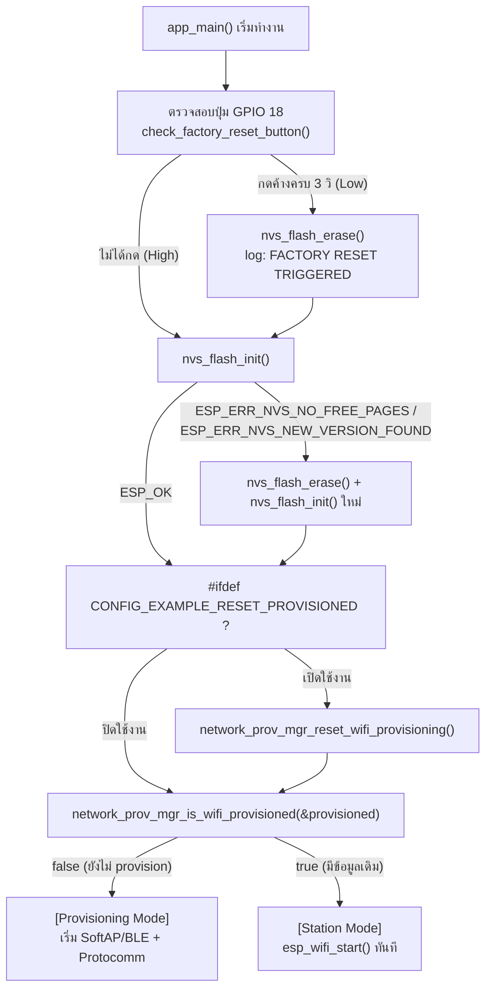
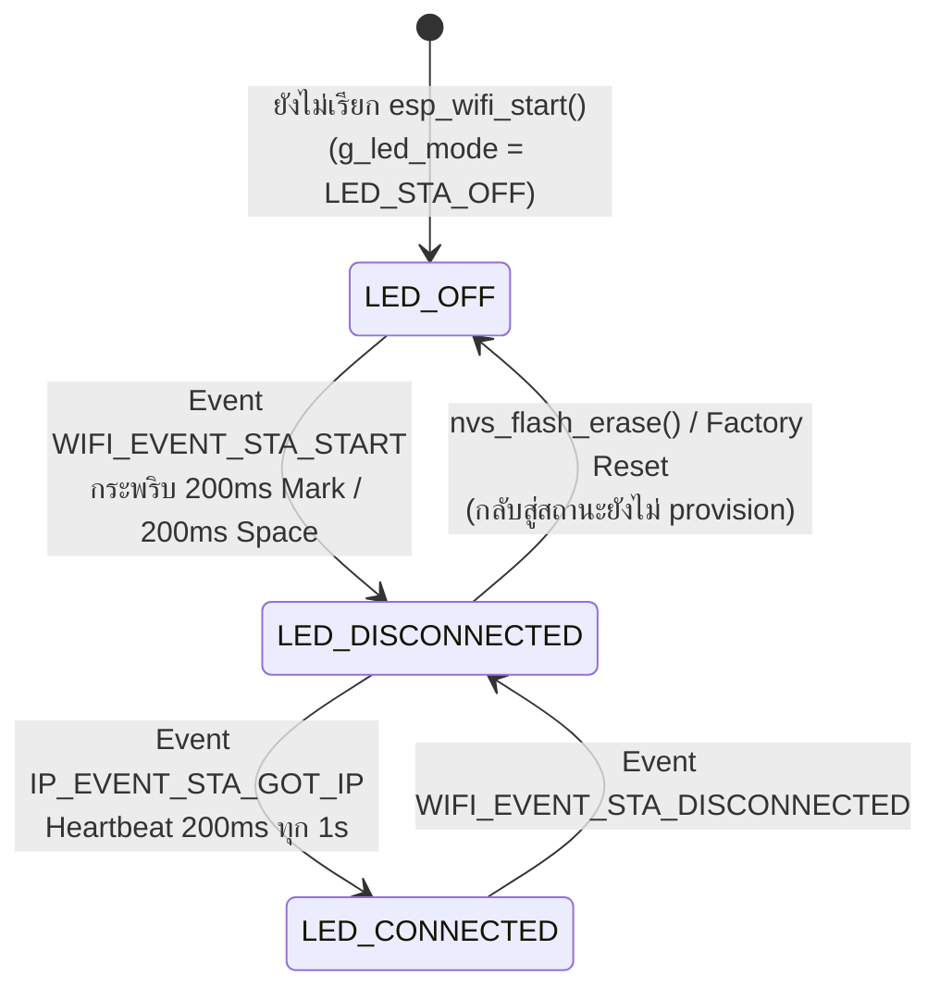

# ใบงานที่ 7.1 — การศึกษากลไก Reset Provisioning 3 รูปแบบ และ NVS Memory Forensics

> รหัสนักศึกษา 67030098 | ESP-IDF v6.0.2 | ESP32-D0WD-V3 (rev v3.1) | MAC `14:33:5c:0e:01:d0`

---

## 1. ผลการทดลอง (Results)

### 1.1 Boot Log ที่ได้จากบอร์ดจริง

```
rst:0x1 (POWERON_RESET),boot:0x13 (SPI_FAST_FLASH_BOOT)
I (27) boot: ESP-IDF v6.0.2 2nd stage bootloader
I (29) boot: chip revision: v3.1
I (39) boot.esp32: SPI Flash Size : 2MB
I (399) boot: Loaded app from partition at offset 0x10000
I (424) app_init: Project name:     lab7_1_reset_nvs_forensics
I (443) app_init: ESP-IDF:          v6.0.2
I (512) LAB7_1_RESET: Hold GPIO 18 button for 3 seconds to trigger Factory Reset...
W (612) LAB7_1_RESET: [STATUS]: Device is NOT provisioned (NVS is empty)
W (622) LAB7_1_RESET: Ready for Provisioning Lab 7-2 (SoftAP) or 7-3 (BLE)!
```

**จุดสังเกตสำคัญจาก Log**

| บรรทัด | ความหมาย |
| :--- | :--- |
| `rst:0x1 (POWERON_RESET)` | สาเหตุการรีเซ็ตคือการจ่ายไฟใหม่ ไม่ใช่ Watchdog หรือ Panic |
| `boot:0x13 (SPI_FAST_FLASH_BOOT)` | ค่า Strapping ที่ถูก latch ตอนรีเซ็ต บอกว่า **GPIO 0 = HIGH** ชิปจึงบูตจาก SPI Flash ตามปกติ |
| `Loaded app from partition at offset 0x10000` | โหลด Application จาก partition `factory` สำเร็จ |
| `Device is NOT provisioned (NVS is empty)` | `network_prov_mgr_is_wifi_provisioned()` คืนค่า `false` |

### 1.2 Partition Table ที่อ่านได้ตอน Boot

| # | Label | Usage | Type | ST | Offset | Length | ขอบเขตที่กินพื้นที่ |
| :--- | :--- | :--- | :--- | :--- | :--- | :--- | :--- |
| 0 | `nvs` | WiFi data | 01 | 02 | `0x009000` | `0x006000` (24 KB) | `0x009000`–`0x00EFFF` |
| 1 | `phy_init` | RF data | 01 | 01 | `0x00F000` | `0x001000` (4 KB) | `0x00F000`–`0x00FFFF` |
| 2 | `factory` | factory app | 00 | 00 | `0x010000` | `0x100000` (1 MB) | `0x010000`–`0x10FFFF` |

> ตารางนี้คือหลักฐานสำคัญที่ใช้ตอบคำถามข้อ 2 — พื้นที่ `nvs` กับ `factory` **แยกขาดจากกัน ไม่ทับซ้อนกันเลย**

### 1.3 ผังงาน (Flowchart / State Diagram) — ภารกิจถอดรหัสซอร์สโค้ด

#### ภารกิจที่ 1: ผังงานการตัดสินใจช่วง Bootstrapping & Reset Decision



**หลักฐานที่ยืนยันเส้นทางที่เกิดขึ้นจริงในการทดลองนี้:** log แสดง `Device is NOT provisioned (NVS is empty)` แปลว่าบอร์ดเดินตามเส้นทาง `CheckBtn: ไม่ได้กด → NvsInit: ESP_OK → CheckMenu: ปิดใช้งาน (ไม่มี flag นี้ใน main.c) → CheckProv: false → ProvMode`

#### ภารกิจที่ 2: ผังสถานะไฟ LED 1 (Wi-Fi STA Indicator)



**สถานะที่ยืนยันได้จากการทดลองนี้:** LED 1 อยู่ที่ `LED_OFF` ตลอด เพราะ log ยืนยันว่า `Device is NOT provisioned` และไม่มีการเรียก `esp_wifi_start()` เกิดขึ้นในรอบทดลองนี้ (ยังไม่ได้ทำ Provisioning ต่อใน Lab 7-1)

---

### 1.4 ตารางบันทึกผลการทดลอง Reset ทั้ง 3 รูปแบบ

| รูปแบบการ Reset | คำสั่ง / พฤติกรรม | ขอบเขตที่ถูกลบ | สถานะใน Serial Monitor | เฟิร์มแวร์หาย |
| :--- | :--- | :--- | :--- | :--- |
| **1. CLI Erase** | `idf.py -p COM3 erase-flash` | **ทั้งชิป** ตั้งแต่ `0x000000` | หลังลบต้อง flash ใหม่ ไม่งั้นบอร์ดบูตไม่ขึ้น | **หาย** |
| **2. Menuconfig Flag** | `CONFIG_EXAMPLE_RESET_PROVISIONED=y` | เฉพาะ key Wi-Fi ใน namespace `nvs.net80211` | `Device is NOT provisioned` ทุกครั้งที่บูต | ไม่หาย |
| **3. Hardware Button** | กด GPIO 18 ค้าง 3 วินาที | เฉพาะ partition `nvs` (`0x009000`–`0x00EFFF`) | `>>> FACTORY RESET TRIGGERED! ERASING NVS FLASH <<<` | ไม่หาย |

**สถานะ LED 1 (GPIO 2) ที่สังเกตได้จริง:** ดับสนิท เนื่องจาก `g_led_mode` ยังเป็น `LED_STA_OFF`
และยังไม่มีการเรียก `esp_wifi_start()` เพราะอุปกรณ์ยังไม่ถูก provision จึงยังไม่เกิด event
`WIFI_EVENT_STA_START` ที่จะเปลี่ยนโหมดไฟเป็น `LED_STA_DISCONNECTED`

---

## 2. คำถามท้ายการทดลอง (Post-Lab Questions)

### ข้อ 1. เพราะเหตุใดการกดปุ่ม BOOT (GPIO 0) ค้างไว้ในจังหวะรีเซ็ตบอร์ด จึงทำให้โปรแกรมค้างอยู่ที่ ROM Bootloader และไม่ยอมทำงานต่อ

เหตุผลคือ GPIO 0 บน ESP32 ไม่ใช่ขา I/O ธรรมดา แต่เป็น **Strapping Pin** ที่ชิปใช้ตัดสินใจว่าจะบูตยังไง

ตอนที่สัญญาณ Reset เพิ่งปลด ชิปจะอ่านค่าระดับไฟฟ้าของขานี้แค่ครั้งเดียวสั้นๆ แล้วเก็บค่าไว้ในรีจิสเตอร์ `GPIO_STRAP` จากนั้น GPIO 0 ก็กลับไปทำงานเป็นขาปกติทันที ถ้าตอนนั้น GPIO 0 เป็น HIGH (ค่าปกติเพราะมี pull-up ภายใน) ชิปจะเลือกโหมด SPI Flash Boot คือโหลด 2nd stage bootloader จาก flash แล้วไล่โหลด app ต่อไปจนถึง `app_main()` ตามปกติ แต่ถ้าตอนนั้นมีคนกดปุ่ม BOOT ค้างอยู่พอดี (ทำให้ GPIO 0 เป็น LOW) ชิปจะเปลี่ยนไปเลือกโหมด UART Download Boot แทน

ปัญหาคือในโหมด Download นี้ ตัว ROM Bootloader (โค้ดที่ฝังอยู่ใน Mask ROM ตั้งแต่โรงงาน แก้ไม่ได้) จะไม่แตะ SPI Flash เลย มันแค่นั่งรอรับคำสั่งผ่าน UART อย่างเดียว (รอ esptool เข้ามาคุยด้วย) เพราะฉะนั้นจึงไม่มีการโหลด 2nd stage bootloader และไม่มีการโหลด Application ใดๆ ทั้งสิ้น — `app_main()` เลยไม่เคยถูกเรียกเลย นี่เป็นจุดที่คนมักเข้าใจผิดว่าโปรแกรม "ค้าง" หรือ "แฮงก์" ทั้งที่จริงๆ แล้วโปรแกรมไม่เคยถูกโหลดขึ้นมาตั้งแต่ต้นต่างหาก

จาก log ที่ได้จากบอร์ดจริงในการทดลองนี้ เห็นบรรทัด `rst:0x1 (POWERON_RESET),boot:0x13 (SPI_FAST_FLASH_BOOT)` ซึ่งค่า `boot:0x13` นี่แหละคือค่า Strapping ที่ latch ได้ ยืนยันว่า GPIO 0 เป็น HIGH ตอนรีเซ็ต ชิปเลยเลือกบูตจาก flash ตามปกติ ถ้ากดปุ่ม BOOT ค้างไว้ตอนรีเซ็ต ค่านี้จะเปลี่ยนเป็นโหมด Download แทน และจะไม่มีบรรทัด `I (27) boot: ESP-IDF v6.0.2 2nd stage bootloader` ตามมาเลย

อีกจุดที่ควรรู้คือค่าที่ latch ไปแล้วจะไม่เปลี่ยนจนกว่าจะรีเซ็ตใหม่ ต่อให้ปล่อยปุ่มทีหลังก็ไม่ช่วยให้หลุดจากโหมด Download ต้องกดรีเซ็ตใหม่โดยให้ GPIO 0 เป็น HIGH เท่านั้นถึงจะกลับมาบูตปกติได้ นี่คือเหตุผลที่ในแล็บนี้เลือกใช้ **GPIO 18** ซึ่งเป็นขา I/O ธรรมดาไม่ใช่ Strapping Pin มาทำปุ่ม Factory Reset แทนที่จะใช้ปุ่ม BOOT เดิม

---

### ข้อ 2. เพราะเหตุใดคำสั่ง `idf.py erase-flash` จึงทำให้ข้อมูลเฟิร์มแวร์ Application หายไปด้วย ในขณะที่ `nvs_flash_erase()` ไม่ทำให้เฟิร์มแวร์หาย

ต่างกันตรงที่ทั้งสองคำสั่งทำงานคนละชั้น และ "รู้จัก" partition table ไม่เท่ากัน

`idf.py erase-flash` สั่งงานผ่าน esptool ที่รันอยู่บนพีซี คุยกับชิปผ่าน UART/ROM Download Bootloader โดยส่งคำสั่ง Chip Erase ไปตรงๆ ในมุมมองของ esptool ตัว flash คือก้อนไบต์เดียวยาวๆ ไม่มีแนวคิดเรื่อง partition เลย มันเลยลบทุกอย่างเรียบตั้งแต่ `0x000000` ไม่ว่าจะเป็น 2nd stage bootloader ที่ `0x1000`, partition table เองที่ `0x8000`, NVS ที่ `0x9000` ไปจนถึง application ที่ `0x10000` — ตรงนี้เองที่เฟิร์มแวร์อยู่ พอโดนลบไปด้วยบอร์ดเลยบูตไม่ขึ้น ต้อง flash ใหม่ทั้งชุด

ส่วน `nvs_flash_erase()` รันอยู่ในเฟิร์มแวร์ที่กำลังทำงานบนบอร์ดเอง มันเปิด partition table ที่ `0x8000` มาหาก่อนว่า partition ไหน type เป็น `data` subtype เป็น `nvs` (จากตารางในหัวข้อ 1.2 ของบอร์ดนี้คือ offset `0x009000` ยาว `0x006000`) แล้วค่อยสั่ง erase เฉพาะ sector ในช่วงนั้นเท่านั้น เพราะ partition `factory` เริ่มที่ `0x010000` ซึ่งอยู่คนละช่วงกับ NVS อย่างสิ้นเชิง โค้ด application จึงไม่โดนแตะเลย

ที่จริงมันก็มีเหตุผลเชิงตรรกะง่ายๆ ด้วยว่าทำไม `nvs_flash_erase()` ถึงลบเฟิร์มแวร์ตัวเองไม่ได้ — เพราะถ้ามันลบพื้นที่ `factory` ที่ตัวเองกำลังรันอยู่ทิ้งไปจริงๆ ระบบก็จะพังกลางคันทันที การออกแบบให้รู้จัก partition ก่อนค่อยลบจึงไม่ใช่แค่เรื่อง scope แต่เป็นเรื่องความปลอดภัยของระบบด้วย

---

### ข้อ 3. การออกแบบปุ่ม Factory Reset บนอุปกรณ์ IoT เชิงพาณิชย์ เหตุใดจึงต้องกำหนดให้ผู้ใช้กดปุ่มค้างไว้ 3-5 วินาที แทนที่จะสั่งลบข้อมูลทันทีที่แตะปุ่มเพียงเสี้ยววินาที

เหตุผลหลักคือป้องกันการลบโดยไม่ตั้งใจ Factory Reset เป็นการกระทำที่ทำลายข้อมูลและย้อนกลับไม่ได้ ผู้ใช้ต้องมาตั้งค่า Wi-Fi ใหม่ทั้งหมด ถ้าลบทันทีที่แค่แตะปุ่ม โอกาสเกิดอุบัติเหตุจะสูงมาก เช่น เด็กหรือสัตว์เลี้ยงไปกดเล่น ปุ่มโดนกดระหว่างขนส่ง/ติดตั้ง/ทำความสะอาด หรือผู้ใช้กดผิดปุ่มเพราะอุปกรณ์ headless มักมีปุ่มเดียวที่ทำได้หลายหน้าที่

อีกมุมหนึ่งคือมันทำหน้าที่แทน confirmation dialog อุปกรณ์ IoT ทั่วไปไม่มีจอให้กด OK/Cancel เหมือนคอมพิวเตอร์ ระยะเวลาที่ต้องกดค้างจึงถูกใช้แทนตรงนั้น เป็นการพิสูจน์ว่าผู้ใช้ตั้งใจจริงๆ ไม่ใช่กดโดนเฉยๆ

นอกจากนี้ยังช่วยกรองสัญญาณรบกวนทางไฟฟ้าได้ด้วย สวิตช์กลไกทั่วไปเวลากดจะเกิด contact bounce คือกระเด้งสร้างพัลส์ HIGH/LOW สลับกันหลายสิบครั้งในช่วงไม่กี่มิลลิวินาที หรือถ้าสายต่อยาวก็อาจโดน EMI/ESD รบกวนจนขาตกลง LOW ชั่วขณะได้เหมือนกัน การบังคับให้ต้องเป็น LOW ต่อเนื่องยาวถึง 3 วินาทีทำให้สัญญาณรบกวนระดับมิลลิวินาทีพวกนี้ไม่มีทางไปกระตุ้นการลบข้อมูลได้เลย ในโค้ดของแล็บนี้ก็ทำผ่านลูปแบบนี้:

```c
while (gpio_get_level(FACTORY_RESET_BUTTON_GPIO) == 0) {
    vTaskDelay(pdMS_TO_TICKS(100));
    hold_count++;
    if (hold_count >= 30) {   // ครบ 30 x 100ms = 3 วินาที
        return true;
    }
}
return false;   // ปล่อยปุ่มก่อนครบ เท่ากับยกเลิกทันที
```

จะเห็นว่าถ้าปล่อยปุ่มก่อนครบ 3 วินาที ลูปจะหลุดแล้ว return false ทันที นั่นแปลว่าผู้ใช้ยกเลิกได้ตลอดเวลาแค่ปล่อยมือ และช่วงเวลานี้ยังเปิดโอกาสให้เฟิร์มแวร์ส่ง feedback กลับมาด้วย เช่นในโค้ดที่ log นับถอยหลังทุก 1 วินาที (`Holding button... %d/3 seconds`) หรือในของจริงอาจจะเป็นไฟกระพริบถี่ขึ้นเรื่อยๆ เพื่อเตือนว่ากำลังจะรีเซ็ตแล้ว ผลพลอยได้อีกอย่างคือปุ่มเดียวใช้ได้หลายหน้าที่ กดสั้นเป็นเปิดปิด กดค้าง 3 วินาทีเป็น factory reset ช่วยลดจำนวนปุ่มและต้นทุนการผลิตไปในตัว

---

### ข้อ 4. หากอุปกรณ์ IoT ถูกติดตั้งอยู่บนเสาสูงหรือฝังอยู่ในผนัง วิธีการ Reset ทางกายภาพรูปแบบใดเหมาะสมที่สุด

คิดว่าวิธีที่เหมาะสุดคือ **Power-Cycle Pattern Reset** คือให้ผู้ใช้เปิด-ปิดสวิตช์ไฟหลักที่จ่ายให้อุปกรณ์ติดต่อกันตามจังหวะที่กำหนด เช่น เปิดปิด 5 ครั้ง แต่ละครั้งเว้นไม่เกิน 2 วินาที แล้วเฟิร์มแวร์จะนับจำนวนครั้งแล้วสั่ง factory reset เอง

ตัวนับจำนวนครั้งทำได้สองแบบ อย่างแรกคือใช้ RTC memory (ตัวแปรที่ประกาศด้วย `RTC_NOINIT_ATTR`) ซึ่งจะคงค่าข้ามการรีเซ็ตแบบ soft ได้ อีกแบบคือเขียนตัวนับลง NVS ตอนบูต แล้วตั้ง timer ไว้ว่าถ้าอุปกรณ์อยู่รอดเกิน N วินาทีให้ล้างตัวนับกลับเป็นศูนย์ — ตรรกะคือถ้าบูตแล้วอยู่ได้ไม่นานก็โดนตัดไฟอีก แสดงว่าผู้ใช้กำลังตั้งใจกระพริบสวิตช์อยู่จริงๆ

เหตุผลที่คิดว่าวิธีนี้เหมาะกับโจทย์เสาสูง/ฝังผนังที่สุดเพราะไม่ต้องเข้าถึงตัวอุปกรณ์เลย ไม่ต้องปีนเสาไม่ต้องรื้อผนัง ตรงประเด็นที่สุดของโจทย์ ไม่ต้องเจาะรูปุ่มด้วยจึงรักษาระดับกันน้ำกันฝุ่น (IP Rating) ไว้ได้ ซึ่งสำคัญมากสำหรับอุปกรณ์ outdoor แถมใช้สวิตช์ไฟที่ผนังซึ่งมีอยู่แล้ว ไม่ต้องเพิ่มชิ้นส่วนอะไรใน BOM เลย และเป็นวิธีที่หลอดไฟอัจฉริยะ/สวิตช์ฝังผนังเชิงพาณิชย์ใช้จริงอยู่แล้วด้วย

ทางเลือกอื่นที่เคยคิดถึงก็มีเหมือนกันแต่ติดข้อจำกัด เช่น Magnetic Reed Switch (ใช้แม่เหล็กแตะผ่านผนังได้ ไม่ต้องเจาะรู แต่ก็ยังต้องเข้าใกล้ตัวอุปกรณ์อยู่ดี), BLE Reset ผ่านแอปพร้อม PoP (สะดวกแต่ใช้ไม่ได้ถ้า BLE stack หรือเฟิร์มแวร์ค้าง), หรือ OTA/Cloud Reset (สั่งจากไหนก็ได้ แต่ดันใช้ไม่ได้ในเคสที่ต้อง reset บ่อยที่สุดคือตอนอุปกรณ์ต่อเน็ตไม่ได้) ส่วนปุ่มกดทางกายภาพแบบเดิมก็ขัดกับโจทย์ตรงๆ เพราะเข้าถึงตัวเครื่องไม่ได้อยู่แล้ว

โดยรวมคิดว่าการออกแบบที่ดีควรมีหลายชั้นซ้อนกันไว้ ชั้นปกติใช้ BLE/Cloud สั่งผ่านแอปเพราะสะดวกสุด ชั้นสำรองใช้ Power-Cycle Pattern เพราะทำงานได้แม้เน็ตล่มหรือแอปใช้ไม่ได้ และชั้นสุดท้ายเก็บปุ่มกดจริงซ่อนไว้ในตัวเครื่องสำหรับช่างเข้าถึงเวลาต้องซ่อมจริงๆ แต่สำหรับโจทย์เสาสูง/ฝังผนังนี้ Power-Cycle Pattern คือคำตอบที่ตรงที่สุดเพราะไม่ต้องเข้าถึงตัวเครื่องเลยและทำงานได้แม้เน็ตล่ม

---

## 3. สรุปผลการทดลอง (Conclusion)

จากการทดลองนี้เห็นชัดเจนว่ากลไก Reset ทั้ง 3 แบบทำงานคนละระดับชั้นกันเลย `erase-flash` ทำงานระดับ raw flash จากภายนอก (ผ่าน esptool) เลยลบทั้งชิปรวมถึงเฟิร์มแวร์ไปด้วย ในขณะที่ `nvs_flash_erase()` ทำงานระดับ partition จากภายในเฟิร์มแวร์เอง เลยลบแค่ NVS ขนาด 24 KB ที่ offset `0x009000` เท่านั้น ไม่กระทบส่วนอื่น

อีกเรื่องที่ได้เรียนรู้คือ Strapping Pin เป็นข้อจำกัดทางฮาร์ดแวร์ที่ต้องระวังตอนออกแบบ เพราะ GPIO 0 ถูก latch ค่าตอนรีเซ็ตเพื่อเลือกโหมดบูต ถ้าเผลอเอามาทำปุ่ม Factory Reset จะทำให้บอร์ดตกไปอยู่ในโหมด Download แทน ในแล็บนี้เลยต้องเลี่ยงไปใช้ GPIO 18 ซึ่งเป็น I/O ธรรมดาแทน

ส่วนเรื่องกดค้าง 3 วินาทีก็ไม่ใช่แค่การหน่วงเวลาเฉยๆ แต่เป็นกลไกยืนยันเจตนาของอุปกรณ์ที่ไม่มีจอ ทำหน้าที่แทน confirmation dialog พร้อมๆ กับกรองสัญญาณรบกวนไปในตัว และยังเปิดโอกาสให้ผู้ใช้ยกเลิกได้ตลอดถ้าปล่อยมือก่อนครบเวลา

จากที่ทดลองจริงบนบอร์ด ESP-IDF v6.0.2 ก็ยืนยันได้ว่าทำงานตามที่คาดไว้ บอร์ดบูตด้วย `SPI_FAST_FLASH_BOOT` โหลด app จาก `0x010000` และ `network_prov_mgr_is_wifi_provisioned()` รายงานสถานะ `NOT provisioned` ได้ถูกต้อง

มีจุดหนึ่งที่สังเกตเห็นเพิ่มระหว่างทำคือใน log มี warning ว่า `Detected size(4096k) larger than the size in the binary image header(2048k)` ซึ่งแปลว่าบอร์ดจริงมี flash 4 MB แต่ค่าคอนฟิกตั้งไว้แค่ 2 MB ระบบยังทำงานได้ปกติเพราะ partition ทั้งหมดรวมกันไม่เกิน 2 MB อยู่แล้ว แต่ก็เท่ากับมีพื้นที่ flash เหลือใช้อีกครึ่งหนึ่งที่ไม่ได้ถูกเอามาใช้ประโยชน์ ถ้าอยากใช้เต็มความจุก็แก้ได้ที่ `sdkconfig.defaults` โดยตั้ง `CONFIG_ESPTOOLPY_FLASHSIZE_4MB=y`
