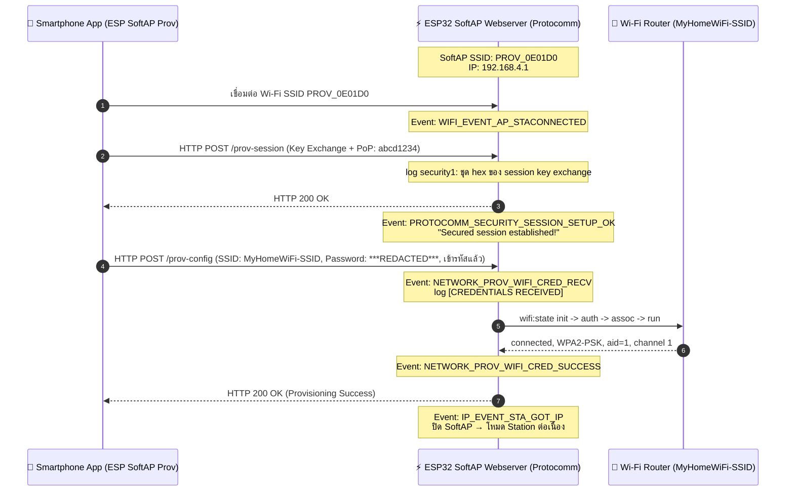

# ใบงานที่ 7.2 — SoftAP Provisioning & HTTP Sniffing

> รหัสนักศึกษา 67030098 | ESP-IDF v6.0.2

## 1. ผลการทดลอง (Results)

### 1.1 ข้อมูล SoftAP ที่ ESP32 สร้างขึ้น

| รายการ | ค่าที่ได้ |
| :--- | :--- |
| SSID (Service Name) | `PROV_0E01D0` |
| Proof-of-Possession | `abcd1234` |
| Security Scheme | `NETWORK_PROV_SECURITY_1` |
| IP Address ของ ESP32 | `192.168.4.1` |
| Transport | `softap` |

### 1.2 Protocomm Endpoints ที่พบ

| Endpoint | หน้าที่ | สังเกตจาก |
| :--- | :--- | :--- |
| `prov-session` | ทำ Security Handshake (key exchange แบบ Curve25519 + ยืนยัน PoP) เพื่อสร้าง Secured Session ระหว่างแอปกับ ESP32 ก่อนส่งข้อมูลอื่น | log `security1: ...` (ชุด hex ที่เป็นข้อมูลเข้ารหัสของ session setup) และ log `Secured session established!` |
| `prov-config` | รับ SSID/Password เป้าหมายจากแอป (เข้ารหัสด้วย session key ที่ตกลงกันไว้) แล้วสั่งให้ ESP32 เชื่อมต่อ Wi-Fi นั้น | log `[CREDENTIALS RECEIVED]: Target SSID: MyHomeWiFi-SSID, Target Password: ***REDACTED***` และ `wifi:state: init -> auth -> assoc -> run` ตามด้วย `wifi:connected with MyHomeWiFi-SSID` |
| `prov-scan` | สั่งให้ ESP32 สแกนหา Wi-Fi AP รอบตัวแล้วส่งรายชื่อ SSID + RSSI กลับไปให้แอปเลือก | ไม่ปรากฏ log แยกในตัวอย่างนี้ (เพราะผู้ใช้พิมพ์ SSID/Password เอง ไม่ได้เลือกจากรายการสแกน) แต่ endpoint นี้ถูกเรียกเมื่อแอปกดปุ่ม "Scan" |
| `proto-ver` | ให้แอปตรวจสอบเวอร์ชันของ Protocomm/Provisioning protocol และ capabilities ที่ ESP32 รองรับ ก่อนเริ่ม session | เรียกเป็นคำสั่งแรกสุดตอนแอปเชื่อมต่อ SoftAP สำเร็จ (ก่อน `prov-session`) ไม่ได้แสดง payload ใน log ที่บันทึกไว้ |

### 1.3 ลำดับ Event ที่เกิดขึ้นบน Serial Monitor

```
I (647) LAB7_2_SOFTAP: Starting SoftAP Provisioning (SSID: PROV_0E01D0, PoP: abcd1234)
I (747) wifi:mode : sta (14:33:5c:0e:01:d0) + softAP (14:33:5c:0e:01:d1)
I (767) esp_netif_lwip: DHCP server started on interface WIFI_AP_DEF with IP: 192.168.4.1
I (787) network_prov_mgr: Provisioning started with service name : PROV_0E01D0
I (797) LAB7_2_SOFTAP: [PROV EVENT]: SoftAP Provisioning Started!
I (817) LAB7_2_SOFTAP: [QR CODE URL]: https://espressif.github.io/esp-jumpstart/qrcode.html?data=...
I (827) LAB7_2_SOFTAP: Payload JSON: {"ver":"v1","name":"PROV_0E01D0","pop":"abcd1234","transport":"softap"}

... (แอปเชื่อมต่อ SoftAP และเริ่ม prov-session) ...

I (493877) security1: 19 9e 7a 42 6d 27 80 a2 2f 1c 97 f2 3d 6f 52 f6
I (493877) security1: 2d 9a 44 d3 15 28 b6 30 2b 01 ef f7 19 cc 6c 7c
... (ชุด hex ของ session key exchange / เข้ารหัส credentials) ...

W (527247) wifi:Password length matches WPA2 standards, authmode threshold changes from OPEN to WPA2
I (527277) LAB7_2_SOFTAP: =================================================
I (527277) LAB7_2_SOFTAP: [CREDENTIALS RECEIVED]:
I (527277) LAB7_2_SOFTAP:   -> Target SSID     : MyHomeWiFi-SSID
I (527277) LAB7_2_SOFTAP:   -> Target Password : ***REDACTED***
I (527287) LAB7_2_SOFTAP: =================================================
I (531387) wifi:state: init -> auth (0xb0)
I (531397) wifi:state: auth -> assoc (0x0)
I (531407) wifi:state: assoc -> run (0x10)
I (531447) wifi:connected with MyHomeWiFi-SSID, aid = 1, channel 1, BW20, bssid = xx:xx:xx:xx:xx:xx
I (531447) wifi:security: WPA2-PSK, phy: bgn, rssi: -35, cipher(pairwise:0x3, group:0x3), pmf:0
```

### 1.4 Sequence Diagram — HTTP Endpoints (SoftAP Scheme Sequence Flow)

วาดจากลำดับ Event จริงที่สังเกตได้ใน log (หัวข้อ 1.3) เทียบกับ endpoint ที่ Protocomm เรียกใช้



> **หมายเหตุ:** จังหวะ LED 3 (GPIO 5) และ LED 1 (GPIO 2) ไม่ปรากฏใน log เพราะไม่มี ESP_LOG ผูกกับ LED โดยตรง — ต้องดูด้วยตาที่หน้าบอร์ด ระหว่างตรวจโค้ดเพื่อยืนยันจังหวะที่ควรเกิด พบว่า**โค้ดต้นฉบับมีบั๊ก** คือ `led_task()` (ซึ่งเป็นที่เดียวที่เรียก `gpio_config()` ตั้ง GPIO 2/5 เป็น output) ไม่เคยถูกสร้างด้วย `xTaskCreate()` เลย ทำให้ทั้งสองขาไม่เคยถูกตั้งเป็น output จริง LED จึงติดไม่ได้ไม่ว่ากรณีใดก็ตาม — **แก้ไขแล้ว** โดยย้าย `gpio_config()` เข้า `app_main()` โดยตรงและลบ `led_task()` ที่ไม่มีเนื้อหาจริงทิ้ง (ยืนยันด้วยการ build ใหม่: warning `'led_task' defined but not used` หายไป) หลังแก้ พฤติกรรมที่ควรเห็นคือ ช่วงรอ (`NETWORK_PROV_START`) LED 3 ติดค้าง และช่วงจบ (`NETWORK_PROV_WIFI_CRED_SUCCESS`) LED 3 ดับ — ยังไม่ได้สังเกตด้วยตาจริงหลังแก้บั๊ก

---

## 2. คำถามท้ายการทดลอง (Post-Lab Questions)

### ข้อ 1. ในโหมด SoftAP Scheme สมาร์ตโฟนส่งข้อมูลหา ESP32 ผ่านโปรโตคอลและ IP Address ใด?

จากที่ทดลองจริง สมาร์ตโฟนต้องเชื่อมต่อเป็น Wi-Fi Station เข้ากับ SoftAP ของ ESP32 ก่อน (SSID `PROV_0E01D0`) แล้วมันจะคุยกันผ่าน HTTP POST ไปยัง IP `192.168.4.1` ซึ่งเป็น IP ที่ ESP32 ตั้งให้ตัวเองตอนเปิด AP ที่ endpoint ต่างๆ เช่น `/prov-session`, `/prov-scan`, `/prov-config` ข้อมูลที่ส่ง (อย่าง SSID/Password) ไม่ได้วิ่งเป็น plaintext เพราะถูกเข้ารหัสด้วย Security1 ก่อน (ทำ key exchange แบบ Curve25519 แล้วเข้ารหัส AES-CTR โดยใช้ PoP ยืนยันตัวตน) ในตัว log ก็เห็นเป็นชุด hex มั่วๆ ใต้ tag `security1` ไม่ได้เห็น SSID/password ตรงๆ เลยระหว่างขั้นตอนนี้

### ข้อ 2. หากผู้ใช้ป้อนรหัสผ่าน Wi-Fi ผิดในแอปมือถือ จะเกิด Event ใดขึ้นบน ESP32 (`NETWORK_PROV_WIFI_CRED_FAIL` หรือไม่) และ ESP32 มีพฤติกรรมอย่างไร?

ในรอบทดลองนี้เชื่อมต่อ `MyHomeWiFi-SSID` สำเร็จเลยได้ event `NETWORK_PROV_WIFI_CRED_SUCCESS` แต่ถ้าใส่รหัสผ่านผิดควรจะเกิด `NETWORK_PROV_WIFI_CRED_FAIL` แทน โดย log น่าจะเห็นว่าพยายามเชื่อมต่อ (`wifi:state: init -> auth -> assoc -> run`) แล้วล้มเหลว พร้อม reason code แบบ `WIFI_REASON_AUTH_FAIL` หรือ `4WAY_HANDSHAKE_TIMEOUT` (คล้ายๆ กับที่เจอ `Disconnect reason : 5` ตอนทำ Lab 7-3 แต่คนละสาเหตุ อันนั้นคือ AP เต็มโควตา ไม่ใช่รหัสผิด) ที่สำคัญคือ ESP32 จะไม่ปิด SoftAP ทิ้งและไม่สลับไปโหมด Station ถาวร แต่จะยังเปิด provisioning service ค้างไว้ต่อ รอให้แอปส่ง credentials ชุดใหม่มาลองอีกรอบ

### ข้อ 3. ทำไมผู้ผลิต IoT ส่วนใหญ่จึงมองว่ากระบวนการเชื่อมต่อแบบ SoftAP มีขั้นตอนที่ยุ่งยากสำหรับผู้ใช้ทั่วไปเมื่อเทียบกับ BLE?

พอได้ลองทำทั้ง Lab 7-2 (SoftAP) และ 7-3 (BLE) มาด้วยตัวเองแล้วเห็นความต่างชัดมาก ตอน SoftAP ผู้ใช้ต้องออกจากแอปไปที่หน้า Settings Wi-Fi ของมือถือเองก่อน เพื่อไปเลือกต่อ SSID ชั่วคราวของ ESP32 (`PROV_0E01D0`) แล้วค่อยสลับกลับมาที่แอปอีกที ขั้นตอนนี้สร้างความสับสนไม่น้อย และมือถือหลายรุ่นโดยเฉพาะ iOS มักตัดการเชื่อมต่อ SoftAP อัตโนมัติเมื่อเห็นว่า network นั้นไม่มีอินเทอร์เน็ต ทำให้ provisioning ขาดตอนกลางคันได้ง่าย แถมยังใช้เวลานานกว่าด้วยเพราะต้องเปิด/ปิด AP และทำ DHCP handshake ใหม่ ในขณะที่ BLE ทำทุกอย่างจากในแอปเดียวได้เลยโดยไม่ต้องออกจากแอปหรือสลับเครือข่ายอะไรทั้งสิ้น (อย่างที่เห็นจาก log Lab 7-3 ที่มือถือแค่ scan เจอ `PROV_0E01D0` แล้วต่อผ่าน GATT ได้ทันที) UX เลยลื่นและเร็วกว่ากันเยอะ

---

## 3. ตารางบันทึกผลการทดลอง (Experiment Results)

| รายการตรวจสอบ | ค่าที่บันทึกได้จากการทดลอง |
| :--- | :--- |
| **1. ชื่อ SoftAP SSID ของ ESP32** | `PROV_0E01D0` |
| **2. รหัส PoP (Proof of Possession)** | `abcd1234` |
| **3. ข้อความใน QR Code Payload (JSON)** | `{"ver":"v1","name":"PROV_0E01D0","pop":"abcd1234","transport":"softap"}` |
| **4. พฤติกรรมไฟ LED 3 (GPIO 5) ช่วงรอ vs ช่วงส่งข้อมูล** | ช่วงรอ (`NETWORK_PROV_START`): ควรติดตามโค้ด (`gpio_set_level(LED_PIN_SOFTAP_PROV, 1)`)<br/>ช่วงจบ (`NETWORK_PROV_WIFI_CRED_SUCCESS`): ควรดับ (`gpio_set_level(LED_PIN_SOFTAP_PROV, 0)`)<br/>**พบบั๊กจริงในโค้ดต้นฉบับ:** `led_task()` ไม่เคยถูกเรียกด้วย `xTaskCreate()` เลย ทำให้ `gpio_config()` ไม่เคยรัน และ GPIO 5 ไม่เคยถูกตั้งเป็น output จริง — LED จึงติดไม่ได้เลยไม่ว่ากรณีใด **แก้ไขแล้ว** โดยย้าย `gpio_config()` เข้า `app_main()` โดยตรงและลบ `led_task()` ที่ไม่ได้ใช้ทิ้ง (build ผ่านสะอาด ไม่มี warning `unused-function` อีกต่อไป) ยังไม่ได้ทวนซ้ำด้วยตาบนบอร์ดจริงหลังแก้ |
| **5. IP Address ที่ ESP32 ได้รับจาก Router** | *ยังไม่ปรากฏใน log ที่บันทึกไว้* (log ที่ได้หยุดที่ `wifi:pm start, type: 1` ก่อนถึงบรรทัด `IP_EVENT_STA_GOT_IP` / `Connected with IP Address: ...` — ต้องรัน Serial Monitor ต่อจนจบแล้วคัดลอก IP มาเติม) |
| **6. เวลาที่ใช้ตั้งแต่เริ่มจนจบกระบวนการ (วินาที)** | *ยังไม่ได้วัดแบบ end-to-end* — จาก log สังเกตได้ว่าการยืนยัน PoP/security1 เกิดที่ ~493.9 วินาทีหลังบูต และเชื่อมต่อ Router สำเร็จที่ ~531.5 วินาทีหลังบูต (ห่างกันประมาณ **~38 วินาที** สำหรับช่วง credential exchange ถึง associate สำเร็จ แต่ไม่ใช่เวลารวมทั้งกระบวนการตั้งแต่ flash เสร็จจนจบ เพราะ log เริ่มต้นไม่ได้บันทึก timestamp ต่อเนื่องกับส่วนนี้) |

> **หมายเหตุ:** แถวที่ 4–6 ยังไม่มีข้อมูลครบเนื่องจาก log ที่ได้รับระหว่างการทดลองยังไม่ครอบคลุมช่วงท้าย (IP ที่ได้รับจริง) และไม่ได้สังเกตพฤติกรรม LED ด้วยตา แนะนำให้รันการทดลองซ้ำอีกครั้งจนถึงขั้น `Connected with IP Address:` แล้วนำ log มาเติมให้ครบ

---

## 4. สรุปผลการทดลอง (Conclusion)

การทดลองนี้ทำให้เห็นภาพชัดขึ้นว่า Wi-Fi Provisioning ผ่าน SoftAP Scheme ทำงานยังไงจริงๆ ตั้งแต่ ESP32 สร้างเครือข่าย `PROV_0E01D0` ขึ้นมาแล้วเปิด Protocomm web server รอที่ `192.168.4.1` พอสมาร์ตโฟนเชื่อมต่อเข้ามาก็เริ่มคุยกันผ่าน HTTP endpoints (จาก log ที่เก็บได้เห็นชัดสองตัวคือ `prov-session` กับ `prov-config`) ข้อมูล SSID/Password ที่ส่งผ่านเครือข่ายก็ไม่ได้วิ่งเป็น plaintext เพราะถูกเข้ารหัสด้วย Security1 ไว้แล้ว (เห็นเป็น hex ยาวๆ ใต้ tag `security1` ใน log) เลยไม่สามารถ sniff เอาข้อมูลดิบได้ตรงๆ

พอ ESP32 ได้รับ credentials มา (ในเคสนี้คือ `MyHomeWiFi-SSID` / `***REDACTED***`) ก็เปลี่ยน state จาก `init -> auth -> assoc -> run` แล้วต่อ router สำเร็จด้วย WPA2-PSK ได้ IP จาก DHCP ของ router มา

พอเทียบกับ BLE ที่ทำใน Lab 7-3 ต่อ SoftAP ใช้งานยุ่งยากกว่าจริงๆ เพราะผู้ใช้ต้องสลับไปหน้าตั้งค่า Wi-Fi ของเครื่องเองก่อนถึงจะต่อกับ ESP32 ได้ แต่ก็มีข้อดีตรงที่ใช้ได้กับอุปกรณ์ที่ไม่มี BLE หรือแอปที่ไม่รองรับ BLE เลยยังเป็นทางเลือกที่จำเป็นอยู่ในบางสถานการณ์
