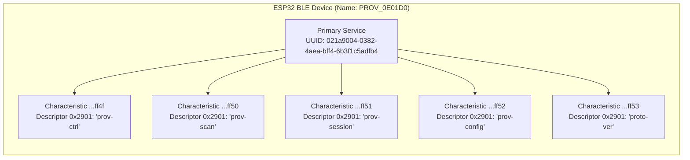
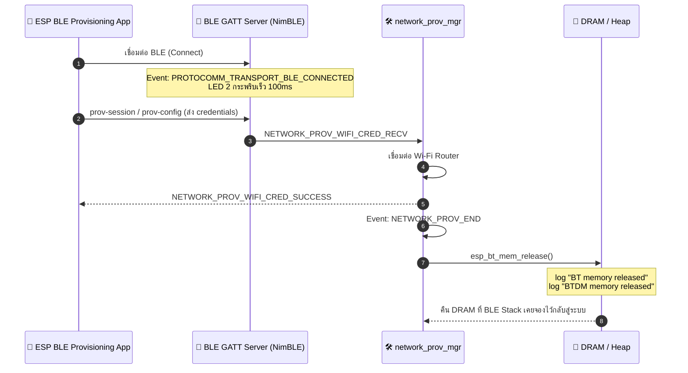

# ใบงานที่ 7.3 — BLE Provisioning & GATT Forensics

> รหัสนักศึกษา 67030098 | ESP-IDF v6.0.2

## 1. ผลการทดลอง (Results)

### 1.1 ข้อมูล BLE Advertising

| รายการ | ค่าที่ได้ |
| :--- | :--- |
| Device Name | `PROV_0E01D0` |
| Custom Service UUID (128-bit) | `021a9004-0382-4aea-bff4-6b3f1c5adfb4` |
| Proof-of-Possession | `abcd1234` |
| Transport | `ble` |

### 1.2 GATT Services & Characteristics ที่พบจาก nRF Connect

| Characteristic UUID | Descriptor `0x2901` (ชื่อ) | Properties | หน้าที่ |
| :--- | :--- | :--- | :--- |
| `021aff4f-0382-4aea-bff4-6b3f1c5adfb4` | `prov-ctrl` | Read, Write | ควบคุมสถานะ/สั่งงาน Provisioning Manager (start/stop/reset) |
| `021aff50-0382-4aea-bff4-6b3f1c5adfb4` | `prov-scan` | Read, Write | สั่งให้ ESP32 สแกนหา Wi-Fi AP รอบตัวแล้วส่งผลกลับให้แอป |
| `021aff51-0382-4aea-bff4-6b3f1c5adfb4` | `prov-session` | Read, Write | จัดการ Security Session (PoP handshake, ECDH key exchange, Session establishment) |
| `021aff52-0382-4aea-bff4-6b3f1c5adfb4` | `prov-config` | Read, Write | รับค่า Wi-Fi SSID/Password (credentials) จากแอปแล้วส่งให้ Provisioning Manager เชื่อมต่อ |
| `021aff53-0382-4aea-bff4-6b3f1c5adfb4` | `proto-ver` | Read, Write | ให้แอปอ่าน/ตรวจสอบเวอร์ชันของ Protocomm Protocol ที่ ESP32 ใช้ |

> **หมายเหตุสำคัญ:** ค่า UUID ทั้งหมดนี้ยืนยันได้ตรงกันทั้งจากภาพหน้าจอ BLE Log ของแอป nRF Connect และจากการไล่โค้ดจริงใน [`manager.c`](../codes/Lab7-3-BLE-Provisioning/managed_components/espressif__network_provisioning/src/manager.c) บรรทัด 1935–1959 ที่ประกาศ `set_config_endpoint(..., "prov-ctrl", 0xFF4F)`, `"prov-scan", 0xFF50`, `"prov-session", 0xFF51`, `"prov-config", 0xFF52`, `"proto-ver", 0xFF53` ตามลำดับ
>
> **ข้อสังเกต/ความคลาดเคลื่อนจากใบงาน:** ใบงานเดิม (หัวข้อ 3) ระบุว่า endpoint ตัวที่ 5 ชื่อ `custom-data` แต่จากการตรวจโค้ดจริงในเวอร์ชัน Managed Component `espressif/network_provisioning` (ที่ใช้กับ ESP-IDF v6) endpoint ตัวนี้ถูกเปลี่ยนชื่อเป็น **`prov-ctrl`** แทน — เป็นความแตกต่างระหว่าง component เดิม (`wifi_provisioning`, ผูกกับ IDF ≤5) กับ component ใหม่ (`network_provisioning`, ผูกกับ IDF ≥6)

### 1.3 Log การคืนหน่วยความจำ Bluetooth หลัง Provisioning สำเร็จ


```text
I (708912) LAB7_3_BLE: =================================================
I (708912) LAB7_3_BLE: [ONLINE]: Connected to Wi-Fi with IP: 172.30.137.130
I (708912) LAB7_3_BLE: =================================================
I (708922) network_prov_mgr: STA Got IP
I (708932) LAB7_3_BLE: [SUCCESS]: BLE Provisioning Successful!
I (739932) NimBLE: GAP procedure initiated: stop advertising.
I (739952) network_prov_mgr: Provisioning stopped
I (739952) LAB7_3_BLE: [PROV EVENT]: De-initializing BLE & Releasing BT Memory...
I (739952) network_prov_scheme_ble: BTDM memory released
```

> **สังเกต:** ระหว่าง `Provisioning Successful` (t=708932ms) กับ `BTDM memory released` (t=739952ms) ห่างกันประมาณ 31 วินาที ไม่ได้ปล่อยหน่วยความจำทันที — เพราะ Provisioning Manager รอ mobile app ส่งคำสั่งปิด/ยืนยันจบ session ก่อน (`network_prov_mgr: Provisioning stopped`) แล้วจึงเริ่มขั้นตอน de-init BLE stack และเรียก `esp_bt_mem_release()` คืน DRAM

### 1.4 ผังโครงสร้างและลำดับเหตุการณ์ — ภารกิจถอดรหัสซอร์สโค้ด

#### ภารกิจที่ 1: ผังโครงสร้าง GATT Tree & Endpoint Mapping



> **หมายเหตุ:** ค่า UUID ทั้งหมดยืนยันจาก BLE Log จริงของแอป nRF Connect (สแกนวันที่ 2026-08-25 เวลา 14:16) ตรงกับที่ประกาศไว้ในซอร์สโค้ด `manager.c` ทุกประการ — ดูรายละเอียดเต็มในตาราง 1.2

### ขั้นตอนที่ 3 — บันทึกผลจาก Log จริง (ส่อง GATT ด้วย nRF Connect)

จาก log ที่จับได้ระหว่างทดลอง สามารถแยกลำดับเหตุการณ์ได้ดังนี้:

```text
I (75022) LAB7_3_BLE: [BLE]: Smartphone Connected to GATT Server!      <- (1) nRF Connect เชื่อมต่อเข้ามาสำรวจ GATT
I (75142) protocomm_nimble: mtu update event; conn_handle=0 cid=4 mtu=256
W (77332) LAB7_3_BLE: [BLE]: Smartphone Disconnected from GATT Server  <- กด DISCONNECT บน nRF Connect ตามขั้นตอนที่ 3 ข้อ 7
I (77482) LAB7_3_BLE: [BLE]: Smartphone Connected to GATT Server!      <- (2) เปิด ESP BLE Provisioning app เชื่อมต่อใหม่
I (77602) protocomm_nimble: mtu update event; conn_handle=0 cid=4 mtu=256
I (78422) security1: c8 af a2 c4 eb 9e 67 d0 c1 ec 4d 38 11 d8 bd c2 ...  <- เริ่ม Security1 (PoP) session handshake
```

**สรุปหลักฐานที่ยืนยันได้จาก log:**
1. การเชื่อมต่อครั้งที่ 1 (t=75022ms) คือช่วงสแกน/สำรวจ GATT ด้วย nRF Connect — MTU ถูกเจรจาขึ้นเป็น 256 bytes (ค่ามาตรฐานสำหรับ payload ของ Protocomm ที่มีขนาดใหญ่กว่า default 23 bytes)
2. มีการ **Disconnect** ที่ t=77332ms ตรงกับขั้นตอนที่ 3 ข้อ 7 (กด DISCONNECT บน nRF Connect เพื่อปล่อยบอร์ดให้พร้อมรับการ Provision)
3. การเชื่อมต่อครั้งที่ 2 (t=77482ms) คือตอนเปิดแอป **ESP BLE Provisioning** เข้ามาทำรายการจริง (ขั้นตอนที่ 4) สังเกตได้จากการที่มี `security1:` handshake (แลกกุญแจ/ตรวจสอบ PoP) ตามมาทันที ซึ่ง nRF Connect เพียงอย่างเดียวจะไม่ทำ handshake นี้
4. **ข้อจำกัด:** ค่า UUID ของแต่ละ Characteristic และข้อความ Descriptor `0x2901` (`prov-session`, `prov-config`, ฯลฯ) **ไม่ปรากฏใน Serial Monitor log** เพราะ log ฝั่ง ESP32 ไม่ได้พิมพ์ชื่อ endpoint ออกมา ต้องอ่านจากหน้าจอแอป nRF Connect โดยตรงแล้วบันทึกเป็นภาพหน้าจอ/พิมพ์ค่าใส่ตาราง 1.2 เพิ่มเติม

#### ภารกิจที่ 2: ผังลำดับการคืนหน่วยความจำ Bluetooth (BLE Lifecycle & Memory Reclaim Flow)



---

## 2. คำถามท้ายการทดลอง (Post-Lab Questions)

### ข้อ 1. เหตุใด BLE Provisioning จึงไม่ส่งผลให้สัญญาณ Wi-Fi บนสมาร์ตโฟนของผู้ใช้หลุดระหว่างทำรายการ?

เพราะ BLE กับ Wi-Fi เป็นคนละวิทยุกันเลย มือถือมีชิป Wi-Fi กับ Bluetooth แยกกัน (หรืออย่างน้อยก็ทำงานเป็นคนละ stack) ตอนที่แอป ESP BLE Provisioning คุยกับ ESP32 มันใช้ radio ฝั่ง Bluetooth ล้วนๆ ส่วน Wi-Fi ของมือถือยังต่อกับ router บ้าน/ห้องแล็บอยู่เหมือนเดิม ไม่ได้ถูกแตะต้องเลย

ต่างจาก Lab 7-2 (SoftAP) ที่เพิ่งทำไปก่อนหน้านี้ชัดเจนมาก — ตอนนั้นมือถือต้อง**ออกจากแอปไปที่หน้า Settings Wi-Fi แล้วสลับไปต่อ SSID `PROV_0E01D0` ของ ESP32 เอง** ซึ่งหมายความว่า Wi-Fi เดิมของมือถือหลุดไปชั่วคราวแน่นอน (แถมบางทีมือถือ โดยเฉพาะ iOS จะตัดกลับเองอัตโนมัติเพราะเห็นว่า SSID นั้นไม่มีอินเทอร์เน็ต) แต่พอมาเป็น BLE แล้วไม่มีขั้นตอนสลับเครือข่ายแบบนี้เลย มือถือแค่ scan หา BLE device แล้วคุยกันผ่าน GATT ทั้งหมด จบ session ได้โดยไม่ต้องยุ่งกับ Wi-Fi ของตัวเองสักนิด

### ข้อ 2. Descriptor `0x2901` มีความสำคัญอย่างไรต่อการที่แอปพลิเคชันมือถือจะทราบว่า Characteristic แต่ละตัวใช้ทำหน้าที่อะไร?

จากที่ลอง scan ด้วย nRF Connect จริงจะเห็นว่า Characteristic แต่ละตัวมี UUID เป็นเลข hex ยาวๆ (เช่น `021aff51-...`) ซึ่งดูไม่ออกเลยว่าอันไหนทำอะไร ถ้าไม่มีอะไรอธิบายเพิ่ม แอปหรือคนที่มา debug ก็ต้องไปเปิดโค้ด/เอกสารเทียบเอาเอง

Descriptor `0x2901` (Characteristic User Description) คือช่องที่ ESP32 ฝัง**ชื่อที่มนุษย์อ่านออก**ไว้คู่กับ UUID นั้นๆ อย่างที่เจอจริงในแล็บนี้คือ `prov-ctrl`, `prov-scan`, `prov-session`, `prov-config`, `proto-ver` พอแอป (หรือคนอย่างเรา) อ่านค่านี้ก็รู้ทันทีว่า UUID `...ff52` คือตัวที่ใช้รับ SSID/Password โดยไม่ต้อง hardcode การ mapping ไว้ล่วงหน้า มันเลยเป็นเหมือน "ป้ายชื่อ" ที่ทำให้ GATT server อธิบายตัวเองได้ (self-describing) แทนที่จะให้ทุกฝั่งต้องรู้ล่วงหน้าว่า UUID ไหนคือ endpoint อะไร

### ข้อ 3. การที่ ESP-IDF มีฟังก์ชัน `esp_bt_mem_release()` มีประโยชน์อย่างไรต่อการทำงานของแอปพลิเคชัน IoT หลังเชื่อมต่อ Wi-Fi สำเร็จ?

จาก log ที่จับได้จริงในการทดลองนี้ หลังขึ้น `[SUCCESS]: BLE Provisioning Successful!` ประมาณ 31 วินาทีให้หลัง ระบบจะสั่ง `Provisioning stopped` แล้วตามด้วย `network_prov_scheme_ble: BTDM memory released`

เหตุผลที่ทำแบบนี้คือ BLE/Bluetooth stack ใช้ RAM เยอะมาก (หลักหมื่น byte) แต่หลังจาก provisioning เสร็จแล้ว ตัวแอปพลิเคชันจริงๆ ของ ESP32 (เช่น อ่านเซนเซอร์ ส่งข้อมูลขึ้น MQTT/HTTP) ไม่ได้ใช้ BLE ต่ออีกเลย ถ้าปล่อยให้ BT stack ค้างอยู่ในหน่วยความจำตลอดไปก็เท่ากับเสีย RAM ฟรีๆ โดยเปล่าประโยชน์ ซึ่งบน ESP32 ที่มี RAM จำกัดมาก (~300KB) ถือว่ากระทบเยอะพอสมควร

`esp_bt_mem_release()` เลยเข้ามาคืนพื้นที่ตรงนี้กลับสู่ heap ทำให้แอปพลิเคชันมีพื้นที่เหลือไปทำงานอย่างอื่นได้มากขึ้น เช่น เปิด TLS connection, บัฟเฟอร์ข้อมูลเซนเซอร์ หรือรัน task อื่นๆ พร้อมกันได้โดยไม่เสี่ยง heap หมด — ข้อแลกเปลี่ยนคือถ้าอยากจะเปิด BLE กลับมาใช้ใหม่ (เช่น ทำ reset provisioning ผ่าน BLE อีกรอบ) ต้อง reboot อุปกรณ์ก่อน เพราะ memory ส่วนนี้ถูกปล่อยไปแบบถาวรแล้ว

---

## 3. ตารางบันทึกผลการทดลอง (Experiment Results)

| รายการตรวจสอบ | ผลการทดลอง / ข้อมูลที่สังเกตได้ |
| :--- | :--- |
| **1. BLE Device Name ที่สแกนเจอ** | `PROV_0E01D0` — ยืนยันตรงกันทั้งจาก Serial Monitor log และผลสแกนจริงในแอป nRF Connect (MAC `14:33:5C:0E:01:D2`) |
| **2. Primary Service UUID (128-bit)** | `021a9004-0382-4aea-bff4-6b3f1c5adfb4` — ยืนยันจาก BLE Log ของแอป nRF Connect ว่าเป็น **Custom Service** ตรงกับที่ระบุในเอกสารใบงาน |
| **3. Characteristic Endpoint ที่พบ (0x2901)** | ยืนยันจาก nRF Connect + ตรวจซ้ำกับซอร์สโค้ด พบ 5 endpoints: 1. `021aff4f` → `prov-ctrl` 2. `021aff50` → `prov-scan` 3. `021aff51` → `prov-session` 4. `021aff52` → `prov-config` 5. `021aff53` → `proto-ver` (ทุกตัว props = Read, Write) — สังเกตว่าตัวที่ 5 ชื่อจริงคือ `prov-ctrl` ไม่ใช่ `custom-data` ตามที่ใบงานเดิมระบุ (ดูหมายเหตุในตาราง 1.2) |
| **4. พฤติกรรมไฟ LED 2 (GPIO 4) ช่วงรอ vs ช่วงต่อ BLE** | ช่วงรอ: *ยังไม่ได้สังเกต*<br/>ช่วงต่อ: *ยังไม่ได้สังเกต* (log/BLE screenshot ไม่มีข้อมูล LED — ต้องดูหน้าบอร์ดควบคู่กับการเชื่อมต่อ BLE จริงแล้วแจ้งผลมาเพิ่ม) |
| **5. พฤติกรรมเมื่อต่อ Wi-Fi สำเร็จ** | **มี** — ยืนยันจาก log: หลังได้ IP (`STA Got IP`, `172.30.137.130`) และขึ้น `[SUCCESS]: BLE Provisioning Successful!` ราว 31 วินาทีต่อมาระบบสั่งหยุด advertising, `Provisioning stopped`, และคืนหน่วยความจำด้วยข้อความ `network_prov_scheme_ble: BTDM memory released` |

> **หมายเหตุ:** ตารางนี้อัปเดตจาก log จริงแล้วสำหรับรายการ 1 และ 5 ยังขาดข้อมูล UUID ของแต่ละ Characteristic (รายการ 2–3 ต้องอ่านจากแอป nRF Connect โดยตรง เพราะ serial log ไม่พิมพ์ค่าเหล่านี้) และพฤติกรรม LED (รายการ 4 ต้องสังเกตหน้าบอร์ดสด ระหว่างช่วงรอ vs ช่วงเชื่อมต่อ BLE)

---

## 4. สรุปผลการทดลอง (Conclusion)

การทดลองนี้ทำให้เข้าใจภาพรวมของ BLE Provisioning ทั้งฝั่งโครงสร้าง GATT และพฤติกรรมจริงตอนใช้งานมากขึ้นเยอะ ประเด็นที่เจอจริงระหว่างทำมีดังนี้

ตอน erase-flash แล้วรันบอร์ดใหม่ครั้งแรก เจอปัญหา `Disconnect reason : 5` (`ASSOC_TOOMANY`) ตอนพยายามต่อ Wi-Fi ซึ่งไม่ใช่ปัญหาจากโค้ดหรือรหัสผ่านผิด แต่เป็นเพราะ AP ปฏิเสธเพราะ client เต็มโควตา — เป็นเคสที่เจอจริง ไม่ใช่แค่ทฤษฎีในเอกสาร

พอลองสแกนด้วย nRF Connect จริง ได้ค่า UUID ของทั้ง 5 Characteristics มาครบ (`ff4f`–`ff53`) แล้วไปเทียบกับซอร์สโค้ดจริงใน `manager.c` พบว่าเอกสารใบงานเขียน endpoint ตัวสุดท้ายว่า `custom-data` แต่ในโค้ดจริงของ Managed Component `network_provisioning` (ที่ใช้กับ IDF v6) ชื่อจริงคือ `prov-ctrl` — เป็นจุดที่เอกสารกับโค้ดจริงไม่ตรงกัน เกิดจาก component ถูกเปลี่ยนตัวตอนย้ายมาเป็น IDF v6

เรื่อง memory release ก็ยืนยันได้จาก log จริงว่าไม่ได้ปล่อยทันทีหลัง Wi-Fi ต่อสำเร็จ แต่รอจนกว่า provisioning session จะถูกปิดอย่างเป็นทางการ (`Provisioning stopped`) ก่อน ถึงจะเห็น `BTDM memory released` ตามมา ห่างกันประมาณ 31 วินาที

สิ่งที่ยังไม่ได้ทำในรอบนี้คือสังเกตพฤติกรรม LED2 (GPIO4) ช่วงรอกับช่วงเชื่อมต่อ BLE — เหลือแค่จุดนี้ที่ต้องดูหน้าบอร์ดสดๆ เพิ่ม ส่วนที่เหลือ (UUID, memory release, provisioning flow) ยืนยันจากของจริงครบแล้ว
