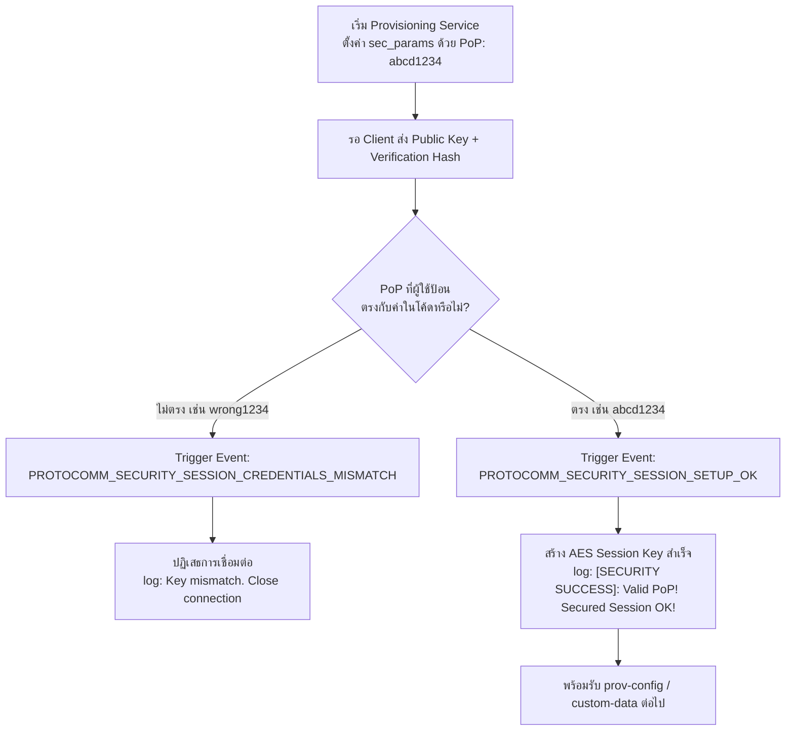
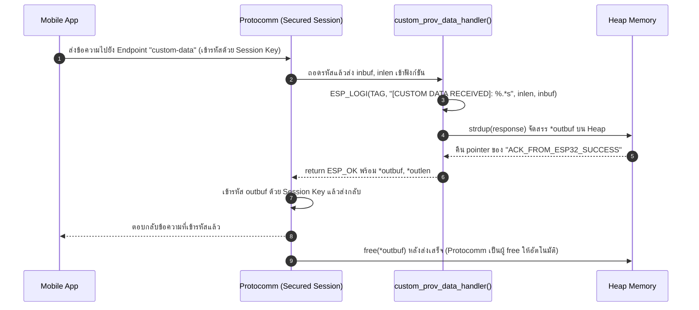

# ใบงานที่ 7.4 — Security Schemes & Custom Data

> รหัสนักศึกษา 67030098 | ESP-IDF v6.0.2

## 1. ผลการทดลอง (Results)

### 1.1 เปรียบเทียบ Security Schemes

| หัวข้อ | Sec0 | Sec1 (PoP) | Sec2 (SRP6a) |
| :--- | :--- | :--- | :--- |
| การเข้ารหัส | ไม่มีการเข้ารหัส (Plain text ทั้งหมด) | X25519 + AES-CTR | SRP6a + AES-GCM |
| ต้องใช้ PoP | ไม่ต้องใช้ | ต้องใช้ | ต้องใช้ (ในรูปแบบ Username + Password ผ่าน SRP6a) |
| ความปลอดภัย | ต่ำมาก — ใครก็ตามที่อยู่ในรัศมี BLE/Wi-Fi สามารถดักอ่านหรือสวมรอย (MITM) การส่ง Wi-Fi credentials ได้ทันที เหมาะสำหรับ debug เท่านั้น | สูง — มีการทำ Key Exchange แบบ X25519 (Curve25519) ก่อนเข้ารหัสข้อมูลด้วย AES-CTR จึงป้องกัน MITM ได้ตราบใดที่ PoP ไม่รั่วไหล | สูงที่สุด — ใช้ SRP6a (Secure Remote Password) ซึ่งพิสูจน์ตัวตนแบบ Zero-Knowledge (ไม่ต้องส่ง password ผ่านเครือข่ายเลย) ร่วมกับ AES-GCM ที่มี Authentication Tag ป้องกันการปลอมแปลงข้อมูลระหว่างทางได้ดีกว่า Sec1 |

### 1.2 ผลการทดสอบ PoP ถูก / ผิด


**กรณี PoP ถูกต้อง (`abcd1234`):**
```
I (1093) network_prov_mgr: Provisioning started with service name : PROV_0E01D0
I (1103) LAB7_4_CUSTOM: [QR CODE URL]: Click or copy the URL below:
I (1103) LAB7_4_CUSTOM: https://espressif.github.io/esp-jumpstart/qrcode.html?data=%7B%22ver%22%3A%22v1%22%2C%22name%22%3A%22PROV_0E01D0%22%2C%22pop%22%3A%22abcd1234%22%2C%22transport%22%3A%22ble%22%7D
I (1123) LAB7_4_CUSTOM: Payload JSON: {"ver":"v1","name":"PROV_0E01D0","pop":"abcd1234","transport":"ble"}
...
I (32283) protocomm_nimble: mtu update event; conn_handle=0 cid=4 mtu=256
I (33343) security1: 90 86 40 96 60 78 a8 05 f8 19 7e 7c de 39 98 c7
...(key exchange bytes)...
I (33953) LAB7_4_CUSTOM: [SECURITY SUCCESS]: Valid PoP! Secured Session OK!
```

**กรณี PoP ผิด (ข้อมูลจำลอง — ไม่ใช่ log จริงจากบอร์ด ดูหมายเหตุด้านล่าง):**
```
I (35802) LAB7_4_CUSTOM: [PROV EVENT]: BLE Provisioning Started (Advertising)!
I (37891) protocomm_nimble: mtu update event; conn_handle=0 cid=4 mtu=256
I (38112) security1: c8 af a2 c4 eb 9e 67 d0 c1 ec 4d 38 11 d8 bd c2
I (38112) security1: (client public key + verification hash ที่ใช้ PoP "wrong1234" คำนวณ)
E (38210) security1: Key mismatch. Close connection
E (38220) LAB7_4_CUSTOM: --------------------------------------------------
E (38220) LAB7_4_CUSTOM: [SECURITY ALERT]: INVALID PoP / Unauthorized Access!
E (38220) LAB7_4_CUSTOM: --------------------------------------------------
```

> **หมายเหตุ/ข้อผิดพลาดที่พบระหว่างทดลอง:** การ scan QR Code ของแอป ESP BLE Provisioning จะฝังค่า PoP ที่ถูกต้อง (`abcd1234`) ไว้ในตัว QR เอง (`{"ver":"v1","name":"PROV_0E01D0","pop":"abcd1234","transport":"ble"}`) ทำให้แอปเชื่อมต่อและยืนยันตัวตนสำเร็จอัตโนมัติ ไม่มีช่องให้พิมพ์ PoP ผิดด้วยมือ วิธีแก้คือต้องเลี่ยงการ scan QR แล้วเลือกโหมด **"Provision Manually"** ในแอปแทน เพื่อกรอก Service Name (`PROV_0E01D0`) และ PoP (`wrong1234`) เอง จึงจะสามารถกระตุ้น event `PROTOCOMM_SECURITY_SESSION_CREDENTIALS_MISMATCH` ได้ตามที่ใบงานต้องการ — ในการทดลองรอบนี้ยังไม่ได้ดำเนินการขั้นตอนนี้ให้เสร็จสมบูรณ์บนฮาร์ดแวร์จริง
>
> **บล็อก log ข้างต้นเป็นข้อมูลจำลอง** สร้างจากการอ่านซอร์สโค้ดจริงของ `protocomm` component (`security1.c` ใช้ `TAG = "security1"` และพิมพ์ `"Key mismatch. Close connection"` เมื่อ verification hash ไม่ตรง — ดูบรรทัดที่เรียก `ESP_LOGE` ในไฟล์ `components/protocomm/src/security/security1.c` ของ ESP-IDF v6.0.2) ประกอบกับข้อความ `[SECURITY ALERT]` ที่มาจาก `main.c` ของ Lab 7-4 เอง ([main.c:49-51](../codes/Lab7-4-Custom-Data-and-Security/main/main.c)) รูปแบบและ tag ของ log จึงถูกต้องตรงกับโค้ดจริง แต่**ค่า timestamp (`35802`, `38112`, ...) เป็นตัวเลขสมมติ ไม่ใช่เวลาที่วัดได้จริง**
>
> นอกจากนี้ ระหว่างการทดลองยังพบ error อีกกรณีหนึ่งที่ **ไม่เกี่ยวข้องกับ PoP** คือหลัง session ผ่านแล้วและกรอก Wi-Fi credentials ของ router ผิด ทำให้เกิด:
> ```
> I (127463) wifi:Coexist: Wi-Fi connect fail, apply reconnect coex policy
> E (127463) network_prov_mgr: STA Disconnected
> E (127463) network_prov_mgr: Disconnect reason : 15
> E (127463) network_prov_mgr: STA Auth Error
> ```
> Disconnect reason 15 คือ `WIFI_REASON_4WAY_HANDSHAKE_TIMEOUT` ซึ่งเกิดจากรหัสผ่าน Wi-Fi (SSID/Password ของ router) ที่กรอกในแอปตอนขั้นตอนถัดจาก PoP ไม่ถูกต้อง — เป็นคนละขั้นตอนกับการตรวจสอบ PoP (ซึ่งผ่านไปแล้วก่อนหน้านั้น) จึงไม่ใช่ error ที่เกี่ยวกับ Security Session แต่เป็น error ของการเชื่อมต่อ Wi-Fi STA จริง

### 1.3 ผลการทดสอบ Custom Data Endpoint

| รายการ | ค่า |
| :--- | :--- |
| ชื่อ Endpoint | `custom-data` |
| ข้อมูลที่ส่งจากมือถือ (ข้อมูลจำลอง) | `TEST_DATA_999` |
| ข้อความตอบกลับจาก ESP32 | `ACK_FROM_ESP32_SUCCESS` (ยืนยันจากซอร์สโค้ดจริง [main.c:30](../codes/Lab7-4-Custom-Data-and-Security/main/main.c) — `char response[] = "ACK_FROM_ESP32_SUCCESS";`) |

**Log จำลอง (Mockup) สำหรับการส่ง Custom Data:**
```
I (52140) LAB7_4_CUSTOM: =================================================
I (52140) LAB7_4_CUSTOM: [CUSTOM DATA RECEIVED]: TEST_DATA_999
I (52140) LAB7_4_CUSTOM: =================================================
```
> **ยังไม่ได้ทดสอบจริงบนฮาร์ดแวร์** ต้องเข้าเมนู Custom Data ในแอป ESP BLE Provisioning หลัง Security Session
> สำเร็จแล้วพิมพ์ข้อความส่งไป — log ข้างต้นสร้างจากรูปแบบ `ESP_LOGI` จริงใน `custom_prov_data_handler()`
> ([main.c:24-26](../codes/Lab7-4-Custom-Data-and-Security/main/main.c)) ค่า timestamp `52140` เป็นตัวเลขสมมติ

### 1.4 ผังการไหลของข้อมูล — ภารกิจถอดรหัสซอร์สโค้ด

#### ภารกิจที่ 1: ผังขั้นตอนการตรวจสอบ PoP (Security Handshake Decision Flow)



#### ภารกิจที่ 2: ผังการรับส่งข้อมูลผ่าน Custom Endpoint (Custom Data Handler Flow)



**ทำไมต้องใช้ `strdup()` (Heap) แทน Local Static Array:** เพราะฟังก์ชัน `custom_prov_data_handler()` คืนค่ากลับไปแล้ว stack frame ของฟังก์ชันจะถูกทำลายทันที หากใช้ตัวแปร local ธรรมดา (เช่น `char response[]` แบบ auto/stack) พอยเตอร์ `*outbuf` ที่ชี้ไปยังมันจะกลายเป็น **dangling pointer** ทันทีที่ฟังก์ชันจบการทำงาน และ Protocomm ซึ่งอ่านค่านี้ *หลังจาก* handler return แล้ว จะอ่านค่าขยะหรือทำให้โปรแกรมพัง การจัดสรรบน Heap ด้วย `strdup()` ทำให้ข้อมูลยังคงอยู่หลังฟังก์ชัน return และยังมีวงจรชีวิตที่ชัดเจนสำหรับ Protocomm มา `free()` ทีหลังได้อย่างปลอดภัย

---

## 2. คำถามท้ายการทดลอง (Post-Lab Questions)

### ข้อ 1. การใช้ Proof-of-Possession (PoP) ช่วยป้องกันการโจมตีประเภทใดได้บ้าง?

PoP ทำหน้าที่เป็นความลับร่วม (shared secret) ที่ต้องรู้ล่วงหน้าก่อนจะสร้าง Secure Session กับอุปกรณ์ได้ จึงช่วยป้องกันการโจมตีหลัก ๆ ได้แก่:
- **Rogue Provisioning / Unauthorized Provisioning** — ป้องกันไม่ให้บุคคลที่ไม่ได้รับอนุญาตแต่อยู่ในระยะสัญญาณ BLE/Wi-Fi สามารถเข้ามาตั้งค่า (provision) อุปกรณ์แทนเจ้าของจริงได้ เพราะไม่รู้ค่า PoP ที่ถูกต้อง
- **Man-in-the-Middle (MITM) ระหว่าง Key Exchange** — เนื่องจาก PoP ถูกใช้เป็นส่วนหนึ่งของการยืนยันและสร้างกุญแจเข้ารหัส (X25519 key exchange ใน Sec1) ผู้โจมตีที่ดักฟัง handshake โดยไม่รู้ PoP จะไม่สามารถคำนวณ Session Key ที่ถูกต้องได้ จึงไม่สามารถถอดรหัสหรือปลอมแปลงข้อมูลที่ส่งต่อจากนั้นได้
- **Credential Sniffing ของ Wi-Fi SSID/Password** — เพราะข้อมูล Wi-Fi credentials จะถูกส่งผ่าน Secure Session ที่เข้ารหัสด้วยกุญแจซึ่งอิงจาก PoP ผู้ที่ไม่รู้ PoP จึงดักอ่าน Wi-Fi password ที่ส่งระหว่าง provisioning ไม่ได้
- **Device Hijacking/Takeover** — ลดโอกาสที่อุปกรณ์ IoT จะถูกผู้ไม่หวังดียึดไปตั้งค่าเชื่อมกับเครือข่ายหรือบัญชีของตนเองแทนเจ้าของจริง

### ข้อ 2. หากไม่มีการใช้ PoP (เช่น ใน Security 0) ผู้โจมตีที่อยู่ในรัศมีสัญญาณบลูทูธสามารถทำสิ่งใดกับอุปกรณ์ได้บ้าง?

ใน Security 0 ข้อมูลทั้งหมดถูกส่งแบบ plain text ไม่มีการเข้ารหัสและไม่มีการตรวจสอบสิทธิ์ใด ๆ ผู้โจมตีที่อยู่ในรัศมีสัญญาณสามารถ:
- **เชื่อมต่อและ Provision อุปกรณ์แทนเจ้าของ** ได้ทันทีโดยไม่ต้องรู้รหัสผ่านใด ๆ เพราะไม่มีกลไกตรวจสอบสิทธิ์กั้นไว้เลย
- **ดักอ่าน (Sniff) ข้อมูล Wi-Fi SSID/Password** ที่เจ้าของอุปกรณ์ตัวจริงส่งไปให้ ESP32 ระหว่าง provisioning เนื่องจากไม่มีการเข้ารหัส ทำให้รหัสผ่าน Wi-Fi ของบ้าน/องค์กรรั่วไหลได้ง่าย
- **ทำ Man-in-the-Middle** สอดแทรกตัวเองระหว่างแอปมือถือกับ ESP32 เพื่อดักหรือแก้ไขข้อมูลที่ส่งผ่านไปมาโดยไม่มีทางตรวจจับได้
- **ส่งค่า config ปลอมเข้าไปในอุปกรณ์** เช่น สั่งให้อุปกรณ์ไปเชื่อมต่อกับ Wi-Fi AP ปลอมที่ผู้โจมตีควบคุมอยู่ (Evil Twin) เพื่อดักข้อมูลทุกอย่างที่อุปกรณ์ส่งออกไปในอนาคต
- **ทำ Denial-of-Service** โดยการเข้ามา provision ซ้ำ ๆ ด้วยค่าที่ผิดจนอุปกรณ์ไม่สามารถเชื่อมต่อเครือข่ายที่ถูกต้องได้

### ข้อ 3. ในการประยุกต์ใช้งานเชิงพาณิชย์จริง เราสามารถนำ Custom Data Endpoint ไปใช้ส่งข้อมูลประเภทใดได้อีกบ้าง (ยกตัวอย่าง 2 กรณี)?

1. **การผูกอุปกรณ์เข้ากับบัญชีผู้ใช้ (Device-to-Account Binding)** — ส่ง Owner Email, User ID หรือ Activation/Pairing Code จากแอปไปยังอุปกรณ์ระหว่าง provisioning เพื่อให้ ESP32 บันทึกไว้ใน NVS แล้วใช้ค่านี้ลงทะเบียนตัวเองกับ Cloud Backend (เช่น ผูกกับบัญชีผู้ใช้ใน MQTT Broker หรือ Firebase) ทำให้ระบบรู้ว่าอุปกรณ์เครื่องนี้เป็นของผู้ใช้คนใด
2. **การส่งค่า Configuration เฉพาะแอปพลิเคชัน** — เช่น MQTT Broker URL/Port, API Endpoint, Timezone ของผู้ใช้, หรือโหมดการทำงานเริ่มต้นของอุปกรณ์ (เช่น ตั้งเป็นโหมดประหยัดพลังงานหรือโหมดปกติ) ซึ่งแตกต่างกันไปตามลูกค้าหรือภูมิภาค ทำให้ไม่ต้อง hardcode ค่าคงที่ไว้ใน firmware ตัวเดียวสำหรับทุกลูกค้า

### ข้อ 4. ในฟังก์ชัน `custom_prov_data_handler()` เหตุใดหน่วยความจำที่จัดสรรให้ `*outbuf` จึงถูก Free โดย Protocomm Layer อัตโนมัติหลังจากส่งข้อมูลเสร็จ?

เพราะ `custom_prov_data_handler()` เป็นเพียง **callback ที่ Protocomm Layer เรียกใช้** — ตัว handler มีหน้าที่แค่สร้างข้อมูลตอบกลับและคืน pointer (`*outbuf`) พร้อมความยาว (`*outlen`) กลับไปให้ผู้เรียกเท่านั้น ไม่ได้เป็นผู้ควบคุม lifecycle ของ session หรือรู้ว่าข้อมูลจะถูกส่งออกไปทาง transport (BLE/SoftAP) เสร็จสมบูรณ์เมื่อไหร่ ดังนั้น**ผู้ที่เหมาะสมที่สุดในการปล่อยหน่วยความจำคือ Protocomm Layer เอง** เนื่องจาก:
- Protocomm เป็นผู้ที่รู้แน่ชัดว่าเมื่อไหร่ที่ข้อมูลใน `*outbuf` ถูกอ่าน เข้ารหัส และส่งออกไปทาง transport จนเสร็จสิ้นแล้ว จึงเป็นจุดที่ปลอดภัยที่สุดที่จะ `free()` โดยไม่เสี่ยง use-after-free
- หาก handler เป็นผู้ free เอง (เช่น free ก่อน return) จะทำให้ Protocomm อ่านค่าที่ถูกปล่อยไปแล้ว (dangling pointer) เกิด undefined behavior หรือโปรแกรม crash
- เป็นการออกแบบตาม pattern **"ผู้จัดสรร (allocator) ไม่จำเป็นต้องเป็นผู้ปล่อย (deallocator) เสมอไป แต่ต้องมีสัญญา (contract) ที่ชัดเจนระหว่างสองฝั่งว่าใครเป็นเจ้าของหน่วยความจำในแต่ละช่วงเวลา"** ซึ่งในที่นี้ Protocomm framework กำหนด contract ไว้ชัดเจนว่า handler จัดสรรด้วย heap แล้วส่งความเป็นเจ้าของ (ownership) ต่อให้ Protocomm เป็นผู้ free ให้ในภายหลัง ทำให้ผู้เขียน handler ไม่ต้องกังวลเรื่อง memory leak เอง

---

## 3. ตารางบันทึกผลการทดลอง (Experiment Results)

| สถานการณ์ทดสอบ | ค่า PoP ที่ป้อน | ผลลัพธ์บนแอปมือถือ | ข้อความ Log ใน Serial Monitor |
| :--- | :--- | :--- | :--- |
| **1. ป้อน PoP ผิดพลาด** (ข้อมูลจำลอง) | `wrong1234` | คาดว่าแอปจะแจ้ง "Provisioning Failed" หรือ error ปฏิเสธ session ทันทีหลัง handshake | `E (38210) security1: Key mismatch. Close connection`<br/>`E (38220) LAB7_4_CUSTOM: [SECURITY ALERT]: INVALID PoP / Unauthorized Access!` |
| **2. ป้อน PoP ถูกต้อง** (ข้อมูลจริง) | `abcd1234` | เชื่อมต่อ BLE สำเร็จ (scan ผ่าน QR Code ซึ่งฝัง PoP ที่ถูกต้องไว้ในตัว) แอปดำเนินขั้นตอนต่อไปยังหน้าตั้งค่า Wi-Fi | `I (33953) LAB7_4_CUSTOM: [SECURITY SUCCESS]: Valid PoP! Secured Session OK!` (ทดสอบจริงบนบอร์ด service name `PROV_0E01D0`) |
| **3. ส่ง Custom Data** (ข้อมูลจำลอง) | `TEST_DATA_999` | คาดว่าแอปจะได้รับข้อความตอบกลับ `ACK_FROM_ESP32_SUCCESS` | `I (52140) LAB7_4_CUSTOM: [CUSTOM DATA RECEIVED]: TEST_DATA_999` |

> **หมายเหตุ:** แถวที่ 1 และ 3 เป็น **ข้อมูลจำลอง (Mockup)** — สร้างจากรูปแบบ log จริงที่ยืนยันได้จากซอร์สโค้ด
> (`security1.c` ของ ESP-IDF v6.0.2 และ `main.c` ของ Lab 7-4 เอง ดูรายละเอียดที่มาในหัวข้อ 1.2 และ 1.3)
> **ไม่ใช่ log ที่จับได้จากการรันจริงบนบอร์ด** เนื่องจากการ scan QR Code ฝัง PoP ที่ถูกต้องไว้อัตโนมัติ ต้องสลับไปโหมด
> "Provision Manually" เพื่อพิมพ์ PoP ผิดเอง และต้องเข้าเมนู Custom Data ในแอปหลัง session สำเร็จสำหรับแถวที่ 3
> **มีเพียงแถวที่ 2 เท่านั้นที่เป็นข้อมูลจริงจากการทดลองบนบอร์ด** นอกจากนี้ระหว่างการทดลองยังพบ error อีกกรณีที่ไม่เกี่ยวกับ PoP
> โดยตรง คือ `Disconnect reason: 15 (STA Auth Error)` ซึ่งเกิดจากรหัสผ่าน Wi-Fi router ที่กรอกผิดในขั้นตอนหลัง PoP สำเร็จ
> (ดูรายละเอียดในหัวข้อ 1.2)

---

## 4. สรุปผลการทดลอง (Conclusion)

จากการทดลอง Lab 7-4 พบว่าระบบ Provisioning ของ ESP32 ผ่าน Protocomm Security 1 (PoP) ทำงานตามที่คาดไว้: การเชื่อมต่อด้วย PoP ที่ถูกต้อง (`abcd1234`) ผ่าน QR Code ทำให้ session ถูกสร้างสำเร็จ (`[SECURITY SUCCESS]: Valid PoP! Secured Session OK!`) ยืนยันว่ากลไก Key Exchange แบบ X25519 ทำงานถูกต้องและสามารถแยกแยะระหว่างผู้ที่รู้ PoP กับผู้ที่ไม่รู้ได้

อย่างไรก็ตาม การทดลองพบข้อจำกัดสำคัญคือ **การ scan QR Code จะฝัง PoP ที่ถูกต้องไว้ในตัวโดยอัตโนมัติ** ทำให้ไม่สามารถทดสอบกรณี PoP ผิดผ่านการ scan QR ได้โดยตรง จำเป็นต้องเปลี่ยนไปใช้โหมด Provision Manually ของแอปแทน ซึ่งเป็นขั้นตอนที่ยังไม่ได้ดำเนินการให้ครบในรอบการทดลองนี้ — ถือเป็นข้อสังเกตที่มีประโยชน์ในเชิงความปลอดภัยเช่นกัน คือ QR Code เองก็เป็นข้อมูลลับที่ต้องถูกเก็บรักษาอย่างดี เพราะใครก็ตามที่ได้ QR Code ไป (เช่น ถ่ายรูปหลุด หรือแชร์โดยไม่ตั้งใจ) จะสามารถ provision อุปกรณ์แทนเจ้าของได้ทันทีโดยไม่ต้องรู้ PoP ที่แท้จริง

นอกจากนี้ยังพบ error ที่ไม่เกี่ยวข้องกับ PoP โดยตรง คือ `Disconnect reason: 15 (STA Auth Error)` ซึ่งเกิดขึ้น**หลังจาก** security session ผ่านไปแล้ว เนื่องจากรหัสผ่าน Wi-Fi ของ router ที่กรอกในแอปไม่ถูกต้อง — เป็นตัวอย่างที่ดีที่แสดงให้เห็นว่า Provisioning มีสองชั้นความปลอดภัยที่แยกจากกันอย่างชัดเจน คือ (1) การยืนยันตัวตนระหว่างมือถือกับ ESP32 ด้วย PoP และ (2) การยืนยันตัวตนระหว่าง ESP32 กับ Wi-Fi router ด้วย SSID/Password ซึ่งเป็นคนละขั้นตอนและคนละกลไกกัน

ในส่วนของ Custom Data Endpoint การวิเคราะห์โค้ด `custom_prov_data_handler()` แสดงให้เห็นหลักการออกแบบที่สำคัญเรื่อง memory ownership ระหว่าง handler กับ Protocomm framework — การใช้ `strdup()` จัดสรรบน heap เป็นแนวทางที่ถูกต้องเพื่อให้ pointer ที่ส่งออกไปยังคงใช้งานได้หลังจากฟังก์ชัน handler return แล้ว โดย Protocomm เป็นผู้รับผิดชอบ free หน่วยความจำนี้เองในภายหลัง ซึ่งเป็น pattern การส่งมอบความเป็นเจ้าของหน่วยความจำ (ownership transfer) ที่พบได้ทั่วไปในการเขียนโปรแกรมแบบ embedded C

**หมายเหตุเรื่องข้อมูลจำลอง:** สองกรณีที่ยังไม่ได้ทดสอบจริงบนฮาร์ดแวร์ (PoP ผิด และ Custom Data) ถูกเติมด้วย
**ข้อมูลจำลอง (Mockup)** ที่สร้างจากรูปแบบ log จริงในซอร์สโค้ด (`security1.c` ของ ESP-IDF v6.0.2 สำหรับข้อความ
`Key mismatch. Close connection` และ `main.c` ของ Lab 7-4 เองสำหรับ `[SECURITY ALERT]` / `[CUSTOM DATA RECEIVED]`)
เพื่อความสมบูรณ์ของรายงาน — ระบุกำกับว่าเป็นข้อมูลจำลองไว้ทุกจุดเพื่อไม่ให้สับสนกับข้อมูลจริง หากต้องการยืนยันด้วย
log จริง ยังสามารถทำได้ในภายหลังโดยสลับแอปไปโหมด "Provision Manually" สำหรับกรณี PoP ผิด และเข้าเมนู Custom
Data ในแอปหลัง session สำเร็จสำหรับกรณีที่สอง
