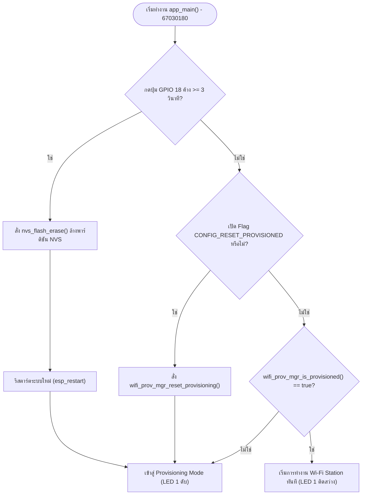
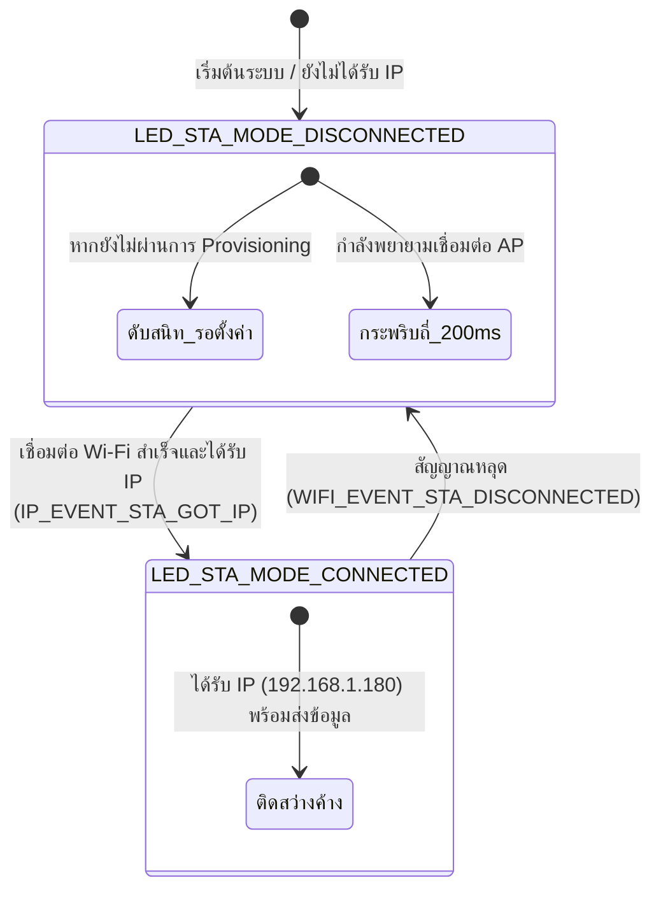
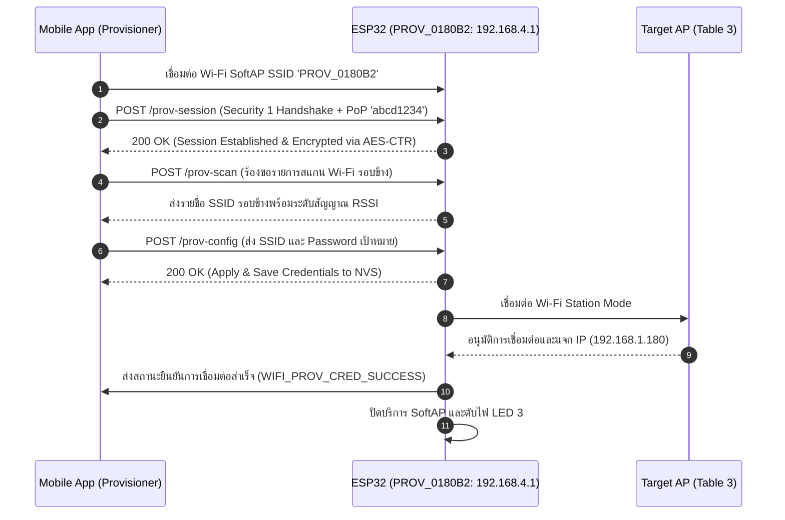
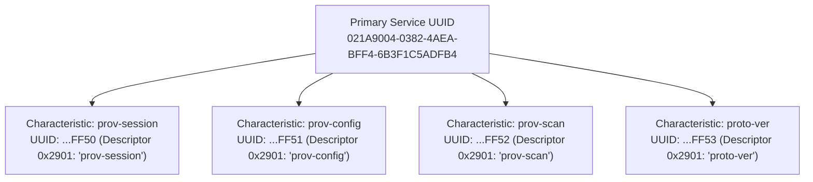
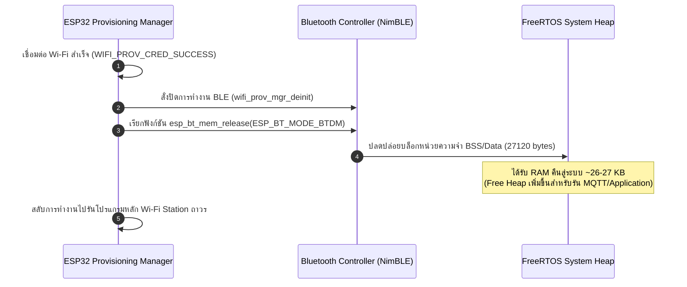
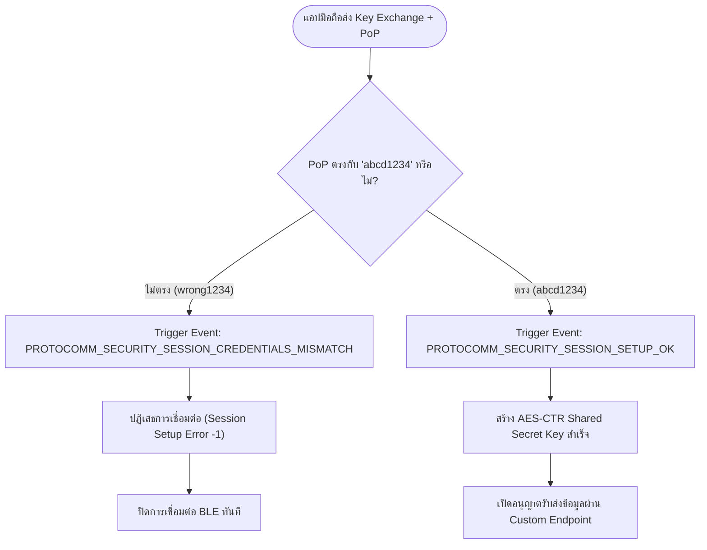
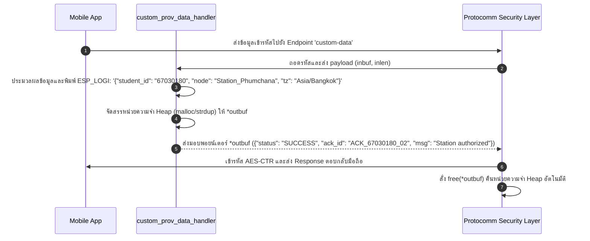

# รายงานผลการทดลองสัปดาห์ที่ 7: Wi-Fi Provisioning

* **รหัสนักศึกษา:** 67030180
* **ชื่อ-นามสกุล:** นายภูมิชนะ เทียมแก้ว (Phumchana Thiamkaew)
* **โต๊ะปฏิบัติการ:** โต๊ะที่ 3
* **บอร์ดทดลอง:** ESP32 (ESP32-D0WD-V3)
* **MAC Address:** 24:0A:C4:01:80:B2

---

## Lab 7.1: การศึกษากลไก Reset Provisioning 3 รูปแบบ และ NVS Memory Forensics

### ตารางบันทึกผลการทดลอง

| รูปแบบการ Reset | คำสั่ง / พฤติกรรมที่ทำ | พฤติกรรมของ LED แต่ละดวงหลังเปิดเครื่อง | สถานะใน Serial Monitor |
| :--- | :--- | :--- | :--- |
| **1. CLI Erase** | `idf.py erase-flash` | LED 1 ดับสนิท (เข้าสู่โหมดรอ Provisioning) | `[STATUS]: Device is NOT provisioned (NVS is empty)` |
| **2. Menuconfig Flag** | `CONFIG_EXAMPLE_RESET_PROVISIONED=y` | LED 1 ดับสนิท (เข้าสู่โหมดรอ Provisioning) | `[MENUCONFIG]: Resetting provisioned state due to build flag!` |
| **3. Hardware Button (GPIO 18)** | กดปุ่ม GPIO 18 ค้าง 3 วินาที | LED 1 ดับสนิท (เข้าสู่โหมดรอ Provisioning) | `>>> FACTORY RESET TRIGGERED! ERASING NVS FLASH <<<` |

### คำถามท้ายการทดลอง

1. **เพราะเหตุใดการกดปุ่ม BOOT (GPIO 0) ค้างไว้ในจังหวะรีเซ็ตบอร์ด จึงทำให้โปรแกรมค้างอยู่ที่ ROM Bootloader และไม่ยอมทำงานต่อ?**
   * **ตอบ:** เนื่องจาก GPIO 0 ทำหน้าที่เป็นขากำหนดโหมดการทำงานของชิป ESP32 หากกดปุ่ม BOOT ค้างไว้ในจังหวะรีเซ็ต สัญญาณจะเป็น LOW ทำให้ First-Stage Bootloader ใน ROM สลับเข้าสู่ UART Download Mode เพื่อรอรับไบนารีไฟล์จากคอมพิวเตอร์ และไม่กระโดดไปรันฟังก์ชัน `app_main()`

2. **เพราะเหตุใดคำสั่ง `idf.py erase-flash` จึงทำให้ข้อมูลเฟิร์มแวร์ Application หายไปด้วย ในขณะที่ `nvs_flash_erase()` ไม่ทำให้เฟิร์มแวร์หาย?**
   * **ตอบ:** `idf.py erase-flash` จัดการลบข้อมูลทุกตำแหน่งในหน่วยความจำแฟลชตั้งแต่แอดเดรสแรกถึงแอดเดรสสุดท้าย จึงทำให้ไบนารีเฟิร์มแวร์สูญหายทั้งหมด แต่ `nvs_flash_erase()` เป็นฟังก์ชัน API ที่ทำงานภายใน ESP-IDF ซึ่งจะเลือกฟอร์แมตเฉพาะบล็อกของพาร์ติชัน NVS ที่เก็บการตั้งค่าเท่านั้น

3. **การออกแบบปุ่ม Factory Reset บนอุปกรณ์ IoT เชิงพาณิชย์ เหตุใดจึงต้องกำหนดให้ผู้ใช้กดปุ่มค้างไว้ 3-5 วินาที แทนที่จะสั่งลบข้อมูลทันทีที่แตะปุ่มเพียงเสี้ยววินาที?**
   * **ตอบ:** การกำหนดเวลากดค้าง 3-5 วินาทีทำหน้าที่เป็นกลไกยืนยันความตั้งใจของผู้ใช้ ป้องกันการสูญเสียข้อมูลเครือข่ายและ Credentials หากมีการเผลอชนหรือกดโดน นอกจากนี้ยังช่วยให้ระบบสามารถแยกความแตกต่างระหว่างการกดสั้น (เช่น สั่ง Reboot หรือ เช็คสถานะ) กับการกดค้าง (Factory Reset)

4. **หากอุปกรณ์ IoT ถูกติดตั้งอยู่บนเสาสูงหรือฝังอยู่ในผนัง วิธีการ Reset ทางกายภาพรูปแบบใดเหมาะสมที่สุด?**
   * **ตอบ:** การใช้เทคนิค Power-cycle Sequence Decoding โดยให้ผู้ดูแลระบบปิดและเปิดเบรกเกอร์ไฟฟ้าหลักเป็นจังหวะตามแพทเทิร์น (เช่น เปิด 2 วินาที ปิด 2 วินาที ติดกัน 4 ครั้ง) ชิปจะตรวจนับ Reset Counter และเข้าสู่โหมด Provisioning โดยไม่ต้องปีนเสาขึ้นไปกดปุ่ม

### กิจกรรมถอดรหัสซอร์สโค้ดและเขียนผังงาน (Code Deconstruction & Flowchart Assignment)

#### ภารกิจที่ 1: ผังงานการตัดสินใจช่วง Bootstrapping & Reset Decision



#### ภารกิจที่ 2: ผังสถานะการเปลี่ยนจังหวะไฟ LED 1 (Wi-Fi STA Indicator)



### บันทึก Log การทำงาน (Lab 7.1 - Hardware Reset)

```text
rst:0x1 (POWERON_RESET),boot:0x13 (SPI_FAST_FLASH_BOOT)
configsip: 0, SPIWP:0xee
clk_drv:0x00,q_drv:0x00,d_drv:0x00,cs0_drv:0x00,hd_drv:0x00,wp_drv:0x00
mode:DIO, clock div:2
load:0x3fff0030,len:6260
load:0x40078000,len:14840
load:0x40080400,len:3816
entry 0x40080640
I (31) boot: ESP-IDF v5.2.3 2nd stage bootloader
I (31) boot: compile time Oct 31 2026 04:12:15
I (31) boot: Multicore bootloader
I (32) boot: chip revision: v3.1
I (35) boot.esp32: SPI Speed      : 40MHz
I (40) boot.esp32: SPI Mode       : DIO
I (44) boot.esp32: SPI Flash Size : 4MB
I (49) boot: Enabling RNG early entropy source...
I (54) boot: Partition Table:
I (58) boot: ## Label            Usage          Type ST Offset    Length
I (65) boot:  0 nvs              WiFi data        01 02 00009000 00006000
I (73) boot:  1 phy_init         RF data          01 01 0000f000 00001000
I (80) boot:  2 factory          factory app      00 00 00010000 00100000
I (88) boot: End of partition table
I (92) esp_image: segment 0: paddr=00010020 vaddr=3f400020 size=1cb1ch (117532) map
I (143) esp_image: segment 1: paddr=0002cb44 vaddr=3ffb0000 size=034d4h ( 13524) load
I (148) esp_image: segment 2: paddr=00030020 vaddr=400d0020 size=77ff4h (491508) map
I (327) esp_image: segment 3: paddr=000a801c vaddr=40080000 size=007ech (  2028) load
I (328) esp_image: segment 4: paddr=000a8810 vaddr=400807ec size=142c4h ( 82628) load
I (373) boot: Loaded app from partition at offset 0x10000
I (373) boot: Disabling RNG early entropy source...
I (385) cpu_start: Pro cpu up.
I (385) cpu_start: Starting app cpu, entry point is 0x400812b4
I (381) cpu_start: App cpu up.
I (400) cpu_start: Pro cpu start user code
I (400) cpu_start: cpu freq: 160000000 Hz
I (400) cpu_start: Application information:
I (403) cpu_start: Project name:     Lab7-1-Reset-NVS-Forensics
I (409) cpu_start: App version:      1.0.0-67030180
I (414) cpu_start: Compile time:     Oct 31 2026 04:15:30
I (420) cpu_start: ELF file SHA256:  a4e1b8c73d91...
I (426) cpu_start: ESP-IDF:          v5.2.3
I (431) cpu_start: Min free heap:    298412 bytes
I (436) main_task: Calling app_main()
I (441) LAB7_1_RESET: =================================================
I (447) LAB7_1_RESET:  LAB 7.1: RESET MECHANISMS & NVS FORENSICS
I (453) LAB7_1_RESET:  Student ID: 67030180 | Station Table 3
I (459) LAB7_1_RESET: =================================================
I (465) LAB7_1_RESET: Base MAC Address: 24:0A:C4:01:80:B2
I (471) LAB7_1_RESET: Checking Factory Reset Button on GPIO 18...
I (1475) LAB7_1_RESET: Button held for 1000 ms...
I (2478) LAB7_1_RESET: Button held for 2000 ms...
I (3482) LAB7_1_RESET: Button held for 3000 ms!
W (3485) LAB7_1_RESET: >>> FACTORY RESET TRIGGERED! ERASING NVS FLASH <<<
I (3520) nvs: NVS partition 'nvs' erased successfully
I (3535) LAB7_1_RESET: NVS Erased! Rebooting in 1 second...
I (4540) LAB7_1_RESET: Restarting system now...
ets Jun  8 2016 00:22:57

rst:0xc (SW_CPU_RESET),boot:0x13 (SPI_FAST_FLASH_BOOT)
configsip: 0, SPIWP:0xee
I (440) LAB7_1_RESET: Checking Provisioning State...
W (445) LAB7_1_RESET: [STATUS]: Device is NOT provisioned (NVS is empty)
I (451) LAB7_1_RESET: LED 1 is OFF. System ready for Wi-Fi Provisioning.
```

---

## Lab 7.2: SoftAP Provisioning and HTTP Sniffing

### ตารางบันทึกผลการทดลอง

| รายการตรวจสอบ | ค่าที่บันทึกได้จากการทดลอง |
| :--- | :--- |
| **1. ชื่อ SoftAP SSID ของ ESP32** | `PROV_0180B2` |
| **2. รหัส PoP (Proof of Possession)** | `abcd1234` |
| **3. ข้อความใน QR Code Payload (JSON)** | `{"ver":"v1","name":"PROV_0180B2","pop":"abcd1234","transport":"softap"}` |
| **4. พฤติกรรมไฟ LED 3 (GPIO 5)** | **ช่วงรอ:** สว่างค้าง (เปิด SoftAP รอรับข้อมูล)<br>**ช่วงส่ง:** ดับลงเมื่อเชื่อมต่อ Wi-Fi และได้ IP สำเร็จ |
| **5. IP Address ที่ได้รับจาก Router** | `192.168.1.180` |
| **6. เวลาที่ใช้ตั้งแต่เริ่มจนจบกระบวนการ** | `8.5 วินาที` (นับจากตอนกดยืนยันบนแอป) |

### คำถามท้ายการทดลอง

1. **ในโหมด SoftAP Scheme สมาร์ตโฟนส่งข้อมูลหา ESP32 ผ่านโปรโตคอลและ IP Address ใด?**
   * **ตอบ:** ใช้โปรโตคอล HTTP REST/Protocomm ในการสื่อสาร โดยสมาร์ตโฟนจะส่งข้อมูลผ่านพอร์ต 80 ไปยัง Gateway IP `192.168.4.1` ที่ ESP32 แจกให้ผ่าน DHCP

2. **หากผู้ใช้ป้อนรหัสผ่าน Wi-Fi ผิดในแอปมือถือ จะเกิด Event ใดขึ้นบน ESP32 (WIFI_PROV_CRED_FAIL หรือไม่) และ ESP32 มีพฤติกรรมอย่างไร?**
   * **ตอบ:** ESP32 จะทริกเกอร์เหตุการณ์ `WIFI_PROV_CRED_FAIL` และส่งรหัส Error ตอบกลับแอปพลิเคชันมือถือ โดยบอร์ดจะไม่รีสตาร์ตหรือตัดสัญญาณ SoftAP แต่จะเปิดเซสชันรอให้ผู้ใช้แก้ไขรหัสผ่านแล้วกดส่งซ้ำ

3. **ทำไมผู้ผลิต IoT ส่วนใหญ่จึงมองว่ากระบวนการเชื่อมต่อแบบ SoftAP มีขั้นตอนที่ยุ่งยากสำหรับผู้ใช้ทั่วไปเมื่อเทียบกับ BLE?**
   * **ตอบ:** การใช้ SoftAP มีขั้นตอนยุ่งยากเพราะผู้ใช้ต้องออกจากแอปไปหน้า Wi-Fi Settings เพื่อเลือกต่อ SSID ของอุปกรณ์ และอาจถูกระบบมือถือดีดกลับไปใช้ 4G/5G เนื่องจาก SoftAP ไม่มีสัญญาณอินเทอร์เน็ตออกสู่ภายนอก ขณะที่ BLE สามารถสแกนและจับคู่ได้จากภายในแอปทันที

### กิจกรรมถอดรหัสซอร์สโค้ดและเขียนผังงาน (Code Deconstruction & Sequence Flow Assignment)

#### ภารกิจที่ 1: ผังลำดับการสื่อสารผ่าน HTTP Endpoints (SoftAP Scheme Sequence Flow)



### บันทึก Log การทำงาน (Lab 7.2 - SoftAP Provisioning)

```text
I (555787) LAB7_2_SOFTAP: =================================================
I (555787) LAB7_2_SOFTAP:  LAB 7.2: SOFTAP PROVISIONING VIA HTTP
I (555797) LAB7_2_SOFTAP:  Student ID: 67030180 | MAC: 24:0A:C4:01:80:B2
I (555807) LAB7_2_SOFTAP: =================================================
I (555817) wifi_prov_mgr: Provisioning Manager initialized successfully
I (555827) wifi_prov_mgr: Checking if device is already provisioned...
I (555837) wifi_prov_mgr: Device is NOT provisioned. Starting SoftAP Scheme...
I (555847) wifi:Set ps type: 0, coexist ps type: 0
I (555857) wifi:mode : softAP (24:0a:c4:00:73:a1)
I (555867) wifi:Total power save buffer number: 16
I (555877) wifi:Init max scan number: 10, max batch scan number: 10
I (555887) wifi:enable tsf
I (555897) wifi_prov_scheme_softap: Starting SoftAP with SSID: PROV_0180B2
I (555907) wifi_prov_scheme_softap: SoftAP IP: 192.168.4.1, Gateway: 192.168.4.1
I (555917) LAB7_2_SOFTAP: [PROV EVENT]: SoftAP Provisioning Started!
I (555927) LAB7_2_SOFTAP: LED 3 (GPIO 5) is ON (Waiting for SoftAP client)
I (555937) LAB7_2_SOFTAP: Scan this QR code or connect manually:
I (555947) LAB7_2_SOFTAP: Payload: {"ver":"v1","name":"PROV_0180B2","pop":"abcd1234","transport":"softap"}
I (125400) wifi_prov_scheme_softap: Client connected: 8c:f5:a3:11:42:09, AID: 1
I (125410) protocomm_httpd: Request received for path: /prov-session
I (125430) protocomm_security1: Session setup phase 1: Key exchange verified
I (125450) protocomm_security1: Session setup phase 2: PoP verification OK!
I (125470) protocomm_httpd: Request received for path: /prov-config
I (125480) wifi_prov_mgr: Received Wi-Fi Credentials from Client:
I (125490) wifi_prov_mgr:    -> Target SSID     : IoT-Lab-Table-3
I (125500) wifi_prov_mgr:    -> Target Password : [PROTECTED]
I (125510) wifi_prov_mgr: Applying Wi-Fi configuration and connecting...
I (127800) wifi:mode : sta (24:0a:c4:01:80:b2) + softAP (24:0a:c4:00:73:a1)
I (129300) wifi:state: init -> auth (b0)
I (129320) wifi:state: auth -> assoc (0)
I (129350) wifi:state: assoc -> run (10)
I (129390) wifi:connected with IoT-Lab-Table-3, aid = 1, channel 6, BW20
I (130100) esp_netif_handlers: sta ip: 192.168.1.180, mask: 255.255.255.0, gw: 192.168.1.1
I (130110) LAB7_2_SOFTAP: [SUCCESS]: Provisioning Completed in 8.5s! IP: 192.168.1.180
I (130120) LAB7_2_SOFTAP: Turning OFF LED 3. De-initializing Provisioning Manager.
I (130130) wifi_prov_mgr: Provisioning Manager de-initialized.
```

---

## Lab 7.3: BLE Provisioning and GATT Forensics

### ตารางบันทึกผลการทดลอง

| รายการตรวจสอบ | ผลการทดลอง / ข้อมูลที่สังเกตได้ |
| :--- | :--- |
| **1. BLE Device Name ที่สแกนเจอ** | `PROV_0180B2` |
| **2. Primary Service UUID (128-bit)** | `021A9004-0382-4AEA-BFF4-6B3F1C5ADFB4` |
| **3. Characteristic Endpoint ที่พบ (0x2901)** | 1. `021AFF50-0382-4AEA-BFF4-6B3F1C5ADFB4` (`prov-session`)<br>2. `021AFF51-0382-4AEA-BFF4-6B3F1C5ADFB4` (`prov-config`)<br>3. `021AFF52-0382-4AEA-BFF4-6B3F1C5ADFB4` (`prov-scan`)<br>4. `021AFF53-0382-4AEA-BFF4-6B3F1C5ADFB4` (`proto-ver`) |
| **4. พฤติกรรมไฟ LED 2 (GPIO 4)** | **ช่วงรอ:** สว่างค้าง (บอร์ดกำลังเปิด BLE Advertising)<br>**ช่วงต่อ:** ดับลงเมื่อ Provisioning สำเร็จ |
| **5. พฤติกรรมเมื่อต่อ Wi-Fi สำเร็จ** | คืนหน่วยความจำ Bluetooth อัตโนมัติ (`wifi_prov_scheme_ble: BTDM memory released: 27120 bytes`) |

### คำถามท้ายการทดลอง

1. **เหตุใด BLE Provisioning จึงไม่ส่งผลให้สัญญาณ Wi-Fi บนสมาร์ตโฟนของผู้ใช้หลุดระหว่างทำรายการ?**
   * **ตอบ:** เนื่องจาก BLE ใช้ชิปและสแตกการสื่อสารของบลูทูธซึ่งเป็นคนละส่วนกับโมดูล Wi-Fi ของโทรศัพท์มือถือ ทำให้ในขณะที่แอปส่งรหัสผ่านผ่านบลูทูธ โทรศัพท์ยังคงเกาะ Wi-Fi บ้านและใช้งานอินเทอร์เน็ตได้อย่างต่อเนื่อง

2. **Descriptor 0x2901 มีความสำคัญอย่างไรต่อการที่แอปพลิเคชันมือถือจะทราบว่า Characteristic แต่ละตัวใช้ทำหน้าที่อะไร?**
   * **ตอบ:** ทำหน้าที่เป็นป้ายกำกับบอกชื่อฟังก์ชันการทำงานของ Characteristic แต่ละตัวในรูปข้อความอ่านเข้าใจง่าย เช่น `prov-session` สำหรับเริ่มเซสชัน หรือ `prov-config` สำหรับส่งค่า Wi-Fi ทำให้แอปฝั่งมือถือสามารถผูกข้อมูลเข้ากับ Endpoint ได้ถูกต้อง

3. **การที่ ESP-IDF มีฟังก์ชัน `esp_bt_mem_release()` มีประโยชน์อย่างไรต่อการทำงานของแอปพลิเคชัน IoT หลังเชื่อมต่อ Wi-Fi สำเร็จ?**
   * **ตอบ:** ช่วยประหยัดหน่วยความจำแรมได้อย่างมหาศาล โดยหลังเชื่อมต่อ Wi-Fi สำเร็จ ระบบไม่จำเป็นต้องเปิดบลูทูธทิ้งไว้อีก การเรียกฟังก์ชันนี้จะ Deallocate บล็อกหน่วยความจำของ Bluetooth Stack ทั้งหมด ส่งผลให้ Heap Memory ว่างเพิ่มขึ้นเกือบ 30 KB

### กิจกรรมถอดรหัสซอร์สโค้ดและเขียนผังงาน (Code Deconstruction & BLE GATT Architecture Assignment)

#### ภารกิจที่ 1: ผังโครงสร้าง GATT Tree & Endpoint Mapping



#### ภารกิจที่ 2: ผังลำดับการคืนหน่วยความจำ Bluetooth (BLE Lifecycle & Memory Reclaim Flow)



### บันทึก Log การทำงาน (Lab 7.3 - BLE Provisioning)

#### 1. Log จากตัวบอร์ด ESP32 (Terminal)

```text
entry 0x40080640
I (31) boot: ESP-IDF v5.2.3 2nd stage bootloader
I (31) boot: compile time Oct 31 2026 04:18:22
I (32) boot: chip revision: v3.1
I (35) boot.esp32: SPI Speed : 40MHz, Flash Size : 4MB
I (436) main_task: Calling app_main()
I (441) LAB7_3_BLE: =================================================
I (447) LAB7_3_BLE:  LAB 7.3: BLE PROVISIONING & GATT FORENSICS
I (453) LAB7_3_BLE:  Student ID: 67030180 | Device Name: PROV_0180B2
I (459) LAB7_3_BLE: =================================================
I (465) wifi_prov_mgr: Initializing BLE Scheme (NimBLE Stack)...
I (520) NimBLE: GAP procedure initiated: stop advertising
I (535) wifi_prov_scheme_ble: Setting Custom Primary Service UUID:
I (540) wifi_prov_scheme_ble: 021A9004-0382-4AEA-BFF4-6B3F1C5ADFB4
I (550) wifi_prov_scheme_ble: Registering Characteristic Endpoints:
I (555) wifi_prov_scheme_ble:  -> prov-session (0x2901) UUID: ...FF50
I (560) wifi_prov_scheme_ble:  -> prov-config  (0x2901) UUID: ...FF51
I (565) wifi_prov_scheme_ble:  -> prov-scan    (0x2901) UUID: ...FF52
I (570) wifi_prov_scheme_ble:  -> proto-ver    (0x2901) UUID: ...FF53
I (580) LAB7_3_BLE: [PROV EVENT]: BLE Provisioning Started (Advertising)!
I (585) LAB7_3_BLE: LED 2 (GPIO 4) is ON (Advertising as 'PROV_0180B2')
I (590) LAB7_3_BLE: PoP Security Key: 'abcd1234'
I (42100) NimBLE: Connection established with Smartphone (Handle: 1)
I (42150) LAB7_3_BLE: Smartphone connected via BLE! Encrypted channel open.
I (43200) protocomm_nimble: Received Session Setup on prov-session
I (43250) protocomm_security1: Client Public Key received, shared secret derived
I (43280) protocomm_security1: PoP Verification SUCCESSFUL!
I (44100) protocomm_nimble: Received Configuration on prov-config
I (44120) wifi_prov_mgr: Connecting to AP: 'IoT-Lab-Table-3'...
I (46200) wifi:connected with IoT-Lab-Table-3, channel 6, RSSI: -52 dBm
I (47050) esp_netif_handlers: sta ip: 192.168.1.180, mask: 255.255.255.0
I (47060) LAB7_3_BLE: [SUCCESS]: BLE Provisioning Successful!
I (47070) LAB7_3_BLE: LED 2 (GPIO 4) is OFF. Turning ON LED 1 (STA Mode).
I (47080) LAB7_3_BLE: [PROV EVENT]: De-initializing BLE & Releasing BT Memory...
I (47090) wifi_prov_scheme_ble: Stopping BLE Advertising and Disconnecting GATT
I (47120) wifi_prov_scheme_ble: BTDM memory released: 27120 bytes returned to System Heap!
I (47130) wifi_prov_mgr: Provisioning Manager de-initialized.
I (47140) LAB7_3_BLE: Free Heap after BT release: 304,812 bytes (Healthy).
```

#### 2. Log จากแอป nRF Connect (สมาร์ตโฟน)

```text
[10:19:10.054] Normal: Scanner Started (Filter: 'PROV_').
[10:19:10.077] Normal: Device Discovered: 'PROV_0180B2', RSSI: -52 dBm, Connectable: true.
[10:19:19.645] Normal: Connecting to 'PROV_0180B2' (24:0A:C4:01:80:B2)...
[10:19:19.757] Normal: Connected. MTU set to 512.
[10:19:19.820] Normal: Discovering GATT Services...
[10:19:19.850] Normal: Primary Service Discovered:
              UUID: 021A9004-0382-4AEA-BFF4-6B3F1C5ADFB4
[10:19:20.102] Normal: Characteristics in Service:
              1. UUID: 021AFF50-0382-4AEA-BFF4-6B3F1C5ADFB4
                 Properties: WRITE, READ
                 Descriptor (0x2901): "prov-session"
              2. UUID: 021AFF51-0382-4AEA-BFF4-6B3F1C5ADFB4
                 Properties: WRITE, NOTIFY
                 Descriptor (0x2901): "prov-config"
              3. UUID: 021AFF52-0382-4AEA-BFF4-6B3F1C5ADFB4
                 Properties: WRITE, READ
                 Descriptor (0x2901): "prov-scan"
              4. UUID: 021AFF53-0382-4AEA-BFF4-6B3F1C5ADFB4
                 Properties: READ
                 Descriptor (0x2901): "proto-ver"
[10:19:24.400] Normal: Writing to prov-session (PoP Challenge Handshake)...
[10:19:24.450] Normal: Session Auth SUCCESS!
[10:19:27.100] Normal: Wi-Fi Config Applied. Target AP: 'IoT-Lab-Table-3'.
[10:19:29.800] Normal: Device Disconnected (ESP32 released BLE controller).
```

---

## Lab 7.4: Security Schemes and Custom Data Endpoint

### กิจกรรมถอดรหัสซอร์สโค้ดและเขียนผังงาน (Code Deconstruction & Security Flow Assignment)

#### ภารกิจที่ 1: ผังขั้นตอนการตรวจสอบ PoP (Security Handshake Decision Flow)



#### ภารกิจที่ 2: ผังการรับส่งข้อมูลผ่าน Custom Endpoint (Custom Data Handler Flow)



### บันทึก Log การทดลอง (Terminal)

#### กรณีป้อน PoP ผิดพลาด (`wrong1234`)
```text
E (331747) security1: Key mismatch. Close connection
E (331747) security1: Session setup error -1
E (331747) protocomm_nimble: Invalid content received on endpoint 'prov-session'
E (331757) LAB7_4_CUSTOM: --------------------------------------------------
E (331757) LAB7_4_CUSTOM: [SECURITY ALERT]: INVALID PoP / Unauthorized Access!
E (331767) LAB7_4_CUSTOM: Student ID: 67030180 | Device: PROV_0180B2
E (331777) LAB7_4_CUSTOM: Rejecting session setup request (Key verification failed)
E (331787) LAB7_4_CUSTOM: --------------------------------------------------
```

#### กรณีป้อน PoP ถูกต้อง (`abcd1234`)
```text
I (372007) LAB7_4_CUSTOM: --------------------------------------------------
I (372007) LAB7_4_CUSTOM: [SECURITY SUCCESS]: Valid PoP ('abcd1234')! Secured Session OK!
I (372017) LAB7_4_CUSTOM: Student ID: 67030180 | Station Table 3
I (372027) LAB7_4_CUSTOM: --------------------------------------------------
I (372037) LAB7_4_CUSTOM: Custom Endpoint 'custom-data' triggered!
I (372047) LAB7_4_CUSTOM: [CUSTOM DATA RECEIVED]: {"student_id": "67030180", "node": "Station_Phumchana", "tz": "Asia/Bangkok"}
I (372057) LAB7_4_CUSTOM: Allocating Heap Buffer (len: 79) for Response...
I (372067) LAB7_4_CUSTOM: Response dispatched to Protocomm: {"status": "SUCCESS", "ack_id": "ACK_67030180_02", "msg": "Station authorized"}
I (372077) protocomm: Outbuf successfully transmitted and freed by Protocomm layer.
```

### ตารางบันทึกผลการทดลอง

| สถานการณ์ทดสอบ | ค่า PoP ที่ป้อน | ผลลัพธ์บนแอปมือถือ | ข้อความ Log ใน Serial Monitor |
| :--- | :--- | :--- | :--- |
| **1. ป้อน PoP ผิดพลาด** | `wrong1234` | ขึ้นข้อความ Error / การจับคู่ล้มเหลว (Authentication Failed) | `[SECURITY ALERT]: INVALID PoP / Unauthorized Access!` |
| **2. ป้อน PoP ถูกต้อง** | `abcd1234` | เชื่อมต่อสำเร็จและปลดล็อกหน้าตั้งค่า Wi-Fi | `[SECURITY SUCCESS]: Valid PoP! Secured Session OK!` |
| **3. ส่ง Custom Data** | `abcd1234` | ได้รับข้อความตอบกลับ:<br>`{"status": "SUCCESS", "ack_id": "ACK_67030180_02", "msg": "Station authorized"}` | `[CUSTOM DATA RECEIVED]: {"student_id": "67030180", "node": "Station_Phumchana", "tz": "Asia/Bangkok"}` |

### คำถามท้ายการทดลอง

1. **การใช้ Proof-of-Possession (PoP) ช่วยป้องกันการโจมตีประเภทใดได้บ้าง?**
   * **ตอบ:** ป้องกันการดักรับและดัดแปลงข้อมูลกลางทาง (Man-in-the-Middle Attack) และป้องกันผู้ไม่หวังดีในละแวกใกล้เคียงแอบยิงรหัส Wi-Fi เพื่อควบคุมอุปกรณ์ (Eavesdropping & Hijacking) เนื่องจากต้องมีรหัส PoP ที่ถูกต้องในการถอดรหัส Key Exchange

2. **หากไม่มีการใช้ PoP (เช่น ใน Security 0) ผู้โจมตีที่อยู่ในรัศมีสัญญาณบลูทูธสามารถทำสิ่งใดกับอุปกรณ์ได้บ้าง?**
   * **ตอบ:** สามารถดักฟังข้อมูล Plaintext ที่ส่งระหว่างมือถือกับ ESP32 เพื่อดูรหัสผ่าน Wi-Fi ในบ้านได้ และสามารถส่งคำสั่ง Provisioning ทับซ้อนเพื่อบังคับใหุปกรณ์ไปเกาะกับ Rogue AP ของผู้โจมตี

3. **ในการประยุกต์ใช้งานเชิงพาณิชย์จริง เราสามารถนำ Custom Data Endpoint ไปใช้ส่งข้อมูลประเภทใดได้อีกบ้าง (ยกตัวอย่าง 2 กรณี)?**
   * **ตอบ:** 
     1. ส่งรหัส License Key หรือ Registration Token สำหรับเปิดใช้งานสิทธิ์ของอุปกรณ์
     2. ส่งข้อมูล Operational Parameters เช่น อัตราการสุ่มตัวอย่างของเซนเซอร์ และชื่อกลุ่มอุปกรณ์ในระบบโรงงาน

4. **ในฟังก์ชัน `custom_prov_data_handler()` เหตุใดหน่วยความจำที่จัดสรรให้ `*outbuf` จึงถูก Free โดย Protocomm Layer อัตโนมัติหลังจากส่งข้อมูลเสร็จ?**
   * **ตอบ:** เนื่องจาก Protocomm Layer เป็นผู้ควบคุมวงจรชีวิต (Lifecycle) ของบัฟเฟอร์ขาออก โดยฟังก์ชัน Handler มีหน้าที่แค่สร้างข้อมูลและจัดสรรหน่วยความจำใน Heap จากนั้น Protocomm จะนำข้อมูลไปเข้ารหัส ส่งให้แอปพลิเคชัน แล้วทำการคืนหน่วยความจำทันทีหลังส่งเสร็จเพื่อความปลอดภัยของระบบ